# ABAP quick revision

Use these questions for the final review. For deeper context, follow the question ID in the complete topic guide.

## CLOUD-01 A new approval extension needs immediate document validation and an external supplier portal. Would you put everything on-stack or on BTP?

**Level:** Senior

**Short answer:** Keep the document check where it can reject the document before saving, using a supported local extension point. The supplier portal can be a separate BTP app if its users and release cycle justify that. Connect them through released remote interfaces. Make pending and failed steps visible. Choose based on timing, APIs, permissions, and recovery rather than putting everything in one place.

**Reasoning and example:** Suppose every internal posting waits for a live response from the supplier portal. A network outage can now stop all postings, even when the core document itself is valid. If the business permits it, save a valid submission locally and let the portal interaction happen afterward through a reliable integration process.

The user then needs to see whether the request is waiting, accepted, or failed. Track retries with a stable request identity and decide what withdrawal means after submission. Some rules must still reject the local document immediately, so keep those at a suitable supported local point. A separate application does not make remote work part of the same database transaction.

**Avoid this mistake:** Deploying side-by-side does not make synchronous cross-system validation atomic or automatically clean-core compliant.

**Interviewer follow-ups:**

- Which business rule must be checked before the core document is committed?
- How does the user recover when the portal accepts a request but the core system is unavailable?

**Strong answer criteria:**

- Explains which business steps run in which system
- Compares response time and independent release needs
- Explains recovery when only part of the process succeeds

**Verification evidence:** An architecture decision record, target API availability checks, and a failure-sequence test showing pending, retry, and withdrawal outcomes.

**Read and verify this answer:**

- [SAP extension architecture guidance](https://help.sap.com/docs/sap-btp-guidance-framework/extension-architecture-guide/getting-started-with-extensibility) - Use the documented rules to check the design choice. Confirm that the required option exists on the target product.

Visual: Extension placement decision

Start from the business need and transaction boundary before choosing an extension location.

**Explain it:** When would local transactional consistency favor an on-stack extension?

**Limit:** Placement does not establish Clean Core level or availability in a specific edition.

Visual: Local and remote transaction boundaries

The remote commit belongs to another system, so local failure needs an explicit recovery strategy.

**Explain it:** What should happen if the remote side succeeds but the response is lost?

**Limit:** This explains distributed consistency, not a particular messaging product guarantee.

Visual: Remote commit and uncertain local outcome

The local application durably records intent before separately owned delivery. The remote payment commits, but its reply is lost; recovery must identify the existing effect through REQ-42.

**Explain it:** How do you distinguish an unprocessed request from a committed payment whose response never arrived?

**Limit:** The delivery and idempotency mechanisms are design requirements, not automatic guarantees from HTTP or RAP. This example does not claim distributed atomicity.

## CLOUD-02 A stakeholder says ABAP Cloud means moving the existing application to SAP BTP ABAP environment. How would you correct the proposal?

**Level:** Senior

**Short answer:** ABAP Cloud is a development model, not just a place to run code. It uses restricted language versions, released APIs, and models such as RAP on supported S/4HANA systems and SAP BTP ABAP environment. Moving to BTP is a separate decision. Check the data, business APIs, connectivity, and operational responsibilities available there before promising that an existing app will move unchanged.

**Reasoning and example:** A class currently reads sales data through a local S/4HANA interface. In a BTP ABAP system, the same business data and local interface may not exist. The new application might need a remote service, a supported replication design, or a different owner for that information. Valid ABAP syntax alone does not solve that difference.

List the application's dependencies and map each to an available target capability. Try the most important integration with realistic input before estimating the move. This separates two questions: can the code follow ABAP Cloud's rules, and is the proposed runtime the right place for the application? Both need evidence, even though they are often discussed together.

**Avoid this mistake:** Cloud-compatible syntax does not establish identical application content, API availability, or deployment portability.

**Interviewer follow-ups:**

- Which dependencies become remote after the move?
- What target-system evidence would you require before estimating migration?

**Strong answer criteria:**

- Distinguishes model from runtime
- Identifies lost data locality
- Checks product-specific capabilities

**Verification evidence:** A list of target-system capabilities mapping each dependency to a supported local or remote replacement, plus a tested integration example.

**Read and verify this answer:**

- [SAP ABAP Cloud development model](https://help.sap.com/docs/abap-cloud/abap-cloud-background-concepts-and-overview/abap-cloud-development-model) - Use the documented rules to check the design choice. Confirm that the required option exists on the target product.

Visual: BTP account and runtime map

Read the nesting as an organizational example, then distinguish the application, service instance and credentials.

**Explain it:** How is a service instance different from a binding or service key?

**Limit:** Schematic Cloud Foundry route; other BTP environments have different runtime structures.

## CLOUD-04 Two teams want independent releases but share pricing helpers and persistence types. How would you structure packages and software components?

**Level:** Senior

**Short answer:** Give shared code a clear owner and a small, stable interface. Packages organize code and access; software components also affect delivery and lifecycle dependencies. Keep private database types with their owning component. Avoid circular dependencies and define delivery order. Supported component relations can allow targeted access, but access permission alone does not promise that an interface will stay compatible.

**Reasoning and example:** Two teams say they can release independently, but each uses the other's database row types. A field change can then require both components to activate together. Replacing those types with a narrow pricing request and result reduces the number of changes that callers must follow. The shared pricing capability also needs an owner and compatibility tests.

If that interface is still changing frequently, coordinated releases may be the honest choice for now. Creating more components does not itself remove the dependency. Document the direction of calls, permitted component access, and import order. Check that a provider change still supports previously delivered consumers before describing the components as independently releasable.

**Avoid this mistake:** More software components do not create independent lifecycles when their dependencies still require lockstep delivery.

**Interviewer follow-ups:**

- When would you choose a component relation instead of a C1 API?
- How would an incompatible dependency removal be detected?

**Strong answer criteria:**

- Shows which component depends on which
- Distinguishes permission to call an interface from a promise of compatibility
- Matches component boundaries to how releases actually work

**Verification evidence:** A dependency graph without cycles, explicit component relations, a transport/import sequence, and compatibility checks against the prior delivered API snapshot.

**Read and verify this answer:**

- [SAP software component dependencies and API snapshots](https://help.sap.com/docs/sap-btp-abap-environment/abap-environment/software-component-dependencies) - Use the documented rules to check the design choice. Confirm that the required option exists on the target product.
- [SAP software component organization and lifecycle boundaries](https://help.sap.com/docs/sap-btp-abap-environment/abap-environment/software-components) - Use the documented rules to check the design choice. Confirm that the required option exists on the target product.

## CLOUD-18 What would you require before approving a senior team's ABAP Cloud architecture for production?

**Level:** Senior

**Short answer:** Require evidence that the main business rules, permissions, transaction boundaries, and recovery paths work on the intended runtime. Check released dependencies, realistic workload, monitoring, retention, and deployment order. Give important assumptions an owner and a test result. Distinguish a prototype from a production-tested solution. Remaining risk can be accepted deliberately, with practical controls and clear responsibility.

**Reasoning and example:** A Fiori demo using mocked data looks convincing, but it cannot prove real RAP locking or permissions. Walk through a concurrent update, a dependency outage, a failed deployment, and a recovery exercise on the relevant environment. Link each result to the actual release candidate so old evidence is not mistaken for proof of new code.

Focus effort on failures that would harm the business rather than collecting diagrams alone. Confirm who monitors failures, who can retry safely, and how data remains consistent during recovery. A green syntax check or ATC run supports the review but cannot replace these checks. Production approval should state what was demonstrated and which controlled risks remain.

**Avoid this mistake:** A clean syntax check, green ATC run, or attractive diagram is not an end-to-end production-readiness certificate.

**Interviewer follow-ups:**

- Which risk would you prove first with a technical spike?
- What evidence would make you delay the release despite a successful demo?

**Strong answer criteria:**

- Tests the risks with the greatest consequences first
- Links evidence to the real runtime and source version
- Defines who operates the app and how it recovers

**Verification evidence:** A release review for the exact source version, including focused workload, permission, transaction, deployment, and recovery test results.

**Read and verify this answer:**

- [SAP extension architecture guidance](https://help.sap.com/docs/sap-btp-guidance-framework/extension-architecture-guide/getting-started-with-extensibility) - Use the documented rules to check the design choice. Confirm that the required option exists on the target product.

Visual: Testing scope and evidence

The widening base suggests many focused checks, but there is no mandatory numerical ratio.

**Explain it:** Which risk remains after an ABAP Unit test with doubles passes?

**Limit:** Conceptual coverage map, not a count of tests actually run in SAP.

## SRAP-01 A new approval app has custom persistence, while its posting step must reuse an existing transactional API. Which RAP implementation type would you choose?

**Level:** Senior

**Short answer:** Start with managed RAP for the new approval tables. If an eligible API must perform the actual writes while RAP can manage the pending changes, consider managed RAP with unmanaged save. Use fully unmanaged RAP when existing logic must also handle interaction. Check the API's locks, permissions, numbering, buffering, and commits. Calling it a BAPI does not prove it fits.

**Reasoning and example:** Follow one successful approval and one rejected approval through the proposed design. Identify who holds pending changes and who writes each document. Additional save adds work alongside managed database writes; it is not a way to replace the owner of those writes. Make that choice explicit before implementing the handlers.

If posting happens in another system, it has a separate transaction. A managed approval object with a pending-posting state and reliable asynchronous processing may fit better than a synchronous action that promises everything commits together. Test what happens when approval saves but posting is unavailable, and how a retry avoids creating a second document. Complexity alone is not a reason to choose unmanaged RAP.

**Avoid this mistake:** Choosing unmanaged merely because the application is complex, or assuming managed with unmanaged save removes RAP transaction rules.

**Interviewer follow-ups:**

- What concrete API property would rule out a synchronous RAP adapter?
- Which implementation responsibilities would your choice leave with the framework?

**Strong answer criteria:**

- Identifies who handles pending changes and database writes
- Checks what the API actually does
- Separates remote processing from one local transaction

**Verification evidence:** Prepare a decision table and trace a create, failed update and rollback against the selected API on the target release.

**Read and verify this answer:**

- [SAP: Save options](https://help.sap.com/docs/btp/fc4c71aa50014fd1b43721701471913d/11e2c9d9a2c8420f88d1cf2d6c015c2b.html?version=202310.002) - Read what this operation is allowed to do in this RAP phase, and check support on the target release.

Visual: RAP buffer with a concrete value change

During modification, the transactional view can show 120 EUR while saved data still shows 100 EUR.

**Explain it:** Why can a direct SQL read be the wrong way to read the BO during modification?

**Limit:** Simplified single-record example, not a promise about a particular SQL isolation level.

Visual: RAP implementation ownership matrix

Trace the same request through three implementation choices and name the owner of each responsibility.

**Explain it:** Which part stays managed when only the save implementation is replaced?

**Limit:** Conceptual comparison; specific saver variants and failure support depend on release and scenario.

## SRAP-03 A developer puts ordinary business validation in SAVE because the final data is available there. What would you change?

**Level:** Senior

**Short answer:** Move predictable business checks to the supported early save checks, after needed calculations and before late saving. Late save normally writes data that has already passed those checks. An error message is not a general rollback mechanism there. SAP does document special failure-capable saver options for some BAPI integrations. Verify that exact option and release instead of assuming all late failures work alike.

**Reasoning and example:** An approval amount exceeds the permitted limit. Detect that before database writes and return a message linked to the failing instance. The user can then correct the amount. Waiting until SAVE just because the final values are convenient there puts an ordinary business check at the wrong stage.

A database outage is a different technical failure and needs its supported recovery behavior. If a BAPI integration genuinely needs a documented failure-capable saver, inspect its generated signature and target-release guidance. That exception is not a reason to postpone checks that can run earlier, and it does not allow independently committed side effects. Avoid both absolutes: routine errors cannot all be returned from SAVE, but supported special cases do exist.

**Avoid this mistake:** Saying either 'all errors can be returned from SAVE' or 'no supported late-save failure mechanism exists anywhere'.

**Interviewer follow-ups:**

- Where do final derivations belong relative to final consistency checks?
- What evidence would justify using a failure-capable saver here?

**Strong answer criteria:**

- Rejects predictable business errors before late save
- Distinguishes invalid business data from technical failures
- Explains the documented BAPI exception and its limits

**Verification evidence:** Trace the save phases for invalid input and inspect the generated saver signature and SAP guidance for the installed release.

**Read and verify this answer:**

- [SAP: General RAP BO implementation contract](https://help.sap.com/docs/abap-cloud/abap-rap/general-rap-bo-implementation-contract) - Read what this operation is allowed to do in this RAP phase, and check support on the target release.
- [SAP: BAPI consumption, late numbering and save sequence](https://help.sap.com/docs/abap-cloud/developer-guide-from-classic-abap-to-abap-cloud/bapi-consumption-in-rap-late-numbering-and-save-sequence?locale=en-US&state=PRODUCTION&version=sap_cross_product_abap) - Read what this operation is allowed to do in this RAP phase, and check support on the target release.

Visual: RAP save sequence and early failure path

Follow one order from total calculation to buffer cleanup. The orange branch stops a rejected save before late numbering and persistence.

**Explain it:** Where is the last buffer-change phase, and when is the point of no return reached?

**Limit:** Simplified phase flow, not a trace of every runtime call. Managed and unmanaged implementation hooks differ; special late-failure support is scenario- and release-dependent.

Visual: RAP transaction and workflow boundary

Separate the local transaction from event delivery and the later workflow callback.

**Explain it:** What is lost if a handler calls a committing legacy API?

**Limit:** Exact RAP save methods and supported event infrastructure depend on scenario and release.

Visual: RAP hook responsibilities

Read each card as a separate design question; this is not an execution sequence.

**Explain it:** Where would you derive a total, reject an invalid input and implement Submit?

**Limit:** Check scenario and release support; do not rely on an undocumented ordering of independent hooks.

## SRAP-04 One action updates two local RAP BOs and then calls a remote payment service. Can the whole action be atomic?

**Level:** Senior

**Short answer:** Compatible local RAP objects can take part in the same RAP-controlled SAP transaction. A normal HTTP payment call cannot join that database transaction. If payment succeeds and local saving fails, local rollback will not undo payment. Model pending work and reliable delivery, or an explicit compensating process. Define timeout, retry, and reconciliation behavior instead of promising one atomic action.

**Reasoning and example:** Update the two local objects through supported behavior interfaces and check the permitted cross-object operations for the phase. Do not commit each object separately. Their shared local transaction can coordinate those compatible changes, but a remote payment has its own outcome and owner.

Store a stable business reference for the payment request. If the remote response times out, payment may still have completed; treat the result as unknown until a status check or reconciliation establishes it. A blind retry can charge twice. Show users an honest pending or recovery status, and test failures before and after both local save and remote response so every saved state has a recovery path.

**Avoid this mistake:** Assuming that calling HTTP inside an action enrolls the remote system in the SAP database transaction.

**Interviewer follow-ups:**

- What happens after a payment timeout followed by a retry?
- How would you recover after local commit succeeds but event delivery is delayed?

**Strong answer criteria:**

- Draws the local transaction boundary
- Models uncertain remote outcomes
- Designs idempotency and reconciliation

**Verification evidence:** Fault-inject before and after each local save and remote response boundary; verify that every persisted state has a documented recovery path.

**Read and verify this answer:**

- [SAP: General RAP BO implementation contract](https://help.sap.com/docs/abap-cloud/abap-rap/general-rap-bo-implementation-contract) - Read what this operation is allowed to do in this RAP phase, and check support on the target release.

Visual: Local and remote transaction boundaries

The remote commit belongs to another system, so local failure needs an explicit recovery strategy.

**Explain it:** What should happen if the remote side succeeds but the response is lost?

**Limit:** This explains distributed consistency, not a particular messaging product guarantee.

Visual: Remote commit and uncertain local outcome

The local application durably records intent before separately owned delivery. The remote payment commits, but its reply is lost; recovery must identify the existing effect through REQ-42.

**Explain it:** How do you distinguish an unprocessed request from a committed payment whose response never arrived?

**Limit:** The delivery and idempotency mechanisms are design requirements, not automatic guarantees from HTTP or RAP. This example does not claim distributed atomicity.

## SRAP-08 A posting API returns the final document number only when called. How would you integrate numbering without publishing incorrect keys?

**Level:** Senior

**Short answer:** Keep preliminary identities until the supported save process assigns final document keys. Map %pre to the final %key during number adjustment. SAP documents a BAPI pattern that calls creation in ADJUST_NUMBERS with a suitable failure-capable saver. Check its availability, API release status, and error rules on the target system. Do not present an earlier identifier as a committed document number.

**Reasoning and example:** Create several documents concurrently and include a rejected API call. Verify that items and returned mappings still identify the right final documents. Do not publish a number in an email or external event before the business change is durably saved. Late numbering alone also does not guarantee a gap-free sequence; number-range and posting-API behavior still matter.

In the documented failure-capable late-save scenario, a late-save failure makes COMMIT ENTITIES return sy-subrc 8. An external EML consumer must issue ROLLBACK ENTITIES before continuing. Verify support for that exact pattern. This rule does not allow commit or rollback statements inside a behavior implementation, and ordinary ADJUST_NUMBERS must not be assumed to offer the special failure response.

**Avoid this mistake:** Do not use SELECT MAX plus one, lose the preliminary-to-final key mapping, or assume ordinary ADJUST_NUMBERS supports recoverable failures without the documented special saver.

**Interviewer follow-ups:**

- How does the external EML consumer obtain the final key?
- What must be demonstrated if the business insists on gap-free numbering?

**Strong answer criteria:**

- Separates preliminary and final identities
- Qualifies the BAPI saver exception
- Does not promise gap-free numbers from RAP alone

**Verification evidence:** Create several documents concurrently, include a failing API call, and verify final key conversion, associations and number-allocation behavior.

**Read and verify this answer:**

- [SAP: BAPI consumption, late numbering and save sequence](https://help.sap.com/docs/abap-cloud/developer-guide-from-classic-abap-to-abap-cloud/bapi-consumption-in-rap-late-numbering-and-save-sequence?locale=en-US&state=PRODUCTION&version=sap_cross_product_abap) - Read what this operation is allowed to do in this RAP phase, and check support on the target release.

Visual: EML identity tags

Content IDs connect entries within a request. Transactional and preliminary identities address other lifecycle needs.

**Explain it:** How can a new item refer to a newly created order before the final order number exists?

**Limit:** Generated EML types and available components are authoritative for the specific BO.

Visual: RAP identity and numbering timeline

Compare when the identity becomes final and when persistence is confirmed.

**Explain it:** What must an external EML consumer inspect after MODIFY and after COMMIT?

**Limit:** Illustrative numbering paths; exact %pid/%pre mapping and conversion syntax are release/scenario-specific.

## SRAP-12 A request changes CompanyCode to an unauthorized value and also makes its dates inconsistent. Would you use prechecks or validations?

**Level:** Senior

**Short answer:** Use a supported precheck to reject a disallowed incoming company-code change before it enters the buffer. Use the appropriate validation to reject inconsistent final dates. Keep the complete RAP authorization design as well; neither mechanism replaces it. For partial updates, combine supplied fields with the existing values needed for the check. Do not assume the request contains every field.

**Reasoning and example:** A user may be allowed to edit a request in company 1000 but not move it to company 2000. Check the proposed target context at the allowed operation boundary, including any permissions needed for the original context. The precheck must not accidentally accept an unauthorized change because it only examines the old company.

Separately, check the resulting date range. If only the end date is supplied, read the current start date needed for comparison. Test through both EML and the service so the rule is not just a UI convenience. For unmanaged active instances, implement consistency in the suitable handler or save checks; declared draft validations do not automatically protect active database writes.

**Avoid this mistake:** Treating prechecks as a global security bypass or believing a UI mandatory marker enforces all backend invariants.

**Interviewer follow-ups:**

- Which state does the precheck see before the update is applied?
- How would the rule behave for a partial update that omits both dates?

**Strong answer criteria:**

- Separates incoming intent from final state
- Keeps authorization explicit
- Accounts for partial updates and unmanaged restrictions

**Verification evidence:** Verify that a denied target context is rejected by the precheck before entering the transactional buffer. Separately verify that inconsistent dates are rejected by validation and cannot be persisted; test correction and successful retry through EML and the service.

**Read and verify this answer:**

- [SAP RAP operation prechecks](https://help.sap.com/docs/ABAP_PLATFORM_NEW/fc4c71aa50014fd1b43721701471913d/f6e3880b641649b1b8247486579a1c9b.html) - Check that prechecks inspect proposed changes before they enter the buffer. Validations reject invalid final data at their supported point in processing.

Visual: RAP hook responsibilities

Read each card as a separate design question; this is not an execution sequence.

**Explain it:** Where would you derive a total, reject an invalid input and implement Submit?

**Limit:** Check scenario and release support; do not rely on an undocumented ordering of independent hooks.

Visual: EML update intent: absent versus clear

The first two requests carry the same initial ABAP value but differ in update intent. The field control decides whether the old comment is preserved or explicitly cleared.

**Explain it:** How would you preserve Amount while clearing Comment, and how could an adapter lose that distinction?

**Limit:** This is a worked mapping example. Actual generated EML types, UPDATE FIELDS syntax, protocol nullability, and business validation remain authoritative.

Visual: Existing and proposed state authorization

Editing the current A instance and moving it into B are different authorization decisions. Partial input must be interpreted with existing state without treating omitted fields as explicit clears.

**Explain it:** Which state does each check inspect, and what happens if a determination changes the target scope?

**Limit:** A policy example, not a universal company-code rule. Implement through the target RAP scenario's supported hooks; prechecks do not replace the complete authorization model.

## SRAP-16 An older RAP BO works without strict mode. The team wants to release it for cloud consumption by adding strict(2). Is that sufficient?

**Level:** Senior

**Short answer:** No. strict(2) adds modeling and implementation checks; it does not release the object as an API. Review base and projection behavior together, including locks, permissions, ETags, and composition relationships. Check derived-type changes and eligible dependencies. A released API also needs a stable supported interface and lifecycle plan. Syntax success alone proves neither compatibility nor secure operation.

**Reasoning and example:** Capture the existing service metadata and representative EML and OData calls before enabling strict mode. Previously implicit behavior may need to be declared explicitly, and changes can affect what existing callers may do. Activate and test the whole dependent model on the target release, not just the base behavior definition.

Decide what the future released interface promises and which implementation details remain private. Check consumption and extension permissions separately, and define how incompatible changes will be handled. Documentation for a newer product version may describe features unavailable on this target. Run appropriate ATC checks and real consumer regressions, but do not treat strict mode as a Clean Core grade or an automatic API-release switch.

**Avoid this mistake:** Treating strict(2) as a clean-core grade or API-release switch, or enabling it only on one layer and ignoring resulting contract changes.

**Interviewer follow-ups:**

- Which implicit behavior could disappear when strict mode is enabled?
- What would you freeze in a released BO interface rather than in the base implementation?

**Strong answer criteria:**

- Separates strict checks from API release
- Reviews all affected layers
- Plans compatibility and consumer regression evidence

**Verification evidence:** Record before/after metadata, activate the full dependency set, run ATC and execute representative old consumer calls on the target release.

**Read and verify this answer:**

- [SAP: Strict mode implementation requirements](https://help.sap.com/docs/abap-cloud/abap-rap/strict-mode-implementation-requirements) - Read what this operation is allowed to do in this RAP phase, and check support on the target release.

Visual: RAP contract stack

Read from the client down to storage, then explain what each artifact contributes.

**Explain it:** Where would you restrict the exposed operation set?

**Limit:** Conceptual layers; the exact artifact set depends on the scenario and release.

Visual: RAP release and consumption gates

Review eligibility, behavior and delivery as separate evidence gates.

**Explain it:** Which gate would catch an API-compatible change that breaks deployment configuration?

**Limit:** A teaching checklist; exact release contracts, component visibility and delivery tools depend on the product.

## MODEL-01 A new consumption entity exposes orders outside the user's sales organization. The base CDS has DCL. What do you investigate?

**Level:** Senior

**Short answer:** Trace the entity that the service actually reads and its access rules. DCL on the base view does not automatically protect every higher view or navigation path. Define the required restrictions, using supported inheritance and mappings where appropriate. Test both allowed and denied data. A UI filter or #CHECK annotation alone cannot create the missing security rule.

**Reasoning and example:** Create similar orders in sales organizations A and B, then use an identity allowed only for A. Compare direct base reads, the exposed projection, and association navigation. This reveals where the intended restriction stops being applied, rather than assuming the layer with DCL secures all later layers.

Include counts, value helps, and alternative service paths. A hidden organization's key or count can still disclose information even when its rows are absent from the main list. Preserve legitimate access and any deliberate documented exceptions while fixing the rule. Keep RAP update and action permissions separate: proving which rows a user can read does not prove which operations that user may perform.

**Avoid this mistake:** Do not add #CHECK and assume it creates a missing rule.

**Interviewer follow-ups:**

- Which entry point actually evaluated DCL?
- How would a field rename affect inherited restrictions?

**Strong answer criteria:**

- Traces the exposed read path
- Defines restrictions at the correct boundary
- Tests negative and positive identities

**Verification evidence:** Capture the real service responses for two organizational scopes, including navigation and counts.

**Read and verify this answer:**

- [SAP Learning: authority checks and DCL](https://learning.sap.com/courses/building-transactional-apps-with-the-abap-restful-application-programming-model/implementing-authority-checks) - Test the entity and service callers actually use. Include denied users, filters, and attempts to cross the allowed access boundary.

Visual: CDS security boundaries

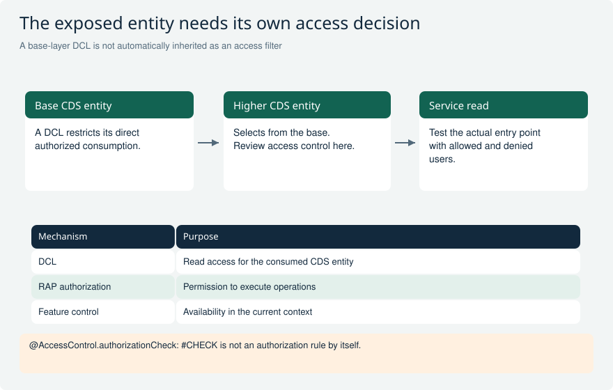

Review security where consumers enter the model, rather than assuming that lower layers protect every upper view.

**Explain it:** Which two tests prove that an exposed service rejects unauthorized access?

**Limit:** Authorization behavior depends on the access path and supported DCL inheritance mechanisms.

## MODEL-02 An approver may update organization A. Can an update move an order from A to B using only existing-instance authorization?

**Level:** Senior

**Short answer:** Permission to update an order in A does not automatically allow moving it into B. Check both the current object and the proposed target values at the appropriate operation boundary. Supported prechecks can help reject disallowed input before it enters the buffer. Cover creates, updates, and derived changes. Keep the complete authorization and business validation design, not just the existing-instance check.

**Reasoning and example:** An approver can edit an order in organization A, so the check against its current state succeeds. The update payload changes Organization to B, which the user is not allowed to choose. Without a target-value check, permission for A becomes an unintended route into B.

Test A-to-A changes, denied A-to-B changes, initial values, and several inputs in one request. If a determination derives the organization, that result must also remain within the intended rules. Internal local-mode updates should sit behind a properly checked public operation, not provide an indirect way to submit forbidden values. Creation needs its own checks because there is no existing instance whose authorization settles the question.

**Avoid this mistake:** Do not equate authorization for the current object with authorization for any future object state.

**Interviewer follow-ups:**

- What is checked for creation?
- What happens if a determination changes the organization?

**Strong answer criteria:**

- Separates current and proposed state
- Checks the public mutation boundary
- Considers derived and bulk changes

**Verification evidence:** Demonstrate a rejected cross-scope update through the actual service with no unauthorized persisted change.

**Read and verify this answer:**

- [SAP RAP authorization control](https://help.sap.com/docs/abap-cloud/abap-rap/authorization-control) - Test the entity and service callers actually use. Include denied users, filters, and attempts to cross the allowed access boundary.

Visual: Identity, authorization and feature control

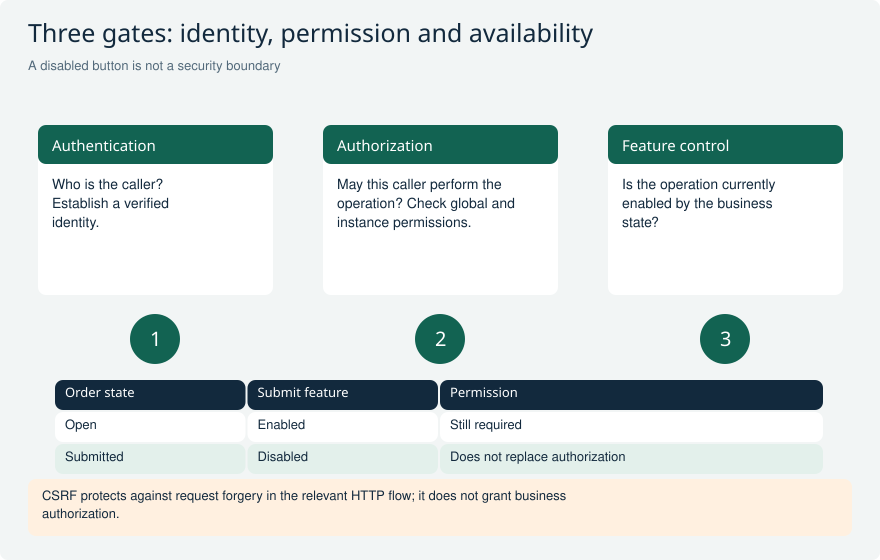

Treat identity, business permission and contextual availability as separate checks.

**Explain it:** If Submit is disabled in Fiori, what happens when someone calls the service directly?

**Limit:** Static operation characteristics differ from dynamic instance/global feature checks.

Visual: Existing and proposed state authorization

Editing the current A instance and moving it into B are different authorization decisions. Partial input must be interpreted with existing state without treating omitted fields as explicit clears.

**Explain it:** Which state does each check inspect, and what happens if a determination changes the target scope?

**Limit:** A policy example, not a universal company-code rule. Implement through the target RAP scenario's supported hooks; prechecks do not replace the complete authorization model.

## MODEL-03 A custom query returns only authorized rows but an unrestricted total count. Is it secure?

**Level:** Senior

**Short answer:** No. The count must describe the same authorized, filtered result as the returned rows, before paging. A custom provider cannot assume remote or manually assembled data is protected automatically by database access control. Apply the same restrictions to data, count, and supported aggregates. If an operation cannot be answered securely and correctly, reject it clearly instead of returning misleading information.

**Reasoning and example:** A user can see five permitted orders, but the service returns a total count of 900 including hidden orders. The list has filtered the rows, yet the count still reveals information. Use one consistent definition of the permitted result before calculating its count or selecting a page. Do not simply fetch everything remotely and hide only the displayed rows.

Test a user with no access, a count-only request, filters, ordering, and any navigation or aggregation the service supports. A count-only request must still apply permissions even when no rows are requested. If the remote source cannot support the required secure selection, choose a suitable safe implementation or explicitly reject the unsupported request.

**Avoid this mistake:** Filtering only the displayed page leaves count, aggregates and existence checks exposed.

**Interviewer follow-ups:**

- How do you handle count-only requests?
- What if the remote API cannot apply your authorization predicate?

**Strong answer criteria:**

- Uses one authorized result definition
- Protects count and aggregates
- Rejects unsupported semantics explicitly

**Verification evidence:** Use restricted identities and compare authorized data, count and aggregate responses over the same fixture.

**Read and verify this answer:**

- [SAP: Requesting and Setting Data or Count](https://help.sap.com/docs/abap-cloud/abap-rap/requesting-and-setting-data-or-count-in-unmanaged-query) - Handle requests for rows and requests for a count independently. Apply the same permissions and filters to both, and test a request that asks only for the count.

Visual: Filtering, paging and total count

Count and paging answer different questions. Stable ordering matters when the client requests successive pages.

**Explain it:** For this example, what count belongs beside a page of five records?

**Limit:** Provider-side execution order may be optimized while preserving request semantics.

Visual: Secure custom-query filtering, count, and page

The same authorized logical set contains IDs 2, 4, and 6. Counting it returns three; skipping one and taking two returns IDs 4 and 6 without revealing hidden B rows.

**Explain it:** What should a count-only request return, and what should happen if the filter cannot be represented safely?

**Limit:** The drawing specifies semantics, not a mandatory physical execution plan. A remote/custom provider must preserve equivalent authorization, filtering, count, and ordering behavior.

## MODEL-04 A query-provider filter cannot be converted to simple ranges. A developer catches the exception and returns everything. What is the correction?

**Level:** Senior

**Short answer:** Do not turn a filter-conversion failure into an unrestricted read. Preserve the original AND/OR grouping using a supported expression representation or another safe translation. If the provider cannot support the filter, reject it clearly. Keep mandatory authorization restrictions separate from user filters so neither disappears on an error. Handle dynamic field names and values through supported safe APIs.

**Reasoning and example:** The filter means either region A with amount above 100, or region B with Urgent true. Converting that into separate region and amount ranges can change which records match. A request that should return selected urgent B records may instead return too much or hide legitimate matches.

Create test rows that distinguish the original grouped expression from the simplified one. Include an unsupported function and verify that its failure returns the documented error rather than all records. Authorization restrictions must remain in force regardless of filter parsing. If the backend cannot express the requested condition faithfully, an explicit unsupported-request response is safer and more useful than a successful-looking incorrect dataset.

**Avoid this mistake:** A swallowed filter exception must not become an unrestricted selection.

**Interviewer follow-ups:**

- Can the backend express the same predicate?
- How do mandatory authorization filters survive translation failure?

**Strong answer criteria:**

- Preserves AND/OR grouping
- Keeps mandatory access rules in force
- Clearly rejects unsupported requests

**Verification evidence:** Compare expected row sets for nested filters and prove failure never broadens authorized access.

**Read and verify this answer:**

- [SAP: Implementing Filtering in an Unmanaged Query](https://help.sap.com/docs/abap-cloud/abap-rap/implementing-filtering-in-unmanaged-query) - Check which filter expressions can be translated correctly. An unsupported filter must not cause the provider to drop the requested filter or required access restrictions.

Visual: Filtering, paging and total count

Count and paging answer different questions. Stable ordering matters when the client requests successive pages.

**Explain it:** For this example, what count belongs beside a page of five records?

**Limit:** Provider-side execution order may be optimized while preserving request semantics.

Visual: Secure custom-query filtering, count, and page

The same authorized logical set contains IDs 2, 4, and 6. Counting it returns three; skipping one and taking two returns IDs 4 and 6 without revealing hidden B rows.

**Explain it:** What should a count-only request return, and what should happen if the filter cannot be represented safely?

**Limit:** The drawing specifies semantics, not a mandatory physical execution plan. A remote/custom provider must preserve equivalent authorization, filtering, count, and ordering behavior.

## MODEL-14 A CDS unit test passes, but the same entity leaks data for a restricted user. What may the test be missing?

**Level:** Senior

**Short answer:** Check whether the test actually evaluates access control. CDS doubles used to test joins may isolate or disable DCL, so a passing query test is not automatically a security test. Use supported access-control test setup with meaningful permission data where available. Add real service tests with restricted identities. Keep query correctness and deployed authorization evidence separate.

**Reasoning and example:** A unit test proves that a join returns three expected rows from fixture data. That is useful, but it says nothing about whether a user should see all three. Add cases for no access and two different organizational scopes, and inspect the test configuration to confirm that DCL is enabled and exercised.

Finally call the real service with restricted users. That checks the consumed entity, binding, and identity propagation that the isolated test may not cover. Capture positive cases too, so a fix does not simply block everyone. A green double-based test and a passing restricted-user service test prove different things; neither result should be inferred from the other.

**Avoid this mistake:** A green database-double test does not prove deployed authorization.

**Interviewer follow-ups:**

- Is DCL enabled in the test environment?
- Which real identity is used by the service?

**Strong answer criteria:**

- Inspects double behavior
- Adds denied and scoped authorization cases
- Separates unit and deployed evidence

**Verification evidence:** Show test configuration plus restricted-user service results; do not infer one from the other.

**Read and verify this answer:**

- [SAP CDS access-control tests](https://help.sap.com/docs/abap-cloud/abap-development-tools-for-visual-studio-code/writing-test-for-cds-entity-with-access-control) - Test the entity and service callers actually use. Include denied users, filters, and attempts to cross the allowed access boundary.

Visual: CDS security boundaries

Review security where consumers enter the model, rather than assuming that lower layers protect every upper view.

**Explain it:** Which two tests prove that an exposed service rejects unauthorized access?

**Limit:** Authorization behavior depends on the access path and supported DCL inheritance mechanisms.

Visual: Real behavior under test and dependency doubles

Two deliberately different inputs exercise the real Submit rule while a separate limit-provider dependency is controlled. Assertions inspect state and response identity, not only execution coverage.

**Explain it:** If the account-assignment rejection is removed, which test fails? What evidence remains missing after these tests pass?

**Limit:** The fixture is conceptual and not an executed ABAP Unit result. Framework double support and persistence setup depend on the target release and test boundary.

## OPS-01 How would you test a Submit action without replacing the business object you are supposed to verify?

**Level:** Senior

**Short answer:** I run the real Submit action and keep the business rules I want to test. I replace only outside dependencies, such as another service or business object, with suitable test doubles. Then I call the action, often through EML, and check its results, errors and saved state. Mocking Submit itself would not test Submit.

**Reasoning and example:** A purchase request may be submitted only when every item has an account assignment. I create one valid request and another with an assignment missing. Both tests execute the real Submit implementation. I check that the valid request reaches the intended state and that the invalid one is rejected with the correct message.

If a different business object supplies a spending limit, I can replace that dependency with a supported double and choose its returned limit. That keeps this test focused on Submit. I also verify the saved outcome through the test framework's supported save boundary. A predefined successful response from a fake Submit would prove none of these rules.

**Avoid this mistake:** Do not label a test of a mocked Submit response as a test of Submit.

**Interviewer follow-ups:**

- Which real business rule must this test execute?
- Which outside dependency can be replaced without replacing that rule?

**Strong answer criteria:**

- Names the real behavior being tested
- Replaces only outside dependencies
- Checks the result, errors and saved state

**Verification evidence:** Show the dependencies and a test that fails when the real Submit check is deliberately broken.

**Read and verify this answer:**

- [SAP RAP test frameworks and boundaries](https://help.sap.com/docs/abap-cloud/abap-rap/used-frameworks-and-tools) - Use the documented framework rules to design these checks. These examples are proposed tests, not claimed SAP runtime results.

Visual: Testing scope and evidence

The widening base suggests many focused checks, but there is no mandatory numerical ratio.

**Explain it:** Which risk remains after an ABAP Unit test with doubles passes?

**Limit:** Conceptual coverage map, not a count of tests actually run in SAP.

Visual: Real behavior under test and dependency doubles

Two deliberately different inputs exercise the real Submit rule while a separate limit-provider dependency is controlled. Assertions inspect state and response identity, not only execution coverage.

**Explain it:** If the account-assignment rejection is removed, which test fails? What evidence remains missing after these tests pass?

**Limit:** The fixture is conceptual and not an executed ABAP Unit result. Framework double support and persistence setup depend on the target release and test boundary.

## OPS-05 How do you prove optimistic concurrency rather than merely calling the same update twice?

**Level:** Senior

**Short answer:** I use two independent clients that read the same version before either saves. The first update should succeed; the second should be rejected when it sends the old ETag. I check that the first user's data remains intact. Draft locks and the draft total ETag need separate tests because they protect different parts of the editing flow.

**Reasoning and example:** Alice and Ben both read one entity instance and keep its ETag. Alice changes it and saves. Ben then updates that same instance with his old token. The expected result is a stale-version rejection, not an overwrite. If Ben rereads first, he gets the new token and the test no longer exercises a stale writer.

For draft, I separately test editing while an exclusive lock is valid and resuming after it expires. A child-only change to active data should be considered by the configured draft total ETag check. That is different from the entity-level If-Match test. Two updates inside one shared transaction do not reproduce two users with independent versions.

**Avoid this mistake:** Two updates in one shared transaction are not a realistic two-user concurrency test.

**Interviewer follow-ups:**

- Which token protects this entity update?
- What separate case should the draft total ETag test cover?

**Strong answer criteria:**

- Uses independent clients or sessions
- Sends an intentionally old version token
- Checks that rejected updates leave data intact

**Verification evidence:** Record each client version, request, response and final value from the controlled two-user test.

**Read and verify this answer:**

- [SAP total ETag and draft concurrency](https://help.sap.com/docs/ABAP_PLATFORM_NEW/fc4c71aa50014fd1b43721701471913d/f5e8548c241b43ab82bceec030b5dc9a.html) - Use the documented framework rules to design these checks. These examples are proposed tests, not claimed SAP runtime results.

Visual: Two ETag boundaries

The left side tests a conditional entity update; the right tests the active-state basis of a resumed draft.

**Explain it:** Why does testing one entity ETag not prove the draft total-ETag implementation?

**Limit:** ETags are opaque. Verify lock expiry, relevant child changes and generated behavior on the actual system.

Visual: Two editors and one version: an illustrated story

Alice and Ben read version 7. Alice updates successfully, producing version 8. Ben must not overwrite that newer state using the stale version 7 precondition.

**Explain it:** Why should the client refresh and resolve the conflict instead of blindly retrying its old payload?

**Limit:** Version numbers are illustrative. Real ETags are opaque validators; a failed If-Match precondition commonly returns HTTP 412. This is optimistic concurrency, not a pessimistic lock.

## OPS-11 A remote approval succeeded, but the RAP caller timed out. How should an operator recover?

**Level:** Senior

**Short answer:** A timeout leaves the result unknown until I check it. I use the request's stable reference to find the remote approval before submitting again. If it exists, recovery should reuse that result. If it cannot be determined, the case needs a visible status and an owner. Local rollback cannot erase an approval already committed remotely.

**Reasoning and example:** The remote workflow creates approval 9001, but its response never reaches the RAP caller. A new creation request could start approval 9002 for the same submission. I query by the original reference or use the service's documented idempotency rule so a retry returns or reuses the first result. The local app records the resolved workflow link.

If the remote outcome cannot be queried, I keep a durable recovery record and use the agreed operator or compensation procedure. I also test a late duplicate callback and a callback for a request version that has since changed. A delayed response must not approve stale local data or repeat an already completed decision.

**Avoid this mistake:** A timeout is not evidence that the other system performed no work.

**Interviewer follow-ups:**

- Which stable reference identifies the original request?
- Who investigates when the remote outcome cannot be queried?

**Strong answer criteria:**

- Distinguishes unknown from failed
- Finds the original result before unsafe retry
- Handles duplicate and outdated callbacks

**Verification evidence:** Simulate a lost response. Verify one intended business effect and a visible status from which recovery is possible.

**Read and verify this answer:**

- [SAP RAP business-object contract](https://help.sap.com/docs/abap-cloud/abap-rap/rap-business-object-contract) - Use the documented framework rules to design these checks. These examples are proposed tests, not claimed SAP runtime results.

Visual: Local and remote transaction boundaries

The remote commit belongs to another system, so local failure needs an explicit recovery strategy.

**Explain it:** What should happen if the remote side succeeds but the response is lost?

**Limit:** This explains distributed consistency, not a particular messaging product guarantee.

Visual: Duplicate events and stale approvals

The event identity and current business state decide whether to apply, ignore or reject the request.

**Explain it:** Two consumers process the same event simultaneously: what prevents a double effect?

**Limit:** Exact transactional deduplication mechanisms depend on the chosen infrastructure.

Visual: Remote commit and uncertain local outcome

The local application durably records intent before separately owned delivery. The remote payment commits, but its reply is lost; recovery must identify the existing effect through REQ-42.

**Explain it:** How do you distinguish an unprocessed request from a committed payment whose response never arrived?

**Limit:** The delivery and idempotency mechanisms are design requirements, not automatic guarantees from HTTP or RAP. This example does not claim distributed atomicity.

## OPS-14 What belongs in a RAP release gate beyond a passing ATC run?

**Level:** Senior

**Short answer:** ATC is one check, not proof that the feature works. I also test the business rules, failures, permissions and integrations affected by the change. Changes involving saves or concurrency need matching rollback and conflict tests. I record the version and environment for each result, and clearly mark anything not run rather than count it as passed.

**Reasoning and example:** A release changes an action parameter and publishes a new approval event. I test existing callers against the new action, verify the event after a successful save and check duplicate delivery. I also test a user who must not submit. These checks address the risks of this change; they are more useful than repeating an unrelated checklist.

For a label-only adjustment, the required evidence would be much smaller. For this release, I also verify relevant performance, dependency compatibility and target configuration. ATC can find issues covered by its configured checks, but it cannot prove every business rule or external connection. The release record should show executed results, pending checks and their owners.

**Avoid this mistake:** Choose tests for the failure risks this change creates; a generic checklist alone is not enough.

**Interviewer follow-ups:**

- Which new failure mode did this change introduce?
- Which result is pending rather than passed?

**Strong answer criteria:**

- Chooses checks for the risks of this change
- Separates source checks from runtime tests
- Records tested versions and pending checks

**Verification evidence:** Link each changed behavior to actual test results, responsible people and remaining risks.

**Read and verify this answer:**

- [SAP RAP test frameworks and boundaries](https://help.sap.com/docs/abap-cloud/abap-rap/used-frameworks-and-tools) - Use the documented framework rules to design these checks. These examples are proposed tests, not claimed SAP runtime results.
- [SAP RAP feature and release overview](https://help.sap.com/docs/abap-cloud/abap-rap/what-s-new) - Use the documented framework rules to design these checks. These examples are proposed tests, not claimed SAP runtime results.

Visual: Testing scope and evidence

The widening base suggests many focused checks, but there is no mandatory numerical ratio.

**Explain it:** Which risk remains after an ABAP Unit test with doubles passes?

**Limit:** Conceptual coverage map, not a count of tests actually run in SAP.

Visual: RAP release and consumption gates

Review eligibility, behavior and delivery as separate evidence gates.

**Explain it:** Which gate would catch an API-compatible change that breaks deployment configuration?

**Limit:** A teaching checklist; exact release contracts, component visibility and delivery tools depend on the product.

## GOV-01 A project claims Level A because its frontend uses RAP. How would you assess the extension?

**Level:** Senior

**Short answer:** Check the whole extension, including wrappers and the SAP objects they call. RAP and Fiori do not decide the Clean Core level. A depends on released contracts; B uses classified classic options; C uses internals; D uses non-recommended dependencies or techniques. Record the actual classification for each path on the target system. Do not call a mixed solution entirely Level A.

**Reasoning and example:** A RAP handler calls a custom wrapper, which then calls an internal SAP class. Looking only at the handler's released custom interface misses the underlying dependency. Assess the consumer and wrapper separately where appropriate, but include both in the delivered solution's dependency record. A customer namespace does not erase the risk.

Link each finding to the business capability it affects and the person responsible for maintaining it. Confirm the applicable API state, classification, and ATC result for the same source version. A passing UI test shows that a tested interaction worked, not that every call underneath uses Level A interfaces. State clearly what is included in any classification claim.

**Avoid this mistake:** RAP, BTP deployment, a customer namespace, or a green UI test is not proof that every underlying dependency is Level A.

**Interviewer follow-ups:**

- What exactly is included in the claimed Level A scope?
- How would you find dependencies hidden behind customer adapters?

**Strong answer criteria:**

- Defines scope before classification
- Traces indirect dependencies
- Separates framework choice from API evidence

**Verification evidence:** An object-level dependency inventory with target-system release/classification evidence and the applicable ATC result for the same revision.

**Read and verify this answer:**

- [SAP Clean Core levels, classic APIs, wrappers, and edition boundaries](https://learning.sap.com/courses/practicing-clean-core-extensibility-for-sap-s-4hana-cloud/explaining-extensibility-model-best-practices_e290f382-800e-40ef-a203-85a13115f487) - Check three things separately: the dependency classification, its supported released use, and who approves and maintains any exception.

Visual: Clean Core levels A-D

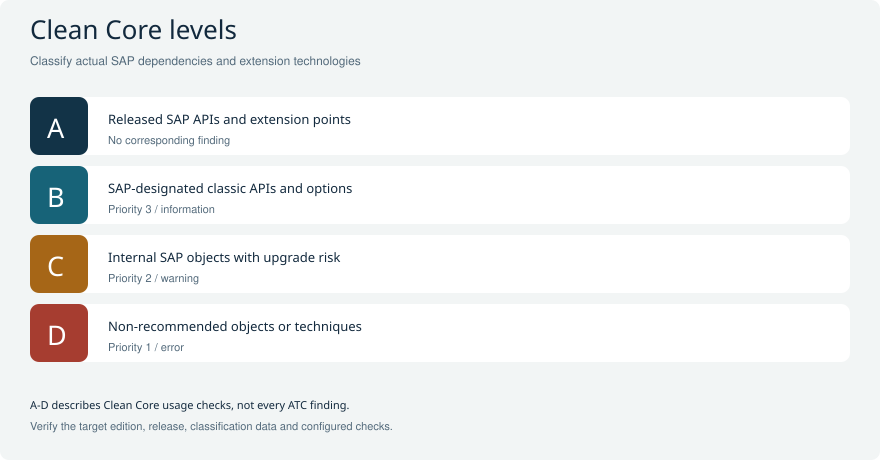

Read each level as a classification of the actual SAP dependency or extension technology.

**Explain it:** Which configured Clean Core finding priority corresponds to levels B, C and D?

**Limit:** This mapping is specific to Clean Core usage checks; it does not classify every ATC finding.

Visual: Release contracts versus Clean Core levels

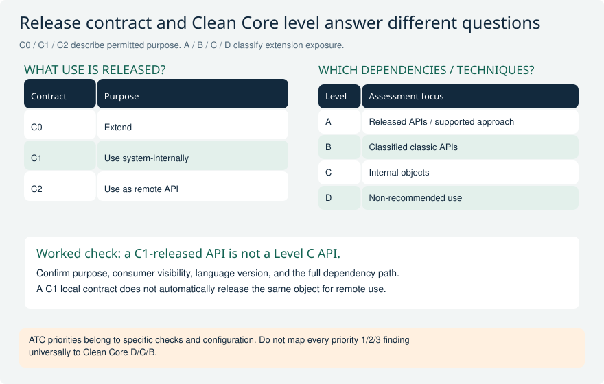

The two tables are separate classification axes. C1 identifies a local-use contract, while Level C identifies internal-object exposure in the Clean Core assessment context.

**Explain it:** What else must you verify after finding a C1 release flag, and why does a wrapper not erase the underlying exposure?

**Limit:** These are the three contracts requested for this comparison, not the complete release-contract catalogue. Exact object classification, extension technology, target edition, and ATC scope remain decisive.

## GOV-02 An API is released with C1. A team assumes that means Clean Core Level C and permission to expose it remotely. How do you respond?

**Level:** Senior

**Short answer:** These are two different naming systems. C0 means Extend, C1 means Use System-Internally, and C2 means Use as Remote API. They are release-contract purposes, not Clean Core levels A to D. Check the object's visibility for the intended caller too. A C1 release does not by itself authorize remote exposure or classify the dependency as Level C.

**Reasoning and example:** A locally released class may be suitable for an on-stack application without being a remote API. If you build a custom remote service over it, you become the provider of a new interface. You must define authentication, business permissions, errors, transaction behavior, and how callers can rely on future versions.

The local API has not magically changed to C2, and your service does not inherit guarantees that its provider never made. Inspect API-state properties and documentation for the exact supported use. Keep the separate questions clear: what release purpose is allowed, who may consume it, and what Clean Core classification applies to the implementation's actual dependencies?

**Avoid this mistake:** C0/C1/C2 and Clean Core A/B/C/D are different classifications; release for one purpose does not release every possible usage.

**Interviewer follow-ups:**

- Which visibility must the API expose for this caller?
- What responsibilities arise if you build a custom remote service over a local API?

**Strong answer criteria:**

- Names contracts accurately
- Checks purpose and visibility
- Recognizes new provider responsibilities

**Verification evidence:** ADT API-state properties, provider documentation, and a consumer design showing local use or an explicitly owned remote contract.

**Read and verify this answer:**

- [SAP release contracts, visibility, and API lifecycle states](https://help.sap.com/docs/abap-cloud/abap-development-tools-user-guide/released-apis) - Check three things separately: the dependency classification, its supported released use, and who approves and maintains any exception.

Visual: Release contracts versus Clean Core levels

The two tables are separate classification axes. C1 identifies a local-use contract, while Level C identifies internal-object exposure in the Clean Core assessment context.

**Explain it:** What else must you verify after finding a C1 release flag, and why does a wrapper not erase the underlying exposure?

**Limit:** These are the three contracts requested for this comparison, not the complete release-contract catalogue. Exact object classification, extension technology, target edition, and ATC scope remain decisive.

## GOV-04 An urgent release needs an ATC exemption for an internal dependency. What makes the exception governable?

**Level:** Senior

**Short answer:** Make the exception specific: business need, exact finding, source scope, target edition, alternatives, risk owner, and supporting tests. Give it an expiry or review trigger and a realistic fix plan. An ATC exemption changes how a finding is handled. It does not make forbidden code legal or turn the dependency into Level A. The release decision must accept the remaining risk explicitly.

**Reasoning and example:** An approved exception covers one read-only adapter. A later change adds a write through another internal call. That new risk must not silently inherit the old approval. Tie the exception to the relevant objects and finding category, rerun checks after changes, and revisit it when the provider or target release changes.

Keep security and transaction defects visible as separate decisions; they are not automatically accepted by a Clean Core waiver. State which tests reduce the risk and who will replace the dependency. An indefinite blanket exemption makes future changes hard to assess. A bounded exception lets the team deliver a justified need while preserving a clear limit on what was actually accepted.

**Avoid this mistake:** An approved exemption is not a reclassification to Level A and must not become a general permission to bypass ABAP Cloud restrictions.

**Interviewer follow-ups:**

- What event invalidates this exception?
- How do you prevent the approved scope from growing unnoticed?

**Strong answer criteria:**

- Limits what the exception covers and how long it lasts
- Names who accepts and owns the risk
- Distinguishes exempting a finding from permission to use an API

**Verification evidence:** An exception record linked to the exact ATC finding, source revision, release target, regression evidence, owner, and expiry or review trigger.

**Read and verify this answer:**

- [SAP ATC configuration and transport-release governance](https://help.sap.com/docs/sap-btp-abap-environment/abap-environment/set-up-add-on-development) - Check three things separately: the dependency classification, its supported released use, and who approves and maintains any exception.

Visual: Exception governance and review lifecycle

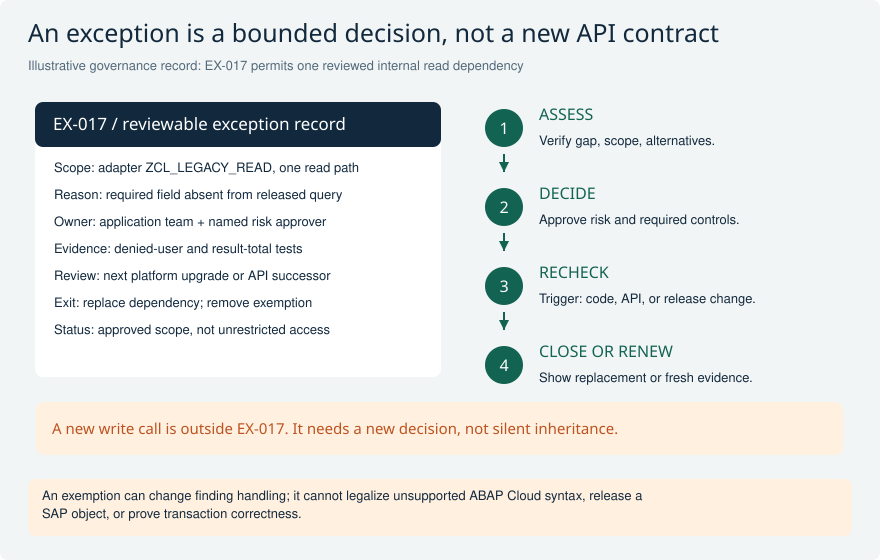

A concrete exception record limits one dependency, states its evidence and owner, and defines review and exit triggers. A changed implementation must be assessed against that scope.

**Explain it:** Which change invalidates this decision, and what proves that an exception is resolved rather than merely hidden?

**Limit:** EX-017 and the class name are fictional teaching identifiers. Actual approvals, gate behavior, and allowed development techniques follow the target environment and organization policy.

## GOV-10 The direct dependency scan is clean, but an upgrade still breaks the extension. What could the governance model be missing?

**Level:** Senior

**Short answer:** Check what the scan did not cover: indirect calls, dynamic selection, configured implementations, remote interfaces, and data assumptions. Verify its package scope, check version, and classification data too. Connect static findings with a dependency map and process tests. Clean direct references are useful evidence, but they do not prove that every runtime path will survive an upgrade.

**Reasoning and example:** A custom facade chooses an internal implementation from configuration, so scanning only its direct references misses the actual dependency. A remote service can also change independently of the ABAP transport. Include these paths in the map and assign owners who can explain and test them.

Another upgrade failure may come from data behavior: a query expected one text row, but changed data now gives several and doubles a total. No forbidden direct call is needed for that defect. Rehearse representative configured processes on the target upgrade and document what the checks and tests covered. A green result is meaningful only within that stated scope; it is not proof that all hidden assumptions are safe.

**Avoid this mistake:** A green direct-reference check is not proof that the whole solution has no unsupported or semantically fragile dependencies.

**Interviewer follow-ups:**

- How would you discover configuration-driven dependencies?
- Which runtime paths must the upgrade rehearsal cover?

**Strong answer criteria:**

- Looks for indirect, dynamic, and configured dependencies
- Checks whether the scan covered the needed objects
- Tests complete business processes

**Verification evidence:** An expanded dependency graph, documented scan scope and tool versions, and upgrade regression evidence covering configured runtime paths.

**Read and verify this answer:**

- [SAP software component relations and consistency checks](https://help.sap.com/docs/ABAP_PLATFORM_NEW/c238d694b825421f940829321ffa326a/e9bd731abe1b424d8e6f25f47a2868a8.html) - Check three things separately: the dependency classification, its supported released use, and who approves and maintains any exception.

## GOV-18 An interview panel shows an A-D chart with ATC priorities. What would you clarify before treating it as a release gate?

**Level:** Senior

**Short answer:** Explain that the A-D priority mapping belongs to particular Clean Core checks. Ask which variant, checks, classification data, object scope, and target release produced the results. Other ATC priorities can describe security or performance issues instead. Define what the release gate proves, which exemptions remain, and which runtime tests are still needed. Save enough run information to repeat the assessment.

**Reasoning and example:** One project has fewer findings because its variant omitted an enhancement check or used different classification data. Comparing the raw count with another project can therefore reward missing checks rather than safer code. Store the configuration, source version, scope, and exemptions so the comparison is like for like.

Even matching static checks do not prove that a posting transaction behaves correctly. Add the relevant runtime evidence and distinguish a resolved dependency from a finding that was merely exempted. Do not treat every priority 1 as Level D or every priority 2 as C across all ATC checks. Absence of findings also does not prove complete Level A coverage when assessment scope is incomplete.

**Avoid this mistake:** Do not interpret every priority 1 finding as Level D, every priority 2 as Level C, or absence of findings as proof of complete Level A coverage.

**Interviewer follow-ups:**

- What would you store so this assessment can be reproduced?
- How would you distinguish an exempted finding from a resolved dependency?

**Strong answer criteria:**

- Explains which check gives the priority mapping
- Records enough information to repeat the assessment
- Distinguishes static checks from runtime tests

**Verification evidence:** The exact ATC variant and check configuration, classification/version information, source and scope identifiers, exemptions, and complementary runtime validation results.

**Read and verify this answer:**

- [SAP ADT release notes: ABAP_CLEAN_CORE_READINESS check variant](https://help.sap.com/docs/abap-cloud/abap-development-tools-for-eclipse-release-notes/release-notes-of-abap-development-tools-for-eclipse-3-58) - Check three things separately: the dependency classification, its supported released use, and who approves and maintains any exception.

Visual: Clean Core levels A-D

Read each level as a classification of the actual SAP dependency or extension technology.

**Explain it:** Which configured Clean Core finding priority corresponds to levels B, C and D?

**Limit:** This mapping is specific to Clean Core usage checks; it does not classify every ATC finding.

Visual: Release contracts versus Clean Core levels

The two tables are separate classification axes. C1 identifies a local-use contract, while Level C identifies internal-object exposure in the Clean Core assessment context.

**Explain it:** What else must you verify after finding a C1 release flag, and why does a wrapper not erase the underlying exposure?

**Limit:** These are the three contracts requested for this comparison, not the complete release-contract catalogue. Exact object classification, extension technology, target edition, and ATC scope remain decisive.

Visual: Exception governance and review lifecycle

A concrete exception record limits one dependency, states its evidence and owner, and defines review and exit triggers. A changed implementation must be assessed against that scope.

**Explain it:** Which change invalidates this decision, and what proves that an exception is resolved rather than merely hidden?

**Limit:** EX-017 and the class name are fictional teaching identifiers. Actual approvals, gate behavior, and allowed development techniques follow the target environment and organization policy.

## ABAP-01 How do you choose between standard, sorted, and hashed internal tables?

**Level:** Core

**Short answer:** I choose the table by how I will read it. A standard table is useful for processing rows in sequence or by position. A sorted table keeps rows in key order and helps with key ranges. A hashed table is useful for finding one row by its complete unique key. I also consider how often rows change and how much memory the table needs.

**Reasoning and example:** Imagine importing orders from a file. If I must report errors in file order, I can keep the rows in a standard table. If I repeatedly find one order by its unique ID, a hashed lookup table can avoid searching every row. If I process all orders for one customer together, a sorted key starting with customer is useful.

The important question is which lookup the program actually performs. Searching a hashed table by a different field does not receive the same benefit as using its complete hash key. I test realistic volumes and include the cost of inserting and changing rows, not only reading them.

**Avoid this mistake:** A hashed primary key is unique; that does not mean every field value must be unique or that arbitrary partial-key searches are constant time.

**Read and verify this answer:**

- [SAP internal table reference and examples](https://github.com/SAP-samples/abap-cheat-sheets/blob/main/01_Internal_Tables.md) - Check how the language feature behaves. A classic example does not prove that its APIs are allowed in ABAP Cloud.

Visual: Internal table lookup

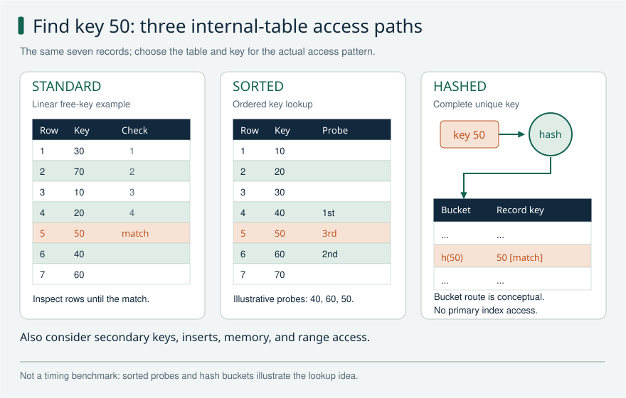

A free-key linear search, an ordered lookup, and a complete hashed-key lookup find the same record through different access paths.

**Explain it:** What changes if I need all rows in a key range, or preserve input order?

**Limit:** A standard table can use secondary keys; a hash lookup requires a suitable complete key. Hash storage and probe order are schematic, not SAP implementation guarantees.

## ABAP-07 How do you explain an SAP LUW versus a database LUW?

**Level:** Advanced

**Short answer:** A database LUW is one database transaction, ending with commit or rollback. An SAP LUW is the whole business change that the application treats as one unit. In classic dialog processing, it can span several database LUWs. SAP locks and the save process help keep that business change consistent. The application or framework that owns the transaction decides when to save.

**Reasoning and example:** A user opens an order, changes several fields and then presses Save. Classic dialog steps can cause database transaction boundaries before that final business decision. The application cannot simply keep ordinary database locks open while the user thinks. It uses the appropriate SAP enqueue lock and save mechanism to protect the business operation.

This is why a helper method must not commit just because its own work is finished. The larger operation may still fail. In RAP, the framework controls the transaction and save sequence, so classic COMMIT WORK patterns cannot simply be inserted into behavior methods. I first identify who owns the complete save.

**Avoid this mistake:** A database commit caused by a work-process boundary is not permission to split a business operation into independently committed fragments.

**Read and verify this answer:**

- [SAP LUW reference and examples](https://github.com/SAP-samples/abap-cheat-sheets/blob/main/17_SAP_LUW.md) - Check how the language feature behaves. A classic example does not prove that its APIs are allowed in ABAP Cloud.

Visual: SAP LUW and database LUW

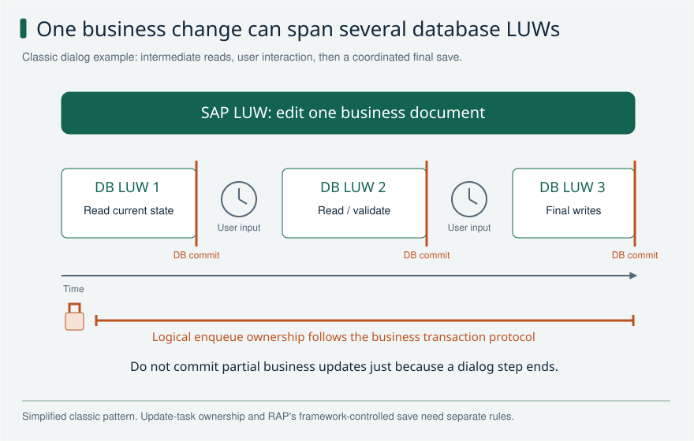

Several database transactions can serve a single classic SAP business transaction. The illustrated early database transactions only read; coordinated persistence happens at the end.

**Explain it:** Who owns the commit, and why does a database lock not protect a long user interaction?

**Limit:** The final save may use update processing in another context. Lock scope and transfer rules vary; the line is conceptual ownership, not a universal enqueue lifetime. Do not apply classic COMMIT WORK patterns inside RAP handlers.

## ABAP-08 Who should issue COMMIT WORK, and what does AND WAIT guarantee?

**Level:** Advanced

**Short answer:** The caller responsible for the complete business operation should commit. A helper must not save half the work unexpectedly. In classic update processing, COMMIT WORK AND WAIT waits for high-priority updates: sy-subrc is 0 for success and 4 for failure. Without AND WAIT, sy-subrc is 0 without confirming the asynchronous update result. Neither form waits for every external follow-up.

**Reasoning and example:** Imagine a process that creates a document and then adds required accounting data. If the document helper commits immediately, a later accounting error can leave an incomplete business result. The helper should follow the agreed transaction rules and let the owner decide when the complete operation is ready to save.

AND WAIT is useful for checking the relevant classic update result, but it does not prove that an email, background job or remote system has finished. In a RAP behavior implementation, I do not add COMMIT WORK or BAPI_TRANSACTION_COMMIT. I check both RAP restrictions and any legacy API, because an internal commit hidden inside that API is also a problem.

**Avoid this mistake:** COMMIT WORK AND WAIT is not a distributed transaction guarantee and does not authorize commits inside RAP handlers.

**Read and verify this answer:**

- [SAP LUW reference and examples](https://github.com/SAP-samples/abap-cheat-sheets/blob/main/17_SAP_LUW.md) - Check how the language feature behaves. A classic example does not prove that its APIs are allowed in ABAP Cloud.
- [SAP: COMMIT WORK and update result](https://help.sap.com/doc/abapdocu_752_index_htm/7.52/en-US/abapcommit.htm?file=abapcommit.htm%2F1000) - Classic ABAP reference for AND WAIT and sy-subrc. It does not authorize COMMIT WORK inside RAP behavior implementations.

Visual: SAP LUW and database LUW

Several database transactions can serve a single classic SAP business transaction. The illustrated early database transactions only read; coordinated persistence happens at the end.

**Explain it:** Who owns the commit, and why does a database lock not protect a long user interaction?

**Limit:** The final save may use update processing in another context. Lock scope and transfer rules vary; the line is conceptual ownership, not a universal enqueue lifetime. Do not apply classic COMMIT WORK patterns inside RAP handlers.

## OO-02 What can an ABAP interface contain, and when would you use one?

**Level:** Core

**Short answer:** An ABAP interface describes what an implementing class provides. It can contain methods, types, constants, attributes and events, not just method names. I use a small interface when callers need one clear capability and different implementations can provide it. This also lets a test supply a controlled replacement. Specialized interfaces, such as BAdI interfaces, can have additional rules.

**Reasoning and example:** A checkout needs a price, so its price-provider interface can define how to request one and what happens when no price is available. One class reads local data; another calls an external service. The checkout uses the same operation, while the implementations keep their technical work private.

The contract must include behavior as well as types. Returning an empty price on network failure is different from reporting that no price exists. I avoid putting unrelated operations into the interface simply because one concrete class already has them. A narrow interface makes both the caller and its test double easier to understand, and it reduces the effect of future changes.

**Avoid this mistake:** An interface is not an abstract class, and a collection of similarly named methods alone does not establish a meaningful common contract.

**Read and verify this answer:**

- [SAP interfaces and implementation semantics](https://help.sap.com/saphelp_snc70/helpdata/EN/c3/225b6254f411d194a60000e8353423/content.htm) - Compare the language contract with the Clean ABAP design guidance. Project conventions can differ from style recommendations.

Visual: OO interfaces and dependency injection

The service depends on a repository contract. Production and test implementations fit the same socket; the composition boundary supplies the appropriate collaborator.

**Explain it:** Which object chooses the implementation, and what does a double-based test fail to prove?

**Limit:** The plug is a design metaphor, not a SAP connector or code signature. Injection does not itself guarantee a good abstraction or production integration.

## OO-03 How do ABSTRACT and FINAL affect classes and methods?

**Level:** Core

**Short answer:** An abstract class cannot be created directly, but it may contain working shared code. It does not have to contain an abstract method. An abstract method leaves implementation to a subclass before that subclass can be concrete. FINAL on a class prevents subclasses. FINAL on a method prevents further redefinition of that method.

**Reasoning and example:** A document-processing base class could provide common logging while leaving a processing step abstract. A concrete subclass implements that step and can then be instantiated if no abstract methods remain. This is useful only when the shared process and the allowed variation are deliberate parts of the design.

For a service that should not be specialized through inheritance, FINAL makes that limit explicit. It can still implement interfaces and receive other objects as dependencies. I follow ABAP rules rather than copying assumptions from another language: redefining an inherited method preserves its interface, and ABAP does not solve this with same-name methods that have different parameter lists.

**Avoid this mistake:** Do not import another language's virtual keyword or method-overloading rules into ABAP; use ABAP's actual redefinition and signature rules.

**Read and verify this answer:**

- [SAP ABAP object orientation examples](https://github.com/SAP-samples/abap-cheat-sheets/blob/main/04_ABAP_Object_Orientation.md) - Compare the language contract with the Clean ABAP design guidance. Project conventions can differ from style recommendations.

## OO-07 How do dependency injection and dependency inversion differ?

**Level:** Core

**Short answer:** Dependency inversion means business code depends on the capability it needs, usually an interface, rather than one technical implementation. Dependency injection means someone else supplies that implementation, often through the constructor. The first is a design rule; the second is a way to connect objects. Together they make dependencies visible and easier to replace in tests.

**Reasoning and example:** An approval service needs to read a request. It accepts a repository interface in its constructor instead of creating a database repository inside approve. Production setup supplies the real repository; a unit test supplies a fake that returns a known request. The approval rule itself runs unchanged in both cases.

Passing an object is not enough if the service ignores it and creates another dependency internally. Also, injecting a large concrete database class can still leave business code dependent on database details. I keep the required operations small and meaningful, and test both successful reads and failures through that interface. This reveals what the service really relies on.

**Avoid this mistake:** Injecting a concrete class everywhere may aid construction while still leaving the business layer tightly coupled to infrastructure.

**Read and verify this answer:**

- [SAP Clean ABAP style guide](https://github.com/SAP/styleguides/blob/main/clean-abap/CleanABAP.md) - Compare the language contract with the Clean ABAP design guidance. Project conventions can differ from style recommendations.

Visual: OO interfaces and dependency injection

The service depends on a repository contract. Production and test implementations fit the same socket; the composition boundary supplies the appropriate collaborator.

**Explain it:** Which object chooses the implementation, and what does a double-based test fail to prove?

**Limit:** The plug is a design metaphor, not a SAP connector or code signature. Injection does not itself guarantee a good abstraction or production integration.

## SQL-02 What is the empty-table trap in FOR ALL ENTRIES?

**Level:** Core

**Short answer:** An empty FOR ALL ENTRIES driver is dangerous: the WHERE condition is ignored, so the query can read all rows in scope. I check that the driver is not empty before selecting. I also decide how duplicates should be handled. FOR ALL ENTRIES removes duplicate result rows, which can matter when selected columns do not uniquely identify records.

**Reasoning and example:** A report receives a list of customer IDs and should read their orders. If the list is empty, I normally return an empty result without running the selection. Adding another condition in the same WHERE clause is not a replacement for that guard: the empty-driver rule still applies.

I can remove repeated driver keys to reduce unnecessary work, but I separately check the output. Two different orders may have the same selected customer and amount. If I omit the order identity, result duplicate elimination can collapse those rows. I test empty input, repeated IDs and distinct records with equal displayed values before deciding the query is correct.

**Avoid this mistake:** An empty FAE driver does not mean no rows; a separate filter in the same WHERE clause is not a safe replacement for the guard.

**Read and verify this answer:**

- [SAP FOR ALL ENTRIES selection semantics](https://help.sap.com/saphelp_em900/helpdata/en/fc/eb3a1f358411d1829f0000e829fbfe/content.htm) - Check what the query returns and measure it in the target system before choosing a performance change.

## SQL-04 How can a LEFT OUTER JOIN accidentally behave like an inner join?

**Level:** Advanced

**Short answer:** A LEFT OUTER JOIN keeps left-side rows even when no right-side row matches. The missing right side contains SQL NULL values. A WHERE condition demanding a right-side value can remove those rows again. I put a condition in ON when it defines which right rows may match. I use WHERE when I really want to filter the final result.

**Reasoning and example:** The report must show every order, with an English description where available. I join the description using the order key and language condition in ON. An order without English text remains in the list, with no matching description. The user can still see that the order exists.

If I put the right-side language condition in WHERE instead, the unmatched row does not meet it and disappears. The report now hides some orders, even though the SQL still says LEFT OUTER JOIN. I test an order with English text, one with only another language and one with no text. That makes the intended behavior visible before tuning the query.

**Avoid this mistake:** Moving conditions between ON and WHERE is not always semantics-preserving for outer joins.

**Read and verify this answer:**

- [SAP ABAP SQL examples and semantics](https://github.com/SAP-samples/abap-cheat-sheets/blob/main/03_ABAP_SQL.md) - Check what the query returns and measure it in the target system before choosing a performance change.

Visual: SQL join multiplication

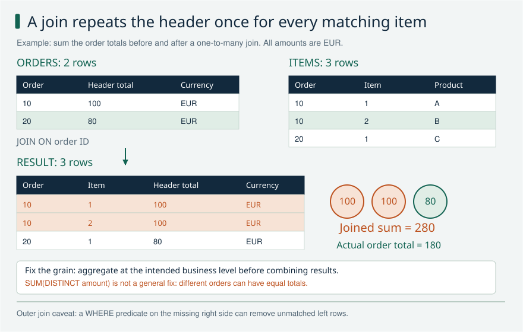

Joining two order headers to three items repeats order 10's total, inflating a naive sum from EUR 180 to EUR 280. For outer joins, matching conditions in ON can preserve unmatched left rows, while right-side conditions in WHERE can remove them.

**Explain it:** What is one row of this result supposed to represent? Where should a language filter go for optional text?

**Limit:** This is an inner-join example. WHERE and ON placement must follow intended semantics; neither DISTINCT nor SUM(DISTINCT amount) repairs every incorrect join or aggregation.

## SQL-10 How do ST05, SAT, SQL Monitor, and database plans complement each other?

**Level:** Advanced

**Short answer:** ST05 shows database accesses for a traced execution. SAT shows where ABAP runtime is spent and which calls are made. SQL Monitor helps find costly SQL across a wider workload. A database plan shows how a particular statement is executed. I choose the tool for the suspected problem and use the tools and permissions available in the target environment.

**Reasoning and example:** A report is slow, but one SQL statement does not explain the whole delay. I first find whether time is spent in ABAP processing, database calls or another dependency. Then I trace a representative run and compare execution count, rows and total time. A statement taking a small amount of time can dominate if it runs thousands of times.

For expensive database work, the execution plan helps explain scans, joins and large intermediate results. I measure again after a focused change. Classic ST05 and SAT access is not available in every cloud environment, so I use supported ADT or monitoring tools there rather than promise the same transaction codes everywhere.

**Avoid this mistake:** The slowest individual SQL statement may not be the largest total cost if another cheap statement is executed thousands of times.

**Read and verify this answer:**

- [SAP analyzing SQL statements in ADT](https://help.sap.com/docs/abap-cloud/abap-development-tools-user-guide/analyzing-sql-statements) - Cloud-tool reference for SQL investigation; classic ST05/SAT access depends on the target landscape.

Visual: Performance diagnosis

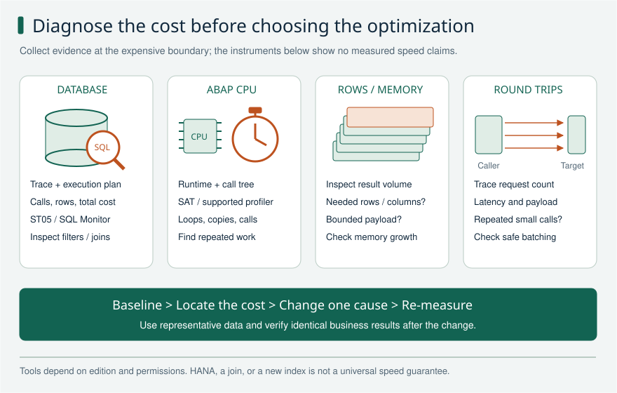

Inspect database work, ABAP computation, transferred volume, and repeated calls as different possible causes. Choose the trace and change based on evidence.

**Explain it:** Is the largest cost one slow statement, many cheap statements, ABAP processing, or transfer volume?

**Limit:** No percentages or speedups are measured here. These cost categories can overlap; do not sum overlapping trace durations. Available tools differ between classic and cloud editions.

## CDS-03 Association or join and how do you select cardinality?

**Level:** Core

**Short answer:** A join combines sources in the current query. An association defines a relationship that a consumer can follow, often producing a join when used. Cardinality describes how many related rows can really match the ON condition. It must match the data. Declaring a relationship to-one when several rows can match can lead to incorrect results.

**Reasoning and example:** A flight can point to its carrier by the carrier key. If that condition matches at most one carrier row, a to-one target cardinality may be correct. Test both a missing carrier and unexpected duplicates. The association declaration does not create a foreign-key constraint that fixes bad data for you.

The flight's own key is a separate issue. It may need carrier, connection, and flight date to identify one flight. Adding the date to that key does not prove the carrier association is to-one; the ON condition and target data do. Also measure performance where needed. An association is useful for modeling relationships, but is not automatically faster than writing a join.

**Avoid this mistake:** Associations are not automatically faster than joins and do not enforce referential integrity.

**Read and verify this answer:**

- [SAP Learning on CDS concepts](https://learning.sap.com/courses/building-data-models-with-the-abap-dictionary-and-abap-core-data-services/exploring-abap-core-data-services_f6b58d1f-ca51-461b-8355-aef95aa3864e) - Check which CDS entity type is used, what its provider contract allows, and what the target release supports.

Visual: CDS links and ownership

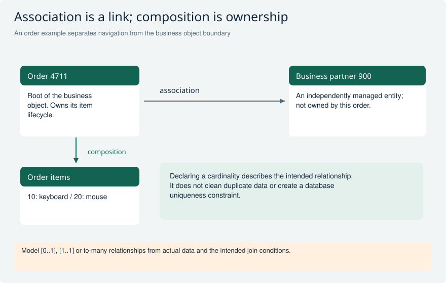

Items belong to the order BO; a partner reference crosses to an independently managed object.

**Explain it:** What breaks if a declared to-one relationship actually returns two partners?

**Limit:** Composition semantics and generated operations still require the corresponding RAP model.

## CDS-07 Does DCL on a base view automatically protect every higher view?

**Level:** Core

**Short answer:** No. Access control on a lower CDS view does not automatically protect every view built on it. Design the read rules for the entity that callers actually access. Supported DCL inheritance can reuse conditions with the required mappings. The #CHECK annotation alone creates no rule. RAP permissions for changing objects are a separate check.

**Reasoning and example:** Assume the base model has a company-code restriction, and a service exposes a higher projection. Test the projection through the actual read path with a user allowed to see only company code 1000. If rows from 2000 appear, the protected base view has not proved the service is protected.

Inspect the effective DCL on the accessed entity and any inherited conditions and field mappings. Include users with different permissions and realistic filters in the test. Then test update or approval permission separately in RAP. A correct read filter limits visible rows; it does not automatically decide whether the user may execute every action on those rows.

**Avoid this mistake:** DCL on one layer does not automatically secure an arbitrary view-on-view stack.

**Read and verify this answer:**

- [SAP Learning on DCL inheritance](https://learning.sap.com/courses/building-transactional-apps-with-the-abap-restful-application-programming-model/implementing-authority-checks) - Check which CDS entity type is used, what its provider contract allows, and what the target release supports.

Visual: CDS security boundaries

Review security where consumers enter the model, rather than assuming that lower layers protect every upper view.

**Explain it:** Which two tests prove that an exposed service rejects unauthorized access?

**Limit:** Authorization behavior depends on the access path and supported DCL inheritance mechanisms.

## CDS-11 How do CDS keys and database keys relate?

**Level:** Core

**Short answer:** A CDS key tells consumers which fields identify a row. It does not force the query result to be unique. A database key enforces uniqueness in a table, but joins and grouping can change the result. RAP and OData need a stable, truly unique identity. Check the complete result, not just the key declarations.

**Reasoning and example:** Imagine flight rows identified by carrier, connection, and flight date. If a CDS entity marks only carrier and connection as keys, two flights on different dates appear to have the same identity to the client. A list may confuse them or address the wrong row even though the database has two valid records.

Include the fields needed to identify one result row and check what joins do to that uniqueness. Joining a flight to several related rows can multiply the result again. Marking another field as key does not remove duplicates or repair the underlying query. Test with realistic repeated business values, not just sample data where every connection happens to appear once.

**Avoid this mistake:** Marking an element key does not remove duplicate rows.

**Read and verify this answer:**

- [SAP Learning on CDS concepts](https://learning.sap.com/courses/building-data-models-with-the-abap-dictionary-and-abap-core-data-services/exploring-abap-core-data-services_f6b58d1f-ca51-461b-8355-aef95aa3864e) - Check which CDS entity type is used, what its provider contract allows, and what the target release supports.

Visual: CDS links and ownership

Items belong to the order BO; a partner reference crosses to an independently managed object.

**Explain it:** What breaks if a declared to-one relationship actually returns two partners?

**Limit:** Composition semantics and generated operations still require the corresponding RAP model.

## RAP-02 How do you choose managed versus unmanaged RAP?

**Level:** Core

**Short answer:** Use managed RAP when the framework can handle your object's changes and database writes. Use unmanaged RAP when your implementation must handle those jobs, often because an existing business API already owns them. Managed RAP with unmanaged save is a middle option: RAP handles changes, and your code handles persistence. In every option, RAP still controls the transaction.

**Reasoning and example:** For a new travel-request app with your own tables, managed RAP usually avoids writing basic create, update, and delete handling yourself. You can focus on rules such as checking travel dates. For an existing application, a business API may already update several related tables correctly. Reusing it may justify unmanaged save or a fully unmanaged implementation.

Before choosing, check whether that API commits by itself, uses update tasks, or requires its own locks. A commit inside local RAP processing violates its runtime rules and may be rejected. Moving the call to a separate transaction creates another problem: it can save independently, and a later local rollback cannot undo it. Choose based on the API's behavior, not the application's age.

**Avoid this mistake:** Unmanaged does not permit arbitrary COMMIT WORK or database changes anywhere in a handler.

**Read and verify this answer:**

- [SAP Learning on behavior implementation options](https://learning.sap.com/courses/building-transactional-apps-with-the-abap-restful-application-programming-model/exploring-the-behavior-implementation-options) - Check the RAP implementation type and what is allowed at this point in the transaction.

Visual: RAP implementation ownership matrix

Trace the same request through three implementation choices and name the owner of each responsibility.

**Explain it:** Which part stays managed when only the save implementation is replaced?

**Limit:** Conceptual comparison; specific saver variants and failure support depend on release and scenario.

## RAP-04 Where may COMMIT ENTITIES be called?

**Level:** Core

**Short answer:** Call COMMIT ENTITIES from an external ABAP program that owns an EML transaction. Inside a RAP handler or saver, let the framework finish the transaction. Do not call COMMIT ENTITIES or COMMIT WORK there. This rule also applies to actions, validations, and determinations. The OData request framework owns the save boundary for its requests.

**Reasoning and example:** A standalone ABAP program creates a request and its items with EML. It checks the modification responses, then calls COMMIT ENTITIES at the point where the complete business change should be saved. It must also check the save responses, because accepting a modification does not prove that saving succeeded.

Now put the same creation logic inside a RAP action. The action may make permitted changes, but it must not commit them itself. The framework still has other rules and changes to process. An early commit could split what should be one transaction, and violating the RAP contract can cause a runtime error. Moving the commit into a saver method does not fix that.

**Avoid this mistake:** Moving the commit from validation into SAVE or CANCEL does not make it valid.

**Read and verify this answer:**

- [SAP Learning on EML and transaction ownership](https://learning.sap.com/courses/building-transactional-apps-with-the-abap-restful-application-programming-model/using-the-entity-manipulation-language-eml-to-access-business-objects) - Check the RAP implementation type and what is allowed at this point in the transaction.
- [SAP RAP BO contract](https://help.sap.com/docs/abap-cloud/abap-rap/rap-business-object-contract) - Check the RAP implementation type and what is allowed at this point in the transaction.

Visual: RAP transaction and workflow boundary

Separate the local transaction from event delivery and the later workflow callback.

**Explain it:** What is lost if a handler calls a committing legacy API?

**Limit:** Exact RAP save methods and supported event infrastructure depend on scenario and release.

Visual: RAP buffer with a concrete value change

During modification, the transactional view can show 120 EUR while saved data still shows 100 EUR.

**Explain it:** Why can a direct SQL read be the wrong way to read the BO during modification?

**Limit:** Simplified single-record example, not a promise about a particular SQL isolation level.

## RAP-07 How do FAILED REPORTED and MAPPED differ?

**Level:** Core

**Short answer:** FAILED says which instance or operation was rejected. REPORTED carries messages, including their severity and the field or instance they concern. MAPPED links a caller's creation identifier to the created object's identity where the operation supports it. These structures do different jobs. An error message in REPORTED alone does not necessarily make an operation fail.

**Reasoning and example:** A user saves two requests, and one has an invalid delivery date. A validation must identify the rejected request in FAILED and explain the problem in REPORTED. Adding a field reference lets the UI point to the date the user should fix. Reporting only an error-looking message is not a reliable way to reject the save.

For a successful create, the caller may have used a content ID before a final identity was available. MAPPED allows the caller to connect that input to the new object. Always use the response parameters actually provided by the handler contract. For example, a determination does not provide FAILED, so it is not a substitute for a rejecting validation.

**Avoid this mistake:** Error severity in REPORTED is not a substitute for FAILED; determinations do not expose FAILED.

**Read and verify this answer:**

- [SAP Learning on EML and transaction ownership](https://learning.sap.com/courses/building-transactional-apps-with-the-abap-restful-application-programming-model/using-the-entity-manipulation-language-eml-to-access-business-objects) - Check the RAP implementation type and what is allowed at this point in the transaction.

Visual: EML identity tags

Content IDs connect entries within a request. Transactional and preliminary identities address other lifecycle needs.

**Explain it:** How can a new item refer to a newly created order before the final order number exists?

**Limit:** Generated EML types and available components are authoritative for the specific BO.

Visual: RAP message lifecycle and correction

Follow the same child through an error and correction instead of treating a message as timeless text.

**Explain it:** Which identity and state area would you inspect when the old error remains?

**Limit:** Message lifetime and permitted state-message scenarios depend on active/draft and the supported operation contract.

## RAP-10 What do %cid %cid_ref %tky and %pid mean?

**Level:** Core

**Short answer:** These fields identify objects at different stages of a RAP request. %cid labels a new instance, and %cid_ref refers to that creation, for example when adding its items. %tky is the transactional key, including relevant context such as draft state. %pid is a preliminary identifier for late numbering. None of these names means they are interchangeable.

**Reasoning and example:** Create a header and two items in one request. The header may not yet have its final document number. Give its creation a content ID, then refer to that ID when creating the items by association. RAP can connect them without requiring the caller to guess a final key.

Inside handlers, use the supplied transactional identity when returning results or messages. Rebuilding a key from only the document number can lose draft context. For late numbering, ADJUST_NUMBERS maps the preliminary identification in %pre to the final %key. A content ID belongs to request correlation; it is not a business number to store and show forever.

**Avoid this mistake:** %tky means transactional key, not temporary key; %cid is not a persisted business document number.

**Read and verify this answer:**

- [SAP Learning on EML and transaction ownership](https://learning.sap.com/courses/building-transactional-apps-with-the-abap-restful-application-programming-model/using-the-entity-manipulation-language-eml-to-access-business-objects) - Check the RAP implementation type and what is allowed at this point in the transaction.

Visual: EML identity tags

Content IDs connect entries within a request. Transactional and preliminary identities address other lifecycle needs.

**Explain it:** How can a new item refer to a newly created order before the final order number exists?

**Limit:** Generated EML types and available components are authoritative for the specific BO.

Visual: RAP identity and numbering timeline

Compare when the identity becomes final and when persistence is confirmed.

**Explain it:** What must an external EML consumer inspect after MODIFY and after COMMIT?

**Limit:** Illustrative numbering paths; exact %pid/%pre mapping and conversion syntax are release/scenario-specific.

## RAP-11 Early numbering versus late numbering?

**Level:** Advanced

**Short answer:** Early numbering gives an instance its final key during interaction. Late numbering keeps a preliminary identity and assigns the final key late in saving. A technical UUID and a business document number can be separate fields with different rules. Late numbering can avoid consuming numbers for some rejected changes. It does not, by itself, promise a gap-free business sequence.

**Reasoning and example:** A new request can receive a UUID immediately so its items have a stable technical parent. The business may want the visible approval number only when the request is accepted. That number can follow a separate supported numbering design rather than being used as the only technical identity.

Now consider two users saving at the same time. Reading the highest number and adding one can give both users the same result. Use suitable number-range and transaction handling instead. If the business requires no gaps, also examine failed saves, cancellations, and the exact numbering guarantees. Choosing late numbering is only one part of that design, not proof that every possible gap has disappeared.

**Avoid this mistake:** Late numbering alone does not guarantee a gap-free sequence, and SELECT MAX plus one is unsafe under concurrency.

**Read and verify this answer:**

- [SAP Learning on numbering and determinations](https://learning.sap.com/courses/building-transactional-apps-with-the-abap-restful-application-programming-model/setting-values-using-numbering-and-determinations) - Check the RAP implementation type and what is allowed at this point in the transaction.
- [SAP RAP late-numbering mapping](https://help.sap.com/docs/abap-cloud/abap-rap/adjust-numbers) - Check the RAP implementation type and what is allowed at this point in the transaction.

Visual: EML identity tags

Content IDs connect entries within a request. Transactional and preliminary identities address other lifecycle needs.

**Explain it:** How can a new item refer to a newly created order before the final order number exists?

**Limit:** Generated EML types and available components are authoritative for the specific BO.

Visual: RAP identity and numbering timeline

Compare when the identity becomes final and when persistence is confirmed.

**Explain it:** What must an external EML consumer inspect after MODIFY and after COMMIT?

**Limit:** Illustrative numbering paths; exact %pid/%pre mapping and conversion syntax are release/scenario-specific.

## RAP-12 What problem does draft solve?

**Level:** Core

**Short answer:** Draft saves unfinished editing work separately from active business data. It lets a user continue across HTTP requests or return after an interruption. RAP provides operations such as Edit, Resume, Activate, and Discard; Prepare can run selected checks and calculations. Activation moves valid draft changes into active processing. The request still needs its save sequence to finish.

**Reasoning and example:** A user starts a travel request, enters a destination, and closes the browser before adding dates. A draft-enabled app can keep that incomplete version so the user can resume later. Other business processing should continue to distinguish this unfinished draft from an active request.

When the user activates it, required checks can reject missing or invalid data. Successful activation is part of the processing that produces active data; it does not authorize a custom handler to commit on its own. Keep draft and active identities clear in reads, messages, and actions. A custom Submit action may represent a separate business step and is not automatically the same as draft activation.

**Avoid this mistake:** Every BO is not automatically draft-enabled, and a custom Submit action is not automatically draft activation.

**Read and verify this answer:**

- [SAP Learning on draft](https://learning.sap.com/courses/building-transactional-apps-with-the-abap-restful-application-programming-model/understanding-the-draft-concept) - Check the RAP implementation type and what is allowed at this point in the transaction.

Visual: Draft lifecycle

Follow edit, activate and discard for an existing active object, then explain how a new-object draft differs.

**Explain it:** What remains after discarding an edit draft? What if activation fails?

**Limit:** Schematic state transitions; draft actions and supported flows depend on the BO and consumer.

Visual: Three storage lifetimes: an illustrated analogy

The desk represents the current transactional buffer; the draft cabinet represents persistent work across requests; the shared archive represents saved active data.

**Explain it:** Which of the three can survive several HTTP requests without becoming active business data?

**Limit:** An analogy, not literal SAP storage architecture or a mandatory three-stage pipeline. A new draft may have no active instance. Active business records may still be updated.

## ADV-01 How do pessimistic locks and ETags complement each other?

**Level:** Core

**Short answer:** A lock stops conflicting processing while it is held. An ETag lets a write request check whether the data has changed since the client read it. They solve different problems and are often needed together. RAP declares the relevant lock and version handling in behavior. Draft scenarios also need total-ETag handling for relevant changes to active data.

**Reasoning and example:** Anna and Ben open the same request. Anna saves a new amount. Ben's screen still shows the old amount, so his update must not silently replace Anna's work. An If-Match check against the current ETag can detect that his version is outdated and make him refresh. The ETag did not reserve the request while he was reading it.

A pessimistic lock addresses conflicting processing during the period it is held. Draft editing and changes to active data require the matching draft lock and total-ETag design. Test stale updates and draft resume behavior separately. A lock is temporary coordination; an ETag is a version check, and neither is an audit log.

**Avoid this mistake:** Locking and logging are different concepts; an ETag is not a log and does not reserve the object.

**Read and verify this answer:**

- [SAP draft concept](https://learning.sap.com/courses/building-transactional-apps-with-the-abap-restful-application-programming-model/understanding-the-draft-concept) - Check which RAP behavior is supported by the target release and the client that calls it.

Visual: Draft lifecycle

Follow edit, activate and discard for an existing active object, then explain how a new-object draft differs.

**Explain it:** What remains after discarding an edit draft? What if activation fails?

**Limit:** Schematic state transitions; draft actions and supported flows depend on the BO and consumer.

Visual: Two ETag boundaries

The left side tests a conditional entity update; the right tests the active-state basis of a resumed draft.

**Explain it:** Why does testing one entity ETag not prove the draft total-ETag implementation?

**Limit:** ETags are opaque. Verify lock expiry, relevant child changes and generated behavior on the actual system.

Visual: Two editors and one version: an illustrated story

Alice and Ben read version 7. Alice updates successfully, producing version 8. Ben must not overwrite that newer state using the stale version 7 precondition.

**Explain it:** Why should the client refresh and resolve the conflict instead of blindly retrying its old payload?

**Limit:** Version numbers are illustrative. Real ETags are opaque validators; a failed If-Match precondition commonly returns HTTP 412. This is optimistic concurrency, not a pessimistic lock.

## ADV-02 Global authorization instance authorization or feature control?

**Level:** Advanced

**Short answer:** Global authorization checks whether a user may perform an operation without looking at one specific object. Instance authorization also considers that object's data. Feature control says whether an operation or field is currently available under business rules. These checks have different jobs. A disabled button helps the user, but it cannot replace permission checks in the backend.

**Reasoning and example:** A submitted request may be readonly for every user because editing is no longer allowed at that stage. That is a business-availability rule. Approval may additionally require permission for the request's company code or responsibility area. That is a permission decision, even if the UI also disables the Approve button.

Test both through a direct service or EML consumer using the intended public access path. A user without approval authority must not succeed just by skipping the screen. Also test an authorized approver against a request in a state that cannot be approved. This separates who is allowed to act from whether the action currently makes business sense.

**Avoid this mistake:** Hiding or disabling a button is not an authorization check.

**Read and verify this answer:**

- [SAP Learning on authorization](https://learning.sap.com/courses/building-transactional-apps-with-the-abap-restful-application-programming-model/implementing-authority-checks) - Check which RAP behavior is supported by the target release and the client that calls it.

Visual: CDS security boundaries

Review security where consumers enter the model, rather than assuming that lower layers protect every upper view.

**Explain it:** Which two tests prove that an exposed service rejects unauthorized access?

**Limit:** Authorization behavior depends on the access path and supported DCL inheritance mechanisms.

Visual: Identity, authorization and feature control

Treat identity, business permission and contextual availability as separate checks.

**Explain it:** If Submit is disabled in Fiori, what happens when someone calls the service directly?

**Limit:** Static operation characteristics differ from dynamic instance/global feature checks.

## ADV-06 What is augmentation and how does it differ from additional save?

**Level:** Advanced

**Short answer:** Augmentation changes or adds supported input at a RAP projection boundary before the underlying business object handles it. It helps adapt a particular consumer's input. Additional save performs extra persistence-related work in a suitable managed save scenario. These mechanisms run for different reasons. Neither is a general hook for arbitrary work before every save.

**Reasoning and example:** A specialized projection may accept input that needs to be translated into fields understood by the shared business object. A supported augmentation can make that translation so the underlying behavior receives the right changes. Check the projection's supported modifying operations and keep the core business rules in the appropriate underlying implementation.

Writing an audit record alongside the managed object's persisted changes is a different concern. It may require an additional-save design that follows the transaction rules. Putting it into augmentation just because that code runs during a modification confuses input handling with saving. Similarly, a virtual display field does not become persistent simply because an augmentation exists; design its supported data flow explicitly.

**Avoid this mistake:** Augmentation is not a generic before-save hook for copying every virtual element into a table.

**Read and verify this answer:**

- [SAP operation augmentation](https://help.sap.com/docs/abap-cloud/abap-rap/operation-augmentation) - Check which RAP behavior is supported by the target release and the client that calls it.

Visual: Augmentation versus additional save

Locate the input transformation and persistence supplement on the same conceptual timeline.

**Explain it:** Why would writing an audit row not make augmentation the right save hook?

**Limit:** The arrow is conceptual; availability, supported fields and trigger details depend on the target RAP release.

## ADV-13 How do static and dynamic feature controls differ?

**Level:** Advanced

**Short answer:** Static restrictions are declared in the behavior definition, such as a readonly field. Dynamic feature controls decide availability from current context, such as making approved requests uneditable. They describe business availability, not who has permission. Check the controls supported for the operation and release. For one operation, choose global or instance feature control; do not declare both.

**Reasoning and example:** A generated UUID should not be freely edited by the caller, so a static readonly declaration fits. The request description may be editable while the request is open but readonly after approval, which needs a state-dependent rule. Use the applicable generated feature-control handler to express the supported restriction.

Now test an API call as well as the screen. Permission checks must still prevent an unauthorized user from changing an otherwise editable request. Also validate the business data: mandatory field metadata is not a complete substitute for backend consistency rules. Keeping static restrictions, dynamic availability, authorization, and validation separate makes it easier to explain why a request was rejected.

**Avoid this mistake:** A dynamic UI state does not prove security, and mandatory metadata does not replace all backend business validations.

**Read and verify this answer:**

- [SAP feature control](https://help.sap.com/docs/abap-cloud/abap-rap/feature-control) - Check which RAP behavior is supported by the target release and the client that calls it.

Visual: Identity, authorization and feature control

Treat identity, business permission and contextual availability as separate checks.

**Explain it:** If Submit is disabled in Fiori, what happens when someone calls the service directly?

**Limit:** Static operation characteristics differ from dynamic instance/global feature checks.

## ODATA-01 When would you choose OData V4 rather than V2?

**Level:** Core

**Short answer:** For a new RAP service, I start with OData V4 if the backend and client support it. I keep V2 when an existing app or integration needs it. The choice affects request formats and supported operations, so it needs testing. Switching to V4 alone does not make an application faster.

**Reasoning and example:** Suppose we are building a new Fiori elements app for purchase requests. I check the backend release, the SAPUI5 version and the chosen page template before selecting a V4 binding. I then test the operations the app needs, including actions and draft editing if used.

An older partner application might only understand V2. I would keep its working endpoint during migration rather than force a protocol change with the new UI. Draft, validations and determinations belong to RAP; they are not exclusive V4 features. Support still depends on the particular service and consumer, so a successful V4 demo does not answer every compatibility question.

**Avoid this mistake:** RAP and draft are not exclusive to V4, and Gateway is not exclusive to V2. Check the actual supported combination.

**Read and verify this answer:**

- [SAP Learning on OData](https://learning.sap.com/courses/building-odata-services-with-sap-gateway/explaining-open-data-protocol-odata-) - Check the protocol version and what the SAP service actually supports. A feature in the standard is not automatically available in every service.
- [SAP Learning on UI service bindings](https://learning.sap.com/courses/building-transactional-apps-with-the-abap-restful-application-programming-model/defining-an-odata-ui-service) - Check the protocol version and what the SAP service actually supports. A feature in the standard is not automatically available in every service.

## ODATA-04 How do paging and total count work in V2 and V4?

**Level:** Advanced

**Short answer:** The total count tells the client how many rows match the filter, not how many fit on one page. Filter first, then count and page with a stable order. V2 commonly uses $inlinecount=allpages; V4 uses $count=true for an inline count. When the server returns a next link, the client should follow it.

**Reasoning and example:** A filter finds 500 open orders, but the screen displays 20 at a time. The response can correctly contain 20 orders and a total of 500. Returning 20 as the total would make the screen think there are no more pages. The /$count resource is another way to request a count.

Sorting matters too. Without a stable order, rows may move between pages even when the underlying data has not changed. Concurrent inserts or deletes can still affect offset paging. In a custom provider, I use the actual response API for that framework; I do not assume every Gateway implementation has the same method for setting the count.

**Avoid this mistake:** Use the response API of the actual provider. Do not assume every Gateway implementation has one generic SET_COUNT method.

**Read and verify this answer:**

- [OASIS OData V4 protocol](https://docs.oasis-open.org/odata/odata/v4.0/errata03/os/complete/part1-protocol/odata-v4.0-errata03-os-part1-protocol-complete.html) - Check the protocol version and what the SAP service actually supports. A feature in the standard is not automatically available in every service.

Visual: Filtering, paging and total count

Count and paging answer different questions. Stable ordering matters when the client requests successive pages.

**Explain it:** For this example, what count belongs beside a page of five records?

**Limit:** Provider-side execution order may be optimized while preserving request semantics.

## ODATA-07 Is a batch request one database transaction?

**Level:** Advanced

**Short answer:** A batch is an envelope containing several requests. It does not automatically make them one transaction. Changesets provide atomic groups in multipart batches; OData 4.01 JSON batch has atomicity groups. I check what the service supports and inspect every inner result. An outer success response does not mean every operation succeeded.

**Reasoning and example:** Suppose a batch contains an order creation and an unrelated address change. These may belong to different groups and finish differently. If creating an order and its items must succeed together, the requests need the supported atomic grouping, or a supported deep-create operation for that structure. Deep create still needs correct backend transaction handling.

I test an invalid item and verify that the intended group leaves no partly created order. I also test a failure in a separate group and inspect each inner response. A service called V4 does not automatically implement every V4.01 JSON batch feature, so I verify its actual protocol and provider capabilities.

**Avoid this mistake:** HTTP 200 for a batch does not mean every operation inside it succeeded.

**Read and verify this answer:**

- [OASIS OData V4 protocol](https://docs.oasis-open.org/odata/odata/v4.0/errata03/os/complete/part1-protocol/odata-v4.0-errata03-os-part1-protocol-complete.html) - Check the protocol version and what the SAP service actually supports. A feature in the standard is not automatically available in every service.
- [OASIS OData 4.01 JSON Format: Batch Requests](https://docs.oasis-open.org/odata/odata-json-format/v4.01/odata-json-format-v4.01.html) - Explains atomicityGroup in JSON batch. Check that the SAP service supports this protocol version and format.

Visual: OData batch envelope and atomic groups

The outer envelope reduces HTTP packaging overhead; it does not establish one universal database transaction.

**Explain it:** If a later independent group fails, must an earlier successful group be rolled back?

**Limit:** Conceptual grouping, not an exact multipart or JSON batch payload.

## CORE-02 What are Clean Core levels A B C and D?

**Level:** Core

**Short answer:** The levels describe which SAP dependencies and extension techniques custom code uses. A uses released APIs and extension points under their supported contracts. B uses SAP-designated classic APIs and supported classic options. C uses SAP internals that may change. D uses explicitly non-recommended objects or techniques. Check the actual classification for the product and use involved.

**Reasoning and example:** Imagine four ways to meet a requirement. A released API that supports the operation is the preferred A path. A designated classic API may provide a justified B path in a landscape where classic development is allowed. Calling an internal object introduces C risk, while an explicitly non-recommended technique belongs to D.

The response should match the risk: prefer A where suitable, assess B, give C a named owner and replacement plan, and prioritize fixing D. Do not classify by familiarity or naming. A function module everyone has used for years is not automatically B, and an unreleased object is not automatically D. Look up the actual dependency and supported operation.

**Avoid this mistake:** A familiar API is not automatically B, and every unreleased object is not automatically D.

**Read and verify this answer:**

- [SAP Clean Core ATC levels and setup](https://learning.sap.com/courses/practicing-clean-core-extensibility-for-sap-s-4hana-cloud/creating-tier-2-cloud-apis_a75bf2cd-815c-42bb-8d3b-2bba4931ecad) - Look up the actual dependency classification and check what the target edition permits.

Visual: Clean Core levels A-D

Read each level as a classification of the actual SAP dependency or extension technology.

**Explain it:** Which configured Clean Core finding priority corresponds to levels B, C and D?

**Limit:** This mapping is specific to Clean Core usage checks; it does not classify every ATC finding.

## CORE-03 How do the levels map to ATC messages?

**Level:** Core

**Short answer:** For the configured Clean Core usage checks, A has no corresponding finding. B gives priority 3 information, C gives a priority 2 warning, and D gives a priority 1 error. This mapping applies to those checks. Other ATC checks may use priorities for different problems. A green run is useful only when the right checks and classification data actually ran.

**Reasoning and example:** A team sees no Clean Core findings after an ATC run and calls the application Level A. Before accepting that, check the variant, check implementation, classification data, and target release. If the relevant usage check was not included, silence says nothing about those dependencies.

When a priority 2 finding appears, inspect the object and the relevant Clean Core classification rather than treating the number as a universal description of every ATC issue. A security finding with the same priority needs its own interpretation. Use the findings to guide dependency review, and test the application separately for correctness and security. Clean Core classification is not a complete application quality certificate.

**Avoid this mistake:** No ATC findings does not prove that the entire application is secure, correct or fully Level A.

**Read and verify this answer:**

- [SAP Clean Core ATC levels and setup](https://learning.sap.com/courses/practicing-clean-core-extensibility-for-sap-s-4hana-cloud/creating-tier-2-cloud-apis_a75bf2cd-815c-42bb-8d3b-2bba4931ecad) - Look up the actual dependency classification and check what the target edition permits.

Visual: Clean Core levels A-D

Read each level as a classification of the actual SAP dependency or extension technology.

**Explain it:** Which configured Clean Core finding priority corresponds to levels B, C and D?

**Limit:** This mapping is specific to Clean Core usage checks; it does not classify every ATC finding.

## CORE-08 Does wrapping an unreleased SAP API make it Level A?

**Level:** Advanced

**Short answer:** No. A released custom wrapper can give its callers a controlled interface where the platform allows that design. The wrapper still calls the underlying SAP object, with that object's classification and upgrade risk. Review the full call chain. Releasing your own interface does not make an internal or non-recommended SAP dependency become Level A.

**Reasoning and example:** An ABAP Cloud class calls a released custom wrapper, and the wrapper calls a nominated classic API. The consumer now has a clear custom contract, but the wrapper implementation still has the B dependency. If the classic API changes, someone must still maintain that wrapper and test its callers.

The same reasoning applies to an internal C dependency or a D technique: hiding it behind one method does not remove it. Record the dependency, owner, and replacement condition. If a suitable released SAP API becomes available, assess moving to it and retiring the wrapper. The wrapper's useful job is to control and isolate access, not to change the facts about the code underneath.

**Avoid this mistake:** A wrapper is not a mechanism for laundering an internal or prohibited dependency into an entirely Level A solution.

**Read and verify this answer:**

- [SAP Clean Core ATC levels and setup](https://learning.sap.com/courses/practicing-clean-core-extensibility-for-sap-s-4hana-cloud/creating-tier-2-cloud-apis_a75bf2cd-815c-42bb-8d3b-2bba4931ecad) - Look up the actual dependency classification and check what the target edition permits.

Visual: Clean Core wrapper dependency

Trace dependencies across the wrapper instead of classifying the solution from its visible surface alone.

**Explain it:** What evidence would let you accept a classic SAP dependency responsibly?

**Limit:** A governance review must consider technology restrictions, classifications and lifecycle risk.

## CORE-10 How do you choose key-user on-stack and side-by-side extensibility?

**Level:** Core

**Short answer:** Choose the simplest supported option that meets the business need. Key-user tools fit supported field and process adaptations. On-stack developer extensibility fits logic that needs close access to local business data or the transaction. Side-by-side fits a more independent app or cross-system process. Use supported remote interfaces and plan how separate systems recover when one fails.

**Reasoning and example:** An extra field may already be supported by a key-user business context, so writing a new application adds little value. A validation that must reject the current document before it saves may fit a released local BAdI. A supplier portal used across several systems may fit a separate BTP application with its own release cycle.

Compare the required timing, users, data, and failure behavior. A remote portal cannot automatically share the local document's database transaction, so define pending and failed states where needed. These are placement choices, not automatic Clean Core grades. Each chosen implementation still needs a review of the APIs and extension technologies it actually uses.

**Avoid this mistake:** These are placement and development choices, not automatic A-D grades or fixed implementation times.

**Read and verify this answer:**

- [SAP Clean Core best practices](https://learning.sap.com/courses/practicing-clean-core-extensibility-for-sap-s-4hana-cloud/explaining-extensibility-model-best-practices_e290f382-800e-40ef-a203-85a13115f487) - Look up the actual dependency classification and check what the target edition permits.

Visual: Extension placement decision

Start from the business need and transaction boundary before choosing an extension location.

**Explain it:** When would local transactional consistency favor an on-stack extension?

**Limit:** Placement does not establish Clean Core level or availability in a specific edition.

## CORE-15 What if no released API covers the business requirement?

**Level:** Core

**Short answer:** First recheck standard features, configuration, and supported extension points on the target release. Consider a different process or placement if it meets the requirement. Where classic development is allowed, assess designated classic APIs and any remaining internal dependency under the exception policy. Request a supported API when needed. Do not assume a classic workaround is possible in public edition.

**Reasoning and example:** A team cannot find a released API for a required write. Confirm the exact missing operation before declaring an API gap: a standard process or released extension point may achieve it another way. Compare alternatives with the business, including whether immediate completion is truly required or a different workflow would work.

If an allowed temporary exception remains necessary, record its owner, rejected alternatives, test coverage, and replacement condition. Review it when SAP offers a successor. Do not start with a modification simply because it is technically convenient. And in a restricted environment, an exception document cannot enable a forbidden technique; the design must still fit what that product supports.

**Avoid this mistake:** Do not immediately choose a modification, and do not assume public edition permits a classic workaround.

**Read and verify this answer:**

- [SAP Clean Core best practices](https://learning.sap.com/courses/practicing-clean-core-extensibility-for-sap-s-4hana-cloud/explaining-extensibility-model-best-practices_e290f382-800e-40ef-a203-85a13115f487) - Look up the actual dependency classification and check what the target edition permits.

Visual: Extension placement decision

Start from the business need and transaction boundary before choosing an extension location.

**Explain it:** When would local transactional consistency favor an on-stack extension?

**Limit:** Placement does not establish Clean Core level or availability in a specific edition.

Visual: Clean Core wrapper dependency

Trace dependencies across the wrapper instead of classifying the solution from its visible surface alone.

**Explain it:** What evidence would let you accept a classic SAP dependency responsibly?

**Limit:** A governance review must consider technology restrictions, classifications and lifecycle risk.

## BTP-04 What are a service instance binding and service key?

**Level:** Core

**Short answer:** A service instance is a service resource you have created. A binding connects an application to that resource and gives it the required connection information. A service key supplies credentials for a supported external-client use case. These are different objects; creating a binding does not always create a separate service key.

**Reasoning and example:** Suppose a Cloud Foundry app needs a database service. I create the supported service instance and bind the app to it. The app reads the supplied connection settings rather than keeping a password in source code. In Cloud Foundry, this information is commonly available through VCAP_SERVICES, though other delivery methods exist.

An external tool may instead need a service key if that service supports the use case. I protect and rotate those credentials too. When a binding changes, I check whether the app needs a restart or restage to use the new settings. A local default-env.json file is a development convention, not the universal way Cloud Foundry delivers credentials.

**Avoid this mistake:** default-env.json is a local development convention, not the universal Cloud Foundry credential transport.

**Read and verify this answer:**

- [Cloud Foundry service bindings](https://docs.cloudfoundry.org/devguide/services/application-binding.html) - Check where the app runs, which user it calls as and how it connects.

Visual: BTP account and runtime map

Read the nesting as an organizational example, then distinguish the application, service instance and credentials.

**Explain it:** How is a service instance different from a binding or service key?

**Limit:** Schematic Cloud Foundry route; other BTP environments have different runtime structures.

## BTP-07 How do remote transactions differ from local RAP transactions?

**Level:** Advanced

**Short answer:** A remote API usually saves data in a separate transaction. If my local RAP transaction rolls back, the remote system may still keep its change. I therefore plan how to find the original result, retry safely and handle partial success. A timeout means the outcome may be unknown; it does not prove the remote operation failed.

**Reasoning and example:** Our app asks a remote payment service to create a payment. The service creates it, but the response is lost. If we simply send a new creation request, we may pay twice. I use the service's documented idempotency mechanism, meaning the same request identifier reuses the original business effect, or query the payment by a stable reference.

The local app keeps a recoverable pending or uncertain status until it knows the result. If one side succeeds and the other cannot complete, a supported cancellation or other compensating business step may be needed. Calling HTTP inside a RAP action does not make the two systems share one rollback.

**Avoid this mistake:** Calling HTTP inside an action does not make the remote change part of the local RAP database transaction.

**Read and verify this answer:**

- [SAP BTP documentation](https://help.sap.com/docs/btp) - This is a documentation starting point, not proof of every statement. Find the named feature for your target release. The example decision and test plan are original study guidance.

Visual: OData batch envelope and atomic groups

The outer envelope reduces HTTP packaging overhead; it does not establish one universal database transaction.

**Explain it:** If a later independent group fails, must an earlier successful group be rolled back?

**Limit:** Conceptual grouping, not an exact multipart or JSON batch payload.

Visual: Local and remote transaction boundaries

The remote commit belongs to another system, so local failure needs an explicit recovery strategy.

**Explain it:** What should happen if the remote side succeeds but the response is lost?

**Limit:** This explains distributed consistency, not a particular messaging product guarantee.

## RICEFW-11 How should a RAP submit action start an approval process reliably?

**Level:** Advanced

**Short answer:** Submit should check the request and change its state through RAP's transaction rules. The external approval process should start in a way coordinated with a successful save. I use the supported event or integration mechanism for that release. Stable identifiers and duplicate handling stop retries from starting several workflows for the same submission.

**Reasoning and example:** A request moves from Created to Submitted. Only after that change is successfully committed should the integration create its external approval process using the supported mechanism. If save fails, we must not leave an approval waiting for a request that never became submitted. If delivery is repeated, the receiver should find the existing process rather than create another.

I link the request version and workflow instance so an authorized callback can later update the correct state. Draft activation is a separate RAP operation unless the application explicitly coordinates it with submission. I verify the target's event capabilities instead of assuming one universal implementation. Calling a workflow endpoint before save completes is not a reliable substitute.

**Avoid this mistake:** Calling an external workflow endpoint before save succeeds can start approval for a document that never committed.

**Read and verify this answer:**

- [SAP flexible workflow scenario and configuration concepts](https://help.sap.com/docs/SAP_S4HANA_CLOUD/0e602d466b99490187fcbb30d1dc897c/10e7e36908184328aab7d5007d9ecb13.html) - Describes classic systems. Check which alternatives your target product supports.

Visual: RAP transaction and workflow boundary

Separate the local transaction from event delivery and the later workflow callback.

**Explain it:** What is lost if a handler calls a committing legacy API?

**Limit:** Exact RAP save methods and supported event infrastructure depend on scenario and release.

Visual: Draft lifecycle

Follow edit, activate and discard for an existing active object, then explain how a new-object draft differs.

**Explain it:** What remains after discarding an edit draft? What if activation fails?

**Limit:** Schematic state transitions; draft actions and supported flows depend on the BO and consumer.

Visual: Duplicate events and stale approvals

The event identity and current business state decide whether to apply, ignore or reject the request.

**Explain it:** Two consumers process the same event simultaneously: what prevents a double effect?

**Limit:** Exact transactional deduplication mechanisms depend on the chosen infrastructure.

## RICEFW-15 Which S/4HANA changes can affect existing ABAP developments?

**Level:** Advanced

**Short answer:** I check the simplification information and custom-code findings for the target S/4HANA release. Important areas can include MATDOC, ACDOCA, Business Partner and changed output or transactions. I trace how the existing application uses the affected objects. Replacing a table name mechanically is not enough; the business meaning and supported access may have changed.

**Reasoning and example:** A report reads inventory data directly from old tables. Before changing it, I list its reads, writes and called transactions and check the target release's recommended access. I compare the old report's intended result with the new data model, then test totals, filters and runtime using representative business cases.

The same care applies to finance and Business Partner changes. Business Partner integration does not mean every customer and supplier table simply disappeared. Compatibility mechanisms and migration prerequisites vary. I use release-specific findings and functional tests to decide the change, rather than assume that replacing a reference with MATDOC or ACDOCA preserves the original behavior.

**Avoid this mistake:** Replacing a legacy table name with MATDOC or ACDOCA mechanically is not a migration strategy.

**Read and verify this answer:**

- [SAP S/4HANA 2025 upgrade guide](https://help.sap.com/doc/760ce610a2af4174a329d2d8315378e2) - Describes classic systems. Check which alternatives your target product supports.

## TEST-03 How would you test a RAP business object?

**Level:** Advanced

**Short answer:** I test the real RAP business object with controlled data, using suitable EML tests where supported. I check successful changes, rejected changes, messages and what is saved. I also cover authorization and conflicting edits at the appropriate test level. Service and UI tests cover different behavior. Available RAP test frameworks depend on the target release.

**Reasoning and example:** For a Submit action, I create a request in the required initial state and call the real behavior. I check the resulting state and the FAILED and REPORTED responses. I verify persistence only after the intended save, because a change in the transaction buffer is not yet a committed database record.

A second test submits an invalid request and checks that it is rejected without an unintended saved change. Separate tests cover the service protocol and real user permissions. A mocked Fiori success screen or a double replacing the BO cannot prove the implementation works. I state which dependencies were controlled and which real integration paths were actually executed.

**Avoid this mistake:** A mock Fiori success or a doubled BO does not establish that the real RAP implementation works.

**Read and verify this answer:**

- [SAP RAP documentation](https://help.sap.com/docs/abap-cloud/abap-rap) - Documentation navigation starting point, not direct evidence for every statement. Find the named feature and target release; the scenario decision and verification plan are original analysis.

Visual: Testing scope and evidence

The widening base suggests many focused checks, but there is no mandatory numerical ratio.

**Explain it:** Which risk remains after an ABAP Unit test with doubles passes?

**Limit:** Conceptual coverage map, not a count of tests actually run in SAP.

## TEST-06 What security tests would you include?

**Level:** Core

**Short answer:** I test what a user may do and what they must be prevented from doing. That includes direct API reads and actions, not only visible buttons. I check realistic roles, company or organizational limits, bulk requests and sensitive fields. Login, CDS access control and operation authorization are separate checks. Error messages must also avoid revealing data the user may not see.

**Reasoning and example:** A user assigned to company A should see A records and be unable to read B records by editing a URL. I also try an action using a known B record key, because hiding B in a list does not prove that the action is protected. A mixed bulk request should behave according to the documented authorization rules.

I test with restricted users as well as an administrator. The UI may hide fields or disable buttons for convenience, but a client can still call the backend directly. I inspect error details too: a rejection must not return another company's sensitive data. These checks make the actual security boundary visible.

**Avoid this mistake:** Feature control, UI.hidden and disabled buttons are not sufficient security boundaries.

**Read and verify this answer:**

- [SAP Learning on RAP authorization](https://learning.sap.com/courses/building-transactional-apps-with-the-abap-restful-application-programming-model/implementing-authority-checks) - Verify what the test or check proves, and which runtime behavior still needs separate evidence.

Visual: CDS security boundaries

Review security where consumers enter the model, rather than assuming that lower layers protect every upper view.

**Explain it:** Which two tests prove that an exposed service rejects unauthorized access?

**Limit:** Authorization behavior depends on the access path and supported DCL inheritance mechanisms.

Visual: Identity, authorization and feature control

Treat identity, business permission and contextual availability as separate checks.

**Explain it:** If Submit is disabled in Fiori, what happens when someone calls the service directly?

**Limit:** Static operation characteristics differ from dynamic instance/global feature checks.

## HTTP-01 What is the difference between HTTP, REST, OData and a payload format?

**Level:** Core

**Short answer:** HTTP defines how requests and responses work. REST is a set of design rules for an API. OData adds rules for data services, such as querying related records. JSON and XML are formats for the data you send. Using JSON over HTTP does not, by itself, make an API RESTful.

**Reasoning and example:** An order app sends an HTTP GET request and receives a response with a status code. The response body might use JSON to describe order 4711. If the service uses OData, the client can use its supported query rules to request selected fields or related items. These choices describe different parts of the same call.

REST adds architectural rules, including stateless requests. Here, stateless means the request carries the context the server needs to understand it. It does not mean the server cannot store orders in a database. Keeping these ideas separate makes it easier to explain why a payload problem differs from a protocol or API-design problem.

**Avoid this mistake:** Do not use REST, HTTP and JSON as interchangeable names.

**Read and verify this answer:**

- [HTTP semantics: IETF RFC 9110](https://www.rfc-editor.org/rfc/rfc9110.html) - Check the protocol or format rules here, separately from how the ABAP code implements them.
- [REST constraints: Fielding dissertation](https://ics.uci.edu/~fielding/pubs/dissertation/rest_arch_style.htm) - Check the protocol or format rules here, separately from how the ABAP code implements them.

Visual: HTTP request and response anatomy

Read the method, target, status and headers before interpreting the body. The sample domain is deliberately non-production.

**Explain it:** Which header describes the returned body, and which requests a response format?

**Limit:** A teaching example, not a runnable endpoint. HTTP/2 and HTTP/3 use different wire framing.

## HTTP-04 What do safe and idempotent mean, and how do they affect retries?

**Level:** Advanced

**Short answer:** Safe means the requested operation is read-oriented. Idempotent means repeating the same request has the same intended effect as doing it once. PUT and DELETE are idempotent by HTTP semantics, although their responses may differ. POST and PATCH need a specific guarantee before I repeat a business change after a timeout.

**Reasoning and example:** A client sends CreateOrder and times out before receiving a response. The server may already have saved the order. Sending a new request without checking could create a duplicate. I use a documented idempotency key, which identifies repeated attempts at the same request, or query the result using a stable business reference.

For DELETE, the first request might report success and the second might report that the resource is absent. That does not contradict idempotency: the intended final state is still that the resource is removed. Safe methods can also cause incidental logging; the key point is that the client did not request a business change.

**Avoid this mistake:** Do not blindly retry a potentially committed business creation because the response was lost.

**Read and verify this answer:**

- [HTTP semantics: IETF RFC 9110](https://www.rfc-editor.org/rfc/rfc9110.html) - Check the protocol or format rules here, separately from how the ABAP code implements them.
- [PATCH method: IETF RFC 5789](https://www.rfc-editor.org/rfc/rfc5789.html) - Check the protocol or format rules here, separately from how the ABAP code implements them.

## HTTP-07 What must you preserve when mapping JSON to ABAP?

**Level:** Core

**Short answer:** I preserve field names, data types and the meaning of missing values. JSON distinguishes an absent property, null and an empty string; an ABAP update may need to distinguish them too. Arrays keep their order, but object-property order is not a reliable contract. I also protect number precision and identifiers with leading zeros.

**Reasoning and example:** An external customer ID is "0004711". If I read it as a number, the leading zeros disappear, so the contract should treat it as a string. For an amount, I preserve the agreed decimal precision and currency. Whether that amount is sent as a JSON number or string depends on the API.

A PATCH request with no Phone property might leave the phone unchanged, while Phone set to null might clear it. Mapping both to the same initial ABAP value can destroy that distinction. JSON itself has no native date type, comments, NaN or Infinity. I also avoid relying on duplicate object-property names because parsers may handle them differently.

**Avoid this mistake:** Treating missing and null fields as the same initial ABAP value can accidentally change or clear data.

**Read and verify this answer:**

- [JSON format: IETF RFC 8259](https://www.rfc-editor.org/rfc/rfc8259) - Check the protocol or format rules here, separately from how the ABAP code implements them.
- [SAP JSON transformations](https://help.sap.com/docs/abap-cloud/abap-keyword/json-transformations-abencall_trafo_json_abexa) - Check the protocol or format rules here, separately from how the ABAP code implements them.

Visual: JSON and XML: values and mapping

These are two explicitly designed representations of the same sample values, not a universal automatic JSON/XML conversion.

**Explain it:** What could go wrong if an ABAP mapper converts the identifier to an integer?

**Limit:** XML namespace/schema rules and JSON API types must be defined by the actual interface contract.

Visual: EML update intent: absent versus clear

The first two requests carry the same initial ABAP value but differ in update intent. The field control decides whether the old comment is preserved or explicitly cleared.

**Explain it:** How would you preserve Amount while clearing Comment, and how could an adapter lose that distinction?

**Limit:** This is a worked mapping example. Actual generated EML types, UPDATE FIELDS syntax, protocol nullability, and business validation remain authoritative.

## HTTP-08 What XML concepts matter in an integration interview?

**Level:** Core

**Short answer:** XML represents data with elements, attributes and nested content. Well-formed XML follows syntax rules; schema validation checks further rules about its structure and values. Namespace prefixes are aliases, so I identify names using the namespace URI and local name. I use a real XML parser rather than splitting the text by hand.

**Reasoning and example:** One partner sends a:Order and another sends b:Order. If both prefixes refer to the same namespace URI, they can identify the same element name. A parser that only looks for the literal text a:Order would wrongly reject the second message. The namespace URI plus the local name Order identifies what the element means.

A default namespace applies to unprefixed elements, not unprefixed attributes. I also check how the contract distinguishes a missing element, an empty element and an explicit schema-defined nil value. Encoding, escaping and secure parser settings matter. Valid XML syntax alone does not prove that the order contains a valid customer or amount.

**Avoid this mistake:** String splitting is not an XML parser. Correct XML syntax also does not prove valid business data.

**Read and verify this answer:**

- [XML specification: W3C](https://www.w3.org/TR/xml/) - Check the protocol or format rules here, separately from how the ABAP code implements them.
- [SAP sXML parsing](https://help.sap.com/docs/abap-cloud/abap-keyword/sxml-parsing) - Check the protocol or format rules here, separately from how the ABAP code implements them.
- [W3C Namespaces in XML](https://www.w3.org/TR/xml-names/) - Sections 2.1 and 6.2 explain namespace URIs, full element names and how default namespaces apply differently to elements and attributes.

Visual: JSON and XML: values and mapping

These are two explicitly designed representations of the same sample values, not a universal automatic JSON/XML conversion.

**Explain it:** What could go wrong if an ABAP mapper converts the identifier to an integer?

**Limit:** XML namespace/schema rules and JSON API types must be defined by the actual interface contract.

## RFC-02 How do synchronous, asynchronous, transactional, queued, and background RFC differ?

**Level:** Core

**Short answer:** sRFC waits for a reply; aRFC lets the caller continue and collect results later. tRFC records a unit for processing after commit, with durable retry. qRFC adds ordering through queues, while bgRFC supports transactional and queued units with newer infrastructure. I choose by response, retry and ordering needs, within the target system's supported options.

**Reasoning and example:** A tRFC call is first registered in the current SAP LUW. COMMIT WORK triggers processing of that registered unit; ROLLBACK WORK removes the current registrations. The registration itself is not proof that the receiver has finished. sRFC and aRFC do not provide that same durable retry model.

The documented unit guarantees are Exactly Once for tRFC and bgRFC type T, with ordering in the configured scope for qRFC and bgRFC type Q. That does not guarantee one business effect across an entire distributed process: two separate submissions may still create two orders. bgRFC is the successor technology. I let the runtime manage the unit's transaction and do not assume unrelated queues share one global order.

**Avoid this mistake:** STARTING NEW TASK does not provide durable message retry. Separate queues do not automatically have one shared processing order.

**Read and verify this answer:**

- [SAP RFC variants and their quality-of-service scope](https://help.sap.com/saphelp_em900/helpdata/en/48/99b53cee2b73e7e10000000a42189b/content.htm) - These are classic ABAP runtime rules unless the source specifically describes a cloud application job.
- [SAP: CALL FUNCTION IN BACKGROUND TASK](https://help.sap.com/saphelp_snc700_ehp01/helpdata/en/8f/53b67ad30be445b0ccc968d69bc6ff/content.htm) - Explains classic tRFC registration and what COMMIT WORK and ROLLBACK WORK do. Registering a call does not prove it ran remotely.
- [SAP: CALL FUNCTION IN BACKGROUND UNIT](https://help.sap.com/doc/abapdocu_752_index_htm/7.52/en-US/abapcall_function_background_unit.htm) - Explains classic bgRFC units and its role as the successor technology. Check target availability; these rules do not permit commits inside RAP handlers.

Visual: RFC modes and guarantee boundaries

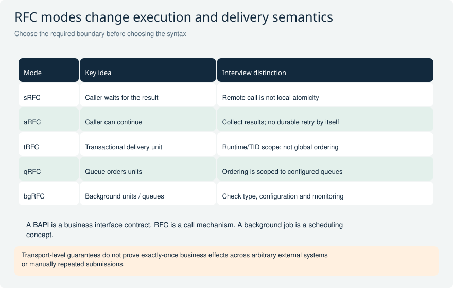

Compare the caller behavior and delivery unit, then name the monitoring and retry owner.

**Explain it:** Why does an asynchronous call not automatically become a durable queued transaction?

**Limit:** Classic terminology; API release, runtime availability and transaction rules must be checked for the target.

## RFC-04 When should BAPI_TRANSACTION_COMMIT or BAPI_TRANSACTION_ROLLBACK be called, and what does WAIT mean?

**Level:** Advanced

**Short answer:** The code that owns the BAPI transaction decides when to commit or roll back after checking the business results. For a remote BAPI, transaction control must reach the correct remote context. WAIT requests completion of high-priority updates; it does not wait for every later workflow or interface. I also check the specific BAPI's documented exceptions.

**Reasoning and example:** A client calls two BAPIs that are meant to form one transaction. It checks their relevant return messages and exceptions before asking the correct transaction context to commit. If the operation fails, it follows the documented rollback path. A local COMMIT WORK is not a way to commit an unrelated remote session.

After BAPI_TRANSACTION_COMMIT with WAIT, I check the commit result as well. Downstream messages, lower-priority work or workflows may still be pending. Some documented legacy BAPIs commit internally, so I verify the actual API behavior before combining calls. Inside RAP behavior code, inserting this commit function is not a permitted shortcut around framework transaction ownership.

**Avoid this mistake:** Check the BAPI's actual success rules and return messages. Local COMMIT WORK cannot commit an unrelated remote BAPI context.

**Read and verify this answer:**

- [SAP BAPI transaction model and documented exceptions](https://help.sap.com/SAPHELP_SCM700_EHP02/helpdata/EN/4d/5b102ba1483d8fe10000000a42189e/content.htm) - These are classic ABAP runtime rules unless the source specifically describes a cloud application job.

Visual: RFC modes and guarantee boundaries

Compare the caller behavior and delivery unit, then name the monitoring and retry owner.

**Explain it:** Why does an asynchronous call not automatically become a durable queued transaction?

**Limit:** Classic terminology; API release, runtime availability and transaction rules must be checked for the target.

## RFC-07 How do you prevent parallel RFC processing from exhausting resources?

**Level:** Advanced

**Short answer:** I limit how many tasks can run at once and give each task a useful-sized package. In classic ABAP, DESTINATION IN GROUP can use a configured RFC server group. Resource availability can change, so I handle RESOURCE_FAILURE and reduce or delay dispatch. I measure the result: more parallel tasks can increase waiting and make the job slower.

**Reasoning and example:** A report needs to process 100,000 independent records. Starting one task per record wastes resources. I choose packages large enough to justify call overhead, use the agreed RFC group and cap outstanding tasks. RZ12 defines the relevant groups in classic systems, and SPBT_INITIALIZE can help inspect currently available resources.

That resource count is only a snapshot, not a reservation. If dispatch fails because capacity disappeared, the coordinator must throttle or retry within a limit. I also measure locks and database load. A background coordinator may start aRFC workers in dialog work processes, so its own job type does not mean every worker uses a background process.

**Avoid this mistake:** A resource count is a snapshot, not a reservation; hard-coded maximum concurrency can overload the system or increase lock contention.

**Read and verify this answer:**

- [SAP parallel processing, callbacks, and resource groups](https://help.sap.com/docs/ABAP_PLATFORM_NEW/7bfe8cdcfbb040dcb6702dada8c3e2f0/4d909309eba36e73e10000000a15822b.html) - These are classic ABAP runtime rules unless the source specifically describes a cloud application job.

Visual: Parallel processing inside a job

A coordinator schedules bounded independent work and collects explicit outcomes; a scheduler does not create parallelism automatically.

**Explain it:** If worker B fails after A commits, what is safe to retry?

**Limit:** Conceptual fan-out/fan-in. Worker session and transaction boundaries require explicit design.

## RFC-10 How do you schedule and troubleshoot a classic background job?

**Level:** Core

**Short answer:** In a classic system, I schedule job steps, variants, user and start conditions, commonly in SM36. In SM37, I inspect status, job log, steps and spool. I then follow application errors or dumps. Before restarting a canceled job, I check what it already saved; cancellation does not undo earlier commits.

**Reasoning and example:** A nightly posting job is canceled halfway through its input. I inspect the job log and application records to find the last confirmed business results. The rerun must use a stable selection and avoid posting the completed records again. If the job is periodic, I also check whether the next run could overlap with recovery.

Job states such as scheduled, released, ready, active, finished and canceled describe execution progress. Finished only means the job completed technically; the report may still have rejected individual business records. I reconcile accepted and failed records and define who handles missed runs, authorization errors and unavailable external systems.

**Avoid this mistake:** SM37 Finished is not proof that every business record succeeded, and canceling a job does not reverse its earlier commits.

**Read and verify this answer:**

- [SAP classic background scheduling and monitoring](https://help.sap.com/saphelp_em700_ehp01/helpdata/en/48/baab96ca960611e10000000a42189b/content.htm) - These are classic ABAP runtime rules unless the source specifically describes a cloud application job.

Visual: Parallel processing inside a job

A coordinator schedules bounded independent work and collects explicit outcomes; a scheduler does not create parallelism automatically.

**Explain it:** If worker B fails after A commits, what is safe to retry?

**Limit:** Conceptual fan-out/fan-in. Worker session and transaction boundaries require explicit design.

## INTF-01 What does an IDoc contain, and how do message type, basic type, and extension differ?

**Level:** Core

**Short answer:** An IDoc has control data, business data in segments and a processing-status history. The message type says what business message it represents. The basic type defines the standard structure, and an extension adds supported customer segments. Sender and receiver must agree on these parts; adding a segment definition does not automatically fill or process its values.

**Reasoning and example:** An order message needs an extra customer reference. I check whether a supported IDoc extension is appropriate, then arrange for the sender to fill the new segment and the receiver to understand it. Middleware mappings may need an update too. Declaring the extension in configuration alone does not transfer the business value into the target order.

When diagnosing the message, the control record helps identify routing and structure, data records hold the actual values, and status records show processing progress. The technical IDoc number identifies that message. It is not automatically the number of the order created by the receiver, so I keep the business reference for correlation.

**Avoid this mistake:** Message type and basic type have different jobs. An IDoc number is also not automatically the target business document number.

**Read and verify this answer:**

- [SAP IDoc control record, message type, basic type, and extension](https://help.sap.com/saphelp_snc700_ehp01/helpdata/en/78/2177f051ce11d189570000e829fbbd/content.htm) - Check the interface configuration and the actual business result, not just its technical message status.

Visual: IDoc processing and AIF operations

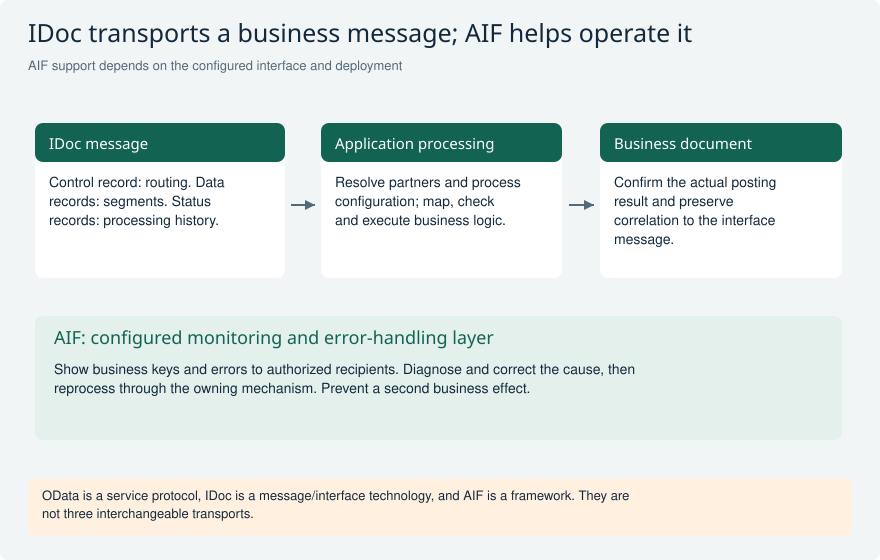

Follow the message to the business outcome. The AIF band represents supported configured capabilities, not an obligatory stage for every IDoc.

**Explain it:** Before restarting an error, how would you check whether a document already exists?

**Limit:** Do not infer end-to-end business success from a transport hand-off status or assume all interfaces use AIF.

## INTF-07 What is SAP Application Interface Framework, and what is it not?

**Level:** Core

**Short answer:** AIF helps teams process, monitor and recover interface messages with useful business context. Depending on configuration, it can provide mappings, checks and actions. It does not replace the underlying transport or automatically cover every interface. I verify the target product's supported features and usage rights before proposing a custom AIF solution.

**Reasoning and example:** A business operator needs to find failed messages by order number rather than decode a technical queue entry. A configured AIF interface can expose that business key, explain a mapping error and provide an authorized recovery path. The message may still travel through an underlying technology such as IDoc; AIF adds processing and operating support around the configured scenario.

Before designing custom interfaces, I confirm the current product scope and the customer's entitlement. SAP distinguishes full custom-interface use from limited runtime rights included in particular products. Seeing an AIF screen does not prove unrestricted custom-development rights or identical features in every cloud and on-premise edition.

**Avoid this mistake:** AIF does not replace the transport. Its presence does not prove unrestricted custom-use rights or the same features in every product.

**Read and verify this answer:**

- [SAP AIF monitoring and error handling](https://help.sap.com/docs/SAP_S4HANA_ON-PREMISE/19d48293097f4a2589433856b034dfa5/0e8f002ea0894c51bd957168699669c5.html) - Check the interface configuration and the actual business result, not just its technical message status.
- [SAP AIF licensing and limited runtime usage distinction](https://help.sap.com/docs/SAP_APPLICATION_INTERFACE_FRAMEWORK/2af43ee5f65347c0bedf7901497ad5d1/0742ccdcf7ca41919972b5349ce018fa.html) - Check the interface configuration and the actual business result, not just its technical message status.

Visual: IDoc processing and AIF operations

Follow the message to the business outcome. The AIF band represents supported configured capabilities, not an obligatory stage for every IDoc.

**Explain it:** Before restarting an error, how would you check whether a document already exists?

**Limit:** Do not infer end-to-end business success from a transport hand-off status or assume all interfaces use AIF.

## INTF-11 When would you use OData, IDoc, or AIF?

**Level:** Core

**Short answer:** OData provides HTTP-based queries and business operations. IDoc provides structured messages for established application-integration scenarios. AIF adds processing, monitoring and recovery around supported interfaces. They can work together because they solve different needs. I choose the available business contract and delivery behavior first, then decide how operators will monitor it.

**Reasoning and example:** A Fiori app needs to read the current status of one request, so a supported OData service can fit. An established partner already sends order messages through an IDoc scenario with asynchronous processing. Replacing that working contract just because OData sounds newer may add cost without improving the business process.

AIF may help operators investigate and recover those messages if the interface is configured for it. It is not a third wire protocol competing with HTTP or IDoc transport. OData also supports system integration, not only UI screens, and IDocs need not wait for batch-only dispatch. The required response timing and supported application interface drive the choice.

**Avoid this mistake:** AIF is not a third wire protocol, OData is not limited to UI use, and IDoc is not restricted to batch-only dispatch.

**Read and verify this answer:**

- [SAP AIF monitoring and error handling](https://help.sap.com/docs/SAP_S4HANA_ON-PREMISE/19d48293097f4a2589433856b034dfa5/0e8f002ea0894c51bd957168699669c5.html) - Check the interface configuration and the actual business result, not just its technical message status.

Visual: IDoc processing and AIF operations

Follow the message to the business outcome. The AIF band represents supported configured capabilities, not an obligatory stage for every IDoc.

**Explain it:** Before restarting an error, how would you check whether a document already exists?

**Limit:** Do not infer end-to-end business success from a transport hand-off status or assume all interfaces use AIF.

## BASE-01 What changes when a method receives a CHANGING parameter by value instead of by reference?

**Level:** Senior

**Short answer:** By reference, the method works on the caller's data directly. With VALUE on a CHANGING parameter, it works on a local value and copies it back when the method finishes normally. If an exception leaves the method, that normal copy-back does not happen. This can protect the caller's value, but it does not roll back database writes or changes to shared objects.

**Reasoning and example:** Start with a plain integer containing 10. A method changes its CHANGING parameter to 20 and then raises an exception that leaves the method. With reference passing, the caller can already see 20. With value passing, the caller retains 10 because the local result was not copied back. On normal completion, both forms can return the changed value.

That difference is important when changing an existing method signature. Tests must cover both successful completion and escaping exceptions. If the value contains an object reference, changing the referenced object is a separate effect: the copy still points to that object. VALUE is not a general undo mechanism for everything the method does.

**Avoid this mistake:** Pass-by-value is not a transaction rollback and does not clone objects behind reference parameters.

**Interviewer follow-ups:**

- How would this change with an object reference parameter?
- Can an IMPORTING reference variable still expose a mutable object?

**Strong answer criteria:**

- Separates input/output direction from value/reference passing
- Explains when a local value is copied back
- Identifies effects on the database and shared objects

**Verification evidence:** A small method-call test showing caller values after normal return and exception.

**Read and verify this answer:**

- [SAP: Pass by value](https://help.sap.com/docs/abap-cloud/abap-keyword/pass-by-value) - Formal parameters are local copies; parameter direction controls transfer.

Visual: Parameter values after exceptional exit

Compare the same assignment under two transfer modes. The final caller value is visible evidence of the difference.

**Explain it:** Which result changes if the method returns normally? What changes if the parameter holds an object reference?

**Limit:** This assumes a plain integer, value-result passing, and no additional side effects.

## BASE-04 A dynamic ASSIGN fails, but IS ASSIGNED is still true. How can the program update the wrong field?

**Level:** Advanced

**Short answer:** The field symbol may still point to the previous successful target after a failed dynamic ASSIGN. IS ASSIGNED only says it points somewhere; it does not prove the latest lookup worked. I check the ASSIGN result immediately. Where supported, ELSE UNASSIGN makes failure clear. Otherwise I unassign before the lookup and handle failure before writing through the field symbol.

**Reasoning and example:** A generic mapper first assigns component PRICE and writes an amount. It then tries the misspelled component PRCIE using the same field symbol. If that lookup fails but the old assignment remains, checking only IS ASSIGNED can allow the next write to change PRICE again. The program has updated a real field, but the wrong one.

I test the sequence of one successful lookup followed by one failed lookup. An isolated failure test can miss the stale assignment. The mapper should reject the unknown component or follow a clearly defined skip rule, and it must not write through the old alias. I verify release support before using ELSE UNASSIGN syntax.

**Avoid this mistake:** An assigned field symbol is not evidence that the most recent dynamic ASSIGN succeeded.

**Read and verify this answer:**

- [SAP: ASSIGN, ELSE UNASSIGN](https://help.sap.com/docs/abap-cloud/abap-keyword/assign-else-unassign) - Failed assignments may preserve an earlier alias unless explicitly unassigned.

Visual: Stale aliases and overwritten return codes

The first sequence can write to the previous target. The second takes a success branch for a different operation than the programmer intended.

**Explain it:** Which test requires a successful operation before the failure to expose the defect?

**Limit:** Only statements documented to set sy-subrc replace it. Assignment failure behavior depends on the exact form and additions.

## BASE-06 An import must reject precision loss rather than silently round or truncate. Where does EXACT help?

**Level:** Advanced

**Short answer:** EXACT checks that an assignment or calculation can produce its target value without losing information. It raises an appropriate exception when that is impossible. CONV uses normal conversion rules and is not the same check. I catch conversion failures at the input boundary and explain them to the caller. I still validate business rules, because an exact value can still be forbidden.

**Reasoning and example:** An import receives a text value longer than the fixed-length target field. A normal conversion may discard characters, while a lossless conversion can reject that input. For a packed result with two decimals, a calculation such as one divided by three cannot be represented exactly, so EXACT is useful if rounding is prohibited.

If the business actually requires rounding, I apply the agreed rounding rule explicitly instead of treating every inexact result as invalid. I also check rules such as a positive amount, a known currency or an allowed identifier. EXACT can detect loss of technical information; it cannot decide whether a perfectly representable negative amount is acceptable for this document.

**Avoid this mistake:** EXACT does not prove that a technically representable value is an allowed business value.

**Read and verify this answer:**

- [SAP: EXACT examples](https://github.com/SAP-samples/abap-cheat-sheets/blob/main/05_Constructor_Expressions.md#exact) - Official executable illustrations of lossless assignments and calculations.

Visual: Conversion, rounding, and reduction counterexamples

A lost character, a one-cent difference, and a false maximum reveal three unrelated errors that concise syntax can hide.

**Explain it:** Which expected results change with a different rounding mode, and which are independent of rounding?

**Limit:** Half-up and two decimals are explicit exercise assumptions, not a universal currency rule. MAX notation is explanatory.

## BASE-12 A report accepts a filter value and a sort-column name. Is escaping quotes sufficient for safe SQL?

**Level:** Senior

**Short answer:** No. A filter value and a column name are different kinds of input. I pass values through host variables in static ABAP SQL where possible. For a configurable column or dynamic clause, I map approved choices to known SQL elements and reject anything else. Escaping quotes in a value does not make arbitrary SQL text safe or authorized.

**Reasoning and example:** A customer name containing an apostrophe should be treated as a value, not assembled into executable SQL text. A requested sort option is different: I map an accepted choice such as newest to a known timestamp column and direction. I do not accept any string and insert it as ORDER BY syntax.

Mandatory authorization restrictions are built separately from optional user filters. The user must not be able to remove them by changing a filter or sort parameter. I test unknown columns, invalid directions and inputs containing SQL-like text, as well as ordinary names. Safe quoting protects one kind of value; it does not approve table names, operators, whole conditions or access to restricted data.

**Avoid this mistake:** Input that is safely quoted as a literal is not therefore safe as SQL syntax or an authorized data access.

**Interviewer follow-ups:**

- How would you test an input that is valid syntax but unauthorized?
- Which parts of the SQL shape can remain completely static?

**Strong answer criteria:**

- Separates data values from SQL names and syntax
- Maps choices to explicitly allowed SQL elements
- Keeps mandatory authorization conditions in place

**Verification evidence:** Negative tests for quoted values, forbidden columns, injected operators, and unauthorized records.

**Read and verify this answer:**

- [SAP: Prevent SQL injection](https://help.sap.com/docs/SAP_S4HANA_ON-PREMISE/86dbe289f813483abd78de6a52458bff/36e78557e0f6a96be10000000a4450e5.html) - Prefer static SQL; validate and escape dynamic content using supported facilities.

Visual: Two input kinds and two safe handling paths

The apostrophe is intentionally harmless data on the left. The sort request on the right selects a predefined identifier rather than supplying executable SQL.

**Explain it:** Why would quoting the sort option as a literal fail to solve identifier validation?

**Limit:** Conceptual SQL boundary; available dynamic-programming helpers and API release status depend on the target environment.

## BASE-16 An authorization helper returns an empty range table. Why is WHERE field IN range unsafe as the only access restriction?

**Level:** Senior

**Short answer:** An empty ABAP selection range means no restriction for IN. It does not mean the user is allowed no values. If an authorization lookup returns no allowed plants, I return no data or reject the request before querying. I keep mandatory access restrictions separate from optional user filters. Nonempty ranges also have inclusion and exclusion rules, not just list membership.

**Reasoning and example:** A user has no permission for any plant. The helper returns an empty range, and a query uses WHERE plant IN that range as its only access check. The initial range does not narrow the selection, so the query can expose records the user should never see. The program must handle the no-permission result explicitly first.

I test a user with no allowed plants, one allowed plant and relevant exclusions. I also test that adding or omitting a user search filter cannot remove the mandatory restriction. An empty optional filter may correctly mean show all permitted data; an empty authorization result means no permitted data. They must not share an ambiguous representation without an explicit check.

**Avoid this mistake:** An empty ABAP selection range is not the same as an SQL list containing zero allowed values.

**Interviewer follow-ups:**

- How do you distinguish an optional filter from mandatory authorization?
- What result do you expect from a range containing only exclusions?

**Strong answer criteria:**

- Explains why an empty range does not restrict IN
- Returns no data when there are no permissions
- Separates optional search filters from required access checks

**Verification evidence:** A denied-user test proves zero data and zero aggregate leakage with an empty authorization result.

**Read and verify this answer:**

- [SAP: Comparison with selection tables](https://help.sap.com/doc/abapdocu_latest_index_htm/latest/en-US/ABENLOGEXP_SELECT_OPTION.html) - Defines inclusion/exclusion semantics and the initial selection-table case.

Visual: Duplicate insertion and empty authorization boundaries

A duplicate unique key preserves the original row for the specified insertion form. An initial selection range has a very different meaning from an empty list of permissions.

**Explain it:** How would you distinguish identical duplicates from conflicting ones, and prove a user with no plants sees nothing?

**Limit:** Single-line INSERT INTO TABLE with a unique primary key; other insertion and key-conflict forms need their own documented handling.

## OODEEP-01 A method named reserve returns a reservation ID. Which promises must be explicit beyond its parameter types?

**Level:** Senior

**Short answer:** I explain what inputs are accepted, what success means and what can change before a failure. The caller also needs to know whether the reservation is already saved, whether repeating the call is safe and who commits. Parameter types cannot answer those questions. I document these rules and test them so another implementation cannot quietly change the caller's expectations.

**Reasoning and example:** A caller needs to reserve two items together. The first implementation returns an ID but leaves saving to the caller. A replacement implementation returns an ID and commits immediately. Both can have the same ABAP signature, yet the second leaves the first reservation saved if reserving the second item fails.

I therefore state whether reserve only prepares the change or makes it permanent. I also define repeated calls, invalid inputs and error results in ABAP Doc or the relevant API documentation. Tests include failure on the second item and inspect the first item afterward. Returning an ID is useful, but it is not proof that a save has happened or that rollback remains possible.

**Avoid this mistake:** RETURNING an identifier does not itself promise committed persistence, and a method name cannot replace a transaction contract.

**Interviewer follow-ups:**

- What state is allowed after reserve raises an exception?
- What is the result when the same business request is retried?

**Strong answer criteria:**

- Defines the state after success and failure
- States who commits
- Defines what repeated calls do

**Verification evidence:** Contract tests plus documentation covering buffered success, persistence boundary, and repeated requests.

**Read and verify this answer:**

- [SAP Learning: Documenting ABAP code](https://learning.sap.com/courses/deepening-your-abap-programming-knowledge/documenting-abap-code_ad565c7e-6ac5-4a49-95e2-e4c33268dac6) - ABAP Doc documents methods, parameters, and exceptions; the scenario applies this to behavioral contracts.

Visual: A concrete counterexample to substitutability

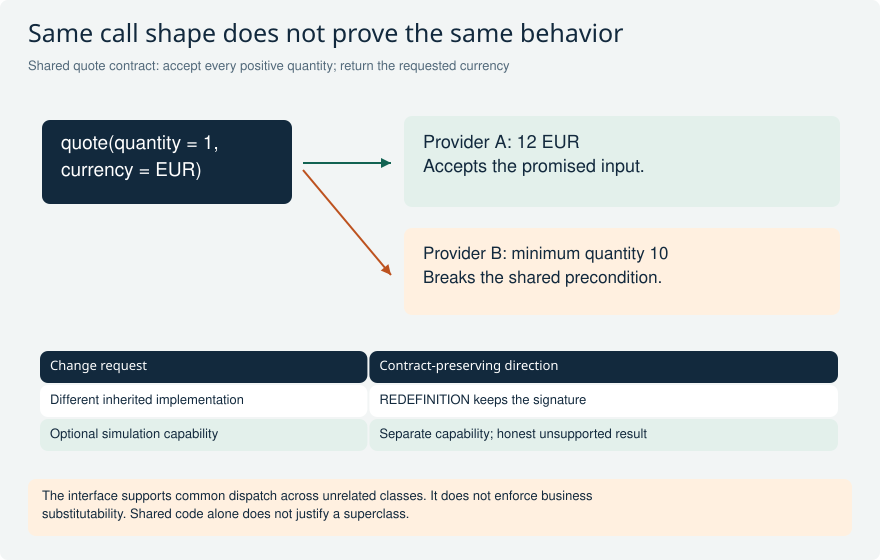

A valid quantity-one call exposes a behavioral violation invisible in matching parameter types. The lower table separates redefinition from a genuinely new capability.

**Explain it:** Would downcasting every caller to Provider B repair the contract? What else besides accepted inputs must agree?

**Limit:** Hypothetical contract; a narrower published domain would lead to a different assessment. No executable interface is implied.

## OODEEP-09 A repository raises a low-level exception. Should a business service catch CX_ROOT and return an empty result?

**Level:** Senior

**Short answer:** Usually no. Returning an empty result can make a technical failure look like a valid not-found result. I catch the failure where I can recover or turn it into a meaningful service error. If I wrap the exception, I keep PREVIOUS so the original cause remains available. Missing data, a rejected business request and an unavailable dependency should remain distinguishable.

**Reasoning and example:** A pricing repository cannot be reached. If the service catches CX_ROOT and returns an empty price, the caller might assume no price exists and apply a default such as zero. A network problem has now become an apparently valid business result, which is more dangerous than a clear error.

I define separate handling for a confirmed missing price and a failed attempt to read the price. The service can expose a useful unavailable message while preserving the low-level cause for diagnosis. Tests simulate both cases and verify that neither accidentally produces a successful free item. A broad catch can be appropriate at a final error-handling point, but not as permission to invent success data.

**Avoid this mistake:** Broad catch-and-default handling is not resilience when it changes an unknown outcome into valid-looking data.

**Interviewer follow-ups:**

- When is catching CX_ROOT justified at an application boundary?
- What information belongs in user feedback versus technical diagnostics?

**Strong answer criteria:**

- Keeps missing data different from a failed read
- Converts errors into useful service-level meaning
- Retains the original exception cause

**Verification evidence:** Tests assert distinct not-found and technical-failure paths, including the previous exception chain.

**Read and verify this answer:**

- [SAP Learning: Working with exception classes](https://learning.sap.com/courses/deepening-your-abap-programming-knowledge/working-with-exception-classes_acd9568c-be4e-445a-a454-14c6f2cfcd2e) - Exception propagation and previous preserve a technical cause during translation.

Visual: Exceptional exits and preserved causes

The table names three exit paths that require separate reasoning. The exception chain carries the lower-level diagnosis through a meaningful service-level failure.

**Explain it:** Which path would a test of only propagated exceptions miss?

**Limit:** Simplified non-resumable scenarios; exact nesting and handlers determine CLEANUP execution. Resource ownership remains application-specific.

## PAT-01 Approval rules vary by country, while the application workflow should remain stable. Strategy or Template Method?

**Level:** Senior

**Short answer:** I would use Strategy for country-specific approval rules. The coordinator keeps the workflow, and the selected strategy returns the rule decision. Template Method fits a shared sequence where subclasses intentionally fill in a few fixed steps. Here the rule can vary without changing the coordinator class. I would only choose inheritance if the shared sequence and permitted overrides are clear requirements.

**Reasoning and example:** The application receives an order and selects the country rule. Each rule receives the required order data and returns a decision, such as the required approver. It should not secretly commit, send email or change global data. The coordinator stays responsible for applying the decision and continuing the workflow.

I test that coordinator with several rules and verify the same success and failure expectations. If countries later need different process sequences, I review the workflow itself instead of adding increasingly powerful subclass hooks. Strategy works best when the changing part is a replaceable rule. Template Method works when a stable base algorithm deliberately controls which steps subclasses may customize.

**Avoid this mistake:** Choosing inheritance solely to share code, or allowing a rule implementation to take over transaction ownership.

**Interviewer follow-ups:**

- Which variation changes at runtime rather than through subclassing?
- How would you prevent a new rule from changing the workflow's transaction boundary?

**Strong answer criteria:**

- Separates country rules from workflow coordination
- Explains why composition or inheritance fits this case
- Keeps rules replaceable and separately testable

**Verification evidence:** Run identical coordinator contract tests with two country rules and a test double; assert decision and side-effect boundaries.

**Read and verify this answer:**

- [SAP ABAP pattern examples: Strategy](https://github.com/SAP-samples/abap-cheat-sheets/blob/main/34_OO_Design_Patterns.md#strategy) - Primary SAP demonstration of the mechanism; the interview scenario and trade-off analysis here are original. Examples require target-release review and are not production templates.
- [SAP ABAP pattern examples: Template Method](https://github.com/SAP-samples/abap-cheat-sheets/blob/main/34_OO_Design_Patterns.md#template-method) - Primary SAP demonstration of the mechanism; the interview scenario and trade-off analysis here are original. Examples require target-release review and are not production templates.

Visual: Strategy versus Template Method in approval rules

The same 700 EUR request receives different policy decisions through the same Strategy contract. Template Method instead fixes a call skeleton and exposes deliberate subclass steps.

**Explain it:** Which part varies, who selects it, and which object keeps transaction ownership?

**Limit:** Conceptual pattern comparison, not executable ABAP or a universal approval rule. Framework-owned construction may require a supported delegation seam.

## PAT-03 A legacy posting API has awkward parameters and a three-step prepare/check/post sequence. Would you build an Adapter, a Facade, or both?

**Level:** Senior

**Short answer:** An Adapter can translate the application request and errors into the legacy API format. A Facade can offer one posting operation over prepare, check and post. Both may be useful, but they must preserve failures, authorization and commit rules. I inspect the actual underlying calls. Neither wrapper makes an unreleased API available to ABAP Cloud or removes an internal commit.

**Reasoning and example:** The application sends a simple posting request. An adapter maps it into the required function-module structures and converts responses into meaningful results. A facade coordinates prepare, check and post, and stops before posting when the check fails. I test mapping separately from that sequence so errors are easy to locate.

Important cases include an explicit zero amount, a warning that must be handled according to the API rules and a remote timeout with an unknown outcome. A timeout is not always proof that nothing was posted. The caller needs enough information to reconcile rather than repeat the operation blindly. The wrapper must expose those facts instead of making the API look safer than it is.

**Avoid this mistake:** Treating any wrapper as both a supported API and a transaction adapter without inspecting its dependencies.

**Interviewer follow-ups:**

- Which errors belong to the domain contract and which retain technical detail?
- What evidence would make the legacy API unsuitable despite a neat interface?

**Strong answer criteria:**

- Separates field/error translation from coordinating several calls
- Preserves commit rules and API release restrictions
- Tests important values and error mapping

**Verification evidence:** Trace all three steps with injected failures and inspect dependency release state; assert no hidden commit or swallowed business rejection.

**Read and verify this answer:**

- [SAP ABAP pattern examples: Adapter](https://github.com/SAP-samples/abap-cheat-sheets/blob/main/34_OO_Design_Patterns.md#adapter) - Primary SAP demonstration of the mechanism; the interview scenario and trade-off analysis here are original. Examples require target-release review and are not production templates.
- [SAP ABAP pattern examples: Facade](https://github.com/SAP-samples/abap-cheat-sheets/blob/main/34_OO_Design_Patterns.md#facade) - Primary SAP demonstration of the mechanism; the interview scenario and trade-off analysis here are original. Examples require target-release review and are not production templates.

Visual: Adapter, Facade and Decorator with observable outcomes

Mapping, orchestration and added behavior are different responsibilities. The lower example shows why wrapper order changes whether a log records one logical call or two attempts.

**Explain it:** Where would you translate an explicit clear, stop after a failed check, and record retry attempts?

**Limit:** The retry example is deliberately an eligible read. Write retries need the actual idempotency and uncertainty contract; no pattern automatically supplies it.

## PAT-08 A repository interface improves testability, but its RAP implementation reads managed persistence directly. What can go wrong?

**Level:** Senior

**Short answer:** A testable interface can still hide an incorrect implementation. Direct table reads can miss changes waiting in the RAP transaction buffer. I first define whether the repository should read saved data or the current transaction state. For BO logic that needs current changes, I use suitable EML access. I do not write managed tables directly and bypass the RAP behavior checks.

**Reasoning and example:** A validation changes an item and then reads it through a repository before save. If the repository selects the database table, it can return the old value even though the current RAP transaction already contains the new one. Newly created or deleted instances make the difference even more obvious.

A reporting read of persisted data may legitimately use a different approach. I give those needs distinct names or responsibilities so callers understand which state they receive. Tests should cover update-then-read, create-then-read and delete-then-read before save using the real BO path. A convenient fake returning expected rows will not reveal a production implementation that reads the wrong state, and a second home-made buffer adds more consistency problems.

**Avoid this mistake:** Equating a mockable interface with correct behavior or recreating RAP's transactional buffer in a second general-purpose cache.

**Interviewer follow-ups:**

- Which caller actually needs persisted rather than buffered state?
- What integration test would fail if the repository used SELECT instead of EML?

**Strong answer criteria:**

- States whether a read returns saved or current buffered data
- Respects RAP save ownership and pending changes
- Tests the interface and the real BO integration

**Verification evidence:** Compare unsaved create/update/delete reads through the adapter with the BO contract, then run rollback and save paths on the target system.

**Read and verify this answer:**

- [SAP ABAP pattern examples: data-access isolation examples](https://github.com/SAP-samples/abap-cheat-sheets/blob/main/34_OO_Design_Patterns.md#data-access-object-dao) - Primary SAP demonstration of the mechanism; the interview scenario and trade-off analysis here are original. Examples require target-release review and are not production templates.
- [SAP RAP implementation contract](https://help.sap.com/docs/abap-cloud/abap-rap/general-rap-bo-implementation-contract) - Defines transaction rules; Repository is a scenario abstraction, not a claim that SAP requires this pattern.

Visual: Repository read semantics and proportional abstraction

A direct persistence read returns 100 while the transaction already sees 120. The repository seam is valuable only if its real implementation honors the state contract required by the caller.

**Explain it:** Which integration test catches a mockable repository that reads the wrong state, and when is no new abstraction needed?

**Limit:** Conceptual read semantics rather than an SQL isolation guarantee. The specific BO, EML operation, authorization and target release remain authoritative.

## PAT-09 A singleton caches the current approver and makes tests pass alone but fail as a suite. How do you redesign its lifetime?

**Level:** Senior

**Short answer:** I would remove the current approver from long-lived shared mutable state. I would pass the relevant context explicitly and use an operation-scoped service, or a cache with clear keys and refresh rules. An ABAP singleton normally belongs to an internal session, not the whole system. Its lifetime can still span several operations or tests. Forcing test order does not fix that design.

**Reasoning and example:** One test asks for an approver for company A and populates the singleton. A later test for company B reuses the cached value and gets the wrong approver. Similar trouble can occur when a job processes several contexts. The cache stored current approver without saying current for which request or policy.

I make that context explicit in the operation and, if caching is needed, include every relevant distinction in its key and invalidation rules. Tests get controlled service instances. A reset method may temporarily isolate legacy tests, but production must still have the correct lifetime. Clearing a cache between tests cannot repair an application that mixes request-specific decisions during normal use.

**Avoid this mistake:** Claiming singleton means one system-wide instance or solving hidden state solely by forcing test order.

**Interviewer follow-ups:**

- What exact lifetime is required by the cached value?
- How would two simulated users in one test expose the defect?

**Strong answer criteria:**

- States the actual singleton lifetime
- Passes request-specific context explicitly
- Separates isolated tests from a correct production cache

**Verification evidence:** Run tests in multiple orders and reuse one session across different users or contexts; assert no stale decisions and deterministic dependency replacement.

**Read and verify this answer:**

- [SAP ABAP pattern examples: Singleton](https://github.com/SAP-samples/abap-cheat-sheets/blob/main/34_OO_Design_Patterns.md#singleton) - Primary SAP demonstration of the mechanism; the interview scenario and trade-off analysis here are original. Examples require target-release review and are not production templates.
- [SAP Clean ABAP: state lifetime](https://github.com/SAP/styleguides/blob/main/clean-abap/CleanABAP.md#dont-mix-stateful-and-stateless-in-the-same-class) - Supports the stated design or testability principle; concrete scenario decisions are contextual recommendations.

Visual: Observer delivery and hidden singleton state

A registered local handler can update an ALV, while an external process needs transactional publication and durable processing evidence. Session-shared mutable state is a separate source of repeated-test failures.

**Explain it:** Which facts survive a process restart, and which request-specific values must not be cached implicitly?

**Limit:** The lower path describes required responsibilities, not an automatic feature of ABAP Objects events. Verify the chosen event infrastructure and service lifetime.

## SQLX-01 A CDS table function joins client-dependent purchasing data in SQLScript, writes a helper table, and assumes the outer CDS DCL protects every internal read. Would you approve it?

**Level:** Senior

**Short answer:** No. A CDS table function's AMDP database function must be read-only under its documented rules. I remove the write and check every source and join for correct client handling. Business authorization is a separate check: an outer CDS rule does not automatically protect every internal SQLScript read. I also verify target support and allowed dependencies.

**Reasoning and example:** Two clients contain purchase order 4711. If a SQLScript join matches only the order number, it can combine records from both clients and produce the wrong total or expose data. Filtering the final rows may not undo a total already contaminated by that join. I check client handling in the actual sources and joins, then test overlapping keys.

I separately test users with different purchasing permissions through the real supported read path. SQLScript does not automatically reproduce ABAP SQL or CDS access checks. I also review return types, intended rows and USING dependencies. If supported CDS or ABAP SQL already solves the task, it may be simpler. General AMDP capabilities are broader than this read-only table-function case.

**Avoid this mistake:** The read-only rule here applies to the CDS table function, not every AMDP method. It also does not grant permission to read any SAP table.

**Interviewer follow-ups:**

- How can joining data from two clients produce a wrong total even if final rows are filtered?
- Which tests prove both client separation and the user's purchasing permissions?

**Strong answer criteria:**

- Distinguishes CDS table-function rules from general AMDP capabilities
- Checks client separation and user permissions independently
- Verifies target support, sources and returned results

**Verification evidence:** Activate on the target release and inspect the real read path. Test overlapping keys across clients and users with allowed and denied purchasing access.

**Read and verify this answer:**

- [SAP CDS table functions: SQLScript, read-only and client safety](https://help.sap.com/docs/ABAP_PLATFORM_NEW/67e4075c942e43d4a9f6f891a8dafcf4/ed4c5fc6d3fd43ebb355f12aa1e73757.html) - This source was reviewed for 2025 FPS01. Verify the same feature and rules in your actual target release.
- [SAP ABAP data models and access-control concepts](https://help.sap.com/docs/abap-cloud/abap-data-models/learn) - Explains CDS models and authorization separately. The example tests across clients and user permissions are original study guidance.

Visual: HANA pushdown: result grain and table-function review

A two-language text join duplicates both item amounts. Repair the relationship before accepting a performance rewrite, then verify security, client isolation and the chosen implementation contract.

**Explain it:** Why would DISTINCT or dividing by two be an unreliable repair, and what metrics would justify pushdown?

**Limit:** Illustrative data, not a benchmark. Read-only here refers to the cited CDS table-function scenario, not every AMDP method; check target rules and consumption-path security.

## DELIV-01 A pull request passes local linting and its ABAP sources are pushed with abapGit. The team calls the cloud feature deployed. What evidence and delivery steps are missing?

**Level:** Senior

**Short answer:** Git stores source history, and abapGit transfers supported development objects. Neither proves that the feature is deployed and usable. I choose the delivery route supported by the actual ABAP product, then verify the target version, activation, tests and configuration. A real service check must show that the intended user can work and a denied user cannot.

**Reasoning and example:** A pull request passes local lint, but the target system may still reject an object during activation or lack a required dependency. I link the source revision to the component versions, delivery identifiers and target import evidence. For BTP ABAP environment, supported transport/gCTS or add-on scenarios may apply; other ABAP Cloud products have their own delivery routes.

The target checks include syntax, activation, ATC, meaningful ABAP Unit tests and relevant integration tests. I also verify service access, communication setup and recovery ownership. Local lint is not SAP activation, and mocks do not prove real permissions. Technical identities and secrets stay out of Git. A source export alone is not a complete application deployment.

**Avoid this mistake:** An abapGit push is not a transport release, and gCTS is not another name for abapGit. Delivery routes differ across ABAP Cloud products.

**Interviewer follow-ups:**

- How do you prove the target received the same source revision that was tested?
- Which missing configuration can break an active service after a successful import?

**Strong answer criteria:**

- Separates Git history, source transfer and deployment
- Chooses the delivery route for the actual product
- Requires target-system results and working configuration

**Verification evidence:** Record the commit, component and dependency versions, and delivery IDs. Keep target activation, ATC, test and import logs plus real allowed-user and denied-user service checks.

**Read and verify this answer:**

- [SAP: working with abapGit](https://help.sap.com/docs/btp/sap-business-technology-platform/working-with-abapgit?ai=true) - Explains source transfer, supported object types and activation after import. Transferring source alone does not prove deployment.
- [SAP BTP ABAP environment: delivery via add-on or gCTS](https://help.sap.com/docs/sap-btp-abap-environment/abap-environment/delivery-via-add-on-or-gcts?locale=en-US) - Explains these BTP ABAP environment delivery options and checks. Other ABAP Cloud products may use different routes.

Visual: Source transfer, delivery and verified runtime evidence

Four evidence layers answer different questions. A release links the reviewed and tested revision to an actual imported state, then verifies the target consumer and configuration.

**Explain it:** Which artifact proves what was imported, and what can fail after a successful import?

**Limit:** REV-42, D-17 and TST are fictional identifiers. The table is an evidence checklist, not a mandatory sequence requiring abapGit in every transport landscape.

