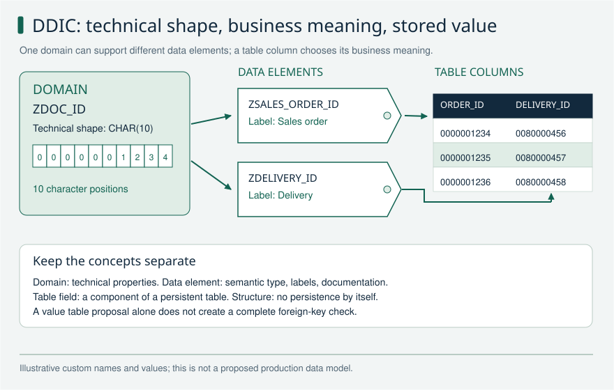

# ABAP foundations

Practice explaining data structures and transactional correctness before discussing frameworks. These answers distinguish internal memory, database persistence, and application locks. Classic update-task examples apply to supported Standard ABAP environments; ABAP Cloud and RAP impose additional API and transaction restrictions.

[Return to the study guide](../README.md) | [Study plan](../study/Study_Plan.md)

## ABAP-01 How do you choose between standard, sorted, and hashed internal tables?

**Level:** Core

**Short answer:** I choose the table by how I will read it. A standard table is useful for processing rows in sequence or by position. A sorted table keeps rows in key order and helps with key ranges. A hashed table is useful for finding one row by its complete unique key. I also consider how often rows change and how much memory the table needs.

**Reasoning and example:** Imagine importing orders from a file. If I must report errors in file order, I can keep the rows in a standard table. If I repeatedly find one order by its unique ID, a hashed lookup table can avoid searching every row. If I process all orders for one customer together, a sorted key starting with customer is useful.

The important question is which lookup the program actually performs. Searching a hashed table by a different field does not receive the same benefit as using its complete hash key. I test realistic volumes and include the cost of inserting and changing rows, not only reading them.

**Avoid this mistake:** A hashed primary key is unique; that does not mean every field value must be unique or that arbitrary partial-key searches are constant time.

**Read and verify this answer:**

- [SAP internal table reference and examples](https://github.com/SAP-samples/abap-cheat-sheets/blob/main/01_Internal_Tables.md) - Check how the language feature behaves. A classic example does not prove that its APIs are allowed in ABAP Cloud.

Visual: Internal table lookup

A free-key linear search, an ordered lookup, and a complete hashed-key lookup find the same record through different access paths.

**Explain it:** What changes if I need all rows in a key range, or preserve input order?

**Limit:** A standard table can use secondary keys; a hash lookup requires a suitable complete key. Hash storage and probe order are schematic, not SAP implementation guarantees.

## ABAP-02 What are primary, secondary, default, and empty internal table keys?

**Level:** Core

**Short answer:** The primary key is the main key in the table definition. A secondary key gives another way to find or order its rows. A default key is chosen from the row type, so it may leave out fields I need. An empty key says that I do not need a primary field-based key for this standard table. Secondary keys cost memory and extra work when data changes.

**Reasoning and example:** An import table may need to keep file order while also supporting repeated lookups by customer. I can use a standard table with an empty primary key and a sorted secondary key for customer. The rows still have positions in the standard table; an empty key does not remove that index.

When reading by customer, I select the intended secondary key explicitly where required. I check whether faster reads justify maintaining another key during imports and changes. This key belongs to the internal table in ABAP memory. It does not create a database index or make a database query faster.

DELETE ADJACENT DUPLICATES removes only neighboring matches. First SORT by the intended duplicate criteria and any rule for which row to retain, then specify those criteria explicitly with COMPARING. For example, sorting by customer and changed_at descending before COMPARING customer keeps the newest row per customer, provided ties have a defined rule. This deliberately changes the original order.

**Avoid this mistake:** An internal table key is not a database index, and an empty key does not remove the standard table's index.

**Read and verify this answer:**

- [SAP internal table reference and examples](https://github.com/SAP-samples/abap-cheat-sheets/blob/main/01_Internal_Tables.md) - Check how the language feature behaves. A classic example does not prove that its APIs are allowed in ABAP Cloud.

Visual: Internal table lookup

A free-key linear search, an ordered lookup, and a complete hashed-key lookup find the same record through different access paths.

**Explain it:** What changes if I need all rows in a key range, or preserve input order?

**Limit:** A standard table can use secondary keys; a hash lookup requires a suitable complete key. Hash storage and probe order are schematic, not SAP implementation guarantees.

## ABAP-03 When is BINARY SEARCH correct, and how do table expressions handle missing rows?

**Level:** Core

**Short answer:** BINARY SEARCH works only when a standard table is sorted in ascending order that matches the search fields. Otherwise it can miss an existing row. A normal table expression raises CX_SY_ITAB_LINE_NOT_FOUND when no row matches. I decide whether a missing row is expected and handle it accordingly. For an existence check only, I can use line_exists.

**Reasoning and example:** Suppose I sort orders by customer and order ID. A binary search must use fields in an order compatible with that sort. Sorting by order ID alone and then searching by customer is not safe. A sorted table can make the intended order harder to break accidentally.

For an optional description, VALUE with OPTIONAL can return an initial value when the row is missing. For a required order, that would hide an error, so I report the missing order instead. When I need the row itself, I normally do one lookup and handle its outcome rather than check existence and repeat the same lookup. line_exists does not set sy-subrc or sy-tabix. Use its boolean result directly; do not inspect those system fields as if READ TABLE had run.

**Avoid this mistake:** Adding BINARY SEARCH to an unsorted table can return incorrect results; modern table-expression syntax does not automatically optimize an unsuitable key.

**Read and verify this answer:**

- [SAP internal table reference and examples](https://github.com/SAP-samples/abap-cheat-sheets/blob/main/01_Internal_Tables.md) - Check how the language feature behaves. A classic example does not prove that its APIs are allowed in ABAP Cloud.

Visual: Internal table lookup

A free-key linear search, an ordered lookup, and a complete hashed-key lookup find the same record through different access paths.

**Explain it:** What changes if I need all rows in a key range, or preserve input order?

**Limit:** A standard table can use secondary keys; a hash lookup requires a suitable complete key. Hash storage and probe order are schematic, not SAP implementation guarantees.

## ABAP-04 How do a work area, field symbol, and data reference differ?

**Level:** Core

**Short answer:** INTO copies a table row into a work area. Changing that work area alone does not change the table row. ASSIGNING gives a field symbol that points at the row, so changes go straight to it. A data reference stores a reference to a data object that I access explicitly. I check that a field symbol is assigned or a reference is bound before using it.

**Reasoning and example:** To mark imported orders as checked, I can loop over lt_orders ASSIGNING <ls_order> and change a non-key status field. The change is immediately visible in the internal table. With INTO ls_order, I only change the work area and need a separate table update if that is intended.

I choose the form that makes ownership clear. Copying a row is useful when I need to calculate without changing it yet. Direct access is useful for deliberate updates. I must still respect key restrictions: changing a protected key field through a field symbol can cause an error rather than safely reorganize the table.

**Avoid this mistake:** Do not change protected table-key components through an alias; key restrictions depend on table category and the access in progress.

**Read and verify this answer:**

- [SAP internal table reference and examples](https://github.com/SAP-samples/abap-cheat-sheets/blob/main/01_Internal_Tables.md) - Check how the language feature behaves. A classic example does not prove that its APIs are allowed in ABAP Cloud.
- [SAP ABAP Keyword Documentation](https://help.sap.com/doc/abapdocu_latest_index_htm/latest/en-US/index.htm) - Check how the language feature behaves. A classic example does not prove that its APIs are allowed in ABAP Cloud.

## ABAP-05 What is the difference between a domain, data element, structure, and table type?

**Level:** Core

**Short answer:** A domain describes technical properties, such as a value type and length. A data element gives a field its business meaning and labels. A structure groups fields into one row. A table type describes an internal table, including its row type and keys. None of these definitions alone creates stored database records.

**Reasoning and example:** Suppose buyer ID and supplier ID both use the same character length. They may share a domain but use different data elements so the screen labels and documentation explain the correct meaning. A request structure can then combine an ID, amount and currency. A table type describes a list of those request rows.

Creating a variable with that table type gives the program an internal table in memory. Saving rows requires a separate persistence operation against an appropriate database object or business API. Also, domain fixed values describe allowed values in certain contexts; the application must still validate rules that are not automatically enforced by its input path.

**Avoid this mistake:** A DDIC structure is not a database table, and domain fixed values are not a universal substitute for application validation.

**Read and verify this answer:**

- [SAP ABAP Keyword Documentation](https://help.sap.com/doc/abapdocu_latest_index_htm/latest/en-US/index.htm) - Check how the language feature behaves. A classic example does not prove that its APIs are allowed in ABAP Cloud.

Visual: DDIC technical and semantic layers

A ten-character domain acts like a technical mold; data elements give two fields different business meanings, and table columns hold values.

**Explain it:** Which layer supplies field labels, and which object actually persists records?

**Limit:** The picture simplifies DDIC typing and does not imply that domain values or a value table enforce every database write.

## ABAP-06 How do a foreign key, check table, and value table differ in classic DDIC?

**Level:** Core

**Short answer:** A check table contains the values that a field is meant to refer to. A DDIC foreign key describes that relationship and supports applicable input checks. I do not assume it is a database constraint that protects every write. A domain value table is only a proposal when defining the relationship. Setting a value table alone does not complete the check.

**Reasoning and example:** A country field may refer to a country customizing table. Defining the foreign key tells Dictionary-based tools how the fields belong together and can support input validation. That helps a user choose a valid country in supported screens, but a different program can still write invalid data if it bypasses the required application checks.

I therefore inspect the actual write path before relying on the relationship. A service should reject an unknown country according to its business rules. I also keep the terms separate: the foreign key describes a relationship; a database index helps find rows. One does not automatically provide the function of the other.

**Avoid this mistake:** Foreign key does not mean secondary key or secondary index, and a value table alone does not guarantee valid database content.

**Read and verify this answer:**

- [SAP ABAP Keyword Documentation](https://help.sap.com/doc/abapdocu_latest_index_htm/latest/en-US/index.htm) - Check how the language feature behaves. A classic example does not prove that its APIs are allowed in ABAP Cloud.

Visual: DDIC technical and semantic layers

A ten-character domain acts like a technical mold; data elements give two fields different business meanings, and table columns hold values.

**Explain it:** Which layer supplies field labels, and which object actually persists records?

**Limit:** The picture simplifies DDIC typing and does not imply that domain values or a value table enforce every database write.

## ABAP-07 How do you explain an SAP LUW versus a database LUW?

**Level:** Advanced

**Short answer:** A database LUW is one database transaction, ending with commit or rollback. An SAP LUW is the whole business change that the application treats as one unit. In classic dialog processing, it can span several database LUWs. SAP locks and the save process help keep that business change consistent. The application or framework that owns the transaction decides when to save.

**Reasoning and example:** A user opens an order, changes several fields and then presses Save. Classic dialog steps can cause database transaction boundaries before that final business decision. The application cannot simply keep ordinary database locks open while the user thinks. It uses the appropriate SAP enqueue lock and save mechanism to protect the business operation.

This is why a helper method must not commit just because its own work is finished. The larger operation may still fail. In RAP, the framework controls the transaction and save sequence, so classic COMMIT WORK patterns cannot simply be inserted into behavior methods. I first identify who owns the complete save.

**Avoid this mistake:** A database commit caused by a work-process boundary is not permission to split a business operation into independently committed fragments.

**Read and verify this answer:**

- [SAP LUW reference and examples](https://github.com/SAP-samples/abap-cheat-sheets/blob/main/17_SAP_LUW.md) - Check how the language feature behaves. A classic example does not prove that its APIs are allowed in ABAP Cloud.

Visual: SAP LUW and database LUW

Several database transactions can serve a single classic SAP business transaction. The illustrated early database transactions only read; coordinated persistence happens at the end.

**Explain it:** Who owns the commit, and why does a database lock not protect a long user interaction?

**Limit:** The final save may use update processing in another context. Lock scope and transfer rules vary; the line is conceptual ownership, not a universal enqueue lifetime. Do not apply classic COMMIT WORK patterns inside RAP handlers.

## ABAP-08 Who should issue COMMIT WORK, and what does AND WAIT guarantee?

**Level:** Advanced

**Short answer:** The caller responsible for the complete business operation should commit. A helper must not save half the work unexpectedly. In classic update processing, COMMIT WORK AND WAIT waits for high-priority updates: sy-subrc is 0 for success and 4 for failure. Without AND WAIT, sy-subrc is 0 without confirming the asynchronous update result. Neither form waits for every external follow-up.

**Reasoning and example:** Imagine a process that creates a document and then adds required accounting data. If the document helper commits immediately, a later accounting error can leave an incomplete business result. The helper should follow the agreed transaction rules and let the owner decide when the complete operation is ready to save.

AND WAIT is useful for checking the relevant classic update result, but it does not prove that an email, background job or remote system has finished. In a RAP behavior implementation, I do not add COMMIT WORK or BAPI_TRANSACTION_COMMIT. I check both RAP restrictions and any legacy API, because an internal commit hidden inside that API is also a problem.

**Avoid this mistake:** COMMIT WORK AND WAIT is not a distributed transaction guarantee and does not authorize commits inside RAP handlers.

**Read and verify this answer:**

- [SAP LUW reference and examples](https://github.com/SAP-samples/abap-cheat-sheets/blob/main/17_SAP_LUW.md) - Check how the language feature behaves. A classic example does not prove that its APIs are allowed in ABAP Cloud.
- [SAP: COMMIT WORK and update result](https://help.sap.com/doc/abapdocu_752_index_htm/7.52/en-US/abapcommit.htm?file=abapcommit.htm%2F1000) - Classic ABAP reference for AND WAIT and sy-subrc. It does not authorize COMMIT WORK inside RAP behavior implementations.

Visual: SAP LUW and database LUW

Several database transactions can serve a single classic SAP business transaction. The illustrated early database transactions only read; coordinated persistence happens at the end.

**Explain it:** Who owns the commit, and why does a database lock not protect a long user interaction?

**Limit:** The final save may use update processing in another context. Lock scope and transfer rules vary; the line is conceptual ownership, not a universal enqueue lifetime. Do not apply classic COMMIT WORK patterns inside RAP handlers.

## ABAP-09 Why do SAP enqueue locks exist in addition to database locks?

**Level:** Advanced

**Short answer:** A database lock protects database work during a database transaction. An SAP enqueue lock says that a business object is being changed and lets cooperating applications detect conflicts. It can cover a longer business interaction, such as editing a document. Every writer must follow the same locking rules. I also handle errors and cancellation so lock ownership is released or transferred correctly.

**Reasoning and example:** Two users open the same order. The first obtains the appropriate SAP lock; the second receives a clear conflict instead of silently overwriting the first change. The first user then reads the state, edits it and saves through the agreed transaction process. Cancellation must also end the edit cleanly.

An enqueue lock only works when programs respect it. An unrelated SQL update can ignore that agreement, so the lock is not a physical barrier around every table write. In classic systems I may inspect SM12 for diagnosis. The exact lock scope and update ownership matter; in cloud applications I use the supported APIs and tools for that environment.

For classic generated ENQUEUE/DEQUEUE modules, _SCOPE controls dialog/update ownership; do not assume every lock ends at the same COMMIT. Initial key fields together with initial X_<field> flags can request a generic lock covering multiple records. Check that breadth deliberately. If an operation needs several locks, acquire them in a consistent order across callers and clean up on failure.

**Avoid this mistake:** An enqueue lock does not physically prevent unrelated SQL code from updating a table if that code ignores the locking protocol.

**Read and verify this answer:**

- [SAP LUW reference and examples](https://github.com/SAP-samples/abap-cheat-sheets/blob/main/17_SAP_LUW.md) - Check how the language feature behaves. A classic example does not prove that its APIs are allowed in ABAP Cloud.
- [SAP: Function modules for lock requests](https://help.sap.com/saphelp_snc70/helpdata/EN/cf/21eebf446011d189700000e8322d00/content.htm?no_cache=true) - Documents _SCOPE, generic key fields and X_<field> flags. Consistent acquisition order is an application design recommendation.

Visual: SAP LUW and database LUW

Several database transactions can serve a single classic SAP business transaction. The illustrated early database transactions only read; coordinated persistence happens at the end.

**Explain it:** Who owns the commit, and why does a database lock not protect a long user interaction?

**Limit:** The final save may use update processing in another context. Lock scope and transfer rules vary; the line is conceptual ownership, not a universal enqueue lifetime. Do not apply classic COMMIT WORK patterns inside RAP handlers.

## ABAP-10 How do you choose and propagate class-based exceptions?

**Level:** Core

**Short answer:** I choose an exception type that tells callers how failure must be handled. CX_STATIC_CHECK makes handling or declaration a syntax-check concern. CX_DYNAMIC_CHECK uses runtime rules when exceptions leave a procedure. CX_NO_CHECK can propagate without a RAISING declaration. I catch an exception where I can recover or explain it better, and keep PREVIOUS when wrapping the original cause.

**Reasoning and example:** A document reader may fail because a dependency is unavailable. The business service can raise a document-read exception with a useful message while keeping the technical exception in PREVIOUS. Support can then inspect the original cause, and the caller can still tell failure from an ordinary missing document.

I avoid an empty CATCH that makes the program continue as if reading succeeded. I also do not replace an established framework error format without checking callers. All three exception categories can be caught. CX_DYNAMIC_CHECK does not mean an exception may cross any undeclared procedure interface without consequences; its propagation rules still have to be respected.

**Avoid this mistake:** NO_CHECK does not mean an exception cannot be caught; DYNAMIC_CHECK does not mean it can cross any procedure interface without declaration.

**Read and verify this answer:**

- [SAP exception category and propagation rules](https://help.sap.com/saphelp_snc70/helpdata/EN/97/16934258a5c76ae10000000a155106/content.htm) - Check how the language feature behaves. A classic example does not prove that its APIs are allowed in ABAP Cloud.

## ABAP-11 Which modern ABAP expressions are useful, and when should you avoid them?

**Level:** Core

**Short answer:** Modern expressions can make simple work easier to read. VALUE builds values, CORRESPONDING copies matching fields, COND chooses a value, and CONV converts a type. Inline declarations and string templates also reduce clutter. I use the syntax supported by the target release. If one expression becomes difficult to explain or debug, I split it into named steps.

**Reasoning and example:** Suppose an import creates a result row from several input fields. A short VALUE expression can show the resulting row in one place. CORRESPONDING is useful when fields have matching names, but I check any mapping and what happens to unmatched fields. CONV performs a technical conversion; it does not prove that a price or business identifier is valid.

For a calculation with several decisions, intermediate variables can explain the work better than a deeply nested COND or REDUCE. I choose readability over the fewest lines. These expressions execute ABAP logic; using newer syntax does not automatically move processing to the database or make the program faster.

**Avoid this mistake:** Modern expression syntax is not synonymous with ABAP SQL and does not automatically improve runtime performance.

**Read and verify this answer:**

- [SAP internal table reference and examples](https://github.com/SAP-samples/abap-cheat-sheets/blob/main/01_Internal_Tables.md) - Check how the language feature behaves. A classic example does not prove that its APIs are allowed in ABAP Cloud.
- [SAP ABAP Keyword Documentation](https://help.sap.com/doc/abapdocu_latest_index_htm/latest/en-US/index.htm) - Check how the language feature behaves. A classic example does not prove that its APIs are allowed in ABAP Cloud.

## ABAP-12 How do you handle amounts, quantities, dates, and timestamps correctly?

**Level:** Core

**Short answer:** An amount needs its currency, and a quantity needs its unit. I use suitable numeric types and explicit conversion and rounding rules. A date identifies a calendar day; a timestamp identifies an instant when its time basis is known. I keep time-zone context when showing it to users. Display formatting must not silently change calculation rules.

**Reasoning and example:** An order contains 100 EUR and 100 USD. Adding the numbers to show 200 without a currency conversion is wrong. I either show separate totals or convert using the required rate and date. I also test currencies with different decimal rules and quantities that use different units.

For time, a deadline stored as an instant can be Monday for one user and Sunday for another. I convert it with the intended time zone instead of treating a local clock string as universal. Tests should include daylight-saving changes and rounding boundaries, because those cases often reveal errors that ordinary values hide.

**Avoid this mistake:** A numeric field alone does not explain its currency or unit, and a local date-time string is not an unambiguous global instant.

**Read and verify this answer:**

- [SAP ABAP Keyword Documentation](https://help.sap.com/doc/abapdocu_latest_index_htm/latest/en-US/index.htm) - Check how the language feature behaves. A classic example does not prove that its APIs are allowed in ABAP Cloud.

Visual: JSON and XML: values and mapping

These are two explicitly designed representations of the same sample values, not a universal automatic JSON/XML conversion.

**Explain it:** What could go wrong if an ABAP mapper converts the identifier to an integer?

**Limit:** XML namespace/schema rules and JSON API types must be defined by the actual interface contract.

## ABAP-13 When would you use RTTI, RTTC, or dynamic ABAP?

**Level:** Advanced

**Short answer:** RTTI lets a program inspect a type at runtime. RTTC lets it create type descriptions for data whose structure is decided at runtime. These tools help genuinely generic code, such as configurable exports. For ordinary business code with known fields, static types are usually easier to understand and check. Any dynamic field or SQL choice still needs validation.

**Reasoning and example:** An export tool lets an administrator choose a supported set of columns. It may inspect the source structure and build an output structure with just those columns. Runtime type tools can help because the final shape is not fixed when the program is written. An invoice calculation with a stable list of fields usually does not need that complexity.

I map choices to known fields and reject unsupported names. If dynamic SQL is involved, escaping a value is not enough to approve a table name or a whole condition. Static types remain my default because the compiler, editor and reviewer can see more errors before the program runs.

**Avoid this mistake:** Dynamic programming is not inherently more reusable, and escaping values alone does not validate arbitrary dynamic SQL identifiers or syntax.

**Read and verify this answer:**

- [SAP ABAP Keyword Documentation](https://help.sap.com/doc/abapdocu_latest_index_htm/latest/en-US/index.htm) - Check how the language feature behaves. A classic example does not prove that its APIs are allowed in ABAP Cloud.

## ABAP-14 How would you investigate an ABAP failure without changing production behavior?

**Level:** Core

**Short answer:** I first collect the failed operation, inputs, time, user and system version. Then I use the relevant logs, dump and call stack to find where it failed. I reproduce the problem safely with controlled data. The fix must address the cause and keep authorization, locks and transaction behavior correct. I add a test for the failing case before declaring it fixed.

**Reasoning and example:** A job fails while the same operation succeeds in a dialog session. I compare the execution user, authorizations, input data and processing context instead of assuming the code path is identical. In a classic system, ST22 may show the failing statement and call stack. Traces and debugging require suitable permission and a limited scope.

Once I can explain the failure, I test the smallest useful correction and the surrounding success path. Catching every exception or granting broad access may remove the visible error while creating a worse problem. If evidence only suggests a cause, I say it is a hypothesis and identify the next check that can confirm it.

**Avoid this mistake:** Suppressing an exception or granting broad authorization may hide the symptom while leaving the defect and data-integrity risk intact.

**Read and verify this answer:**

- [SAP ABAP Keyword Documentation](https://help.sap.com/doc/abapdocu_latest_index_htm/latest/en-US/index.htm) - Check how the language feature behaves. A classic example does not prove that its APIs are allowed in ABAP Cloud.

## Official references

- [SAP internal table reference and examples](https://github.com/SAP-samples/abap-cheat-sheets/blob/main/01_Internal_Tables.md)
- [SAP LUW reference and examples](https://github.com/SAP-samples/abap-cheat-sheets/blob/main/17_SAP_LUW.md)
- [SAP exception category and propagation rules](https://help.sap.com/saphelp_snc70/helpdata/EN/97/16934258a5c76ae10000000a155106/content.htm)
- [SAP ABAP Keyword Documentation](https://help.sap.com/doc/abapdocu_latest_index_htm/latest/en-US/index.htm)
