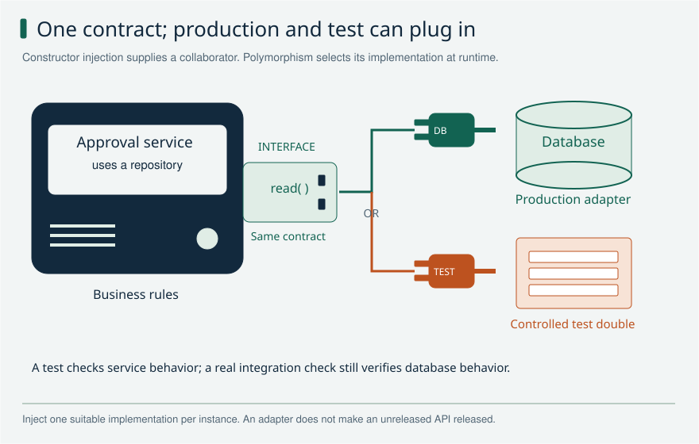
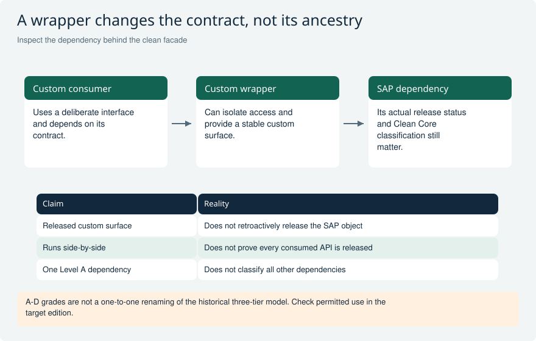

# OO design and Clean ABAP

Explain object orientation through responsibilities, replaceable dependencies, and observable behavior. Memorized definitions become useful when you can name a concrete tradeoff. The examples are hypothetical design exercises, not claims about personal project experience; project naming conventions are separate from the SAP language.

[Return to the study guide](../README.md) | [Study plan](../study/Study_Plan.md)

## OO-01 Explain abstraction, encapsulation, inheritance, and polymorphism with one example.

**Level:** Core

**Short answer:** Abstraction gives callers a simple operation, such as send, without showing every technical step. Encapsulation keeps an object in a valid state by controlling access to its data. Inheritance lets a subclass specialize a base class while keeping its promises. Polymorphism lets the same call use different implementations, such as an email sender or a test sender.

**Reasoning and example:** An approval coordinator needs to notify a user. It calls send through a notification interface and supplies a message. The production implementation sends email, while a test implementation records the message for an assertion. The coordinator does not need to know which concrete class it received.

The sender protects its own valid setup, such as a required destination, rather than exposing every attribute for arbitrary changes. If inheritance is used, a subclass must still behave as a valid sender. These ideas work together: callers see a small useful operation, implementation details stay inside the sender, and a new delivery method can be added without rewriting the approval decision.

**Avoid this mistake:** Encapsulation means protecting valid behavior and state, not merely generating getters and setters for every attribute.

**Read and verify this answer:**

- [SAP ABAP object orientation examples](https://github.com/SAP-samples/abap-cheat-sheets/blob/main/04_ABAP_Object_Orientation.md) - Compare the language contract with the Clean ABAP design guidance. Project conventions can differ from style recommendations.

Visual: OO interfaces and dependency injection

The service depends on a repository contract. Production and test implementations fit the same socket; the composition boundary supplies the appropriate collaborator.

**Explain it:** Which object chooses the implementation, and what does a double-based test fail to prove?

**Limit:** The plug is a design metaphor, not a SAP connector or code signature. Injection does not itself guarantee a good abstraction or production integration.

## OO-02 What can an ABAP interface contain, and when would you use one?

**Level:** Core

**Short answer:** An ABAP interface describes what an implementing class provides. It can contain methods, types, constants, attributes and events, not just method names. I use a small interface when callers need one clear capability and different implementations can provide it. This also lets a test supply a controlled replacement. Specialized interfaces, such as BAdI interfaces, can have additional rules.

**Reasoning and example:** A checkout needs a price, so its price-provider interface can define how to request one and what happens when no price is available. One class reads local data; another calls an external service. The checkout uses the same operation, while the implementations keep their technical work private.

The contract must include behavior as well as types. Returning an empty price on network failure is different from reporting that no price exists. I avoid putting unrelated operations into the interface simply because one concrete class already has them. A narrow interface makes both the caller and its test double easier to understand, and it reduces the effect of future changes.

**Avoid this mistake:** An interface is not an abstract class, and a collection of similarly named methods alone does not establish a meaningful common contract.

**Read and verify this answer:**

- [SAP interfaces and implementation semantics](https://help.sap.com/saphelp_snc70/helpdata/EN/c3/225b6254f411d194a60000e8353423/content.htm) - Compare the language contract with the Clean ABAP design guidance. Project conventions can differ from style recommendations.

Visual: OO interfaces and dependency injection

The service depends on a repository contract. Production and test implementations fit the same socket; the composition boundary supplies the appropriate collaborator.

**Explain it:** Which object chooses the implementation, and what does a double-based test fail to prove?

**Limit:** The plug is a design metaphor, not a SAP connector or code signature. Injection does not itself guarantee a good abstraction or production integration.

## OO-03 How do ABSTRACT and FINAL affect classes and methods?

**Level:** Core

**Short answer:** An abstract class cannot be created directly, but it may contain working shared code. It does not have to contain an abstract method. An abstract method leaves implementation to a subclass before that subclass can be concrete. FINAL on a class prevents subclasses. FINAL on a method prevents further redefinition of that method.

**Reasoning and example:** A document-processing base class could provide common logging while leaving a processing step abstract. A concrete subclass implements that step and can then be instantiated if no abstract methods remain. This is useful only when the shared process and the allowed variation are deliberate parts of the design.

For a service that should not be specialized through inheritance, FINAL makes that limit explicit. It can still implement interfaces and receive other objects as dependencies. I follow ABAP rules rather than copying assumptions from another language: redefining an inherited method preserves its interface, and ABAP does not solve this with same-name methods that have different parameter lists.

**Avoid this mistake:** Do not import another language's virtual keyword or method-overloading rules into ABAP; use ABAP's actual redefinition and signature rules.

**Read and verify this answer:**

- [SAP ABAP object orientation examples](https://github.com/SAP-samples/abap-cheat-sheets/blob/main/04_ABAP_Object_Orientation.md) - Compare the language contract with the Clean ABAP design guidance. Project conventions can differ from style recommendations.

## OO-04 How do upcasting and downcasting work in ABAP Objects?

**Level:** Core

**Short answer:** Upcasting uses a general reference type for an object, such as its superclass or interface. Downcasting asks to use a more specific type. Neither creates a new object. A downcast fails if the actual object does not support the requested type, so I check it or handle CX_SY_MOVE_CAST_ERROR. Frequent downcasts can mean the caller needs a better interface.

**Reasoning and example:** A payment-interface reference can point to a card-payment object. Through that reference, I can use operations declared by the interface. If I really need a card-specific operation, a valid downcast exposes it, but the reference still points to the same object with the same state.

If the reference actually points to a bank-transfer implementation, casting it to the card class cannot turn it into a card. The cast fails. I test that path when a cast is necessary. More often, if ordinary payment processing keeps checking concrete classes, I move the shared capability into a suitable interface so callers can work without knowing every implementation.

**Avoid this mistake:** Casting a reference changes the accessible static view, not the object's dynamic type or stored data.

**Read and verify this answer:**

- [SAP ABAP object orientation examples](https://github.com/SAP-samples/abap-cheat-sheets/blob/main/04_ABAP_Object_Orientation.md) - Compare the language contract with the Clean ABAP design guidance. Project conventions can differ from style recommendations.

## OO-05 What is the difference between instance and static methods and constructors?

**Level:** Core

**Short answer:** An instance method works with a particular object and its data. A static method belongs to the class and has no current object of its own. The instance constructor prepares a newly created object. The class constructor prepares class-level state when the runtime first needs the class in that internal session. I keep that hidden initialization small and predictable.

**Reasoning and example:** Two approval-service objects can each hold a different repository reference. Their instance methods use their own repository. A static helper, by contrast, cannot assume that either object is its current instance. Class-level data can be shared by those instances within the internal session, so changing it may affect both.

I use the instance constructor to receive required dependencies and establish a usable object. I avoid loading large datasets or calling remote systems unexpectedly from a class constructor. Also, declaring CLASS-METHODS does not itself prevent object creation. Creation visibility or an abstract class controls that, and class data is not automatically one shared value across the whole SAP system.

**Avoid this mistake:** ABAP does not make a class uninstantiable simply because it has static methods, and class data is not automatically shared system-wide.

**Read and verify this answer:**

- [SAP ABAP object orientation examples](https://github.com/SAP-samples/abap-cheat-sheets/blob/main/04_ABAP_Object_Orientation.md) - Compare the language contract with the Clean ABAP design guidance. Project conventions can differ from style recommendations.

## OO-06 When do you prefer composition over inheritance?

**Level:** Core

**Short answer:** I prefer composition when one object needs help from another: the service has a repository or a formatter. Those helpers can change independently. Inheritance fits a real specialization where the subclass keeps the base class promises. I do not build a class hierarchy just to reuse a few methods. Composition often makes testing and replacing a dependency simpler.

**Reasoning and example:** A report service reads data, checks access and formats output. It can receive a repository, an authorization policy and a formatter as separate helpers. A test replaces the repository while using the real calculation. A new output format does not require a new version of the entire report hierarchy.

A large base report class may instead force every subclass to inherit database, output and security decisions it does not need. That makes a small change affect unrelated reports. I use inheritance when a shared process and its extension steps are genuinely stable. The practical test is whether a subclass can be used wherever the base type is expected without surprising its caller.

**Avoid this mistake:** Code reuse alone is weak justification for inheritance; a subclass that violates caller expectations is not a sound substitute.

**Read and verify this answer:**

- [SAP Clean ABAP style guide](https://github.com/SAP/styleguides/blob/main/clean-abap/CleanABAP.md) - Compare the language contract with the Clean ABAP design guidance. Project conventions can differ from style recommendations.
- [SAP ABAP object orientation examples](https://github.com/SAP-samples/abap-cheat-sheets/blob/main/04_ABAP_Object_Orientation.md) - Compare the language contract with the Clean ABAP design guidance. Project conventions can differ from style recommendations.

## OO-07 How do dependency injection and dependency inversion differ?

**Level:** Core

**Short answer:** Dependency inversion means business code depends on the capability it needs, usually an interface, rather than one technical implementation. Dependency injection means someone else supplies that implementation, often through the constructor. The first is a design rule; the second is a way to connect objects. Together they make dependencies visible and easier to replace in tests.

**Reasoning and example:** An approval service needs to read a request. It accepts a repository interface in its constructor instead of creating a database repository inside approve. Production setup supplies the real repository; a unit test supplies a fake that returns a known request. The approval rule itself runs unchanged in both cases.

Passing an object is not enough if the service ignores it and creates another dependency internally. Also, injecting a large concrete database class can still leave business code dependent on database details. I keep the required operations small and meaningful, and test both successful reads and failures through that interface. This reveals what the service really relies on.

**Avoid this mistake:** Injecting a concrete class everywhere may aid construction while still leaving the business layer tightly coupled to infrastructure.

**Read and verify this answer:**

- [SAP Clean ABAP style guide](https://github.com/SAP/styleguides/blob/main/clean-abap/CleanABAP.md) - Compare the language contract with the Clean ABAP design guidance. Project conventions can differ from style recommendations.

Visual: OO interfaces and dependency injection

The service depends on a repository contract. Production and test implementations fit the same socket; the composition boundary supplies the appropriate collaborator.

**Explain it:** Which object chooses the implementation, and what does a double-based test fail to prove?

**Limit:** The plug is a design metaphor, not a SAP connector or code signature. Injection does not itself guarantee a good abstraction or production integration.

## OO-08 How would you apply SOLID without overengineering?

**Level:** Advanced

**Short answer:** I use SOLID to keep changes understandable. A class should have a clear job, and new variations should not require editing every caller. Replacements should keep the same promises, interfaces should contain what their callers need, and business rules should depend on useful abstractions. I add structure for a real need. More classes do not automatically mean better design.

**Reasoning and example:** A tax calculation mixed with database reads and printing is difficult to test. Separating the calculation lets me give it known values and check the result without a printer or live database. A narrow rate-provider interface may help if rates can come from different places or the source can fail.

That does not mean every five-line helper needs its own interface and factory. I ask which change or test becomes easier because of each extra layer. Single responsibility does not mean exactly one method per class. Open/closed also does not forbid fixing existing code; it encourages a design where expected variations can be added without repeatedly disrupting stable business logic.

**Avoid this mistake:** Single responsibility does not mean one method per class, and open/closed does not mean existing code must never be changed.

**Read and verify this answer:**

- [SAP Clean ABAP style guide](https://github.com/SAP/styleguides/blob/main/clean-abap/CleanABAP.md) - Compare the language contract with the Clean ABAP design guidance. Project conventions can differ from style recommendations.

## OO-09 What is a Factory, when do you use it, and how does it work with Strategy?

**Level:** Advanced

**Short answer:** A Factory creates the right object for the caller. Strategy is the object that contains one version of a rule. For example, a Factory chooses a domestic or export price calculator; both expose the same calculate method. Use a Factory when choosing or setting up objects is repeated or complicated. For one simple class, NEW at the entry point may be enough.

**Reasoning and example:** Imagine three reports need prices for domestic and export orders. Without a Factory, every report repeats the same IF and knows both concrete class names. Move that choice into a create_calculator method returning the calculator interface. A report then asks the returned object to calculate; it does not need to know which class was created. An unknown country must give a clear error, not silently choose a price rule.

Strategy separates the calculations. Factory separates object creation. The Factory can return a new object each time; it does not imply Singleton. Inject the resulting interface into the business service so a unit test can supply a fake calculator.

A static method with CASE is commonly called a simple Factory. The formal Factory Method pattern lets subclasses decide which product to create. Abstract Factory creates related families, such as a serializer and sender for the same provider. Choose the simplest variant that solves the actual problem.

**Avoid this mistake:** Do not call every method that returns an object Factory Method without distinguishing a simple factory from the formal pattern.

**Read and verify this answer:**

- [SAP Learning: Implementing Factory Methods](https://learning.sap.com/courses/deepening-your-abap-programming-knowledge/implementing-factory-methods_ff885b1e-5e7c-4d73-b9df-b4be5112e1fa) - Read the documented mechanism, then try the small example in your own development system.
- [SAP examples: Factory Method and Abstract Factory](https://github.com/SAP-samples/abap-cheat-sheets/blob/main/34_OO_Design_Patterns.md#factory-method) - Read the documented mechanism, then try the small example in your own development system.

## OO-10 What is a Facade, when is it useful, and how does it differ from Adapter?

**Level:** Advanced

**Short answer:** A Facade gives a complicated subsystem a small, easy-to-use interface. Instead of making every caller run prepare, check and submit, expose one submit_request operation. An Adapter solves a different problem: it converts one interface or data format into another. You can use both. Neither pattern changes the transaction rules of the code it calls.

**Reasoning and example:** Suppose a delivery preview needs three services: read the order, calculate package sizes, and estimate delivery cost. A Facade offers preview_delivery(order_id). It coordinates those services and returns one result. The UI no longer repeats the sequence, and changing the packaging service affects fewer callers. This is useful when several screens or jobs use the same multi-step operation.

If an old carrier API expects technical structures, an Adapter maps your request to those structures. The Facade coordinates the overall task; the Adapter translates one dependency. Keep the dependencies behind interfaces so tests can verify the sequence and stop on a failed check without contacting a carrier.

For a posting Facade, explicitly document who owns COMMIT and what can be rolled back. A Facade is not a new LUW. Do not use it just to rename one trivial method, or hide unreleased SAP dependencies and claim they are now released.

**Avoid this mistake:** Wrapping an unreleased SAP object does not by itself make that underlying dependency released, cloud compliant, or clean-core Level A.

**Read and verify this answer:**

- [SAP examples: Facade](https://github.com/SAP-samples/abap-cheat-sheets/blob/main/34_OO_Design_Patterns.md#facade) - Read the documented mechanism, then try the small example in your own development system.
- [SAP: a RAP facade over existing BAPIs](https://help.sap.com/docs/abap-cloud/developer-guide-from-classic-abap-to-abap-cloud/reference-scenario-material-classification) - This is a larger RAP integration example. A facade interface does not remove the underlying BAPI transaction requirements.

Visual: OO interfaces and dependency injection

The service depends on a repository contract. Production and test implementations fit the same socket; the composition boundary supplies the appropriate collaborator.

**Explain it:** Which object chooses the implementation, and what does a double-based test fail to prove?

**Limit:** The plug is a design metaphor, not a SAP connector or code signature. Injection does not itself guarantee a good abstraction or production integration.

Visual: Clean Core wrapper dependency

Trace dependencies across the wrapper instead of classifying the solution from its visible surface alone.

**Explain it:** What evidence would let you accept a classic SAP dependency responsibly?

**Limit:** A governance review must consider technology restrictions, classifications and lifecycle risk.

## OO-11 What is Singleton in ABAP, how do you implement it, and when would you use it?

**Level:** Advanced

**Short answer:** Singleton lets callers reuse one object instead of creating a new one each time. In ABAP, a typical implementation uses CREATE PRIVATE, a static reference, and get_instance. The first call creates the object; later calls return the same reference. That instance belongs to an internal session, not the whole SAP system. Use it only when sharing that lifetime is intentional.

**Reasoning and example:** Imagine a report repeatedly needs the same read-only configuration. A Singleton can read it once and reuse the same cache during that internal session. Calling get_instance twice returns the same object. A different user or internal session can have another instance, so this is not a system-wide lock or shared cache.

Do not store the current order, current approver, or other request-specific data in a long-lived Singleton. The next operation can see stale values; one test can affect another test. Define refresh and invalidation rules for configuration too. CREATE PRIVATE only prevents arbitrary construction: the class must also retain and reuse its instance.

If shared lifetime is not needed, create an ordinary service and pass it into the caller through an interface. That is easier to replace in tests. Singleton answers how many instances to reuse; Factory answers how to create an object; Facade answers how to simplify a subsystem.

**Avoid this mistake:** A singleton does not synchronize business updates across sessions, work processes, application servers, or users.

**Read and verify this answer:**

- [SAP: implementing a Singleton buffer](https://help.sap.com/docs/CP/c0d02c4330c34b3abca88bdd57eaccfc/71c0abf0e9bc4e3c84f82183890bd792.html?locale=en-US) - Study the instance access mechanism. A transaction buffer additionally needs its documented cleanup lifecycle.
- [SAP Learning: controlling object creation](https://learning.sap.com/courses/deepening-your-abap-programming-knowledge/implementing-factory-methods_ff885b1e-5e7c-4d73-b9df-b4be5112e1fa) - Read the documented mechanism, then try the small example in your own development system.

## OO-12 How do ABAP OO events differ from durable business events?

**Level:** Advanced

**Short answer:** An ABAP OO event calls registered handlers in the current runtime context. It is useful for local notifications, such as a UI interaction. A durable business event must survive failures and support delivery after the business change is saved. That needs a supported event or integration mechanism. RAISE EVENT alone does not provide persistence, retry or reliable external delivery.

**Reasoning and example:** An ALV can raise a local event when the user selects a row. A controller registered with SET HANDLER reacts and updates the display. If that session ends, the local event is not a saved message waiting for another system. This is appropriate for an immediate screen interaction.

Starting an external approval workflow after a document is saved is a different requirement. The design must coordinate save and publication, identify duplicates, monitor failed delivery and support retries. Otherwise the workflow could start for a document that later fails to save, or never start after a temporary outage. Similar event terminology does not make the two delivery mechanisms interchangeable.

**Avoid this mistake:** RAISE EVENT by itself does not persist a message or guarantee workflow creation after a commit.

**Read and verify this answer:**

- [SAP ABAP object orientation examples](https://github.com/SAP-samples/abap-cheat-sheets/blob/main/04_ABAP_Object_Orientation.md) - Compare the language contract with the Clean ABAP design guidance. Project conventions can differ from style recommendations.

Visual: Duplicate events and stale approvals

The event identity and current business state decide whether to apply, ignore or reject the request.

**Explain it:** Two consumers process the same event simultaneously: what prevents a double effect?

**Limit:** Exact transactional deduplication mechanisms depend on the chosen infrastructure.

## OO-13 What would you change first in a difficult legacy ABAP method?

**Level:** Core

**Short answer:** I first find out what the method promises to its callers and who owns its save. Then I make small changes: clearer names, less duplication and separate calculation from database or remote calls. I protect risky behavior with focused tests before larger changes. The goal is easier understanding without changing the business result accidentally.

**Reasoning and example:** A long posting method calculates a discount, reads configuration and saves a document. I first extract the discount calculation if its inputs and result can be made clear. I leave commit, authorization and locking behavior in place until I understand their callers and tests. That gives reviewers a small change they can verify.

Next I use tests around important amounts, rejection paths and existing edge cases before moving more code. Merely converting every loop into an expression can obscure the actual change. Team naming also helps consistency: this project uses lt_ for tables, ls_ for structures and co_ for constants. Those are project conventions, not special ABAP syntax or universal Clean ABAP requirements.

**Avoid this mistake:** A broad stylistic rewrite without behavior evidence can introduce regressions and make review harder, even if the result looks more modern.

**Read and verify this answer:**

- [SAP Clean ABAP style guide](https://github.com/SAP/styleguides/blob/main/clean-abap/CleanABAP.md) - Compare the language contract with the Clean ABAP design guidance. Project conventions can differ from style recommendations.

## OO-14 How do you make an OO design testable, and what should ABAP Unit assert?

**Level:** Core

**Short answer:** I keep the business rule real and make outside dependencies replaceable. Tests supply known data, time or service responses and check the result a caller can observe. I cover normal cases, limits and failures. Coverage can reveal untested code, but it cannot prove the assertions are useful. Real database, authorization and service behavior still need integration checks.

**Reasoning and example:** An approval rule sends amounts above a limit to a manager. I test below, exactly at and above that limit, plus the case where no manager is available. A repository double supplies the request, and the test checks the real decision and reported error. The expected result comes from the rule, not from repeating the implementation in the test.

I also simulate a read failure so it cannot become an accidental approval. Separate tests in the target environment verify the actual repository and security behavior. A unit test with fake persistence is valuable, but it cannot prove a real service call, save or role assignment works correctly.

**Avoid this mistake:** A test that only asserts that a method returned, or mirrors its implementation step by step, provides weak evidence.

**Read and verify this answer:**

- [SAP Clean ABAP style guide](https://github.com/SAP/styleguides/blob/main/clean-abap/CleanABAP.md) - Compare the language contract with the Clean ABAP design guidance. Project conventions can differ from style recommendations.

Visual: OO interfaces and dependency injection

The service depends on a repository contract. Production and test implementations fit the same socket; the composition boundary supplies the appropriate collaborator.

**Explain it:** Which object chooses the implementation, and what does a double-based test fail to prove?

**Limit:** The plug is a design metaphor, not a SAP connector or code signature. Injection does not itself guarantee a good abstraction or production integration.

Visual: Testing scope and evidence

The widening base suggests many focused checks, but there is no mandatory numerical ratio.

**Explain it:** Which risk remains after an ABAP Unit test with doubles passes?

**Limit:** Conceptual coverage map, not a count of tests actually run in SAP.

## OO-15 How does MVC separate responsibilities?

**Level:** Core

**Short answer:** The Model holds application data and relevant behavior. The View displays information and accepts user input. The Controller handles interactions and coordinates what happens next. MVC separates these jobs so changes are easier to manage. It does not require one fixed call sequence, and it does not move backend business rules into the browser.

**Reasoning and example:** In a SAPUI5 application, a view binds a list to a model. When a user presses Submit, the controller gathers the intended action and calls the backend. The backend checks the business rules and permissions, then returns success or an error. The model and bindings help the screen reflect the result.

A disabled Submit button is useful feedback, but it cannot be the only enforcement of the rule. Someone can call the service directly. I keep required validation in the backend and use the UI for a clear experience. This division also helps testing: a controller interaction test and a backend business-rule test prove different parts of the application.

**Avoid this mistake:** MVC does not mean copying all backend business logic into the UI controller or assuming the view must always be manually rebuilt.

**Read and verify this answer:**

- [SAPUI5: Use the MVC Concept](https://help.sap.com/docs/SAPUI5/b2f662dd9d7a4ec680056733050b4d34/07afcf400eb344c2916e4eb3a400ff7b.html?version=1.148) - SAPUI5 example of the responsibility split. Select the documentation version matching the target application; MVC does not relocate backend business rules into the browser.

## OO-16 Singleton, Factory or Facade: how do you choose with a simple example?

**Level:** Core

**Short answer:** Ask what problem you have. Need the right object created? Use a Factory. Need one deliberately shared instance? Consider Singleton. Need one easy entry point to several services? Use a Facade. These patterns can work together, but none is required just because the application uses ABAP Objects.

**Reasoning and example:** For a delivery preview, a Factory can choose a carrier calculator. A Facade can then read the order, calculate package sizes and ask that calculator for a price. A read-only configuration cache might be shared within the internal session, but that is a separate lifetime decision.

Start with ordinary classes. Add a Factory when creation logic repeats, a Facade when callers repeat a multi-step sequence, and Singleton only when one shared instance has a clear benefit and safe lifetime. In an interview, explain the problem and trade-off before naming the pattern. A report with one fixed calculation may need none of them.

**Avoid this mistake:** A Factory does not require Singleton, and a Facade does not automatically add COMMIT, retries, authorization or transactional safety.

**Read and verify this answer:**

- [SAP Learning: Factory Methods](https://learning.sap.com/courses/deepening-your-abap-programming-knowledge/implementing-factory-methods_ff885b1e-5e7c-4d73-b9df-b4be5112e1fa) - Read the documented mechanism, then try the small example in your own development system.
- [SAP examples: OO design patterns](https://github.com/SAP-samples/abap-cheat-sheets/blob/main/34_OO_Design_Patterns.md) - Read the documented mechanism, then try the small example in your own development system.

## Official references

- [SAP Clean ABAP style guide](https://github.com/SAP/styleguides/blob/main/clean-abap/CleanABAP.md)
- [SAP ABAP object orientation examples](https://github.com/SAP-samples/abap-cheat-sheets/blob/main/04_ABAP_Object_Orientation.md)
- [SAP interfaces and implementation semantics](https://help.sap.com/saphelp_snc70/helpdata/EN/c3/225b6254f411d194a60000e8353423/content.htm)
