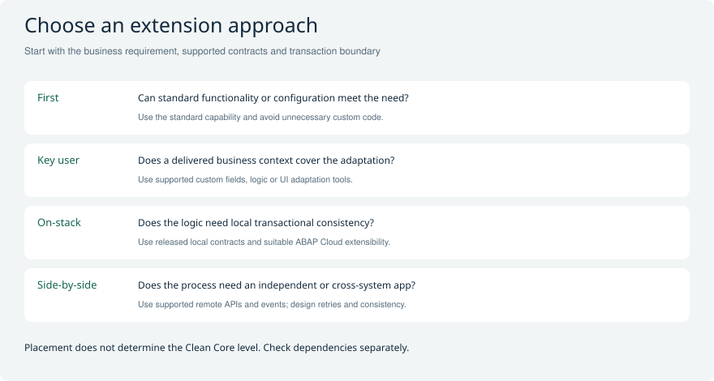
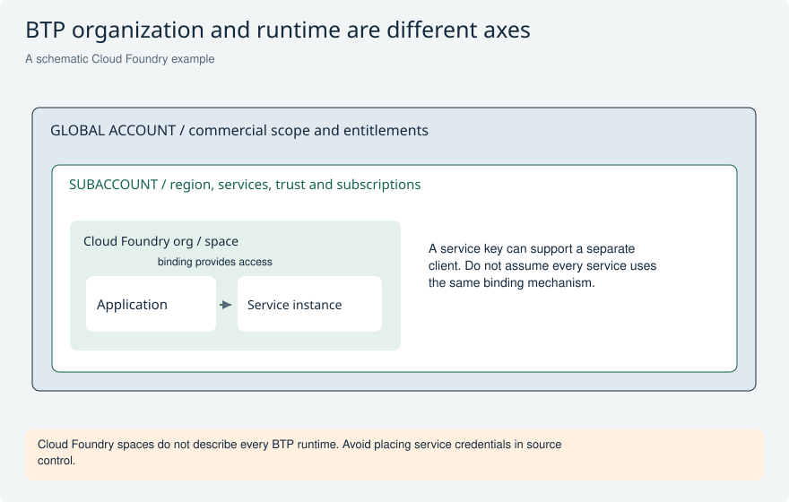

# BTP and cloud integration for ABAP developers

Focus on what an ABAP developer must design, configure or troubleshoot. Separate the ABAP development model from its hosting location, and distinguish Cloud Foundry app mechanics from the managed ABAP environment.

[Return to the study guide](../README.md) | [Study plan](../study/Study_Plan.md)

## BTP-01 What is BTP and how is ABAP Cloud different?

**Level:** Core

**Short answer:** SAP BTP is a platform of services and environments for applications, integration and related capabilities. ABAP Cloud is a development model with restricted language and released contracts. The managed BTP ABAP environment is one place to use that model; supported S/4HANA editions also provide it.

**Example and follow-up:** Explain whether your extension is deployed on the ERP stack or in a separate ABAP environment and how it communicates with the business system.

**Avoid this mistake:** Do not call BTP ABAP simply a normal application container deployed with cf push.

**Read and verify this answer:**

- [SAP ABAP Cloud FAQ](https://pages.community.sap.com/topics/abap/abap-cloud-faq) - Check the target runtime, identity and connectivity context.

Visual: Extension placement decision

Start from the business need and transaction boundary before choosing an extension location.

**Explain it:** When would local transactional consistency favor an on-stack extension?

**Limit:** Placement does not establish Clean Core level or availability in a specific edition.

Visual: BTP account and runtime map

Read the nesting as an organizational example, then distinguish the application, service instance and credentials.

**Explain it:** How is a service instance different from a binding or service key?

**Limit:** Schematic Cloud Foundry route; other BTP environments have different runtime structures.

## BTP-02 How do global accounts subaccounts entitlements and spaces relate?

**Level:** Core

**Short answer:** A global account organizes commercial and administrative scope. Subaccounts separate regional and administrative application contexts. Entitlements allocate permission and quota to consume services. In an enabled Cloud Foundry environment, organizations and spaces structure app and service deployment. These are different layers, not synonyms.

**Example and follow-up:** Check the service plan, region, entitlement and required roles before provisioning. The exact provisioning flow depends on the selected service and current account setup.

**Avoid this mistake:** An entitlement is not a runtime container, and every BTP service does not require the same CF-space workflow.

**Read and verify this answer:**

- [SAP BTP documentation](https://help.sap.com/docs/btp) - Documentation navigation starting point, not direct evidence for every statement. Find the named feature and target release; the scenario decision and verification plan are original analysis.

Visual: BTP account and runtime map

Read the nesting as an organizational example, then distinguish the application, service instance and credentials.

**Explain it:** How is a service instance different from a binding or service key?

**Limit:** Schematic Cloud Foundry route; other BTP environments have different runtime structures.

## BTP-03 What is the difference between IaaS PaaS and SaaS?

**Level:** Core

**Short answer:** IaaS supplies infrastructure, PaaS supplies a managed application platform, and SaaS supplies an application. The key distinction is who operates each part of the stack. In an interview explain your responsibility for code, configuration, identity and data rather than memorizing a provider list.

**Example and follow-up:** A managed ABAP environment lets the developer focus on ABAP applications within service constraints; a SaaS business application provides an already implemented business capability.

**Avoid this mistake:** SAP HANA Cloud is a managed database service, not a generic example of a finished business SaaS application.

**Read and verify this answer:**

- [SAP BTP documentation](https://help.sap.com/docs/btp) - Documentation navigation starting point, not direct evidence for every statement. Find the named feature and target release; the scenario decision and verification plan are original analysis.

## BTP-04 What are a service instance binding and service key?

**Level:** Core

**Short answer:** A service instance is a provisioned service resource. A binding connects an application to that instance and supplies connection material. A service key provides credentials for a supported external client use case. A binding does not universally mean that a separately managed service-key artifact was created.

**Example and follow-up:** In Cloud Foundry, binding data is commonly provided through VCAP_SERVICES; other delivery methods exist. Restart or restage as required by the platform and application to consume changes.

**Avoid this mistake:** default-env.json is a local development convention, not the universal Cloud Foundry credential transport.

**Read and verify this answer:**

- [Cloud Foundry service bindings](https://docs.cloudfoundry.org/devguide/services/application-binding.html) - Check the target runtime, identity and connectivity context.

Visual: BTP account and runtime map

Read the nesting as an organizational example, then distinguish the application, service instance and credentials.

**Explain it:** How is a service instance different from a binding or service key?

**Limit:** Schematic Cloud Foundry route; other BTP environments have different runtime structures.

## BTP-05 What do containers buildpacks droplets and routes do?

**Level:** Advanced

**Short answer:** A buildpack supplies language-runtime support during staging, producing a runnable app artifact. Containers isolate running app instances. Routes direct traffic to applications, and multiple instances can serve the same route. Availability also depends on instance count, placement, dependencies and failure behavior.

**Example and follow-up:** A blue-green deployment switches traffic between app versions, but schema compatibility and in-flight requests still need a rollout plan.

**Avoid this mistake:** A container is not a standalone virtual machine, and one application does not always mean exactly one container.

**Read and verify this answer:**

- [Cloud Foundry: how applications are staged](https://docs.cloudfoundry.org/devguide/deploy-apps/how-applications-are-staged.html) - Cloud Foundry buildpack/staging/droplet background; not the deployment model of managed ABAP environment. The browser retrieval was unavailable during review; follow the official documentation navigation if the page moves.

Visual: BTP account and runtime map

Read the nesting as an organizational example, then distinguish the application, service instance and credentials.

**Explain it:** How is a service instance different from a binding or service key?

**Limit:** Schematic Cloud Foundry route; other BTP environments have different runtime structures.

## BTP-06 What do destinations and Cloud Connector solve?

**Level:** Core

**Short answer:** A destination centralizes connection and authentication configuration for a supported consumer. Cloud Connector provides controlled connectivity from the cloud to permitted on-premise resources through its configured tunnel. Both require appropriate identity and authorization; neither makes an unreleased backend API supported.

**Example and follow-up:** Trace a failed call through destination configuration, connectivity, exposed resource, certificate or token, and backend permission. Avoid copying credentials into application source.

**Avoid this mistake:** Cloud Connector is not simply an unrestricted inbound opening of the entire corporate network.

**Read and verify this answer:**

- [SAP BTP documentation](https://help.sap.com/docs/btp) - Documentation navigation starting point, not direct evidence for every statement. Find the named feature and target release; the scenario decision and verification plan are original analysis.

Visual: Local and remote transaction boundaries

The remote commit belongs to another system, so local failure needs an explicit recovery strategy.

**Explain it:** What should happen if the remote side succeeds but the response is lost?

**Limit:** This explains distributed consistency, not a particular messaging product guarantee.

## BTP-07 How do remote transactions differ from local RAP transactions?

**Level:** Advanced

**Short answer:** A remote API call generally has a separate transaction boundary. A local rollback does not automatically undo a remote commit. Design orchestration with idempotency, explicit statuses, retries and compensation where needed. Do not assume distributed ACID behavior merely because both systems use SAP technology.

**Example and follow-up:** If payment creation succeeds remotely but the local response times out, retry with a stable idempotency key or reconcile before creating another payment.

**Avoid this mistake:** Calling HTTP inside an action does not make the remote change part of the local RAP database transaction.

**Read and verify this answer:**

- [SAP BTP documentation](https://help.sap.com/docs/btp) - Documentation navigation starting point, not direct evidence for every statement. Find the named feature and target release; the scenario decision and verification plan are original analysis.

Visual: OData batch envelope and atomic groups

The outer envelope reduces HTTP packaging overhead; it does not establish one universal database transaction.

**Explain it:** If a later independent group fails, must an earlier successful group be rolled back?

**Limit:** Conceptual grouping, not an exact multipart or JSON batch payload.

Visual: Local and remote transaction boundaries

The remote commit belongs to another system, so local failure needs an explicit recovery strategy.

**Explain it:** What should happen if the remote side succeeds but the response is lost?

**Limit:** This explains distributed consistency, not a particular messaging product guarantee.

## BTP-08 What makes event-driven integration reliable?

**Level:** Advanced

**Short answer:** Publish business events consistently with committed state, use durable delivery where required, handle duplicates and define retry and dead-letter behavior. Consumers should use stable identifiers and be idempotent. Ordering, retention and delivery guarantees depend on the configured broker and protocol.

**Example and follow-up:** A workflow starter records the request-event identifier so redelivery does not create a second approval process. Reconcile unprocessed events with business state.

**Avoid this mistake:** Do not promise exactly-once end-to-end processing or global ordering without a specific proven design.

**Read and verify this answer:**

- [SAP BTP documentation](https://help.sap.com/docs/btp) - Documentation navigation starting point, not direct evidence for every statement. Find the named feature and target release; the scenario decision and verification plan are original analysis.

Visual: Local and remote transaction boundaries

The remote commit belongs to another system, so local failure needs an explicit recovery strategy.

**Explain it:** What should happen if the remote side succeeds but the response is lost?

**Limit:** This explains distributed consistency, not a particular messaging product guarantee.

Visual: Duplicate events and stale approvals

The event identity and current business state decide whether to apply, ignore or reject the request.

**Explain it:** Two consumers process the same event simultaneously: what prevents a double effect?

**Limit:** Exact transactional deduplication mechanisms depend on the chosen infrastructure.

## BTP-09 Which tools matter to an ABAP developer on BTP?

**Level:** Core

**Short answer:** ADT in Eclipse is the primary ABAP development environment. Fiori tooling such as supported SAP Fiori tools supports UI work. BTP cockpit and service-specific tools manage entitlements, identities, connections and deployment. Use the tool appropriate to the runtime rather than one generic build path.

**Example and follow-up:** Know how to establish an ABAP project, find a released API, run ATC and tests, and troubleshoot a service consumer. Check installed tool versions against the target system.

**Avoid this mistake:** The historical name SAP Cloud Platform and a Neo-versus-CF-only diagram are not a complete current BTP model.

**Read and verify this answer:**

- [SAP ABAP Cloud FAQ](https://pages.community.sap.com/topics/abap/abap-cloud-faq) - Check the target runtime, identity and connectivity context.

Visual: BTP account and runtime map

Read the nesting as an organizational example, then distinguish the application, service instance and credentials.

**Explain it:** How is a service instance different from a binding or service key?

**Limit:** Schematic Cloud Foundry route; other BTP environments have different runtime structures.

## BTP-10 How would you secure and operate a side-by-side extension?

**Level:** Advanced

**Short answer:** Use supported authentication, least-privilege authorization and managed credentials. Separate environments, trace requests across systems, monitor latency and failures, and define backup or recovery and deployment procedures. Treat API compatibility and dependency lifecycle as operational responsibilities as well as development concerns.

**Example and follow-up:** A production-ready design explains who owns a failing integration, how to replay safely and how to revoke a credential. Include those points in architecture answers.

**Avoid this mistake:** Successful connectivity from a developer machine is not evidence of secure production operation.

**Read and verify this answer:**

- [SAP BTP documentation](https://help.sap.com/docs/btp) - Documentation navigation starting point, not direct evidence for every statement. Find the named feature and target release; the scenario decision and verification plan are original analysis.

Visual: BTP account and runtime map

Read the nesting as an organizational example, then distinguish the application, service instance and credentials.

**Explain it:** How is a service instance different from a binding or service key?

**Limit:** Schematic Cloud Foundry route; other BTP environments have different runtime structures.

## Official references

- [SAP ABAP Cloud FAQ](https://pages.community.sap.com/topics/abap/abap-cloud-faq)
- [Cloud Foundry service bindings](https://docs.cloudfoundry.org/devguide/services/application-binding.html)
- [Cloud Foundry environment variables](https://docs.cloudfoundry.org/devguide/deploy-apps/environment-variable.html)
- [SAP BTP documentation](https://help.sap.com/docs/btp)
- [Cloud Foundry: how applications are staged](https://docs.cloudfoundry.org/devguide/deploy-apps/how-applications-are-staged.html)
