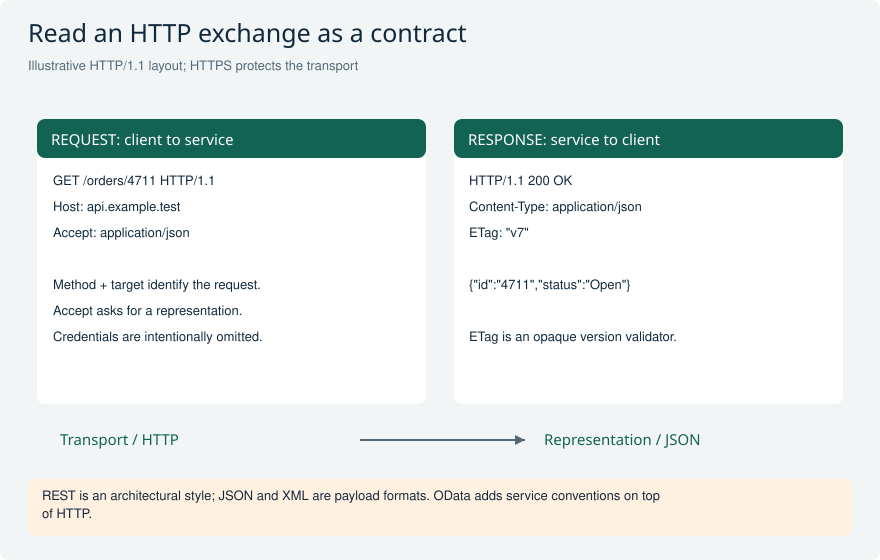
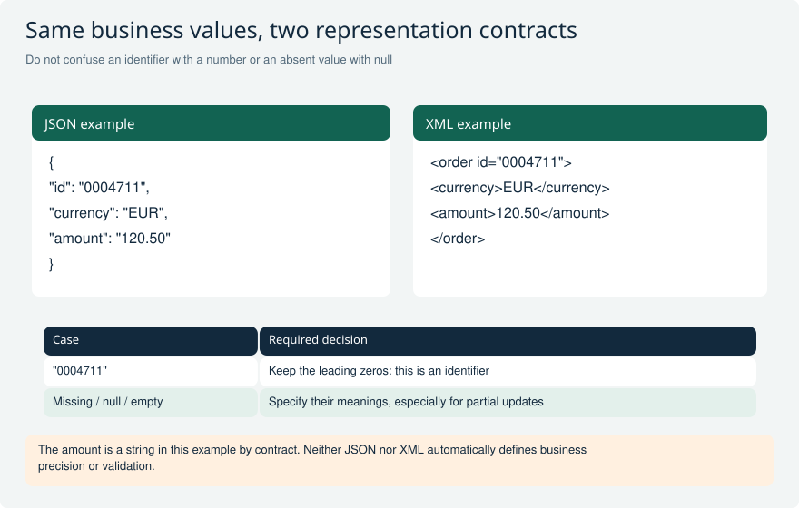
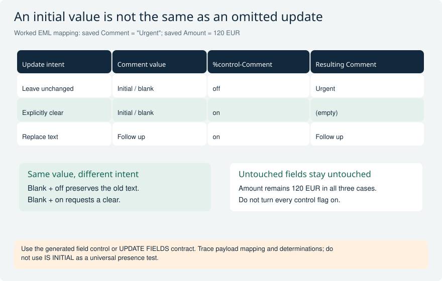

# HTTP, REST, JSON and XML

Explain the protocol, architectural style and payload independently. Practice concrete requests, payload edge cases and ABAP integration failure handling.

[Return to the study guide](../README.md) | [Study plan](../study/Study_Plan.md)

## HTTP-01 What is the difference between HTTP, REST, OData and a payload format?

**Level:** Core

**Short answer:** HTTP defines how requests and responses work. REST is a set of design rules for an API. OData adds rules for data services, such as querying related records. JSON and XML are formats for the data you send. Using JSON over HTTP does not, by itself, make an API RESTful.

**Reasoning and example:** An order app sends an HTTP GET request and receives a response with a status code. The response body might use JSON to describe order 4711. If the service uses OData, the client can use its supported query rules to request selected fields or related items. These choices describe different parts of the same call.

REST adds architectural rules, including stateless requests. Here, stateless means the request carries the context the server needs to understand it. It does not mean the server cannot store orders in a database. Keeping these ideas separate makes it easier to explain why a payload problem differs from a protocol or API-design problem.

**Avoid this mistake:** Do not use REST, HTTP and JSON as interchangeable names.

**Read and verify this answer:**

- [HTTP semantics: IETF RFC 9110](https://www.rfc-editor.org/rfc/rfc9110.html) - Check the protocol or format rules here, separately from how the ABAP code implements them.
- [REST constraints: Fielding dissertation](https://ics.uci.edu/~fielding/pubs/dissertation/rest_arch_style.htm) - Check the protocol or format rules here, separately from how the ABAP code implements them.

Visual: HTTP request and response anatomy

Read the method, target, status and headers before interpreting the body. The sample domain is deliberately non-production.

**Explain it:** Which header describes the returned body, and which requests a response format?

**Limit:** A teaching example, not a runnable endpoint. HTTP/2 and HTTP/3 use different wire framing.

## HTTP-02 What is inside an HTTP request and response?

**Level:** Core

**Short answer:** An HTTP request contains a method, a target address, headers and sometimes a body. The response contains a status, headers and sometimes content. Headers carry information such as authentication or content type. HTTPS protects the connection, but the response still needs checking: a secure connection does not mean the business operation succeeded.

**Reasoning and example:** For an order update, I inspect the target order URL, the method and the fields in the body. I also check credentials, Content-Type and any If-Match version token. In the response, I examine both the status code and the returned data or error message. This shows whether the server accepted the requested business change.

For example, TLS can connect successfully while the server returns 403 because the user cannot change that order. I would then investigate permissions rather than the certificate. HTTP/1.1 is often shown as readable text for teaching; HTTP/2 and HTTP/3 carry the same broad message concepts using different framing.

**Avoid this mistake:** A successful TCP/TLS connection does not prove that the business request succeeded.

**Read and verify this answer:**

- [HTTP semantics: IETF RFC 9110](https://www.rfc-editor.org/rfc/rfc9110.html) - Check the protocol or format rules here, separately from how the ABAP code implements them.

Visual: HTTP request and response anatomy

Read the method, target, status and headers before interpreting the body. The sample domain is deliberately non-production.

**Explain it:** Which header describes the returned body, and which requests a response format?

**Limit:** A teaching example, not a runnable endpoint. HTTP/2 and HTTP/3 use different wire framing.

## HTTP-03 How do GET, POST, PUT, PATCH and DELETE differ?

**Level:** Core

**Short answer:** GET reads data. POST asks the target to process submitted content. PUT creates or replaces the identified resource's state, while PATCH applies a described change. DELETE asks to remove the target resource association. I follow the endpoint's documented meaning; these methods are not interchangeable labels for the same operation.

**Reasoning and example:** To change only an order's delivery note, I check whether the service supports PATCH and which patch format it accepts. Leaving a field out may mean keep its value, while sending null or an empty string may mean something different. The API contract decides those details. PUT should not be assumed to mean an arbitrary partial update.

POST might create an order or invoke a business action; it does not always insert one row. DELETE also does not promise physical erasure of every database record. Repeating PATCH is not inherently safe: setting a value can be repeatable, while an instruction to increment a value may change it again.

**Avoid this mistake:** PUT is not an arbitrary partial update, and POST does not always mean creating exactly one row.

**Read and verify this answer:**

- [HTTP semantics: IETF RFC 9110](https://www.rfc-editor.org/rfc/rfc9110.html) - Check the protocol or format rules here, separately from how the ABAP code implements them.
- [PATCH method: IETF RFC 5789](https://www.rfc-editor.org/rfc/rfc5789.html) - Explains PATCH, how it differs from PUT and when repeating a particular patch can have the same intended effect.

Visual: JSON and XML: values and mapping

These are two explicitly designed representations of the same sample values, not a universal automatic JSON/XML conversion.

**Explain it:** What could go wrong if an ABAP mapper converts the identifier to an integer?

**Limit:** XML namespace/schema rules and JSON API types must be defined by the actual interface contract.

## HTTP-04 What do safe and idempotent mean, and how do they affect retries?

**Level:** Advanced

**Short answer:** Safe means the requested operation is read-oriented. Idempotent means repeating the same request has the same intended effect as doing it once. PUT and DELETE are idempotent by HTTP semantics, although their responses may differ. POST and PATCH need a specific guarantee before I repeat a business change after a timeout.

**Reasoning and example:** A client sends CreateOrder and times out before receiving a response. The server may already have saved the order. Sending a new request without checking could create a duplicate. I use a documented idempotency key, which identifies repeated attempts at the same request, or query the result using a stable business reference.

For DELETE, the first request might report success and the second might report that the resource is absent. That does not contradict idempotency: the intended final state is still that the resource is removed. Safe methods can also cause incidental logging; the key point is that the client did not request a business change.

**Avoid this mistake:** Do not blindly retry a potentially committed business creation because the response was lost.

**Read and verify this answer:**

- [HTTP semantics: IETF RFC 9110](https://www.rfc-editor.org/rfc/rfc9110.html) - Check the protocol or format rules here, separately from how the ABAP code implements them.
- [PATCH method: IETF RFC 5789](https://www.rfc-editor.org/rfc/rfc5789.html) - Check the protocol or format rules here, separately from how the ABAP code implements them.

## HTTP-05 Which HTTP statuses should an ABAP API developer explain?

**Level:** Core

**Short answer:** I distinguish successful completion from acceptance for later processing: 200 is success, 201 creation, 202 accepted and 204 success without content. Common errors are 400 invalid request, 401 missing or invalid authentication, 403 refusal and 404 not found. I also know 409 conflict, 412 failed precondition and 415 unsupported content type.

**Reasoning and example:** A payment API returns 202. I cannot tell the user that payment has finished; I need the documented status check or callback to learn the final result. If an update returns 412, I investigate the stale version condition instead of treating it as a server outage. The error body often explains more than the status alone.

For 429 or 503, the contract may allow a delayed, bounded retry, sometimes using Retry-After. I still consider whether the original operation might have succeeded. A 500 needs diagnosis too. I keep a correlation ID for support without logging credentials, and inspect inner results when a batch envelope returns HTTP 200.

**Avoid this mistake:** HTTP 200 on a batch envelope does not prove every contained operation succeeded.

**Read and verify this answer:**

- [HTTP status reference: MDN](https://developer.mozilla.org/en-US/docs/Web/HTTP/Reference/Status) - Check the protocol or format rules here, separately from how the ABAP code implements them.

Visual: HTTP request and response anatomy

Read the method, target, status and headers before interpreting the body. The sample domain is deliberately non-production.

**Explain it:** Which header describes the returned body, and which requests a response format?

**Limit:** A teaching example, not a runnable endpoint. HTTP/2 and HTTP/3 use different wire framing.

## HTTP-06 How do Accept and Content-Type differ?

**Level:** Core

**Short answer:** Content-Type says what format a message actually contains. Accept says which response formats the client can understand. A client can send JSON and ask for JSON back, but those are two separate settings. I check the actual response type before parsing it, especially when the call fails.

**Reasoning and example:** An app sends a JSON order with Content-Type: application/json and Accept: application/json. If the endpoint only accepts a different request format, it can return 415. If it cannot provide an acceptable response format, it can return 406. These are format problems, not automatically password or authorization problems.

An intermediary might return an HTML error page instead of the expected JSON. Trying to parse that page as an order produces a confusing second error. I therefore inspect the status and response Content-Type first. Merely changing the header from XML to JSON does not convert the body; the serialized data must actually match the declared format.

**Avoid this mistake:** Changing Content-Type does not convert an XML body into JSON.

**Read and verify this answer:**

- [HTTP semantics: IETF RFC 9110](https://www.rfc-editor.org/rfc/rfc9110.html) - Check the protocol or format rules here, separately from how the ABAP code implements them.

Visual: HTTP request and response anatomy

Read the method, target, status and headers before interpreting the body. The sample domain is deliberately non-production.

**Explain it:** Which header describes the returned body, and which requests a response format?

**Limit:** A teaching example, not a runnable endpoint. HTTP/2 and HTTP/3 use different wire framing.

## HTTP-07 What must you preserve when mapping JSON to ABAP?

**Level:** Core

**Short answer:** I preserve field names, data types and the meaning of missing values. JSON distinguishes an absent property, null and an empty string; an ABAP update may need to distinguish them too. Arrays keep their order, but object-property order is not a reliable contract. I also protect number precision and identifiers with leading zeros.

**Reasoning and example:** An external customer ID is "0004711". If I read it as a number, the leading zeros disappear, so the contract should treat it as a string. For an amount, I preserve the agreed decimal precision and currency. Whether that amount is sent as a JSON number or string depends on the API.

A PATCH request with no Phone property might leave the phone unchanged, while Phone set to null might clear it. Mapping both to the same initial ABAP value can destroy that distinction. JSON itself has no native date type, comments, NaN or Infinity. I also avoid relying on duplicate object-property names because parsers may handle them differently.

**Avoid this mistake:** Treating missing and null fields as the same initial ABAP value can accidentally change or clear data.

**Read and verify this answer:**

- [JSON format: IETF RFC 8259](https://www.rfc-editor.org/rfc/rfc8259) - Check the protocol or format rules here, separately from how the ABAP code implements them.
- [SAP JSON transformations](https://help.sap.com/docs/abap-cloud/abap-keyword/json-transformations-abencall_trafo_json_abexa) - Check the protocol or format rules here, separately from how the ABAP code implements them.

Visual: JSON and XML: values and mapping

These are two explicitly designed representations of the same sample values, not a universal automatic JSON/XML conversion.

**Explain it:** What could go wrong if an ABAP mapper converts the identifier to an integer?

**Limit:** XML namespace/schema rules and JSON API types must be defined by the actual interface contract.

Visual: EML update intent: absent versus clear

The first two requests carry the same initial ABAP value but differ in update intent. The field control decides whether the old comment is preserved or explicitly cleared.

**Explain it:** How would you preserve Amount while clearing Comment, and how could an adapter lose that distinction?

**Limit:** This is a worked mapping example. Actual generated EML types, UPDATE FIELDS syntax, protocol nullability, and business validation remain authoritative.

## HTTP-08 What XML concepts matter in an integration interview?

**Level:** Core

**Short answer:** XML represents data with elements, attributes and nested content. Well-formed XML follows syntax rules; schema validation checks further rules about its structure and values. Namespace prefixes are aliases, so I identify names using the namespace URI and local name. I use a real XML parser rather than splitting the text by hand.

**Reasoning and example:** One partner sends a:Order and another sends b:Order. If both prefixes refer to the same namespace URI, they can identify the same element name. A parser that only looks for the literal text a:Order would wrongly reject the second message. The namespace URI plus the local name Order identifies what the element means.

A default namespace applies to unprefixed elements, not unprefixed attributes. I also check how the contract distinguishes a missing element, an empty element and an explicit schema-defined nil value. Encoding, escaping and secure parser settings matter. Valid XML syntax alone does not prove that the order contains a valid customer or amount.

**Avoid this mistake:** String splitting is not an XML parser. Correct XML syntax also does not prove valid business data.

**Read and verify this answer:**

- [XML specification: W3C](https://www.w3.org/TR/xml/) - Check the protocol or format rules here, separately from how the ABAP code implements them.
- [SAP sXML parsing](https://help.sap.com/docs/abap-cloud/abap-keyword/sxml-parsing) - Check the protocol or format rules here, separately from how the ABAP code implements them.
- [W3C Namespaces in XML](https://www.w3.org/TR/xml-names/) - Sections 2.1 and 6.2 explain namespace URIs, full element names and how default namespaces apply differently to elements and attributes.

Visual: JSON and XML: values and mapping

These are two explicitly designed representations of the same sample values, not a universal automatic JSON/XML conversion.

**Explain it:** What could go wrong if an ABAP mapper converts the identifier to an integer?

**Limit:** XML namespace/schema rules and JSON API types must be defined by the actual interface contract.

## HTTP-09 How do you choose ABAP JSON and XML processing tools?

**Level:** Advanced

**Short answer:** I choose a parser, serializer or transformation allowed in the target ABAP environment. The tool must produce the partner's actual format and handle bad input clearly. CALL TRANSFORMATION, sXML and JSON libraries serve different needs. I test real sample payloads and check release status; a familiar classic helper may not be allowed in ABAP Cloud.

**Reasoning and example:** A partner expects a small JSON object with its own property names. The identity transformation can produce canonical ABAP formats such as asJSON or asXML, but that is not automatically the partner's format. I check the output and choose a supported mapping approach that matches the contract, including numbers, missing values and errors.

For a very large XML file, a streaming parser can process sections without loading the whole document into a DOM tree. I compare that with the navigation needs of the task. I never build XML or JSON by simply joining unescaped user values into strings, because quotes and special characters can corrupt the message.

**Avoid this mistake:** Do not promise that a familiar on-premise helper class is released for ABAP Cloud.

**Read and verify this answer:**

- [SAP JSON transformations](https://help.sap.com/docs/abap-cloud/abap-keyword/json-transformations-abencall_trafo_json_abexa) - Explains SAP transformations and parsing. Check API release status in ADT for the target language version; a documentation page alone does not prove the API is allowed.
- [SAP sXML parsing](https://help.sap.com/docs/abap-cloud/abap-keyword/sxml-parsing) - Explains SAP transformations and parsing. Check API release status in ADT for the target language version; a documentation page alone does not prove the API is allowed.

Visual: JSON and XML: values and mapping

These are two explicitly designed representations of the same sample values, not a universal automatic JSON/XML conversion.

**Explain it:** What could go wrong if an ABAP mapper converts the identifier to an integer?

**Limit:** XML namespace/schema rules and JSON API types must be defined by the actual interface contract.

Visual: EML update intent: absent versus clear

The first two requests carry the same initial ABAP value but differ in update intent. The field control decides whether the old comment is preserved or explicitly cleared.

**Explain it:** How would you preserve Amount while clearing Comment, and how could an adapter lose that distinction?

**Limit:** This is a worked mapping example. Actual generated EML types, UPDATE FIELDS syntax, protocol nullability, and business validation remain authoritative.

## HTTP-10 How would you implement and troubleshoot an outbound HTTP call in ABAP?

**Level:** Advanced

**Short answer:** I use an allowed destination and HTTP client, with credentials stored in configuration. I send the documented request, set a timeout and handle connection failures separately from HTTP error responses. Then I parse and validate the response. Retries need an explicit rule, because the remote system may have saved a change before the connection failed.

**Reasoning and example:** An outbound supplier call fails. I first locate the failing step: name resolution, TLS trust, destination configuration, authentication or the application request. If I receive HTTP 400 with a useful error body, repeatedly changing the certificate is unlikely to help. I compare the headers and payload with the API contract instead.

In ABAP Cloud, I use the released client and destination APIs and the communication setup supported by that environment. Classic systems may use different APIs. Logs should help find the request without exposing passwords, tokens or sensitive business data. I also verify the retry policy: rolling back the local transaction does not undo a remote commit.

**Avoid this mistake:** Do not hard-code a password, suppress all exceptions, or assume a remote call shares the local rollback.

**Read and verify this answer:**

- [SAP ABAP integration and connectivity](https://help.sap.com/doc/92f2c1b209a243639a63769070b0dd58/s4hana_cloud/en-US/6e28a25c7dcd4aa395328b1784736547.pdf) - Check the protocol or format rules here, separately from how the ABAP code implements them.

Visual: HTTP request and response anatomy

Read the method, target, status and headers before interpreting the body. The sample domain is deliberately non-production.

**Explain it:** Which header describes the returned body, and which requests a response format?

**Limit:** A teaching example, not a runnable endpoint. HTTP/2 and HTTP/3 use different wire framing.

## HTTP-11 How do authentication, authorization, CORS and CSRF differ?

**Level:** Core

**Short answer:** Authentication answers who is calling; authorization answers what they may do. CORS controls which cross-origin responses browser scripts can access. CSRF defenses help stop forged requests that misuse browser credentials in relevant flows. These protections solve different problems. Allowing an origin does not give its users permission to approve an order.

**Reasoning and example:** The same API call works from an ABAP backend but fails from a browser app hosted on another origin. I inspect the browser's CORS error and any preflight request. The backend call is not subject to the browser's CORS enforcement in the same way, so its success does not prove that the browser configuration is correct.

After fixing CORS, a user may still receive an authorization error when approving an order. That check must remain. In a session-based browser flow, the endpoint may also require CSRF protection for writes. CORS is neither a general server-to-server firewall nor a replacement for authentication, authorization or the applicable CSRF defenses.

**Avoid this mistake:** CORS is not a general server-to-server firewall or a replacement for authentication.

**Read and verify this answer:**

- [CORS: MDN](https://developer.mozilla.org/en-US/docs/Web/HTTP/Guides/CORS) - Check the protocol or format rules here, separately from how the ABAP code implements them.

## HTTP-12 How would you test an HTTP integration contract?

**Level:** Advanced

**Short answer:** I test what the integration does, not just whether it can send JSON. Cases include bad input, missing values, business errors, expired credentials and timeouts. I also test repeated requests and conflicting updates. Controlled doubles help reproduce failures, but a real integration test must check the actual destination, identity and partner behavior.

**Reasoning and example:** For an order creation API, I test a normal order, an invalid customer and a price that needs exact decimal handling. I also simulate a lost response after creation. Recovery should find or safely reuse the first result rather than create a second order. A wrong Content-Type or malformed body should produce a clear error.

I use a test double to make these failures repeatable, then run authorized tests against the real endpoint for TLS, authentication, serialization and permissions. The evidence includes a redacted request, correlation ID and final business outcome. Serializing an object and reading it back locally does not prove the partner accepts that representation.

**Avoid this mistake:** A serializer round-trip test alone does not prove that the partner accepts your representation.

**Read and verify this answer:**

- [HTTP semantics: IETF RFC 9110](https://www.rfc-editor.org/rfc/rfc9110.html) - Check the protocol or format rules here, separately from how the ABAP code implements them.

Visual: JSON and XML: values and mapping

These are two explicitly designed representations of the same sample values, not a universal automatic JSON/XML conversion.

**Explain it:** What could go wrong if an ABAP mapper converts the identifier to an integer?

**Limit:** XML namespace/schema rules and JSON API types must be defined by the actual interface contract.

## HTTP-13 How do you send a GET request with released ABAP HTTP APIs?

**Level:** Advanced

**Short answer:** First configure an approved connection. Resolve an IF_HTTP_DESTINATION, create a client with CL_WEB_HTTP_CLIENT_MANAGER, set the path and headers, then execute GET. Check the status before using the response body. Close the client after success or failure, and keep connection errors separate from HTTP error responses.

**Reasoning and example:** For example, read order 4711 from a partner API. A custom communication scenario contains the HTTP outbound service. An administrator configures the communication system and arrangement with the host and authentication. CL_HTTP_DESTINATION_PROVIDER=>CREATE_BY_COMM_ARRANGEMENT resolves that setup; passwords stay out of the program. This method is for your developed scenario, not an arbitrary SAP-delivered scenario. Newer supported systems also offer communication targets, which SAP now recommends.

The code cards separate connection setup from the GET operation. This example expects HTTP 200 and JSON. A received 404 means the resource was not found; a client exception means the call itself failed. After a 200, verify the content type and required fields rather than assuming every body is valid order data. Close the client in either case and report any cleanup failure separately. Adapt the path, timeout and success contract to the real endpoint.

**Avoid this mistake:** A configured destination does not prove that the remote business user has permission. A returned HTTP response does not prove that the request succeeded.

**Read and verify this answer:**

- [SAP: Outbound HTTP and released client APIs](https://help.sap.com/doc/92f2c1b209a243639a63769070b0dd58/s4hana_cloud/en-US/6e28a25c7dcd4aa395328b1784736547.pdf#page=161) - Communication setup, arrangement-based destination creation, HTTP client methods and cleanup. Verify release availability in your target.
- [IETF: HTTP conditional requests and If-Match](https://www.rfc-editor.org/rfc/rfc9110.html#section-13.1.1) - Explains version preconditions; the actual API defines the allowed methods and success statuses.

## HTTP-14 How do you change remote data safely with PATCH or POST from ABAP?

**Level:** Advanced

**Short answer:** Follow the API contract: choose the method and body format, use its authentication, and fetch a CSRF token if required. For a versioned update, send the ETag you actually read in If-Match. Inspect the response, close the client on every path, and treat a timeout as an unknown outcome. Do not automatically repeat a business change.

**Reasoning and example:** Suppose order 4711 has an ETag from a successful GET. The PATCH example changes only its note. This fictional endpoint accepts JSON Merge Patch, fetches a CSRF token with HEAD, and uses cookies. Keep the same HTTP client for the token and the modifying request. SET_CSRF_TOKEN fetches and sets the token; If-Match separately prevents changing an obsolete version. A 412 response requires a fresh read and conflict handling, not replacing the ETag with *.

For this API, 200 or 204 confirms the completed update; 204 has no body to parse. A 202 response, if the real API supports it, means work was accepted and still needs tracking. A POST to create an order instead needs its documented create payload and success result, often a 201 with Location. A lost response does not prove that either operation failed: reconcile by a stable business reference or use the API's documented duplicate protection. Local ROLLBACK cannot undo a completed remote save.

CSRF is not required by every API, and HEAD-based token fetching is not universal. Follow the service's documented flow. Raw JSON Merge Patch rules are not automatically OData PATCH rules; use the real media type, entity metadata and ETag contract.

**Avoid this mistake:** CSRF token, ETag and an idempotency key are not interchangeable: they address request-session protection, concurrent updates and duplicate attempts respectively.

**Read and verify this answer:**

- [SAP: Outbound HTTP and released client APIs](https://help.sap.com/doc/92f2c1b209a243639a63769070b0dd58/s4hana_cloud/en-US/6e28a25c7dcd4aa395328b1784736547.pdf#page=161) - Communication setup, arrangement-based destination creation, HTTP client methods and cleanup. Verify release availability in your target.
- [IETF: HTTP conditional requests and If-Match](https://www.rfc-editor.org/rfc/rfc9110.html#section-13.1.1) - Explains version preconditions; the actual API defines the allowed methods and success statuses.
- [IETF: JSON Merge Patch](https://www.rfc-editor.org/rfc/rfc7396.html#section-2) - The modifying code example deliberately uses this specific patch format; do not assume the same null rules for all APIs.

## Official references

- [HTTP semantics: IETF RFC 9110](https://www.rfc-editor.org/rfc/rfc9110.html)
- [PATCH method: IETF RFC 5789](https://www.rfc-editor.org/rfc/rfc5789.html)
- [HTTP status reference: MDN](https://developer.mozilla.org/en-US/docs/Web/HTTP/Reference/Status)
- [JSON format: IETF RFC 8259](https://www.rfc-editor.org/rfc/rfc8259)
- [XML specification: W3C](https://www.w3.org/TR/xml/)
- [REST constraints: Fielding dissertation](https://ics.uci.edu/~fielding/pubs/dissertation/rest_arch_style.htm)
- [CORS: MDN](https://developer.mozilla.org/en-US/docs/Web/HTTP/Guides/CORS)
- [SAP JSON transformations](https://help.sap.com/docs/abap-cloud/abap-keyword/json-transformations-abencall_trafo_json_abexa)
- [SAP sXML parsing](https://help.sap.com/docs/abap-cloud/abap-keyword/sxml-parsing)
- [SAP ABAP integration and connectivity](https://help.sap.com/doc/92f2c1b209a243639a63769070b0dd58/s4hana_cloud/en-US/6e28a25c7dcd4aa395328b1784736547.pdf)
