# ABAP Cloud: senior RAP transactions and behavior design

The main interview track: explain a decision, trace its failure paths, and name the evidence that would prove it. These original scenarios extend the supplied RAP notes beyond terminology. They are practice scenarios, not a measured ranking of interview frequency. The target product, ABAP release, language version, BO implementation type and consumer are intentionally unspecified: establish them before promising syntax or runtime support. Read each short answer aloud, then defend it against both follow-up probes.

[Return to the study guide](../README.md) | [Study plan](../study/Study_Plan.md)

## SRAP-01 A new approval app has custom persistence, while its posting step must reuse an existing transactional API. Which RAP implementation type would you choose?

**Level:** Senior

**Short answer:** Start with managed RAP for the new approval tables. If an eligible API must perform the actual writes while RAP can manage the pending changes, consider managed RAP with unmanaged save. Use fully unmanaged RAP when existing logic must also handle interaction. Check the API's locks, permissions, numbering, buffering, and commits. Calling it a BAPI does not prove it fits.

**Reasoning and example:** Follow one successful approval and one rejected approval through the proposed design. Identify who holds pending changes and who writes each document. Additional save adds work alongside managed database writes; it is not a way to replace the owner of those writes. Make that choice explicit before implementing the handlers.

If posting happens in another system, it has a separate transaction. A managed approval object with a pending-posting state and reliable asynchronous processing may fit better than a synchronous action that promises everything commits together. Test what happens when approval saves but posting is unavailable, and how a retry avoids creating a second document. Complexity alone is not a reason to choose unmanaged RAP.

**Avoid this mistake:** Choosing unmanaged merely because the application is complex, or assuming managed with unmanaged save removes RAP transaction rules.

**Interviewer follow-ups:**

- What concrete API property would rule out a synchronous RAP adapter?
- Which implementation responsibilities would your choice leave with the framework?

**Strong answer criteria:**

- Identifies who handles pending changes and database writes
- Checks what the API actually does
- Separates remote processing from one local transaction

**Verification evidence:** Prepare a decision table and trace a create, failed update and rollback against the selected API on the target release.

**Read and verify this answer:**

- [SAP: Save options](https://help.sap.com/docs/btp/fc4c71aa50014fd1b43721701471913d/11e2c9d9a2c8420f88d1cf2d6c015c2b.html?version=202310.002) - Read what this operation is allowed to do in this RAP phase, and check support on the target release.

Visual: RAP buffer with a concrete value change

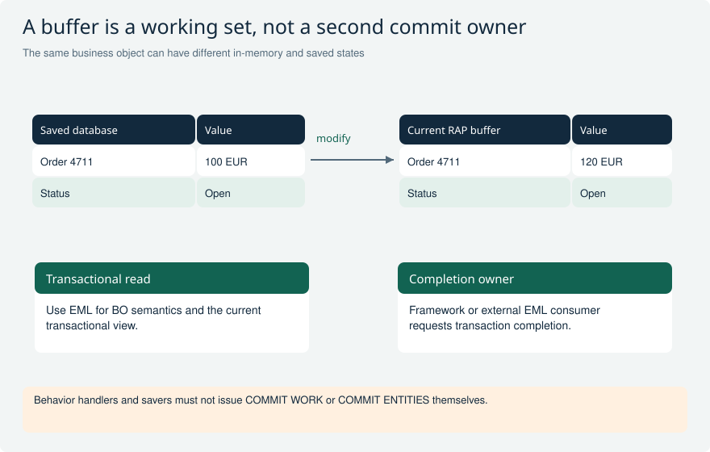

During modification, the transactional view can show 120 EUR while saved data still shows 100 EUR.

**Explain it:** Why can a direct SQL read be the wrong way to read the BO during modification?

**Limit:** Simplified single-record example, not a promise about a particular SQL isolation level.

Visual: RAP implementation ownership matrix

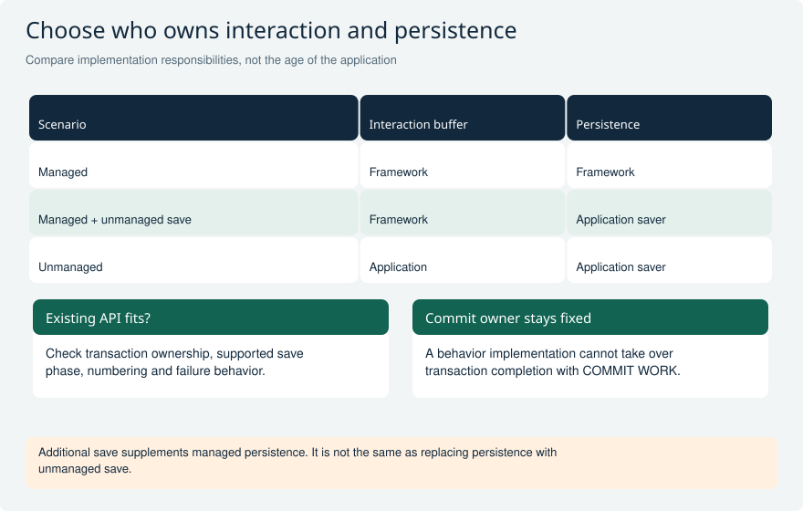

Trace the same request through three implementation choices and name the owner of each responsibility.

**Explain it:** Which part stays managed when only the save implementation is replaced?

**Limit:** Conceptual comparison; specific saver variants and failure support depend on release and scenario.

## SRAP-02 An audit record must be saved with every managed order change. Should you use a determination, additional save, or unmanaged save?

**Level:** Senior

**Short answer:** For an audit that must be saved with a managed order change, additional save may fit. RAP still writes the order, and the supported save extension writes the audit without committing separately. A determination is for deriving object data, not recording an already completed save. Distinguish this business audit from technical logs that may need to survive a rejected transaction.

**Reasoning and example:** An audit record may need the user, operation, changed values, and an identifier linking it to the order change. Check which data the save extension actually receives. Changed-field input is not necessarily a complete before-and-after image; use the documented data options and obtain any required previous values correctly. Explicitly cleared fields matter too.

Test order creation, update, deletion, and a rejected save. The business audit should match the actual saved outcome, rather than claiming a change happened when it rolled back. Technical diagnostics for the failure may have a separate purpose and lifecycle. Do not switch all order persistence to unmanaged save merely to add logging, or directly rewrite managed order tables from additional save.

**Avoid this mistake:** Writing the audit in another LUW and claiming it is guaranteed to match the order, or updating managed order tables directly from additional save.

**Interviewer follow-ups:**

- How do you obtain a trustworthy before-image?
- Should an audit failure reject the transaction, and in which phase can you detect predictable errors?

**Strong answer criteria:**

- Distinguishes business audit from diagnostics
- Preserves managed persistence and commit ownership
- Checks available change-image semantics

**Verification evidence:** Test successful create/update/delete and rejected save; compare order and audit persistence, including explicitly cleared fields.

**Read and verify this answer:**

- [SAP: Save options](https://help.sap.com/docs/btp/fc4c71aa50014fd1b43721701471913d/11e2c9d9a2c8420f88d1cf2d6c015c2b.html?version=202310.002) - Read what this operation is allowed to do in this RAP phase, and check support on the target release.

Visual: Save options: who writes the data and which method runs?

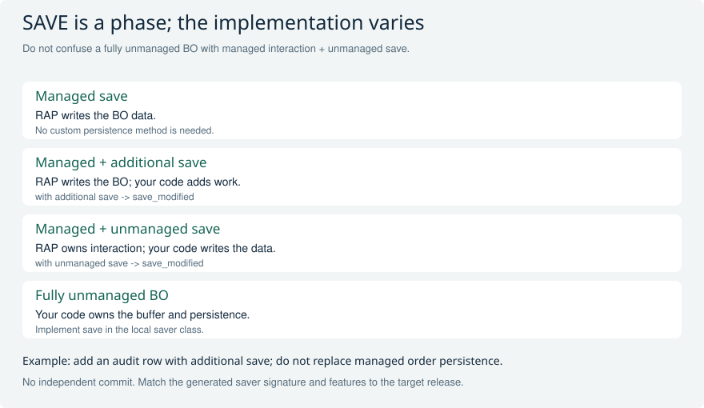

Compare four persistence choices. Both save extensions of managed BOs use save_modified; a fully unmanaged BO uses save.

**Explain it:** Why is with unmanaged save not the same implementation as a fully unmanaged BO?

**Limit:** Conceptual ownership comparison. The complete BDEF, change-image options and saver signatures depend on the scenario and release.

Visual: RAP transaction and workflow boundary

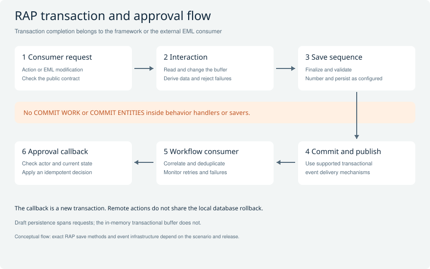

Separate the local transaction from event delivery and the later workflow callback.

**Explain it:** What is lost if a handler calls a committing legacy API?

**Limit:** Exact RAP save methods and supported event infrastructure depend on scenario and release.

Visual: RAP hook responsibilities

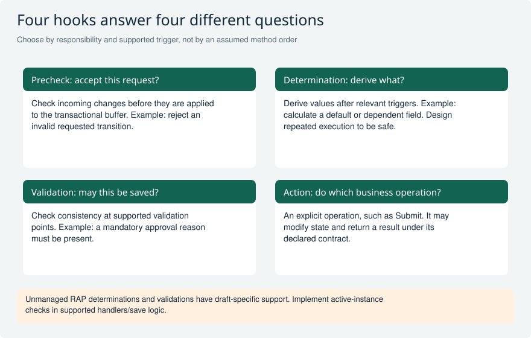

Read each card as a separate design question; this is not an execution sequence.

**Explain it:** Where would you derive a total, reject an invalid input and implement Submit?

**Limit:** Check scenario and release support; do not rely on an undocumented ordering of independent hooks.

Visual: RAP implementation ownership matrix

Trace the same request through three implementation choices and name the owner of each responsibility.

**Explain it:** Which part stays managed when only the save implementation is replaced?

**Limit:** Conceptual comparison; specific saver variants and failure support depend on release and scenario.

Visual: Augmentation versus additional save

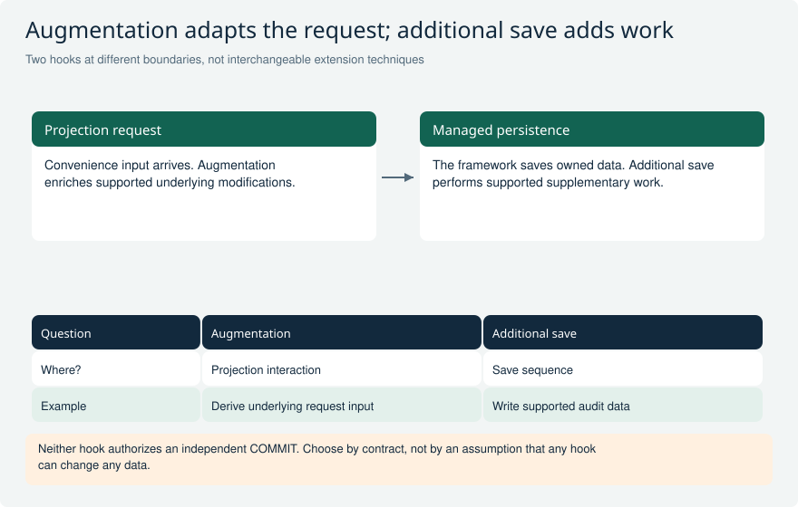

Locate the input transformation and persistence supplement on the same conceptual timeline.

**Explain it:** Why would writing an audit row not make augmentation the right save hook?

**Limit:** The arrow is conceptual; availability, supported fields and trigger details depend on the target RAP release.

## SRAP-03 A developer puts ordinary business validation in SAVE because the final data is available there. What would you change?

**Level:** Senior

**Short answer:** Move predictable business checks to the supported early save checks, after needed calculations and before late saving. Late save normally writes data that has already passed those checks. An error message is not a general rollback mechanism there. SAP does document special failure-capable saver options for some BAPI integrations. Verify that exact option and release instead of assuming all late failures work alike.

**Reasoning and example:** An approval amount exceeds the permitted limit. Detect that before database writes and return a message linked to the failing instance. The user can then correct the amount. Waiting until SAVE just because the final values are convenient there puts an ordinary business check at the wrong stage.

A database outage is a different technical failure and needs its supported recovery behavior. If a BAPI integration genuinely needs a documented failure-capable saver, inspect its generated signature and target-release guidance. That exception is not a reason to postpone checks that can run earlier, and it does not allow independently committed side effects. Avoid both absolutes: routine errors cannot all be returned from SAVE, but supported special cases do exist.

**Avoid this mistake:** Saying either 'all errors can be returned from SAVE' or 'no supported late-save failure mechanism exists anywhere'.

**Interviewer follow-ups:**

- Where do final derivations belong relative to final consistency checks?
- What evidence would justify using a failure-capable saver here?

**Strong answer criteria:**

- Rejects predictable business errors before late save
- Distinguishes invalid business data from technical failures
- Explains the documented BAPI exception and its limits

**Verification evidence:** Trace the save phases for invalid input and inspect the generated saver signature and SAP guidance for the installed release.

**Read and verify this answer:**

- [SAP: General RAP BO implementation contract](https://help.sap.com/docs/abap-cloud/abap-rap/general-rap-bo-implementation-contract) - Read what this operation is allowed to do in this RAP phase, and check support on the target release.
- [SAP: BAPI consumption, late numbering and save sequence](https://help.sap.com/docs/abap-cloud/developer-guide-from-classic-abap-to-abap-cloud/bapi-consumption-in-rap-late-numbering-and-save-sequence?locale=en-US&state=PRODUCTION&version=sap_cross_product_abap) - Read what this operation is allowed to do in this RAP phase, and check support on the target release.

Visual: RAP save sequence and early failure path

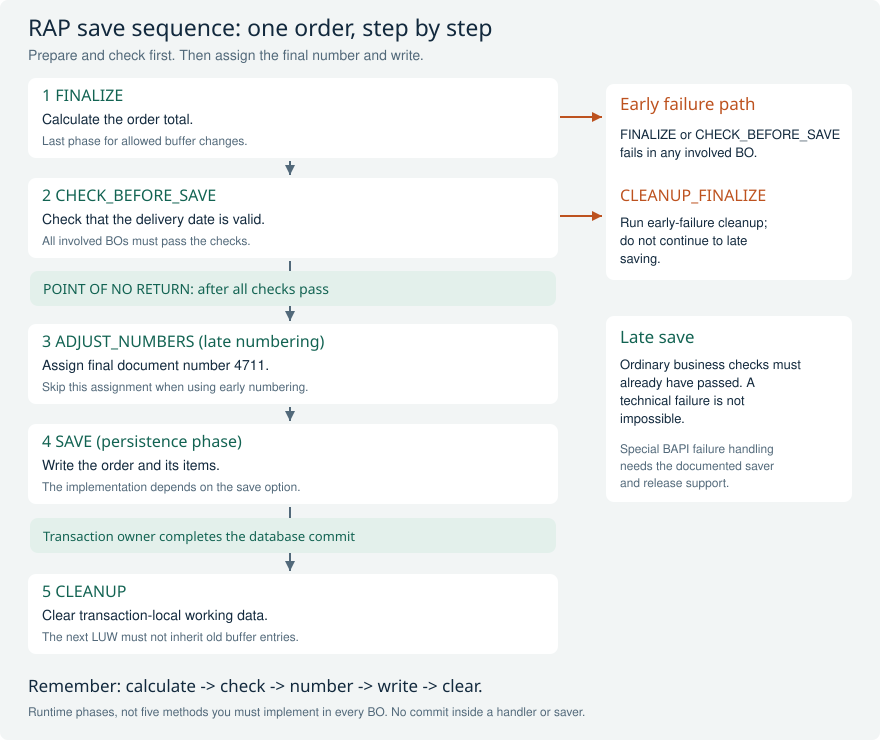

Follow one order from total calculation to buffer cleanup. The orange branch stops a rejected save before late numbering and persistence.

**Explain it:** Where is the last buffer-change phase, and when is the point of no return reached?

**Limit:** Simplified phase flow, not a trace of every runtime call. Managed and unmanaged implementation hooks differ; special late-failure support is scenario- and release-dependent.

Visual: RAP transaction and workflow boundary

Separate the local transaction from event delivery and the later workflow callback.

**Explain it:** What is lost if a handler calls a committing legacy API?

**Limit:** Exact RAP save methods and supported event infrastructure depend on scenario and release.

Visual: RAP hook responsibilities

Read each card as a separate design question; this is not an execution sequence.

**Explain it:** Where would you derive a total, reject an invalid input and implement Submit?

**Limit:** Check scenario and release support; do not rely on an undocumented ordering of independent hooks.

## SRAP-04 One action updates two local RAP BOs and then calls a remote payment service. Can the whole action be atomic?

**Level:** Senior

**Short answer:** Compatible local RAP objects can take part in the same RAP-controlled SAP transaction. A normal HTTP payment call cannot join that database transaction. If payment succeeds and local saving fails, local rollback will not undo payment. Model pending work and reliable delivery, or an explicit compensating process. Define timeout, retry, and reconciliation behavior instead of promising one atomic action.

**Reasoning and example:** Update the two local objects through supported behavior interfaces and check the permitted cross-object operations for the phase. Do not commit each object separately. Their shared local transaction can coordinate those compatible changes, but a remote payment has its own outcome and owner.

Store a stable business reference for the payment request. If the remote response times out, payment may still have completed; treat the result as unknown until a status check or reconciliation establishes it. A blind retry can charge twice. Show users an honest pending or recovery status, and test failures before and after both local save and remote response so every saved state has a recovery path.

**Avoid this mistake:** Assuming that calling HTTP inside an action enrolls the remote system in the SAP database transaction.

**Interviewer follow-ups:**

- What happens after a payment timeout followed by a retry?
- How would you recover after local commit succeeds but event delivery is delayed?

**Strong answer criteria:**

- Draws the local transaction boundary
- Models uncertain remote outcomes
- Designs idempotency and reconciliation

**Verification evidence:** Fault-inject before and after each local save and remote response boundary; verify that every persisted state has a documented recovery path.

**Read and verify this answer:**

- [SAP: General RAP BO implementation contract](https://help.sap.com/docs/abap-cloud/abap-rap/general-rap-bo-implementation-contract) - Read what this operation is allowed to do in this RAP phase, and check support on the target release.

Visual: Local and remote transaction boundaries

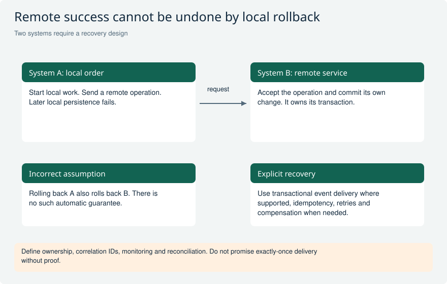

The remote commit belongs to another system, so local failure needs an explicit recovery strategy.

**Explain it:** What should happen if the remote side succeeds but the response is lost?

**Limit:** This explains distributed consistency, not a particular messaging product guarantee.

Visual: Remote commit and uncertain local outcome

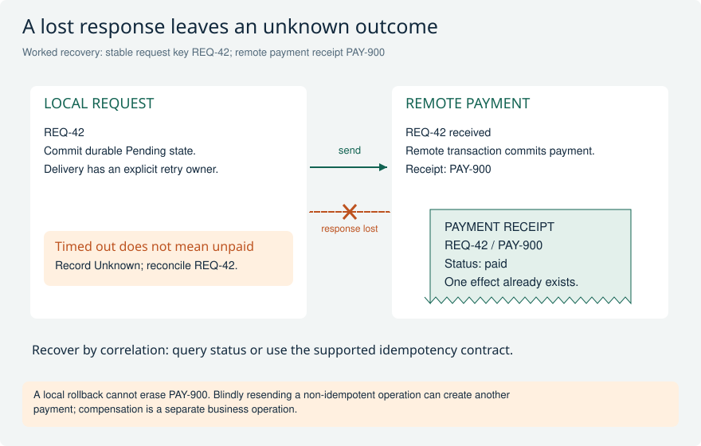

The local application durably records intent before separately owned delivery. The remote payment commits, but its reply is lost; recovery must identify the existing effect through REQ-42.

**Explain it:** How do you distinguish an unprocessed request from a committed payment whose response never arrived?

**Limit:** The delivery and idempotency mechanisms are design requirements, not automatic guarantees from HTTP or RAP. This example does not claim distributed atomicity.

## SRAP-05 A bulk EML update contains 200 instances, including missing keys and unauthorized changes. How do you report and process the result?

**Level:** Senior

**Short answer:** Handle all 200 inputs and keep each response linked to the right instance. FAILED identifies rejected work; REPORTED carries messages, including non-errors. MAPPED is for supported identity mappings, not a list of every success. Combine nested-call responses without losing earlier failures. The caller must still apply its commit policy and inspect the later save result.

**Reasoning and example:** Read the required current object state in suitable bulk operations instead of running a separate query for each row. Some keys may be missing, some updates may be unauthorized, and others may be valid. Every input needs an accountable outcome; unprocessed rows must not accidentally look successful because no error was added for them.

The consumer then decides whether the intended business unit permits eligible updates to continue or requires rejection of the whole unit. That decision depends on the supported operation and transaction boundary. Test several different failures in one input set and reconcile counts, identities, messages, and final database state. MODIFY ENTITIES accepting a change is not proof it has been committed.

**Avoid this mistake:** Checking only the first input row, treating every REPORTED entry as failure, or declaring the operation committed after MODIFY ENTITIES.

**Interviewer follow-ups:**

- How would you associate a child error with its root request?
- What do you check again after the external consumer issues COMMIT ENTITIES?

**Strong answer criteria:**

- Handles all inputs and aggregates responses
- Separates response roles and transaction phases
- Avoids row-by-row dependency access

**Verification evidence:** Run a mixed-input EML test with multiple distinct failures; assert key/message correlation, processed counts and final database state.

**Read and verify this answer:**

- [SAP: Entity Manipulation Language](https://help.sap.com/docs/abap-cloud/abap-rap/entity-manipulation-language-eml) - Read what this operation is allowed to do in this RAP phase, and check support on the target release.

Visual: FAILED, REPORTED, and MAPPED in a worked create

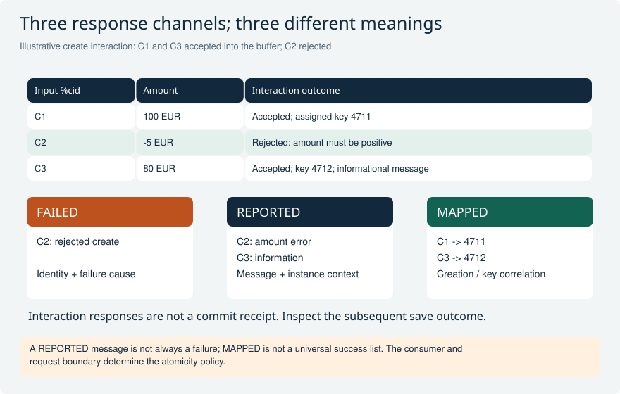

Three input identities produce separate rejection, message, and key-correlation information. A message on C3 does not itself reject that input, and assigned keys do not prove durable persistence.

**Explain it:** What must the consumer inspect after this interaction, and what happens if the later save fails?

**Limit:** Conceptual response contents, not executable EML. Available fields and correlation depend on the operation and BO; save and atomicity semantics must be tested separately.

## SRAP-06 An API consumer sends an empty comment to clear it, but the previous text remains. What do you investigate?

**Level:** Senior

**Short answer:** Check whether the caller supplied an empty value or omitted the field. In EML, the field list or %control says which fields should change. An empty value without that update instruction can correctly leave the old value alone. Trace payload conversion, adapter change flags, and defaulting logic. Do not mark every field supplied just to fix one cleared comment.

**Reasoning and example:** The caller sends only Comment with an empty value because it wants to remove the text. Amount and Currency are omitted and must remain unchanged. Verify that the service-to-EML mapping marks Comment for update, then check whether a determination fills the old default again. If a legacy API is called, map the corresponding change indicator too.

Test three cases separately: omitted comment, explicitly empty comment, and new nonempty text. Apply the same distinction to zero or false values where the field's business rules permit them. IS INITIAL alone cannot tell you whether the caller intended a change. Setting all control flags can fix the comment while accidentally clearing unrelated fields.

**Avoid this mistake:** Using IS INITIAL to mean 'not provided' for every update field, or blindly setting all control flags on.

**Interviewer follow-ups:**

- How would you represent 'leave unchanged' versus 'set to zero'?
- Where can a defaulting determination accidentally undo the requested clear?

**Strong answer criteria:**

- Separates presence from value
- Preserves partial-update semantics
- Traces control mapping through adapters

**Verification evidence:** Test omitted Comment, explicit empty Comment and nonempty Comment while asserting that all untouched fields remain unchanged.

**Read and verify this answer:**

- [SAP: Entity Manipulation Language](https://help.sap.com/docs/abap-cloud/abap-rap/entity-manipulation-language-eml) - Read what this operation is allowed to do in this RAP phase, and check support on the target release.

Visual: EML update intent: absent versus clear

The first two requests carry the same initial ABAP value but differ in update intent. The field control decides whether the old comment is preserved or explicitly cleared.

**Explain it:** How would you preserve Amount while clearing Comment, and how could an adapter lose that distinction?

**Limit:** This is a worked mapping example. Actual generated EML types, UPDATE FIELDS syntax, protocol nullability, and business validation remain authoritative.

## SRAP-07 You must create three new orders with items in one EML request before final order numbers exist. How do you correlate the tree?

**Level:** Senior

**Short answer:** Give each new order a unique content ID for this request. Use %cid_ref to connect item creation to the correct newly created parent. Keep child identities and creation mappings too. Use the generated behavior types and read mappings by identifier, not row position. These content IDs link work within a request; they are not final document numbers or durable retry keys.

**Reasoning and example:** Create three orders, each with several items, before final order numbers are assigned. One item under the second order is invalid. Its message must still point to the correct child and parent, even if inputs are reordered or one creation is rejected. Guessing database keys or matching response-table positions makes this fragile.

Use the supported create-by-association correlation and retain draft or preliminary-key context where applicable. When final keys are assigned, the original parent-child relationships must remain correct. Check MAPPED rather than assuming its order matches the input. Finally, let the external transaction owner apply the intended all-or-nothing policy; correct creation mapping does not by itself decide whether the three orders must save together.

**Avoid this mistake:** Assigning a fake database key to a new parent, correlating by row index, or confusing %cid with %pid.

**Interviewer follow-ups:**

- What changes if the BO uses draft and late numbering?
- How do you correlate an error when the final parent key is still unavailable?

**Strong answer criteria:**

- Connects new parents and children using content IDs
- Keeps the full transactional identity
- Tests errors in requests with several parents and children

**Verification evidence:** Execute a reordered multi-parent deep-create case with one failed child and verify associations, mappings and error paths before and after save.

**Read and verify this answer:**

- [SAP: Entity Manipulation Language](https://help.sap.com/docs/abap-cloud/abap-rap/entity-manipulation-language-eml) - Read what this operation is allowed to do in this RAP phase, and check support on the target release.

Visual: EML identity tags

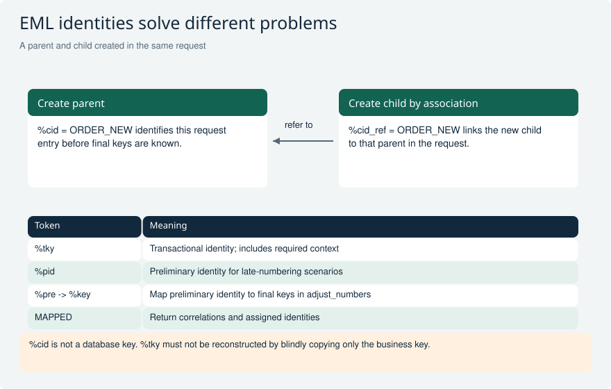

Content IDs connect entries within a request. Transactional and preliminary identities address other lifecycle needs.

**Explain it:** How can a new item refer to a newly created order before the final order number exists?

**Limit:** Generated EML types and available components are authoritative for the specific BO.

Visual: FAILED, REPORTED, and MAPPED in a worked create

Three input identities produce separate rejection, message, and key-correlation information. A message on C3 does not itself reject that input, and assigned keys do not prove durable persistence.

**Explain it:** What must the consumer inspect after this interaction, and what happens if the later save fails?

**Limit:** Conceptual response contents, not executable EML. Available fields and correlation depend on the operation and BO; save and atomicity semantics must be tested separately.

Visual: RAP identity and numbering timeline

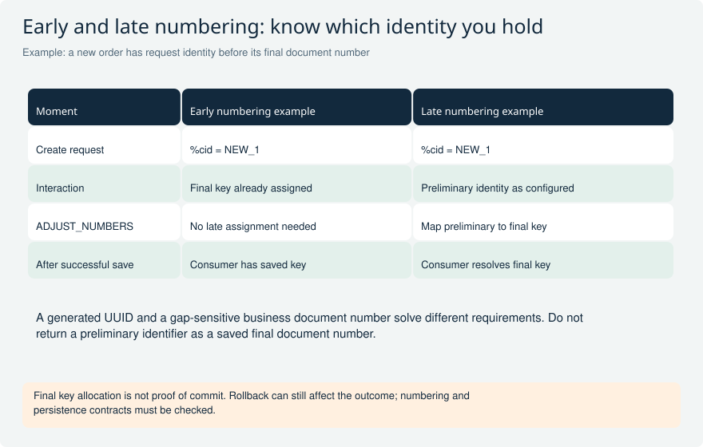

Compare when the identity becomes final and when persistence is confirmed.

**Explain it:** What must an external EML consumer inspect after MODIFY and after COMMIT?

**Limit:** Illustrative numbering paths; exact %pid/%pre mapping and conversion syntax are release/scenario-specific.

## SRAP-08 A posting API returns the final document number only when called. How would you integrate numbering without publishing incorrect keys?

**Level:** Senior

**Short answer:** Keep preliminary identities until the supported save process assigns final document keys. Map %pre to the final %key during number adjustment. SAP documents a BAPI pattern that calls creation in ADJUST_NUMBERS with a suitable failure-capable saver. Check its availability, API release status, and error rules on the target system. Do not present an earlier identifier as a committed document number.

**Reasoning and example:** Create several documents concurrently and include a rejected API call. Verify that items and returned mappings still identify the right final documents. Do not publish a number in an email or external event before the business change is durably saved. Late numbering alone also does not guarantee a gap-free sequence; number-range and posting-API behavior still matter.

In the documented failure-capable late-save scenario, a late-save failure makes COMMIT ENTITIES return sy-subrc 8. An external EML consumer must issue ROLLBACK ENTITIES before continuing. Verify support for that exact pattern. This rule does not allow commit or rollback statements inside a behavior implementation, and ordinary ADJUST_NUMBERS must not be assumed to offer the special failure response.

**Avoid this mistake:** Do not use SELECT MAX plus one, lose the preliminary-to-final key mapping, or assume ordinary ADJUST_NUMBERS supports recoverable failures without the documented special saver.

**Interviewer follow-ups:**

- How does the external EML consumer obtain the final key?
- What must be demonstrated if the business insists on gap-free numbering?

**Strong answer criteria:**

- Separates preliminary and final identities
- Qualifies the BAPI saver exception
- Does not promise gap-free numbers from RAP alone

**Verification evidence:** Create several documents concurrently, include a failing API call, and verify final key conversion, associations and number-allocation behavior.

**Read and verify this answer:**

- [SAP: BAPI consumption, late numbering and save sequence](https://help.sap.com/docs/abap-cloud/developer-guide-from-classic-abap-to-abap-cloud/bapi-consumption-in-rap-late-numbering-and-save-sequence?locale=en-US&state=PRODUCTION&version=sap_cross_product_abap) - Read what this operation is allowed to do in this RAP phase, and check support on the target release.

Visual: EML identity tags

Content IDs connect entries within a request. Transactional and preliminary identities address other lifecycle needs.

**Explain it:** How can a new item refer to a newly created order before the final order number exists?

**Limit:** Generated EML types and available components are authoritative for the specific BO.

Visual: RAP identity and numbering timeline

Compare when the identity becomes final and when persistence is confirmed.

**Explain it:** What must an external EML consumer inspect after MODIFY and after COMMIT?

**Limit:** Illustrative numbering paths; exact %pid/%pre mapping and conversion syntax are release/scenario-specific.

## SRAP-09 A user saves a draft, closes the browser, returns, and presses Activate. What state transitions and failures would you explain?

**Level:** Senior

**Short answer:** A saved draft is unfinished work, separate from active data. Activating a new draft creates active data; activating an edit draft applies changes to its active instance. Assigned Prepare checks, activation, and final saving must succeed. Discarding an edit draft leaves the existing active object intact. A business Submit action is a separate operation unless explicitly designed otherwise.

**Reasoning and example:** Ask what the user means by Save. A draft update can store unfinished editing data without completing the business document. The user can close the browser and later continue from that stored draft. If activation finds missing required data, the user should be able to correct the draft rather than lose the work.

Test both new and edit drafts through the intended UI or service. Discard a new draft and confirm it creates no active object; discard an edit draft and confirm the previous active object remains. Reopen in a fresh browser session and check messages as well as data. Other consumers that write active instances directly still need the appropriate checks; a draft-only flow cannot protect every write automatically.

**Avoid this mistake:** Treating draft persistence as a final business commit or implementing Submit by directly updating draft tables.

**Interviewer follow-ups:**

- Which checks must still protect an API that writes active instances directly?
- What remains after discarding an edit draft versus a new draft?

**Strong answer criteria:**

- Distinguishes draft, activation and business status
- Explains both new and edit drafts
- Preserves a recoverable validation experience

**Verification evidence:** Test new/edit draft creation, browser reopen, failed Prepare, successful activation and both discard variants; inspect active and draft results.

**Read and verify this answer:**

- [SAP: Draft runtime](https://help.sap.com/docs/abap-cloud/abap-rap/draft-runtime) - Read what this operation is allowed to do in this RAP phase, and check support on the target release.

Visual: Draft lifecycle

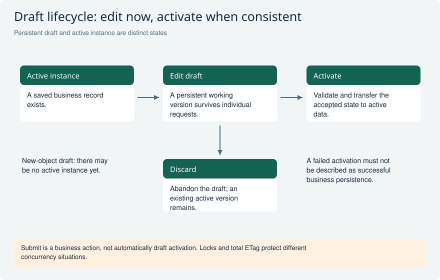

Follow edit, activate and discard for an existing active object, then explain how a new-object draft differs.

**Explain it:** What remains after discarding an edit draft? What if activation fails?

**Limit:** Schematic state transitions; draft actions and supported flows depend on the BO and consumer.

Visual: Three storage lifetimes: an illustrated analogy

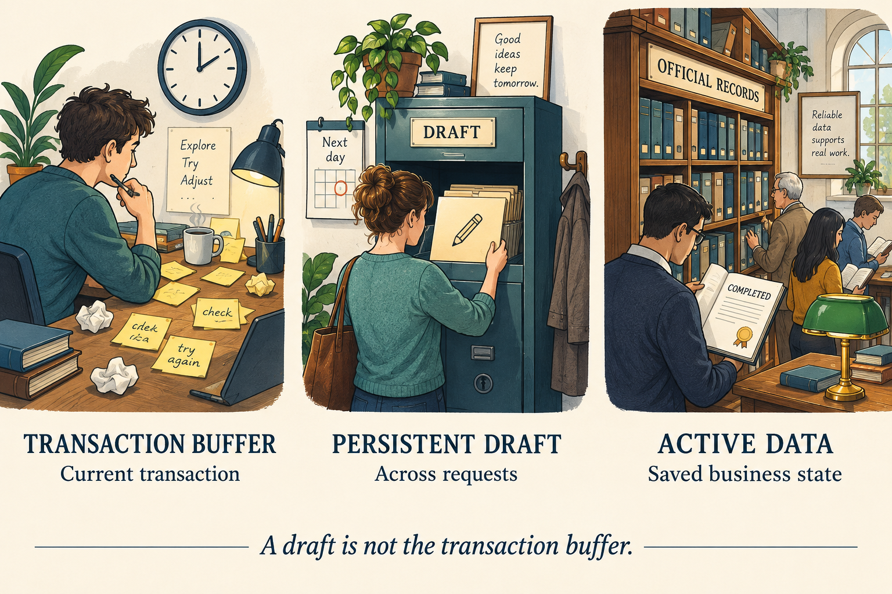

The desk represents the current transactional buffer; the draft cabinet represents persistent work across requests; the shared archive represents saved active data.

**Explain it:** Which of the three can survive several HTTP requests without becoming active business data?

**Limit:** An analogy, not literal SAP storage architecture or a mandatory three-stage pipeline. A new draft may have no active instance. Active business records may still be updated.

## SRAP-10 A draft lock expires, another process changes an active child, and the first user resumes editing. How do you prevent silent loss of the child change?

**Level:** Senior

**Short answer:** Check the total ETag for the whole relevant active object, including child changes. After an exclusive draft lock expires, resume uses that version to detect changes made to active data. A normal entity ETag has a different request-level job. If a child update does not advance the required total version, an old draft may overwrite newer work unnoticed.

**Reasoning and example:** A user starts editing an order draft and leaves it open until the exclusive lock expires. Another process changes only an active item. When the first user resumes, the application should detect that the active object changed and offer the supported conflict recovery, rather than treating the old draft as current.

Test this exact child-only case with two sessions. Check all active update paths, including APIs outside the UI. In unmanaged RAP, inspect the implemented lock and version maintenance rather than assuming it is provided automatically. Direct table writes can bypass it entirely. Renewing a lock is not proof that a stored draft still matches active data; the total-ETag check supplies that missing comparison.

**Avoid this mistake:** Checking only the root's own business fields or assuming an expired lock means the stored draft is automatically current.

**Interviewer follow-ups:**

- Which timestamp should change after a child-only modification?
- How do you distinguish stale If-Match handling from draft resume protection?

**Strong answer criteria:**

- Separates ordinary and total ETags
- Includes child and alternative update paths
- Defines a stale-draft recovery experience

**Verification evidence:** Use two sessions, expire the draft lock, change only an active child, then resume and verify the conflict and unchanged active data.

**Read and verify this answer:**

- [SAP RAP total ETag](https://help.sap.com/docs/ABAP_PLATFORM_NEW/fc4c71aa50014fd1b43721701471913d/f5e8548c241b43ab82bceec030b5dc9a.html) - Check how the total ETag protects draft resume after a lock expires. Distinguish it from the ETag used for a normal entity update.

Visual: Draft lifecycle

Follow edit, activate and discard for an existing active object, then explain how a new-object draft differs.

**Explain it:** What remains after discarding an edit draft? What if activation fails?

**Limit:** Schematic state transitions; draft actions and supported flows depend on the BO and consumer.

Visual: Two ETag boundaries

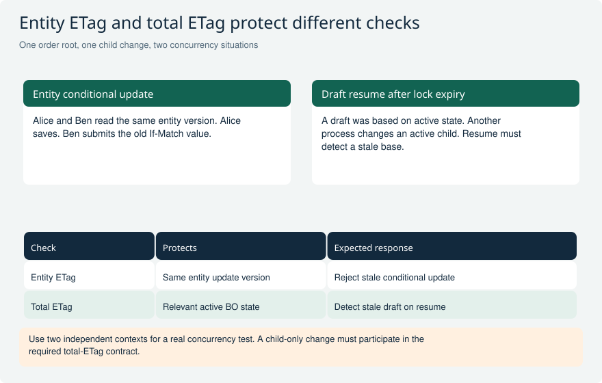

The left side tests a conditional entity update; the right tests the active-state basis of a resumed draft.

**Explain it:** Why does testing one entity ETag not prove the draft total-ETag implementation?

**Limit:** ETags are opaque. Verify lock expiry, relevant child changes and generated behavior on the actual system.

Visual: Two editors and one version: an illustrated story

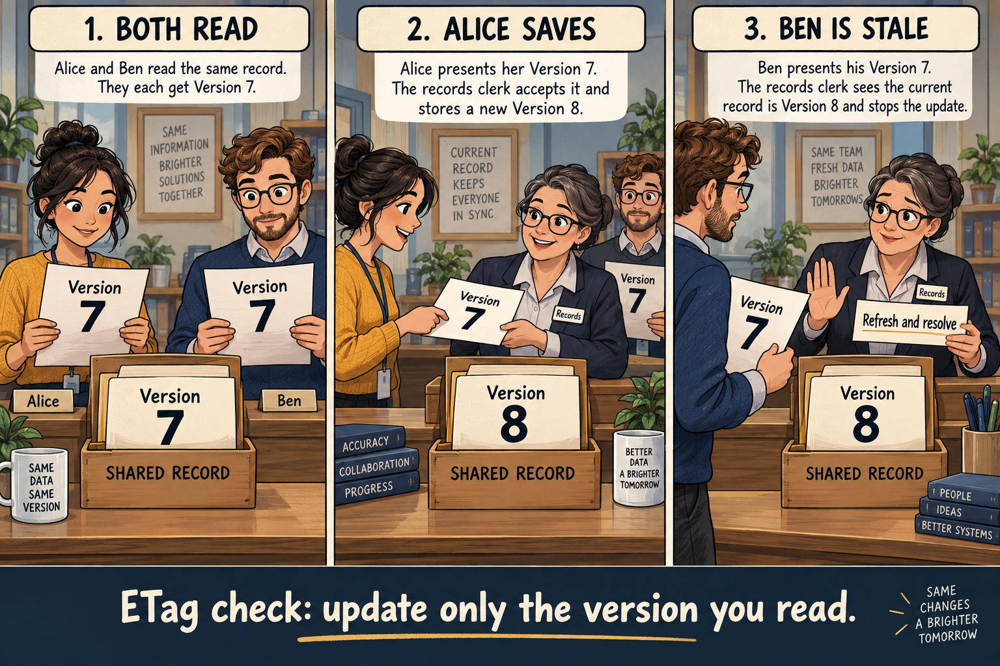

Alice and Ben read version 7. Alice updates successfully, producing version 8. Ben must not overwrite that newer state using the stale version 7 precondition.

**Explain it:** Why should the client refresh and resolve the conflict instead of blindly retrying its old payload?

**Limit:** Version numbers are illustrative. Real ETags are opaque validators; a failed If-Match precondition commonly returns HTTP 412. This is optimistic concurrency, not a pessimistic lock.

## SRAP-11 Two determinations calculate discount and total. Production results depend on which one executes first. How would you redesign them?

**Level:** Senior

**Short answer:** Calculate discount and total from the current source values without relying on an unspecified handler order. Repeating the calculation with the same input must give the same result. Cover every input that can affect it and avoid trigger loops. A shared calculation routine can help. For unmanaged active instances, first confirm that the chosen determination mechanism is actually supported.

**Reasoning and example:** If a rule subtracts a discount from an amount already discounted by a previous run, repeating it keeps lowering the total. Calculate from base price, quantity, and the intended discount instead. Changing Quantity and Discount together should produce the same final total as changing them separately. Update only the derived values that need changing.

Test repeated execution, combined edits, draft activation, and rules that trigger each other. Make sure they settle on a consistent result rather than loop or create extra children. Keep notifications and remote side effects out of repeatable calculations. A session flag saying run once can hide the symptom while leaving later valid changes uncalculated, so it is not a reliable replacement for correct derivation logic.

**Avoid this mistake:** Depending on declaration order, using a session flag to run once, or sending a notification each time the determination runs.

**Interviewer follow-ups:**

- What happens when activation reuses already executed consistency work?
- How would you detect and prevent a determination-trigger cycle?

**Strong answer criteria:**

- Repeating a calculation gives the same result
- Does not rely on an unsupported handler order
- Checks triggers and what the implementation type supports

**Verification evidence:** Test combined and separate field changes, repeated evaluation, draft activation and create-then-delete in one transaction; compare final values.

**Read and verify this answer:**

- [SAP: Determinations](https://help.sap.com/docs/ABAP_Cloud/c22b59d4c9314104b4a448f3d30ee2e3/6edb0438d3e14d18b3c403c406fbe209.html?version=sap_btp) - Read what this operation is allowed to do in this RAP phase, and check support on the target release.

Visual: RAP hook responsibilities

Read each card as a separate design question; this is not an execution sequence.

**Explain it:** Where would you derive a total, reject an invalid input and implement Submit?

**Limit:** Check scenario and release support; do not rely on an undocumented ordering of independent hooks.

## SRAP-12 A request changes CompanyCode to an unauthorized value and also makes its dates inconsistent. Would you use prechecks or validations?

**Level:** Senior

**Short answer:** Use a supported precheck to reject a disallowed incoming company-code change before it enters the buffer. Use the appropriate validation to reject inconsistent final dates. Keep the complete RAP authorization design as well; neither mechanism replaces it. For partial updates, combine supplied fields with the existing values needed for the check. Do not assume the request contains every field.

**Reasoning and example:** A user may be allowed to edit a request in company 1000 but not move it to company 2000. Check the proposed target context at the allowed operation boundary, including any permissions needed for the original context. The precheck must not accidentally accept an unauthorized change because it only examines the old company.

Separately, check the resulting date range. If only the end date is supplied, read the current start date needed for comparison. Test through both EML and the service so the rule is not just a UI convenience. For unmanaged active instances, implement consistency in the suitable handler or save checks; declared draft validations do not automatically protect active database writes.

**Avoid this mistake:** Treating prechecks as a global security bypass or believing a UI mandatory marker enforces all backend invariants.

**Interviewer follow-ups:**

- Which state does the precheck see before the update is applied?
- How would the rule behave for a partial update that omits both dates?

**Strong answer criteria:**

- Separates incoming intent from final state
- Keeps authorization explicit
- Accounts for partial updates and unmanaged restrictions

**Verification evidence:** Verify that a denied target context is rejected by the precheck before entering the transactional buffer. Separately verify that inconsistent dates are rejected by validation and cannot be persisted; test correction and successful retry through EML and the service.

**Read and verify this answer:**

- [SAP RAP operation prechecks](https://help.sap.com/docs/ABAP_PLATFORM_NEW/fc4c71aa50014fd1b43721701471913d/f6e3880b641649b1b8247486579a1c9b.html) - Check that prechecks inspect proposed changes before they enter the buffer. Validations reject invalid final data at their supported point in processing.

Visual: RAP hook responsibilities

Read each card as a separate design question; this is not an execution sequence.

**Explain it:** Where would you derive a total, reject an invalid input and implement Submit?

**Limit:** Check scenario and release support; do not rely on an undocumented ordering of independent hooks.

Visual: EML update intent: absent versus clear

The first two requests carry the same initial ABAP value but differ in update intent. The field control decides whether the old comment is preserved or explicitly cleared.

**Explain it:** How would you preserve Amount while clearing Comment, and how could an adapter lose that distinction?

**Limit:** This is a worked mapping example. Actual generated EML types, UPDATE FIELDS syntax, protocol nullability, and business validation remain authoritative.

Visual: Existing and proposed state authorization

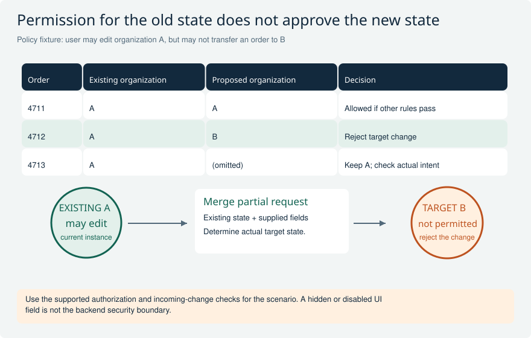

Editing the current A instance and moving it into B are different authorization decisions. Partial input must be interpreted with existing state without treating omitted fields as explicit clears.

**Explain it:** Which state does each check inspect, and what happens if a determination changes the target scope?

**Limit:** A policy example, not a universal company-code rule. Implement through the target RAP scenario's supported hooks; prechecks do not replace the complete authorization model.

## SRAP-13 A CopyOrder action creates an order, but the UI stays on the source and the consumer cannot identify the copy. How do you review the action contract?

**Level:** Senior

**Short answer:** Decide whether CopyOrder should be a factory action that creates a new instance. Its MAPPED response links the caller's content ID to that creation; it is not an ordinary action-result parameter. A normal action with a declared result must fill that result correctly instead. Check supported cardinality and UI navigation on the target release. Returning $self does not automatically mean create a copy.

**Reasoning and example:** Define what copying means before debugging navigation. Generate a new identity, reset approval status, omit source audit ownership, and decide which children should be copied. Assigning the whole source structure can incorrectly copy permissions or business state even when the new key is returned correctly.

Then call the action with several inputs through EML and the UI. Verify that each created object maps to the right source request and that the UI navigates according to the supported action behavior. If one source must create several targets, check the allowed cardinality for this release and consumer. A hard-coded UI redirect can hide a broken action response instead of fixing its identification rules.

**Avoid this mistake:** Assuming all factory-action cardinalities are identical on every release or solving wrong result mapping with a hard-coded UI redirect.

**Interviewer follow-ups:**

- What changes if one source must create several target objects?
- Which source fields and children must never be copied automatically?

**Strong answer criteria:**

- Chooses factory versus ordinary action deliberately
- Preserves request-to-created-instance mapping
- Defines copy semantics and release-dependent consumer behavior

**Verification evidence:** Call the action through EML and the UI with multiple inputs; verify mappings, new identities, reset fields and navigation to the correct instance.

**Read and verify this answer:**

- [SAP: Action definition](https://help.sap.com/docs/abap-cloud/abap-rap/action-definition) - Read what this operation is allowed to do in this RAP phase, and check support on the target release.

Visual: EML identity tags

Content IDs connect entries within a request. Transactional and preliminary identities address other lifecycle needs.

**Explain it:** How can a new item refer to a newly created order before the final order number exists?

**Limit:** Generated EML types and available components are authoritative for the specific BO.

## SRAP-14 A projection accepts a convenience field that must enrich an underlying create. Why might augmentation fit, and what are its boundaries?

**Level:** Senior

**Short answer:** Augmentation can add or translate input for supported operations at a RAP projection. Preserve values the caller already supplied and link generated work back to its original request. Check the permitted operations, control flags, and response behavior on the target release. It is not a general save hook. The base object's business rules must still protect every consumer.

**Reasoning and example:** A specialized projection accepts a display language when creating a request. Supported augmentation may add a related text creation so the underlying object receives both pieces of input. If the caller already supplied that text or a conflicting value, handle the conflict deliberately rather than overwriting it without explanation.

Use unique content IDs and the supported correlation mechanism so an error in generated child work can be traced to the original create. Test multiple instances, omitted convenience input, and generated-operation failures. Augmenting EML does not behave like an unrestricted normal modify call with arbitrary immediate results. Keep permanent consistency checks in the base behavior so another projection cannot bypass them by omitting the augmentation.

**Avoid this mistake:** Using augmentation to bypass base validations or expecting an unrestricted local result from an augmenting operation.

**Interviewer follow-ups:**

- What if the caller already supplied the field your augmentation wants to set?
- How is a generated child operation related back to the original request?

**Strong answer criteria:**

- Uses augmentation to adapt projection input
- Preserves supplied-field flags and request correlation
- Keeps shared business checks in the base object

**Verification evidence:** Test absent/present convenience fields, conflicting underlying input, multi-instance requests and generated-operation failures with the supported augmentation API.

**Read and verify this answer:**

- [SAP: Operation augmentation](https://help.sap.com/docs/abap-cloud/abap-rap/operation-augmentation) - Read what this operation is allowed to do in this RAP phase, and check support on the target release.

Visual: Augmentation versus additional save

Locate the input transformation and persistence supplement on the same conceptual timeline.

**Explain it:** Why would writing an audit row not make augmentation the right save hook?

**Limit:** The arrow is conceptual; availability, supported fields and trigger details depend on the target RAP release.

## SRAP-15 A legacy function module issues COMMIT WORK internally. Can you make it safe by wrapping it in a RAP action?

**Level:** Senior

**Short answer:** No. The wrapper still executes the function module's commit, which conflicts with RAP owning the transaction. Moving that call into a saver does not remove the problem. Look for a supported API with compatible buffering and saving, or design a separate asynchronous transaction explicitly. Check the entire call chain, language permissions, API release state, and authorization rules before integrating it.

**Reasoning and example:** Calling a function module that commits inside local RAP processing violates the runtime rules and may cause a runtime error. Do not assume the commit will simply succeed and RAP will continue normally. Trace the full call chain to find explicit or implicit commits before selecting the integration approach.

Moving the call to RFC or HTTP in a separate transaction does not restore atomicity. That remote operation can commit while local RAP saving later fails, leaving a real document behind despite the local rejection. If separate processing is necessary, define pending states, safe retry, and reconciliation. Test where durable effects occur. Do not hide the committing call or disable checks while promising that RAP can roll everything back.

**Avoid this mistake:** Do not hide a commit inside a wrapper or disable runtime checks. Moving it to another task does not make the separate transactions one LUW.

**Interviewer follow-ups:**

- How would you discover an implicit commit several calls below the adapter?
- What business states would an asynchronous replacement expose?

**Strong answer criteria:**

- Preserves RAP transaction ownership
- Audits nested and implicit transaction effects
- Offers a viable alternative integration boundary

**Verification evidence:** Review the dependency call graph and trace successful and rejected requests; document the first durable effect and the actual transaction owner.

**Read and verify this answer:**

- [SAP: General RAP BO implementation contract](https://help.sap.com/docs/abap-cloud/abap-rap/general-rap-bo-implementation-contract) - Read what this operation is allowed to do in this RAP phase, and check support on the target release.
- [SAP: BAPI consumption, late numbering and save sequence](https://help.sap.com/docs/abap-cloud/developer-guide-from-classic-abap-to-abap-cloud/bapi-consumption-in-rap-late-numbering-and-save-sequence?locale=en-US&state=PRODUCTION&version=sap_cross_product_abap) - Read what this operation is allowed to do in this RAP phase, and check support on the target release.

Visual: RAP transaction and workflow boundary

Separate the local transaction from event delivery and the later workflow callback.

**Explain it:** What is lost if a handler calls a committing legacy API?

**Limit:** Exact RAP save methods and supported event infrastructure depend on scenario and release.

Visual: Local and remote transaction boundaries

The remote commit belongs to another system, so local failure needs an explicit recovery strategy.

**Explain it:** What should happen if the remote side succeeds but the response is lost?

**Limit:** This explains distributed consistency, not a particular messaging product guarantee.

## SRAP-16 An older RAP BO works without strict mode. The team wants to release it for cloud consumption by adding strict(2). Is that sufficient?

**Level:** Senior

**Short answer:** No. strict(2) adds modeling and implementation checks; it does not release the object as an API. Review base and projection behavior together, including locks, permissions, ETags, and composition relationships. Check derived-type changes and eligible dependencies. A released API also needs a stable supported interface and lifecycle plan. Syntax success alone proves neither compatibility nor secure operation.

**Reasoning and example:** Capture the existing service metadata and representative EML and OData calls before enabling strict mode. Previously implicit behavior may need to be declared explicitly, and changes can affect what existing callers may do. Activate and test the whole dependent model on the target release, not just the base behavior definition.

Decide what the future released interface promises and which implementation details remain private. Check consumption and extension permissions separately, and define how incompatible changes will be handled. Documentation for a newer product version may describe features unavailable on this target. Run appropriate ATC checks and real consumer regressions, but do not treat strict mode as a Clean Core grade or an automatic API-release switch.

**Avoid this mistake:** Treating strict(2) as a clean-core grade or API-release switch, or enabling it only on one layer and ignoring resulting contract changes.

**Interviewer follow-ups:**

- Which implicit behavior could disappear when strict mode is enabled?
- What would you freeze in a released BO interface rather than in the base implementation?

**Strong answer criteria:**

- Separates strict checks from API release
- Reviews all affected layers
- Plans compatibility and consumer regression evidence

**Verification evidence:** Record before/after metadata, activate the full dependency set, run ATC and execute representative old consumer calls on the target release.

**Read and verify this answer:**

- [SAP: Strict mode implementation requirements](https://help.sap.com/docs/abap-cloud/abap-rap/strict-mode-implementation-requirements) - Read what this operation is allowed to do in this RAP phase, and check support on the target release.

Visual: RAP contract stack

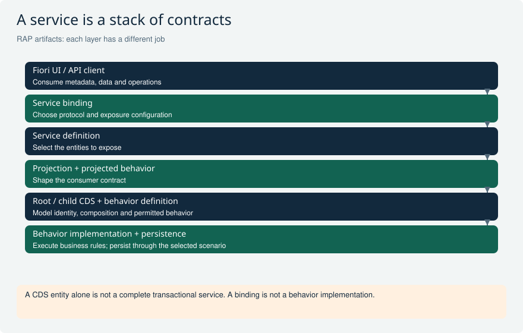

Read from the client down to storage, then explain what each artifact contributes.

**Explain it:** Where would you restrict the exposed operation set?

**Limit:** Conceptual layers; the exact artifact set depends on the scenario and release.

Visual: RAP release and consumption gates

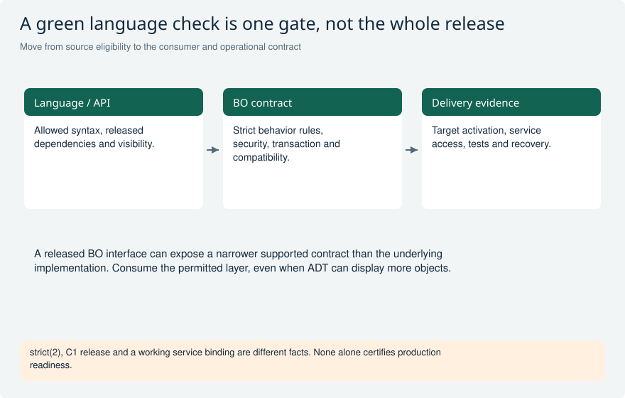

Review eligibility, behavior and delivery as separate evidence gates.

**Explain it:** Which gate would catch an API-compatible change that breaks deployment configuration?

**Limit:** A teaching checklist; exact release contracts, component visibility and delivery tools depend on the product.

## SRAP-17 An unmanaged BO passes isolated tests but a second request reads leftovers after an earlier save rejection. Where do you look?

**Level:** Senior

**Short answer:** Inspect the custom buffer's lifetime and every cleanup path, including early save rejection and external rollback. Reads must show this transaction's changes, not leftovers from an earlier one. CLEANUP and CLEANUP_FINALIZE have different jobs. After an early rejection, remove the appropriate finalize-derived work while retaining the state needed for valid continued interaction. Do not clear all data blindly.

**Reasoning and example:** An unmanaged implementation stores pending rows in a static internal table. Tests pass when each starts in a fresh session, but a failed transaction leaves entries that the next transaction reads. The problem can affect deleted rows, preliminary keys, counters, and dependency data as well as ordinary updates. A static table is not automatically a safe cache.

Run failure-then-success and rollback-then-read sequences in a reused session. Also test correcting data after an early save rejection. Identify which values came from user interaction and which were added during FINALIZE, then apply the documented cleanup behavior for each phase. Cleaning only after successful saves leaks state; erasing every user change after rejection can break the intended retry behavior.

**Avoid this mistake:** Implementing cleanup only after success or deleting all user changes after an early-save rejection without understanding the retry contract.

**Interviewer follow-ups:**

- Which data was created during FINALIZE rather than during user interaction?
- How would an in-transaction READ differ from a direct SELECT after an unsaved update?

**Strong answer criteria:**

- Keeps pending state inside its intended transaction
- Distinguishes the cleanup phases
- Reads current pending changes and preserves correct retry behavior

**Verification evidence:** Run failure-then-success, rollback-then-read and repeated-save sequences within a reused session; assert no stale buffer entries or leaked temporary identifiers.

**Read and verify this answer:**

- [SAP: Cleanup after early save failure](https://help.sap.com/docs/abap-cloud/abap-rap/f030096abe1d41f9ac7549f0290b9c09.html) - Read what this operation is allowed to do in this RAP phase, and check support on the target release.

Visual: RAP buffer with a concrete value change

During modification, the transactional view can show 120 EUR while saved data still shows 100 EUR.

**Explain it:** Why can a direct SQL read be the wrong way to read the BO during modification?

**Limit:** Simplified single-record example, not a promise about a particular SQL isolation level.

## SRAP-18 An Approved event should trigger an external workflow. Why is calling its HTTP endpoint from an on-save determination unreliable?

**Level:** Senior

**Short answer:** An on-save determination can run before commit and can run again. Its remote HTTP call cannot be undone by a local rollback. Use supported transactional event publication or another deliberately designed delivery mechanism. The event should describe a committed business change. Delivery and processing can still be retried, so the consumer must prevent duplicate effects and support recovery.

**Reasoning and example:** An order is approved locally, but saving later fails. If a determination already called the workflow endpoint, a workflow may exist for an approval that never became permanent. Publish through the supported transaction-aware path so that rejected local work does not create that false business fact.

Give the event a stable identity and enough version or transition information for the consumer to recognize duplicates and stale work. A repeated event must not create a second workflow, and a delayed event may need checking against a later cancellation. Monitor the local change, publication, delivery attempts, and consumer outcome separately. A successful HTTP response or in-process event is not proof of exactly-once business completion.

**Avoid this mistake:** Equating a successful HTTP response or a raised in-process event with durable, exactly-once end-to-end workflow execution.

**Interviewer follow-ups:**

- How would you recover an event that is delivered after the order is cancelled?
- What identifier prevents duplicate workflow creation?

**Strong answer criteria:**

- Separates local commit from remote effects
- Handles duplicate and stale events safely
- Monitors publication separately from consumer processing

**Verification evidence:** Test rejected save, publisher outage, duplicate delivery and stale delivery; verify no workflow for rejected data and one effective workflow per transition.

**Read and verify this answer:**

- [SAP: Business events](https://help.sap.com/docs/ABAP_PLATFORM_NEW/fc4c71aa50014fd1b43721701471913d/0b925bc556d4491aad395b21ec2566ff.html) - Read what this operation is allowed to do in this RAP phase, and check support on the target release.

Visual: RAP transaction and workflow boundary

Separate the local transaction from event delivery and the later workflow callback.

**Explain it:** What is lost if a handler calls a committing legacy API?

**Limit:** Exact RAP save methods and supported event infrastructure depend on scenario and release.

Visual: Duplicate events and stale approvals

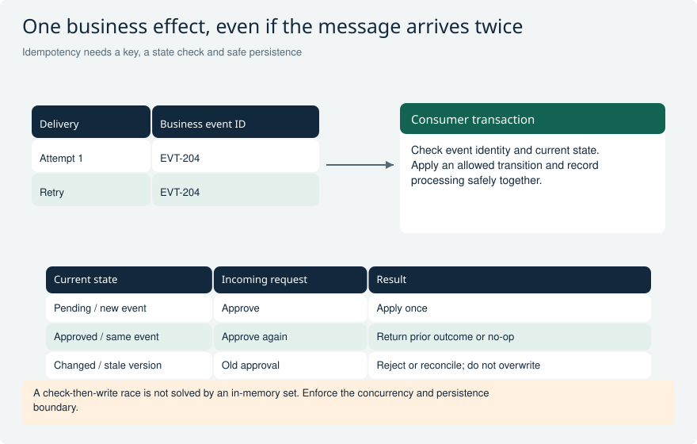

The event identity and current business state decide whether to apply, ignore or reject the request.

**Explain it:** Two consumers process the same event simultaneously: what prevents a double effect?

**Limit:** Exact transactional deduplication mechanisms depend on the chosen infrastructure.

Visual: Remote commit and uncertain local outcome

The local application durably records intent before separately owned delivery. The remote payment commits, but its reply is lost; recovery must identify the existing effect through REQ-42.

**Explain it:** How do you distinguish an unprocessed request from a committed payment whose response never arrived?

**Limit:** The delivery and idempotency mechanisms are design requirements, not automatic guarantees from HTTP or RAP. This example does not claim distributed atomicity.

## SRAP-19 A credit-limit check runs successfully on a draft, but active data is later saved through another consumer with an invalid amount. What is missing?

**Level:** Senior

**Short answer:** Protect the credit rule on every supported write path, including direct active updates. Check validation triggers, Prepare, and the implementation type. Managed save validation and fully unmanaged active consistency handling are different mechanisms. Also consider concurrent credit use. Passing a check earlier does not reserve credit or guarantee that the same amount is still available when saving.

**Reasoning and example:** A draft passes the credit check at 10:00. Before activation, another order uses part of the same customer's limit. The old check now describes an earlier situation. An API that writes active data directly can also miss a rule implemented only for a draft screen or draft-specific check.

Test both draft activation and direct active writes. Then run two transactions whose individual amounts fit the limit but whose combined amount exceeds it. Depending on the credit service, you may need an authoritative reservation, suitable locking, or a process that permits later rejection. Adding the same simple read twice does not eliminate the race between checking available credit and consuming it.

**Avoid this mistake:** Duplicating the check only in the UI or assuming validation alone eliminates a cross-transaction race.

**Interviewer follow-ups:**

- What prevents two parallel orders from consuming the same available credit?
- Which direct active-instance consumer tests would you add?

**Strong answer criteria:**

- Protects the credit rule for all supported callers
- Handles unmanaged active writes correctly
- Recognizes that data can change between checking and using it

**Verification evidence:** Exercise draft activation and direct active writes, then run two competing transactions whose combined amount exceeds the limit.

**Read and verify this answer:**

- [SAP: Validations](https://help.sap.com/docs/ABAP_PLATFORM_NEW/fc4c71aa50014fd1b43721701471913d/171e26c36cca42699976887b4c8a83bf.html) - Check when validation runs, its draft Prepare assignment, and managed versus unmanaged behavior. The proposed credit reservation and concurrency design is an example; validation alone does not guarantee it.

Visual: RAP buffer with a concrete value change

During modification, the transactional view can show 120 EUR while saved data still shows 100 EUR.

**Explain it:** Why can a direct SQL read be the wrong way to read the BO during modification?

**Limit:** Simplified single-record example, not a promise about a particular SQL isolation level.

Visual: RAP hook responsibilities

Read each card as a separate design question; this is not an execution sequence.

**Explain it:** Where would you derive a total, reject an invalid input and implement Submit?

**Limit:** Check scenario and release support; do not rely on an undocumented ordering of independent hooks.

## SRAP-20 In a mass approval request, one instance fails. Must all other approvals be rolled back?

**Level:** Senior

**Short answer:** It depends on the business unit of work and the actual transaction boundary. An EML operation, a SAP LUW, an OData atomicity group, and a whole batch are not the same scope. One FAILED entry alone does not define the outcome for every other input. The transaction owner must inspect responses and apply the required save or rollback policy.

**Reasoning and example:** If the business approves a package only when every request qualifies, model that package's all-or-nothing requirement explicitly and test the save boundary. If approvals are independent, split work into appropriate independent units and show each result clearly. Neither policy should happen accidentally because of how a loop or HTTP envelope was written.

Run a mixed-success case through the actual EML consumer and OData request structure. Check the final database state after the chosen commit or rollback path. A successful interaction response is not proof of persistence, and an OData batch can contain separate atomicity groups. Align the technical boundary with the business expectation rather than claiming every batch succeeds or fails as one transaction.

**Avoid this mistake:** Claiming that any FAILED entry universally rolls back every request, or that every OData batch is one atomic transaction.

**Interviewer follow-ups:**

- How does your answer change for separate atomicity groups?
- What must an external EML consumer do after a partial interaction failure?

**Strong answer criteria:**

- Identifies which changes must succeed together
- Distinguishes accepted changes from a successful save
- Matches transaction handling to the business requirement

**Verification evidence:** Test a mixed-success action via EML and the actual OData request shape; inspect persisted state after both intended commit and rollback paths.

**Read and verify this answer:**

- [SAP: Entity Manipulation Language](https://help.sap.com/docs/abap-cloud/abap-rap/entity-manipulation-language-eml) - Read what this operation is allowed to do in this RAP phase, and check support on the target release.

Visual: OData batch envelope and atomic groups

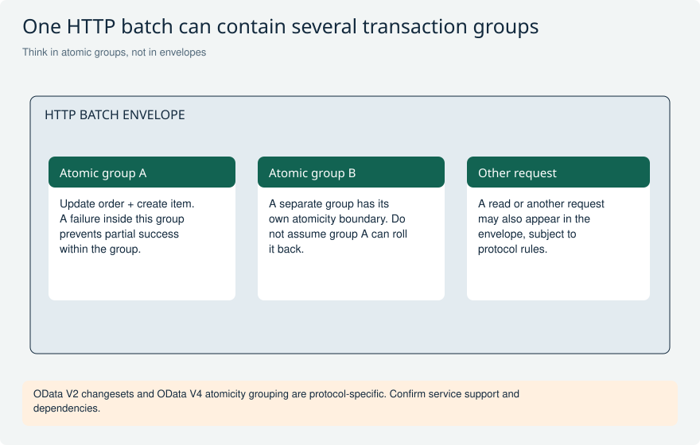

The outer envelope reduces HTTP packaging overhead; it does not establish one universal database transaction.

**Explain it:** If a later independent group fails, must an earlier successful group be rolled back?

**Limit:** Conceptual grouping, not an exact multipart or JSON batch payload.

Visual: FAILED, REPORTED, and MAPPED in a worked create

Three input identities produce separate rejection, message, and key-correlation information. A message on C3 does not itself reject that input, and assigned keys do not prove durable persistence.

**Explain it:** What must the consumer inspect after this interaction, and what happens if the later save fails?

**Limit:** Conceptual response contents, not executable EML. Available fields and correlation depend on the operation and BO; save and atomicity semantics must be tested separately.

## SRAP-21 After a quantity change, the backend total is correct but the Fiori page displays the old value. Is this a transaction bug?

**Level:** Senior

**Short answer:** First check whether the backend value is correct in the relevant draft or active state. If it is, inspect action results, side-effect metadata, and the UI's actual refresh requests. Side effects tell supported consumers what to reread; they do not calculate totals or commit data. Fix the refresh rule when that is the problem, rather than adding a commit.

**Reasoning and example:** Change an item quantity, then read the object through the service or EML in the same relevant state. If the total is already correct there, compare the browser's requests and response values. A missing refresh after a child change can explain why the screen shows the old total even though the calculation worked.

Verify that the metadata asks the supported client to refresh the needed total and action availability, and confirm those requests really occur. Reloading the entire page may hide the issue while losing edit context and fetching unnecessary data. If the total only becomes correct after activation, investigate the backend trigger timing too. Keep backend calculation and client display evidence separate throughout diagnosis.

**Avoid this mistake:** Adding COMMIT WORK to make the UI update or treating a side-effect declaration as a substitute for a backend determination.

**Interviewer follow-ups:**

- What if the total is correct only after activation?
- Which refresh targets and requests would you expect after an item quantity change?

**Strong answer criteria:**

- Diagnoses backend state and client state separately
- Preserves transaction ownership
- Validates metadata against real consumer behavior

**Verification evidence:** Compare EML/service values with browser requests before and after the change; verify draft context, refreshed totals and request volume.

**Read and verify this answer:**

- [SAP RAP side effects](https://help.sap.com/docs/abap-cloud/abap-rap/side-effects) - Check which field change or action triggers a refresh and what should be reread. Verify that the actual UI supports it.

Visual: Side effects and stale UI diagnosis

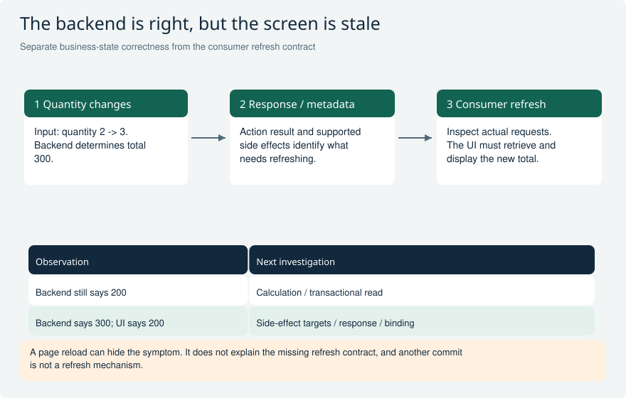

Use the observed backend value to choose the next debugging branch.

**Explain it:** What request proves that the consumer refreshed the calculated total?

**Limit:** Consumer and metadata support are release-dependent; a valid backend side effect is not proof that every client processes it.

## SRAP-22 Your team finds a useful SAP RAP base BO in ADT, but only a narrower BO interface is released. Which layer should your application consume?

**Level:** Senior

**Short answer:** Use the released BO interface and only the fields and operations it exposes for your allowed use. Visible source in ADT is not permission to consume the underlying base object. The interface lets the provider change internals while supporting callers. If an operation is missing, find another released API, request it, or revise the process. Do not bypass the interface with table writes.

**Reasoning and example:** Check whether the released interface includes the actions, fields, associations, and draft operations your application needs. A RAP BO interface exposes a supported subset of a business object; it is not simply an ordinary OO interface where you invent a handler. Target-release and cross-component visibility rules still apply.

Build the consumer using only that exposed subset and test its permissions and failure responses. If the base implementation has a useful extra operation, resist calling it merely because it activates today. C1 permission to consume the interface also does not imply permission to extend every underlying object. Record the actual capability gap so the design decision is explicit rather than hidden in an unsupported call.

**Avoid this mistake:** Calling the base BO because it activates today, or equating C1 consumption permission with permission to extend every underlying artifact.

**Interviewer follow-ups:**

- What does the interface protect when the provider changes its persistence model?
- How would you handle a required operation absent from the released interface?

**Strong answer criteria:**

- Calls the released interface
- Separates permission to use from permission to extend
- Checks missing capabilities before implementing

**Verification evidence:** Record API state and visibility in the target system; compile and test the consumer using only exposed fields, associations and operations.

**Read and verify this answer:**

- [SAP: Business object interface](https://help.sap.com/docs/ABAP_Cloud/abap-rap/business-object-interface) - Read what this operation is allowed to do in this RAP phase, and check support on the target release.

Visual: RAP contract stack

Read from the client down to storage, then explain what each artifact contributes.

**Explain it:** Where would you restrict the exposed operation set?

**Limit:** Conceptual layers; the exact artifact set depends on the scenario and release.

Visual: RAP release and consumption gates

Review eligibility, behavior and delivery as separate evidence gates.

**Explain it:** Which gate would catch an API-compatible change that breaks deployment configuration?

**Limit:** A teaching checklist; exact release contracts, component visibility and delivery tools depend on the product.

## SRAP-23 Two requests execute Submit for the same order, and one client retries after a timeout. How do you prevent duplicate business effects?

**Level:** Senior

**Short answer:** Protect Submit as a business-state change using the appropriate locks and version checks. Then define what a retry means once submission has already succeeded. Return the original effective result or reject the repeat consistently. Use durable correlation for downstream work so retries do not duplicate it. A disabled button or request-local content ID cannot provide that protection across requests.

**Reasoning and example:** Two requests both read status Open before either has protected the transition. Without the right concurrency handling, both may start submission. Coordinate the transition and its durable follow-up intent so only the intended business effect is created. Test simultaneous calls as well as a later retry after the response to a successful commit was lost.

If callers provide an idempotency key, scope it to the operation and relevant business context. Detect reuse with incompatible parameters and decide how long the result is retained and found. A timeout should not force the caller to guess whether another Submit is safe. A singleton flag, browser debounce, or %cid does not store the cross-request business history needed for this decision.

**Avoid this mistake:** Relying on a singleton flag, browser debounce, or request-local %cid as a durable cross-request idempotency key.

**Interviewer follow-ups:**

- What response should the retry receive if the first call committed but its response was lost?
- How do you handle the same idempotency key with different parameters?

**Strong answer criteria:**

- Coordinates state transition and concurrency
- Defines retry outcomes explicitly
- Prevents duplicate downstream effects durably

**Verification evidence:** Run simultaneous Submit calls and replay after a simulated lost response; verify one effective transition and one intended downstream operation.

**Read and verify this answer:**

- [SAP: General RAP BO implementation contract](https://help.sap.com/docs/abap-cloud/abap-rap/general-rap-bo-implementation-contract) - Read what this operation is allowed to do in this RAP phase, and check support on the target release.
- [SAP: Business events](https://help.sap.com/docs/ABAP_PLATFORM_NEW/fc4c71aa50014fd1b43721701471913d/0b925bc556d4491aad395b21ec2566ff.html) - Read what this operation is allowed to do in this RAP phase, and check support on the target release.

Visual: Duplicate events and stale approvals

The event identity and current business state decide whether to apply, ignore or reject the request.

**Explain it:** Two consumers process the same event simultaneously: what prevents a double effect?

**Limit:** Exact transactional deduplication mechanisms depend on the chosen infrastructure.

Visual: Remote commit and uncertain local outcome

The local application durably records intent before separately owned delivery. The remote payment commits, but its reply is lost; recovery must identify the existing effect through REQ-42.

**Explain it:** How do you distinguish an unprocessed request from a committed payment whose response never arrived?

**Limit:** The delivery and idempotency mechanisms are design requirements, not automatic guarantees from HTTP or RAP. This example does not claim distributed atomicity.

## SRAP-24 A validation reports the right error once, but the message remains after correction or appears on the wrong child. How would you debug it?

**Level:** Senior

**Short answer:** Check the message's transactional key, field markers, parent path, and state area. A state message must be removed or replaced when its condition is checked again. Confirm that correction triggers the right validation and uses the right draft instance. Add FAILED where rejection is required. Correct text alone cannot fix a message attached to the wrong child or stale state.

**Reasoning and example:** Two items have different delivery dates, and only the second is invalid. The message must identify that item and its parent path correctly. After the user fixes its date, revalidate the affected state area and clear the obsolete result using the supported pattern. Do not simply append another copy of the same message on every call.

Test invalid-to-valid-to-invalid edits, deletion of the failing child, and draft activation. Preserve unrelated errors from other checks rather than clearing all messages globally. Compare state messages that describe current invalid data with transition messages that describe one operation. Finally, verify the actual save rejection: REPORTED alone is not a substitute for the required FAILED response.

**Avoid this mistake:** Appending error text on every call without resetting its state area, or assuming REPORTED alone rejects a save.

**Interviewer follow-ups:**

- Which message should survive a round trip and which should not?
- How would you preserve an unrelated validation's error while clearing this one?

**Strong answer criteria:**

- Correlates messages to transactional identity and fields
- Manages state areas without erasing unrelated state
- Separates messaging from operation rejection

**Verification evidence:** Test invalid-to-valid-to-invalid edits on two children, child deletion and activation; assert message paths, stale-message removal and correct save rejection.

**Read and verify this answer:**

- [SAP RAP state messages](https://help.sap.com/docs/abap-cloud/abap-rap/state-messages) - Compare messages about the current object state with messages about one operation. Check which instance each message belongs to and how old state messages are cleared.

Visual: RAP message lifecycle and correction

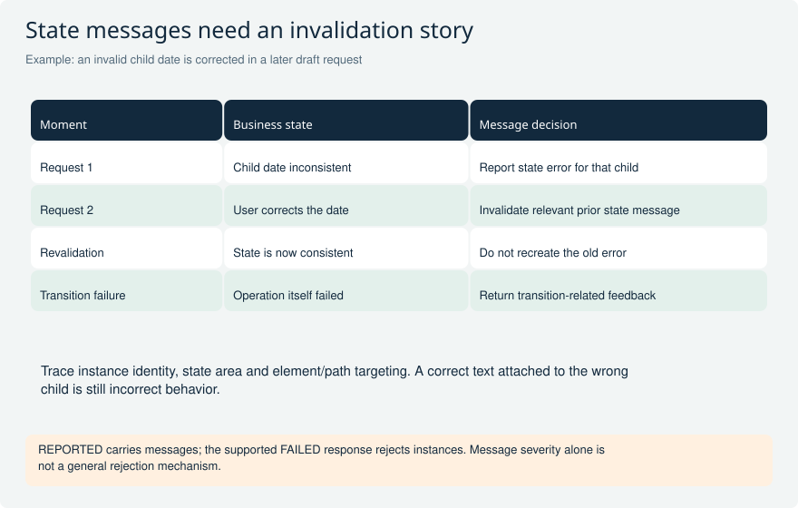

Follow the same child through an error and correction instead of treating a message as timeless text.

**Explain it:** Which identity and state area would you inspect when the old error remains?

**Limit:** Message lifetime and permitted state-message scenarios depend on active/draft and the supported operation contract.

## Official references

- [SAP: General RAP BO implementation contract](https://help.sap.com/docs/abap-cloud/abap-rap/general-rap-bo-implementation-contract)
- [SAP: Save options](https://help.sap.com/docs/btp/fc4c71aa50014fd1b43721701471913d/11e2c9d9a2c8420f88d1cf2d6c015c2b.html?version=202310.002)
- [SAP: BAPI consumption, late numbering and save sequence](https://help.sap.com/docs/abap-cloud/developer-guide-from-classic-abap-to-abap-cloud/bapi-consumption-in-rap-late-numbering-and-save-sequence?locale=en-US&state=PRODUCTION&version=sap_cross_product_abap)
- [SAP: Entity Manipulation Language](https://help.sap.com/docs/abap-cloud/abap-rap/entity-manipulation-language-eml)
- [SAP: Draft runtime](https://help.sap.com/docs/abap-cloud/abap-rap/draft-runtime)
- [SAP: Determinations](https://help.sap.com/docs/ABAP_Cloud/c22b59d4c9314104b4a448f3d30ee2e3/6edb0438d3e14d18b3c403c406fbe209.html?version=sap_btp)
- [SAP: Action definition](https://help.sap.com/docs/abap-cloud/abap-rap/action-definition)
- [SAP: Operation augmentation](https://help.sap.com/docs/abap-cloud/abap-rap/operation-augmentation)
- [SAP: Strict mode implementation requirements](https://help.sap.com/docs/abap-cloud/abap-rap/strict-mode-implementation-requirements)
- [SAP: Business object interface](https://help.sap.com/docs/ABAP_Cloud/abap-rap/business-object-interface)
- [SAP: Business events](https://help.sap.com/docs/ABAP_PLATFORM_NEW/fc4c71aa50014fd1b43721701471913d/0b925bc556d4491aad395b21ec2566ff.html)
- [SAP: Cleanup after early save failure](https://help.sap.com/docs/abap-cloud/abap-rap/f030096abe1d41f9ac7549f0290b9c09.html)
- [SAP RAP total ETag](https://help.sap.com/docs/ABAP_PLATFORM_NEW/fc4c71aa50014fd1b43721701471913d/f5e8548c241b43ab82bceec030b5dc9a.html)
- [SAP RAP operation prechecks](https://help.sap.com/docs/ABAP_PLATFORM_NEW/fc4c71aa50014fd1b43721701471913d/f6e3880b641649b1b8247486579a1c9b.html)
- [SAP RAP side effects](https://help.sap.com/docs/abap-cloud/abap-rap/side-effects)
- [SAP RAP state messages](https://help.sap.com/docs/abap-cloud/abap-rap/state-messages)
