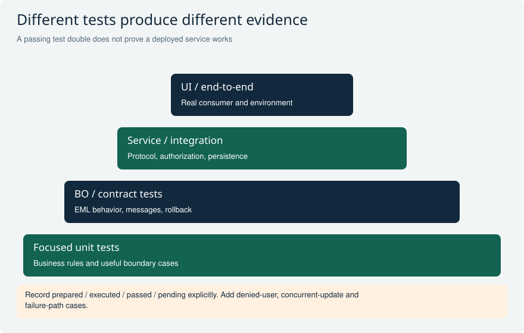
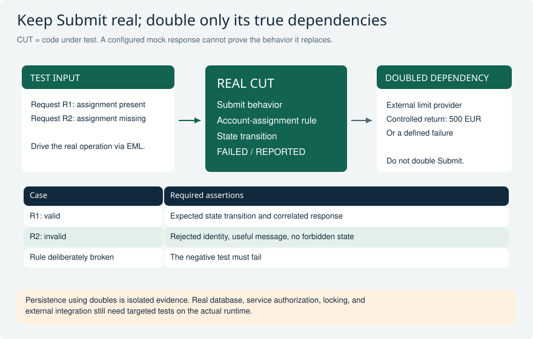
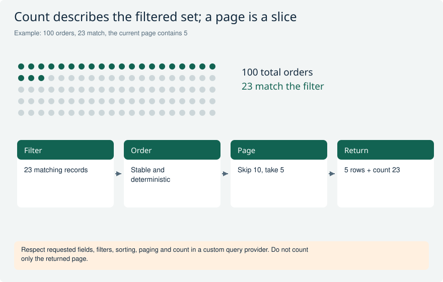
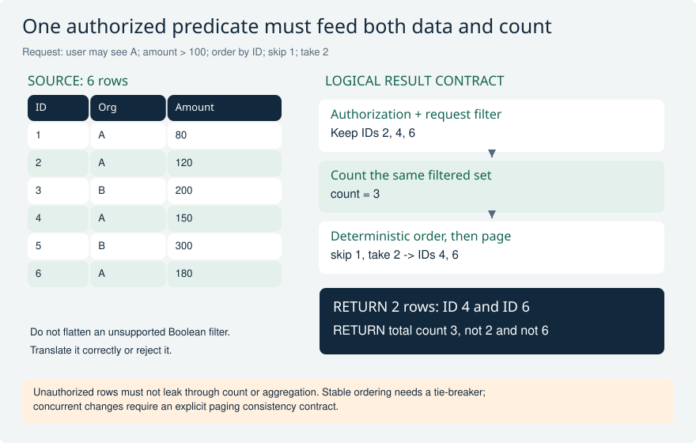
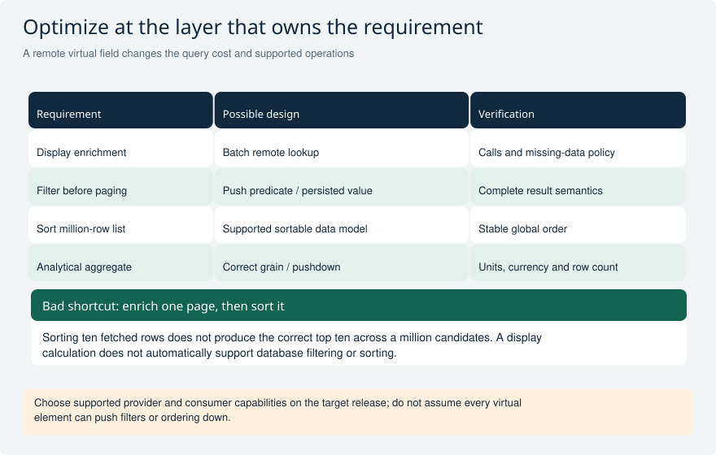
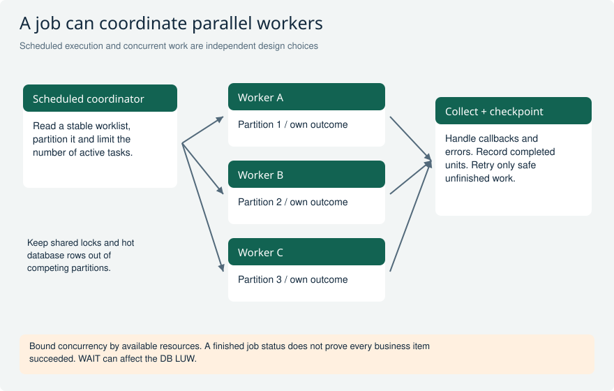
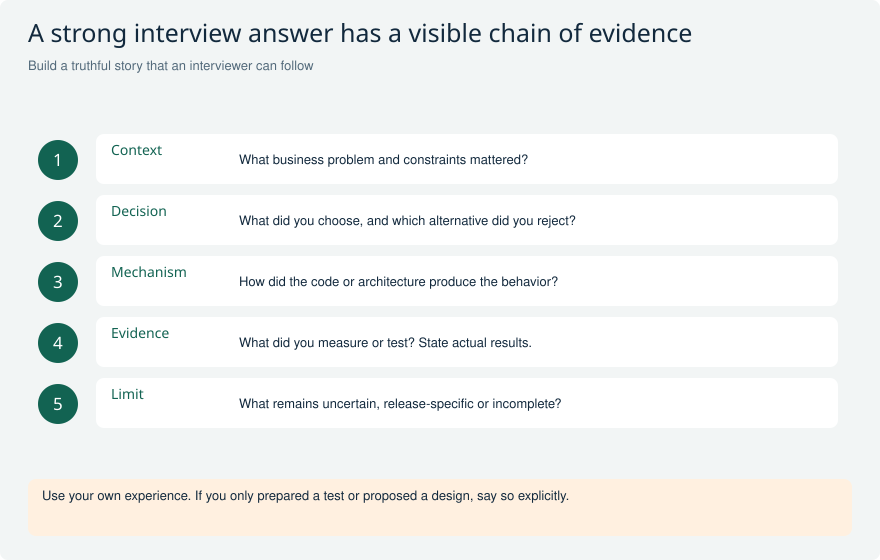

# Senior RAP testing, performance and production

Defend the evidence behind a cloud service: observable behavior, failure recovery, real consumer security, measured performance and reliable delivery. All scenarios are hypothetical; no SAP execution is implied.

[Return to the study guide](../README.md) | [Study plan](../study/Study_Plan.md)

## OPS-01 How would you test a Submit action without replacing the business object you are supposed to verify?

**Level:** Senior

**Short answer:** Keep the Submit implementation and its relevant BO behavior real. Isolate true dependencies such as database tables, external service adapters or other BOs using the appropriate supported doubles. Drive the operation through a meaningful boundary, often EML, and assert state changes, failures and messages. A double of the very action under test would prove the configured double response rather than the business rule.

**Example and follow-up:** A purchase request can be submitted only when every item has an account assignment. Test a valid request and a missing assignment, including persisted outcome after the supported save boundary. If another BO supplies a limit, double that dependency and vary its response.

**Avoid this mistake:** Do not label a test of a mocked Submit response as a test of Submit.

**Interviewer follow-ups:**

- Which behavior remains real?
- How do you prove rejected data was not persisted?

**Strong answer criteria:**

- Defines the unit/contract under test
- Doubles only dependencies
- Asserts state plus response semantics

**Verification evidence:** Show the dependency diagram and a failing test when the real Submit check is deliberately broken.

**Read and verify this answer:**

- [SAP RAP test frameworks and boundaries](https://help.sap.com/docs/abap-cloud/abap-rap/used-frameworks-and-tools) - Use the framework contract to design the proposed evidence; no runtime result is claimed here.

Visual: Testing scope and evidence

The widening base suggests many focused checks, but there is no mandatory numerical ratio.

**Explain it:** Which risk remains after an ABAP Unit test with doubles passes?

**Limit:** Conceptual coverage map, not a count of tests actually run in SAP.

Visual: Real behavior under test and dependency doubles

Two deliberately different inputs exercise the real Submit rule while a separate limit-provider dependency is controlled. Assertions inspect state and response identity, not only execution coverage.

**Explain it:** If the account-assignment rejection is removed, which test fails? What evidence remains missing after these tests pass?

**Limit:** The fixture is conceptual and not an executed ABAP Unit result. Framework double support and persistence setup depend on the target release and test boundary.

## OPS-02 When would SQL doubles, CDS doubles and RAP BO doubles give misleading confidence?

**Level:** Senior

**Short answer:** They isolate different dependencies. SQL doubles replace table access, CDS doubles support tests of CDS logic, and RAP BO doubles isolate dependent EML behavior. Choose the boundary according to the risk being tested. Generic BO buffer doubles do not execute arbitrary custom provider rules, and access-control behavior needs explicit treatment. Complement isolated tests with targeted integration tests for actual persistence, authorization and service contracts.

**Example and follow-up:** A calculation test may use a SQL double successfully while a dependent action contract changes unnoticed. Conversely, a mocked EML response can test consumer error handling without proving the provider action. Name exactly which conclusion each test supports.

**Avoid this mistake:** A more sophisticated double does not automatically provide broader integration evidence.

**Interviewer follow-ups:**

- Does this double execute custom determinations?
- Which real boundary still needs verification?

**Strong answer criteria:**

- Matches doubles to dependency type
- States excluded behavior
- Adds focused integration evidence

**Verification evidence:** Record test scope and verify one representative path through the real provider and service.

**Read and verify this answer:**

- [SAP RAP test frameworks and boundaries](https://help.sap.com/docs/abap-cloud/abap-rap/used-frameworks-and-tools) - Use the framework contract to design the proposed evidence; no runtime result is claimed here.
- [SAP transactional buffer double support](https://help.sap.com/docs/abap-cloud/abap-development-tools-user-guide/transactional-buffer-double-support) - Use the framework contract to design the proposed evidence; no runtime result is claimed here.

Visual: Testing scope and evidence

The widening base suggests many focused checks, but there is no mandatory numerical ratio.

**Explain it:** Which risk remains after an ABAP Unit test with doubles passes?

**Limit:** Conceptual coverage map, not a count of tests actually run in SAP.

Visual: Real behavior under test and dependency doubles

Two deliberately different inputs exercise the real Submit rule while a separate limit-provider dependency is controlled. Assertions inspect state and response identity, not only execution coverage.

**Explain it:** If the account-assignment rejection is removed, which test fails? What evidence remains missing after these tests pass?

**Limit:** The fixture is conceptual and not an executed ABAP Unit result. Framework double support and persistence setup depend on the target release and test boundary.

## OPS-03 A bulk EML action processes ten requests and rejects two. What should its test assert?

**Level:** Senior

**Short answer:** Assert each input-to-result correlation and the intended atomicity contract, not just the number of messages. Verify which identities appear in FAILED, where reported messages point, and what changes remain buffered or persisted after transaction completion. Cover failures during interaction and save separately. The desired all-or-nothing or permitted partial-result behavior must be explicit and supported by the chosen request boundary.

**Example and follow-up:** Use nonsequential keys and distinct invalid reasons so accidental row-position correlation is visible. Reorder input and response fixtures. Include a successful interaction followed by a save rejection, and ensure the consumer does not report that object as durably complete.

**Avoid this mistake:** Do not equate ten returned messages with ten correct operation outcomes.

**Interviewer follow-ups:**

- Which failures occur only on save?
- Can the caller correlate reordered results?

**Strong answer criteria:**

- Checks per-instance correlation
- Separates interaction and persistence
- Tests the declared atomicity rule

**Verification evidence:** Show expected accepted/rejected identities, field messages and final persisted rows for each failure phase.

**Read and verify this answer:**

- [SAP RAP test frameworks and boundaries](https://help.sap.com/docs/abap-cloud/abap-rap/used-frameworks-and-tools) - Use the framework contract to design the proposed evidence; no runtime result is claimed here.

Visual: FAILED, REPORTED, and MAPPED in a worked create

Three input identities produce separate rejection, message, and key-correlation information. A message on C3 does not itself reject that input, and assigned keys do not prove durable persistence.

**Explain it:** What must the consumer inspect after this interaction, and what happens if the later save fails?

**Limit:** Conceptual response contents, not executable EML. Available fields and correlation depend on the operation and BO; save and atomicity semantics must be tested separately.

Visual: Real behavior under test and dependency doubles

Two deliberately different inputs exercise the real Submit rule while a separate limit-provider dependency is controlled. Assertions inspect state and response identity, not only execution coverage.

**Explain it:** If the account-assignment rejection is removed, which test fails? What evidence remains missing after these tests pass?

**Limit:** The fixture is conceptual and not an executed ABAP Unit result. Framework double support and persistence setup depend on the target release and test boundary.

## OPS-04 A draft test passes when run alone but fails after another test. What would you inspect?

**Level:** Senior

**Short answer:** Inspect shared fixtures, draft and active identities, transactional buffers, locks and double-environment lifecycle. Each test must establish its own relevant state and release/reset supported test resources. Do not use uncontrolled commits to make a suite pass. Verify draft-specific actions and the chosen test framework boundaries rather than assuming an active-instance fixture represents a draft.

**Example and follow-up:** Two tests reuse the same business key but differ in draft context. One leaves a buffer or configured double response behind. Run the pair in reversed order and with distinct fixtures, then fix lifecycle isolation while preserving the scenario being tested.

**Avoid this mistake:** A test that depends on execution order is unreliable evidence for draft behavior.

**Interviewer follow-ups:**

- Are active and draft transactional keys distinct?
- Which setup/teardown resource is shared?

**Strong answer criteria:**

- Tracks complete transactional identity
- Resets supported resources
- Checks ordering independence

**Verification evidence:** Run the isolated tests, both orders and the suite; retain evidence of deterministic results.

**Read and verify this answer:**

- [SAP RAP test frameworks and boundaries](https://help.sap.com/docs/abap-cloud/abap-rap/used-frameworks-and-tools) - Use the framework contract to design the proposed evidence; no runtime result is claimed here.

Visual: Draft lifecycle

Follow edit, activate and discard for an existing active object, then explain how a new-object draft differs.

**Explain it:** What remains after discarding an edit draft? What if activation fails?

**Limit:** Schematic state transitions; draft actions and supported flows depend on the BO and consumer.

Visual: Three storage lifetimes: an illustrated analogy

The desk represents the current transactional buffer; the draft cabinet represents persistent work across requests; the shared archive represents saved active data.

**Explain it:** Which of the three can survive several HTTP requests without becoming active business data?

**Limit:** An analogy, not literal SAP storage architecture or a mandatory three-stage pipeline. A new draft may have no active instance. Active business records may still be updated.

## OPS-05 How do you prove optimistic concurrency rather than merely calling the same update twice?

**Level:** Senior

**Short answer:** Use independent consumers or sessions that read the same initial version, then perform conflicting updates in a controlled order. Assert that the first permitted write succeeds and the stale second precondition is rejected without lost data. For draft, separately test the exclusive-lock and total-ETag situations. A sequential test that rereads after every update never exercises a stale writer.

**Example and follow-up:** Alice and Ben read the same entity instance with its entity ETag. Alice updates that instance successfully; Ben submits an update to that same instance using the stale ETag and must not overwrite it. Separately test child-only active changes against the configured draft total ETag when resuming an expired draft lock. Keep entity-level conditional update and draft-resume concurrency assertions distinct.

**Avoid this mistake:** Two updates in one shared transaction are not a realistic two-user concurrency test.

**Interviewer follow-ups:**

- How do you control the interleaving?
- Which field protects the whole draft object?

**Strong answer criteria:**

- Uses independent contexts
- Creates a deliberately stale request
- Asserts unchanged data after rejection

**Verification evidence:** Capture request versions, responses and final values for the orchestrated conflicting sessions.

**Read and verify this answer:**

- [SAP total ETag and draft concurrency](https://help.sap.com/docs/ABAP_PLATFORM_NEW/fc4c71aa50014fd1b43721701471913d/f5e8548c241b43ab82bceec030b5dc9a.html) - Use the framework contract to design the proposed evidence; no runtime result is claimed here.

Visual: Two ETag boundaries

The left side tests a conditional entity update; the right tests the active-state basis of a resumed draft.

**Explain it:** Why does testing one entity ETag not prove the draft total-ETag implementation?

**Limit:** ETags are opaque. Verify lock expiry, relevant child changes and generated behavior on the actual system.

Visual: Two editors and one version: an illustrated story

Alice and Ben read version 7. Alice updates successfully, producing version 8. Ben must not overwrite that newer state using the stale version 7 precondition.

**Explain it:** Why should the client refresh and resolve the conflict instead of blindly retrying its old payload?

**Limit:** Version numbers are illustrative. Real ETags are opaque validators; a failed If-Match precondition commonly returns HTTP 412. This is optimistic concurrency, not a pessimistic lock.

## OPS-06 Fiori still displays an old total after a successful action. How do you separate UI refresh from backend correctness?

**Level:** Senior

**Short answer:** Check the actual operation response and a fresh read of the authoritative BO state. If the backend value is wrong, inspect derivation triggers and transactional reads. If the backend is correct, inspect the action result, side-effect declarations, requested fields and consumer support. Avoid adding a second calculation in the UI that conceals missing backend consistency. Test the real deployed metadata rather than only a local preview.

**Example and follow-up:** Changing an item updates the server total but the header remains stale. Compare a direct read, a new UI session and the original session network requests. The correction may be a targeted refresh contract, not another commit or a full-page reload.

**Avoid this mistake:** A page reload workaround does not explain whether the backend or refresh contract was defective.

**Interviewer follow-ups:**

- What does a fresh service read return?
- Which request should refresh the affected property?

**Strong answer criteria:**

- Establishes the authoritative value
- Traces metadata and network behavior
- Keeps business calculation server-side

**Verification evidence:** Record action and follow-up reads with before/after values in the actual consumer.

**Read and verify this answer:**

- [SAP RAP side effects](https://help.sap.com/docs/abap-cloud/abap-rap/side-effects) - Read the field/action trigger and refresh-target contract; verify the actual UI consumer support.

Visual: Side effects and stale UI diagnosis

Use the observed backend value to choose the next debugging branch.

**Explain it:** What request proves that the consumer refreshed the calculated total?

**Limit:** Consumer and metadata support are release-dependent; a valid backend side effect is not proof that every client processes it.

## OPS-07 A RAP list becomes slow after enabling count and expanding children. What do you measure first?

**Level:** Senior

**Short answer:** Decompose the request into data selection, total count, expansion, authorization and any ABAP or remote enrichment. Use available traces and representative parameters to measure rows, calls, database time and application time. Optimize the observed bottleneck while preserving query and security semantics. Restrict unnecessary fields or expansions where the contract permits, and verify changes with the same workload rather than an unrelated microbenchmark.

**Example and follow-up:** A 20-row page triggers an expensive count across millions of authorized records plus child expansion. Removing a SELECT from one handler may be irrelevant. Compare page-only, count-only and expanded requests, including a restricted user whose authorization predicate changes the plan.

**Avoid this mistake:** Do not optimize the shortest visible SELECT before finding the dominant request cost.

**Interviewer follow-ups:**

- Is count more expensive than the page?
- What changes for an authorization-restricted user?

**Strong answer criteria:**

- Breaks down the actual request
- Measures representative volume and identity
- Preserves semantics while optimizing

**Verification evidence:** Retain comparable request traces and latency/row/call measurements before and after the change.

**Read and verify this answer:**

- [SAP SQL analysis in ADT](https://help.sap.com/docs/abap-cloud/abap-development-tools-user-guide/analyzing-sql-statements) - Use the framework contract to design the proposed evidence; no runtime result is claimed here.

Visual: Filtering, paging and total count

Count and paging answer different questions. Stable ordering matters when the client requests successive pages.

**Explain it:** For this example, what count belongs beside a page of five records?

**Limit:** Provider-side execution order may be optimized while preserving request semantics.

Visual: Secure custom-query filtering, count, and page

The same authorized logical set contains IDs 2, 4, and 6. Counting it returns three; skipping one and taking two returns IDs 4 and 6 without revealing hidden B rows.

**Explain it:** What should a count-only request return, and what should happen if the filter cannot be represented safely?

**Limit:** The drawing specifies semantics, not a mandatory physical execution plan. A remote/custom provider must preserve equivalent authorization, filtering, count, and ordering behavior.

## OPS-08 A custom entity calls a remote API once for every returned row. How would you remove the N+1 pattern?

**Level:** Senior

**Short answer:** Look for supported bulk reads, selective remote filters or bounded prefetch keyed by the requested result set. Consider a governed cache or read model only with explicit freshness and scope rules. Avoid fetching the whole remote dataset to save call overhead. Propagate partial and transient failures honestly, protect credentials and tenant boundaries, and define an upper bound on work per request.

**Example and follow-up:** One list page of 50 items makes 51 remote calls. A bulk endpoint can retrieve the needed reference data in one request, but may return partial failures. Test missing references, duplicate keys and service throttling, not only the happy-path call count.

**Avoid this mistake:** An unbounded cache can trade latency for stale or cross-user data leakage.

**Interviewer follow-ups:**

- What is the maximum request size?
- How are partial remote failures represented?

**Strong answer criteria:**

- Uses bounded bulk access
- Defines freshness and scope
- Handles partial and throttled responses

**Verification evidence:** Measure remote-call count and transferred rows while testing missing data and rate limits.

**Read and verify this answer:**

- [SAP: Implementing an Unmanaged Query](https://help.sap.com/docs/abap-cloud/abap-rap/implementing-unmanaged-query) - Check the supported request contract and target release. Scenario-specific bulk access and caching decisions still need their own correctness and performance evidence.

Visual: Calculation placement and query semantics

Use the requirement to decide where a value must exist before filtering, ordering or aggregation.

**Explain it:** Why can a correct calculation still yield a wrong page of results?

**Limit:** Architecture alternatives, not a promise that all listed options are supported by each projection/custom provider.

## OPS-09 A service works in development but fails after transport. What evidence should the handoff have included?

**Level:** Senior

**Short answer:** Separate transported repository artifacts from required configuration, communication setup, identities, roles, endpoint exposure and frontend deployment. Verify dependency order and the exact active source/version in the target. A published local service binding or preview in development does not establish a consumable production endpoint. The handoff should identify owners and verifiable readiness checks for each non-code dependency.

**Example and follow-up:** The behavior activates, but an outbound destination or communication arrangement is missing. Another issue is a target role not granting the service. Diagnose using the failure boundary and configuration evidence; do not change business code until the deployed source and configuration are reconciled.

**Avoid this mistake:** A green transport import is not end-to-end service acceptance.

**Interviewer follow-ups:**

- Which required items are configuration rather than source?
- Who verifies the real consuming identity?

**Strong answer criteria:**

- Inventories code and configuration separately
- Checks active target state
- Assigns operational owners

**Verification evidence:** Use a target readiness checklist with actual endpoint, role, communication and smoke-test outcomes.

**Read and verify this answer:**

- [SAP RAP service binding](https://help.sap.com/docs/abap-cloud/abap-rap/service-binding) - Use the framework contract to design the proposed evidence; no runtime result is claimed here.

Visual: Testing scope and evidence

The widening base suggests many focused checks, but there is no mandatory numerical ratio.

**Explain it:** Which risk remains after an ABAP Unit test with doubles passes?

**Limit:** Conceptual coverage map, not a count of tests actually run in SAP.

Visual: RAP release and consumption gates

Review eligibility, behavior and delivery as separate evidence gates.

**Explain it:** Which gate would catch an API-compatible change that breaks deployment configuration?

**Limit:** A teaching checklist; exact release contracts, component visibility and delivery tools depend on the product.

## OPS-10 How would you evolve a released RAP service when an action needs a new mandatory input?

**Level:** Senior

**Short answer:** Treat a new mandatory parameter as a potential breaking contract change. Assess existing consumers and choose a compatible optional/defaulted path only if its business meaning is valid; otherwise introduce a deliberate successor operation or version under the supported lifecycle. Keep old behavior operational during migration and provide deprecation guidance. Validate generated clients, metadata-driven UIs and non-UI consumers separately.

**Example and follow-up:** An approval action now requires a legal justification that old clients cannot supply. An empty default may violate the real business rule. Plan a transition with a measurable consumer migration target rather than silently accepting invalid data or breaking every caller at once.

**Avoid this mistake:** Do not call a signature change compatible merely because the server activates.

**Interviewer follow-ups:**

- Is a default legally/business valid?
- How do you know which consumers still use the old contract?

**Strong answer criteria:**

- Identifies the breaking semantic change
- Chooses an explicit transition
- Verifies existing consumers

**Verification evidence:** Run old/new consumer contract tests and track observed usage before retiring the old operation.

**Read and verify this answer:**

- [SAP RAP service binding](https://help.sap.com/docs/abap-cloud/abap-rap/service-binding) - Use the framework contract to design the proposed evidence; no runtime result is claimed here.

Visual: RAP release and consumption gates

Review eligibility, behavior and delivery as separate evidence gates.

**Explain it:** Which gate would catch an API-compatible change that breaks deployment configuration?

**Limit:** A teaching checklist; exact release contracts, component visibility and delivery tools depend on the product.

## OPS-11 A remote approval succeeded, but the RAP caller timed out. How should an operator recover?

**Level:** Senior

**Short answer:** Treat the outcome as uncertain until reconciled using stable correlation. Do not blindly resubmit a non-idempotent business action. Identify which system owns each committed effect and use the documented status query, idempotency contract or compensation process. Preserve a durable recovery record and route unresolved cases to an owner. A local rollback cannot erase a remote commit.

**Example and follow-up:** The remote workflow created an approval instance, but its response was lost. A retry should find or reuse that instance rather than create another. Include a later duplicate callback and an approval referring to an outdated local version.

**Avoid this mistake:** A timeout is not evidence that the other system performed no work.

**Interviewer follow-ups:**

- What is the stable correlation key?
- Who resolves an outcome that cannot be queried?

**Strong answer criteria:**

- Separates unknown from failed outcome
- Reconciles before unsafe retry
- Handles duplicate and stale callbacks

**Verification evidence:** Simulate lost responses and verify one intended business effect plus a visible recoverable status.

**Read and verify this answer:**

- [SAP RAP business-object contract](https://help.sap.com/docs/abap-cloud/abap-rap/rap-business-object-contract) - Use the framework contract to design the proposed evidence; no runtime result is claimed here.

Visual: Local and remote transaction boundaries

The remote commit belongs to another system, so local failure needs an explicit recovery strategy.

**Explain it:** What should happen if the remote side succeeds but the response is lost?

**Limit:** This explains distributed consistency, not a particular messaging product guarantee.

Visual: Duplicate events and stale approvals

The event identity and current business state decide whether to apply, ignore or reject the request.

**Explain it:** Two consumers process the same event simultaneously: what prevents a double effect?

**Limit:** Exact transactional deduplication mechanisms depend on the chosen infrastructure.

Visual: Remote commit and uncertain local outcome

The local application durably records intent before separately owned delivery. The remote payment commits, but its reply is lost; recovery must identify the existing effect through REQ-42.

**Explain it:** How do you distinguish an unprocessed request from a committed payment whose response never arrived?

**Limit:** The delivery and idempotency mechanisms are design requirements, not automatic guarantees from HTTP or RAP. This example does not claim distributed atomicity.

## OPS-12 A failed save leaves no business record, but support still needs diagnostics. How would you log it safely?

**Level:** Senior

**Short answer:** Distinguish transactional business audit data from operational diagnostics and user-facing messages. Data written in the same rolled-back transaction may disappear, while independent commits from behavior code violate transaction ownership. Use supported logging/monitoring facilities with documented lifecycle and privacy behavior. Correlate failures without exposing secrets or persisting a false successful business event.

**Example and follow-up:** A validation rejects an order and REPORTED provides a user message. Support needs a correlation to an observed request failure. Decide what belongs in the service/application monitoring layer and what must be saved only alongside a successful business transition.

**Avoid this mistake:** Do not add COMMIT WORK inside a handler just to preserve a log entry.

**Interviewer follow-ups:**

- Should this record survive a rollback?
- Is it diagnostic evidence or a business audit event?

**Strong answer criteria:**

- Separates log purposes and lifetimes
- Respects RAP completion ownership
- Redacts sensitive diagnostic content

**Verification evidence:** Test success and rollback, then inspect which messages and logs survive through supported mechanisms.

**Read and verify this answer:**

- [SAP RAP business-object contract](https://help.sap.com/docs/abap-cloud/abap-rap/rap-business-object-contract) - Use the framework contract to design the proposed evidence; no runtime result is claimed here.

## OPS-13 A production incident starts after a release. How do you contain it without making the data worse?

**Level:** Senior

**Short answer:** Establish affected scope, current version and the failing transaction boundary before changing code or replaying messages. Stop or limit the damaging path through authorized operational controls, preserve diagnostic evidence and assess already committed effects. Reconcile data and queues before choosing rollback, forward fix or controlled replay. A code rollback is not a general data rollback.

**Example and follow-up:** A new Submit action duplicates downstream approvals. Disable the affected scheduled initiation if authorized, retain correlations and identify duplicate effects. Repair idempotency and reconcile existing approvals before resuming a backlog, with a measured recovery window.

**Avoid this mistake:** Do not rerun the whole backlog while the duplicate-creation defect remains active.

**Interviewer follow-ups:**

- What effects are already durable?
- What proves it is safe to resume processing?

**Strong answer criteria:**

- Contains before replaying
- Separates code from data recovery
- Defines a measurable resume criterion

**Verification evidence:** Produce an incident timeline, affected-record reconciliation and a controlled post-fix replay result.

**Read and verify this answer:**

- [SAP RAP business-object contract](https://help.sap.com/docs/abap-cloud/abap-rap/rap-business-object-contract) - Use the framework contract to design the proposed evidence; no runtime result is claimed here.

## OPS-14 What belongs in a RAP release gate beyond a passing ATC run?

**Level:** Senior

**Short answer:** Combine static findings with contract and behavior tests, relevant authorization cases, concurrency and rollback checks, representative performance evidence, dependency/API compatibility and target configuration readiness. Scale the gate to the changed risks. ATC can identify configured code issues but does not prove all business invariants or real integration behavior. Record unexecuted checks explicitly rather than converting missing evidence into a pass.

**Example and follow-up:** A change touches an action signature and an approval event. Required evidence differs from a label-only UI change: include old consumer compatibility, duplicate delivery and negative authorization. Tie each check to the relevant source revision and environment.

**Avoid this mistake:** A universal checklist is not a substitute for checking the risks actually changed.

**Interviewer follow-ups:**

- Which new failure mode did this change introduce?
- Which result is pending rather than passed?

**Strong answer criteria:**

- Builds a risk-based gate
- Separates static and runtime evidence
- Records versions and pending checks

**Verification evidence:** Present a concise release matrix linking changed behavior to executed results, owners and remaining risks.

**Read and verify this answer:**

- [SAP RAP test frameworks and boundaries](https://help.sap.com/docs/abap-cloud/abap-rap/used-frameworks-and-tools) - Use the framework contract to design the proposed evidence; no runtime result is claimed here.
- [SAP RAP feature and release overview](https://help.sap.com/docs/abap-cloud/abap-rap/what-s-new) - Use the framework contract to design the proposed evidence; no runtime result is claimed here.

Visual: Testing scope and evidence

The widening base suggests many focused checks, but there is no mandatory numerical ratio.

**Explain it:** Which risk remains after an ABAP Unit test with doubles passes?

**Limit:** Conceptual coverage map, not a count of tests actually run in SAP.

Visual: RAP release and consumption gates

Review eligibility, behavior and delivery as separate evidence gates.

**Explain it:** Which gate would catch an API-compatible change that breaks deployment configuration?

**Limit:** A teaching checklist; exact release contracts, component visibility and delivery tools depend on the product.

## OPS-15 A team advertises 95% coverage while never asserting FAILED or persisted state. How would you improve it?

**Level:** Senior

**Short answer:** Treat coverage as a reachability signal, not proof of correct behavior. Identify critical invariants and failure modes, then add assertions that would fail if those rules were broken. Cover rejected operations, message identity, transactional cleanup and unintended side effects. Avoid adding dummy executable code or tests that merely mirror assignments. Use coverage to locate blind spots after meaningful test design.

**Example and follow-up:** A test executes a validation but never checks whether the invalid instance is rejected. Temporarily remove the rejection logic: if the test stays green, it does not prove the rule. Improve the assertion rather than increasing the number of similar happy-path calls.

**Avoid this mistake:** High statement coverage can coexist with a broken business contract.

**Interviewer follow-ups:**

- Would the test fail if the rule were removed?
- Which invariant is more important than the percentage?

**Strong answer criteria:**

- Prioritizes observable behavior
- Uses fault-sensitive assertions
- Reports coverage without overstating evidence

**Verification evidence:** Demonstrate tests that fail for deliberately broken rejection or persistence behavior, then restore the implementation.

**Read and verify this answer:**

- [SAP RAP test frameworks and boundaries](https://help.sap.com/docs/abap-cloud/abap-rap/used-frameworks-and-tools) - Use the framework contract to design the proposed evidence; no runtime result is claimed here.
- [SAP transactional buffer double support](https://help.sap.com/docs/abap-cloud/abap-development-tools-user-guide/transactional-buffer-double-support) - Use the framework contract to design the proposed evidence; no runtime result is claimed here.

Visual: Testing scope and evidence

The widening base suggests many focused checks, but there is no mandatory numerical ratio.

**Explain it:** Which risk remains after an ABAP Unit test with doubles passes?

**Limit:** Conceptual coverage map, not a count of tests actually run in SAP.

Visual: Real behavior under test and dependency doubles

Two deliberately different inputs exercise the real Submit rule while a separate limit-provider dependency is controlled. Assertions inspect state and response identity, not only execution coverage.

**Explain it:** If the account-assignment rejection is removed, which test fails? What evidence remains missing after these tests pass?

**Limit:** The fixture is conceptual and not an executed ABAP Unit result. Framework double support and persistence setup depend on the target release and test boundary.

## OPS-16 How would you prepare an extension for a platform upgrade?

**Level:** Senior

**Short answer:** Inventory the actual used APIs, extension contracts, classifications and target-release changes. Prioritize critical business paths and known exceptions, then run focused regression and consumer tests in a representative target environment. Verify generated metadata, authorization, draft behavior, performance and required configuration where affected. A previously released API reduces a category of risk but does not remove the need to test your own assumptions and integration.

**Example and follow-up:** The extension uses a classic dependency behind a wrapper and a released service consumed externally. Give each a named owner and an upgrade test strategy. A deprecated successor path may require consumer migration before the old dependency can be retired.

**Avoid this mistake:** Do not treat last year's clean ATC report as evidence for the new target release.

**Interviewer follow-ups:**

- Which dependencies drive the upgrade risk?
- What behavior did your code assume beyond the documented contract?

**Strong answer criteria:**

- Uses an actual dependency inventory
- Tests target-specific risks
- Tracks exception and deprecation owners

**Verification evidence:** Record target versions, dependency classification and regression results for the highest-impact flows.

**Read and verify this answer:**

- [SAP RAP feature and release overview](https://help.sap.com/docs/abap-cloud/abap-rap/what-s-new) - Use the framework contract to design the proposed evidence; no runtime result is claimed here.

Visual: Testing scope and evidence

The widening base suggests many focused checks, but there is no mandatory numerical ratio.

**Explain it:** Which risk remains after an ABAP Unit test with doubles passes?

**Limit:** Conceptual coverage map, not a count of tests actually run in SAP.

## OPS-17 A cloud job processes 500,000 records and times out. How would you redesign it?

**Level:** Senior

**Short answer:** Partition work into bounded, restartable units with stable business identities and checkpoints. Use supported background/application-job capabilities for the target environment rather than assuming classic task APIs are available. Control parallelism, database contention and remote limits. Define which units commit independently and how uncertain outcomes are reconciled. Progress reporting should distinguish processed, failed and pending items.

**Example and follow-up:** A pricing recalculation finishes the first 20 partitions before failure. A restart should skip safely completed work and detect conflicting newer updates. Test a crash between the business effect and checkpoint handling so the design does not rely on an unproven exactly-once assumption.

**Avoid this mistake:** Moving a huge synchronous loop into a background job does not solve its transaction or restart design.

**Interviewer follow-ups:**

- What is one independently recoverable unit?
- How do newer user edits interact with retry?

**Strong answer criteria:**

- Bounds work and contention
- Defines durable restart semantics
- Uses supported cloud execution APIs

**Verification evidence:** Inject mid-partition failures and verify recovery, resource limits and final reconciliation.

**Read and verify this answer:**

- [SAP application job catalog and template](https://help.sap.com/docs/btp/sap-business-technology-platform/creating-job-catalog-entry-and-job-template-in-adt) - Read the supported job execution model, then design bounded units and restart checkpoints for the workload.

Visual: Parallel processing inside a job

A coordinator schedules bounded independent work and collects explicit outcomes; a scheduler does not create parallelism automatically.

**Explain it:** If worker B fails after A commits, what is safe to retry?

**Limit:** Conceptual fan-out/fan-in. Worker session and transaction boundaries require explicit design.

## OPS-18 How would you communicate senior readiness when you can review code locally but cannot run SAP checks?

**Level:** Senior

**Short answer:** Separate what was inspected, prepared and actually executed. A local source review can identify contract defects and propose tests, but cannot establish activation, real authorization, ATC results or measured SAP runtime behavior. Provide a precise target execution handoff with expected outcomes and dependencies. This is stronger evidence than inventing a pass or quoting performance numbers from a different environment.

**Example and follow-up:** For a RAP approval change, supply positive/negative EML cases, a two-session concurrency script, role prerequisites and a service smoke test. State the relevant source revision and what must be returned from the target before claiming acceptance.

**Avoid this mistake:** Do not present prepared test code or a mocked UI as successful SAP integration.

**Interviewer follow-ups:**

- Which claim can you prove now?
- What exact target result would close the remaining risk?

**Strong answer criteria:**

- Labels evidence honestly
- Gives executable acceptance scenarios
- Ties results to source and environment

**Verification evidence:** Provide a prepared/executed/pending matrix with specific acceptance criteria and accountable owners.

**Read and verify this answer:**

- [SAP RAP test frameworks and boundaries](https://help.sap.com/docs/abap-cloud/abap-rap/used-frameworks-and-tools) - Use the framework contract to design the proposed evidence; no runtime result is claimed here.

Visual: Testing scope and evidence

The widening base suggests many focused checks, but there is no mandatory numerical ratio.

**Explain it:** Which risk remains after an ABAP Unit test with doubles passes?

**Limit:** Conceptual coverage map, not a count of tests actually run in SAP.

Visual: Explain decisions with evidence

Practice a 60-second version first, then expand the mechanism and evidence when prompted.

**Explain it:** Can you name the decision, trade-off and evidence without inventing metrics?

**Limit:** A rehearsal structure, not a scripted personal history or a substitute for technical depth.

## Official references

- [SAP RAP test frameworks and boundaries](https://help.sap.com/docs/abap-cloud/abap-rap/used-frameworks-and-tools)
- [SAP transactional buffer double support](https://help.sap.com/docs/abap-cloud/abap-development-tools-user-guide/transactional-buffer-double-support)
- [SAP CDS access-control testing](https://help.sap.com/docs/abap-cloud/abap-development-tools-for-visual-studio-code/writing-test-for-cds-entity-with-access-control)
- [SAP SQL analysis in ADT](https://help.sap.com/docs/abap-cloud/abap-development-tools-user-guide/analyzing-sql-statements)
- [SAP RAP service binding](https://help.sap.com/docs/abap-cloud/abap-rap/service-binding)
- [SAP RAP feature and release overview](https://help.sap.com/docs/abap-cloud/abap-rap/what-s-new)
- [SAP RAP business-object contract](https://help.sap.com/docs/abap-cloud/abap-rap/rap-business-object-contract)
- [SAP total ETag and draft concurrency](https://help.sap.com/docs/ABAP_PLATFORM_NEW/fc4c71aa50014fd1b43721701471913d/f5e8548c241b43ab82bceec030b5dc9a.html)
- [SAP RAP side effects](https://help.sap.com/docs/abap-cloud/abap-rap/side-effects)
- [SAP application job catalog and template](https://help.sap.com/docs/btp/sap-business-technology-platform/creating-job-catalog-entry-and-job-template-in-adt)
