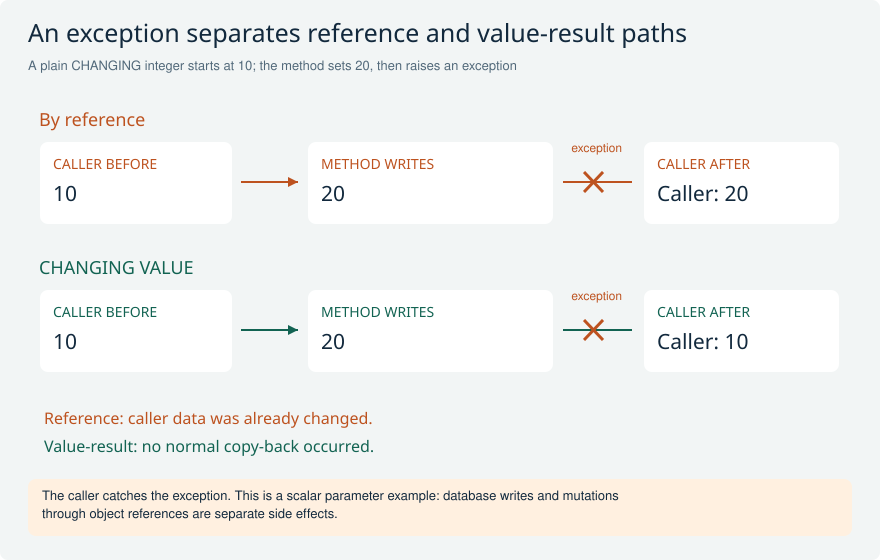
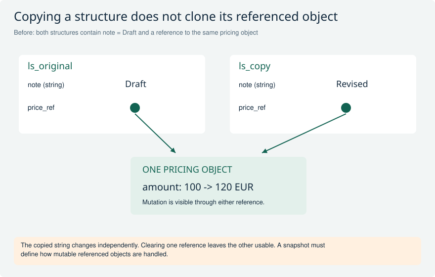
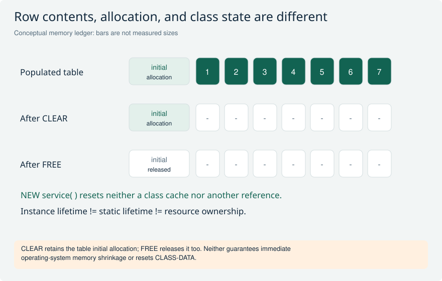
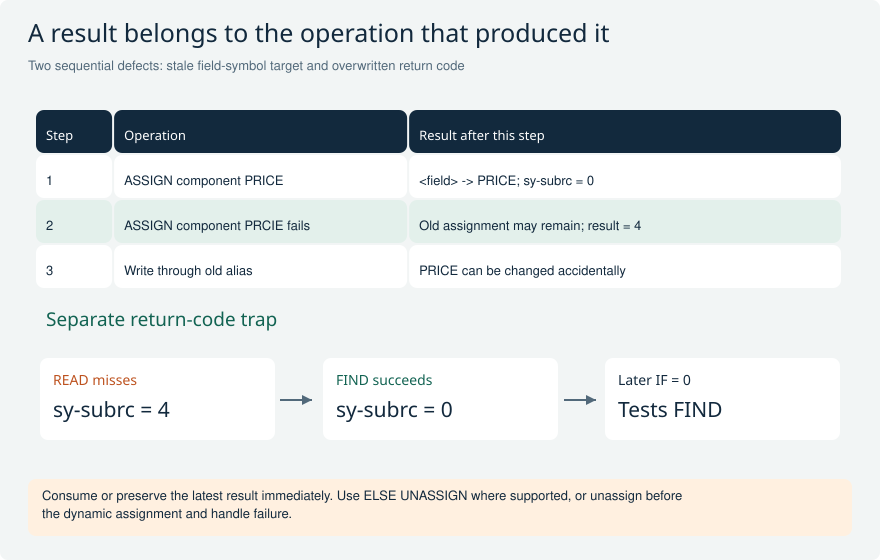
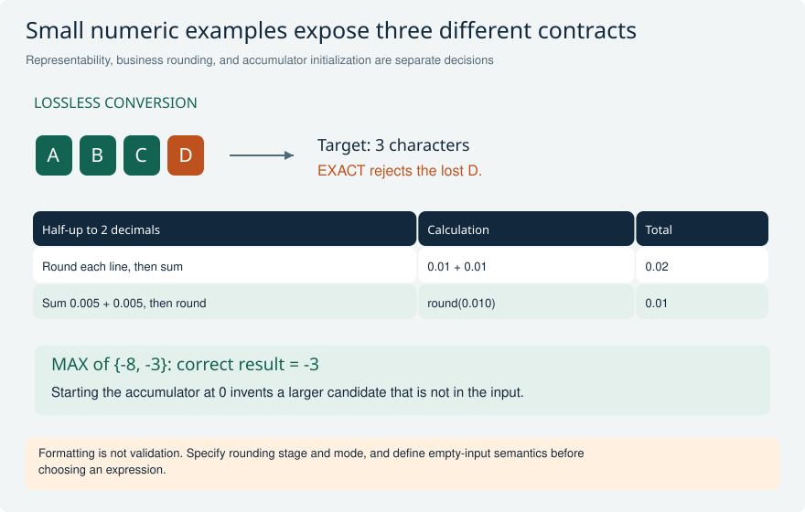
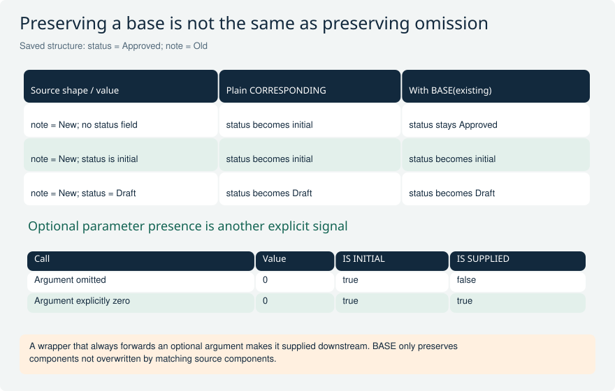
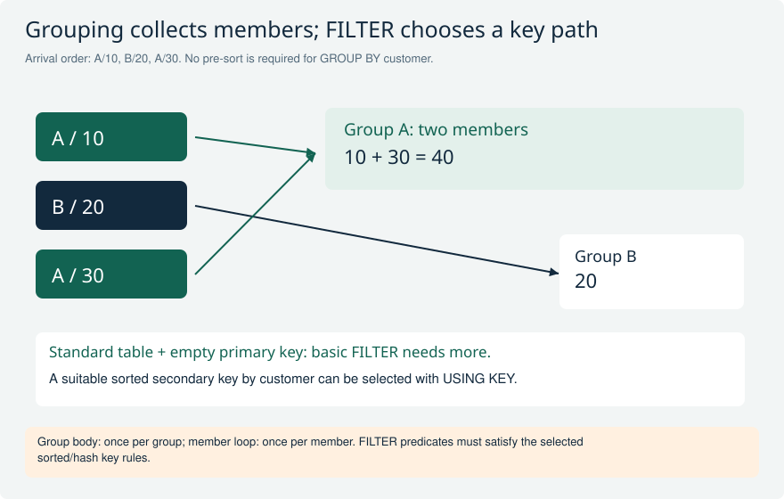
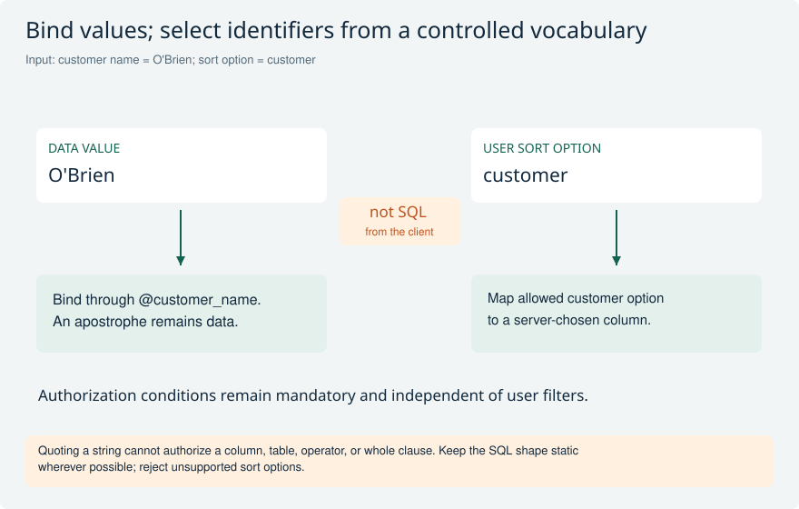
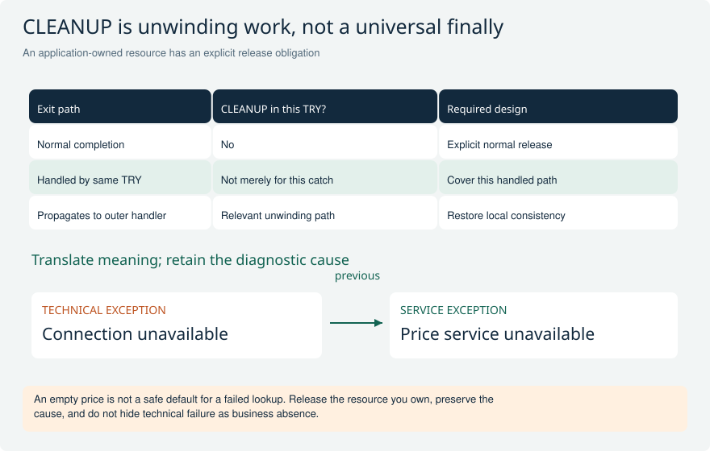
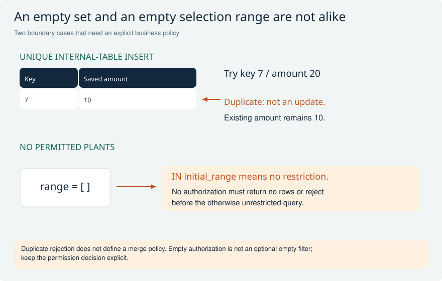

# Practical ABAP: values, expressions, and failure paths

Use these worked scenarios after the basic language questions. They test the consequences of parameter passing, aliasing, partial updates, and failure handling rather than syntax recall alone. Modern additions require a supporting target release and language version; examples are teaching scenarios, not executed SAP evidence.

[Return to the study guide](../README.md) | [Study plan](../study/Study_Plan.md)

## BASE-01 What changes when a method receives a CHANGING parameter by value instead of by reference?

**Level:** Senior

**Short answer:** By reference, the formal parameter aliases the caller's data, so allowed writes affect it immediately. With VALUE, a local value is changed and copied back on normal completion. An exception leaving the method prevents that normal copy-back. This difference affects error guarantees, but it does not undo database writes or changes made through referenced objects.

**Example and follow-up:** Suppose a method changes a plain integer from 10 to 20 and then raises a class-based exception. A reference CHANGING parameter can leave 20 visible to the caller; a value-result parameter retains the caller's 10. Test both failure and success paths before changing an established signature.

**Avoid this mistake:** Pass-by-value is not a transaction rollback and does not clone objects behind reference parameters.

**Interviewer follow-ups:**

- How would this change with an object reference parameter?
- Can an IMPORTING reference variable still expose a mutable object?

**Strong answer criteria:**

- Separates parameter direction from transfer mode
- Explains exceptional copy-back behavior
- Identifies external side effects

**Verification evidence:** A small method-call test showing caller values after normal return and exception.

**Read and verify this answer:**

- [SAP: Pass by value](https://help.sap.com/docs/abap-cloud/abap-keyword/pass-by-value) - Formal parameters are local copies; parameter direction controls transfer.

Visual: Parameter values after exceptional exit

Compare the same assignment under two transfer modes. The final caller value is visible evidence of the difference.

**Explain it:** Which result changes if the method returns normally? What changes if the parameter holds an object reference?

**Limit:** This assumes a plain integer, value-result passing, and no additional side effects.

## BASE-02 A copied structure contains a string, a nested table, and an object reference. Is it an independent snapshot?

**Level:** Senior

**Short answer:** The string and nested table are value components: changing their copied contents does not intentionally mutate the source value. The reference component is different: copying it preserves a reference to the same object. Mutating that object's state through either structure is observable through the other. A true snapshot therefore needs an explicit policy for references and mutable reachable objects.

**Example and follow-up:** For an approval snapshot, copying ls_request preserves the item values but does not freeze an attached mutable pricing object. Store the calculated price as a value, use an immutable collaborator, or implement deliberate cloning with defined identity and cycle handling. Internal sharing optimizations do not change these language-level semantics.

**Avoid this mistake:** A deep ABAP type is not a promise that ordinary assignment recursively clones the entire object graph.

**Interviewer follow-ups:**

- Which components need copying for an audit snapshot?
- How would you test sharing without inspecting memory addresses?

**Strong answer criteria:**

- Distinguishes value components from references
- Preserves object identity semantics
- Defines snapshot ownership

**Verification evidence:** Mutation tests for a copied string, nested row, and referenced object's attribute.

**Read and verify this answer:**

- [SAP: Sharing between dynamic data objects](https://help.sap.com/docs/abap-cloud/abap-keyword/sharing-between-dynamic-data-objects?locale=en-US&state=PRODUCTION&version=latest) - Distinguishes copying reference values from internal sharing of strings and tables.

Visual: Value components versus a shared referent

Two structure values own independent string values but lead to the same pricing object. The arrow targets explain why a getter can expose mutable state.

**Explain it:** Which change affects only ls_copy, and which change affects an object visible through both?

**Limit:** Conceptual object identity, not physical memory addresses or a particular sharing optimization.

## BASE-03 A large temporary internal table is no longer needed. When would you choose CLEAR or FREE?

**Level:** Advanced

**Short answer:** For a headerless internal table, both remove its rows. CLEAR keeps the initial memory requirement available, while FREE also releases that initial allocation. I use CLEAR when the same table will soon be populated again and FREE when retaining its allocation has no useful purpose. Neither deletes the declared variable or guarantees an immediate reduction in operating-system memory.

**Example and follow-up:** In a package loop, repeatedly freeing and rebuilding a modest buffer may add allocation work. After a one-off large reconciliation, releasing the unused table can reduce retained application memory. Measure used and allocated memory in the relevant session before drawing conclusions from process memory alone.

**Avoid this mistake:** Do not claim CLEAR retains every byte ever allocated, or that FREE destroys referenced objects still reachable elsewhere.

**Read and verify this answer:**

- [SAP: CLEAR](https://help.sap.com/docs/abap-cloud/abap-keyword/clear?locale=en-US&state=PRODUCTION&version=latest) - CLEAR releases table rows but retains the initial memory requirement; FREE releases that too.

Visual: Three distinct state and memory lifetimes

Empty row slots and the initial allocation are deliberately drawn separately. A new object does not imply a new internal session or empty class cache.

**Explain it:** Why can recreating a service leave a test-order failure unchanged?

**Limit:** Allocation diagram is qualitative; measure actual ABAP memory and cache lifetime in the target context.

## BASE-04 A dynamic ASSIGN fails, but IS ASSIGNED is still true. How can the program update the wrong field?

**Level:** Advanced

**Short answer:** A failed dynamic assignment can leave the field symbol pointing at its previous target. IS ASSIGNED then says only that some assignment exists, not that the latest lookup succeeded. I check the statement's result immediately and avoid using the alias after failure. On a supporting release, ELSE UNASSIGN makes the failure state explicit; otherwise I unassign before attempting the lookup.

**Example and follow-up:** A mapper assigns component PRICE successfully, then requests nonexistent component PRCIE. If it tests only IS ASSIGNED, a subsequent write may overwrite PRICE. A regression test must include a successful lookup followed by an invalid one using the same field symbol.

**Avoid this mistake:** An assigned field symbol is not evidence that the most recent dynamic ASSIGN succeeded.

**Read and verify this answer:**

- [SAP: ASSIGN, ELSE UNASSIGN](https://help.sap.com/docs/abap-cloud/abap-keyword/assign-else-unassign) - Failed assignments may preserve an earlier alias unless explicitly unassigned.

Visual: Stale aliases and overwritten return codes

The first sequence can write to the previous target. The second takes a success branch for a different operation than the programmer intended.

**Explain it:** Which test requires a successful operation before the failure to expose the defect?

**Limit:** Only statements documented to set sy-subrc replace it. Assignment failure behavior depends on the exact form and additions.

## BASE-05 A READ TABLE fails, yet a later IF sy-subrc = 0 takes the success branch. What do you inspect?

**Level:** Advanced

**Short answer:** I inspect every intervening statement that can set sy-subrc. It is a shared runtime field, not a result permanently attached to READ TABLE. I branch immediately or preserve the result in a named local variable before further work. For modern expressions, I use their documented exception or predicate behavior instead of assuming they set sy-subrc like classic statements.

**Example and follow-up:** A failed lookup is followed by a successful FIND used to prepare logging text. Testing sy-subrc afterward now tests FIND. Include a missing-record case with successful logging preparation; merely testing an immediate lookup in isolation would miss the actual sequence.

**Avoid this mistake:** Not every statement resets sy-subrc, and a table expression is not a drop-in sy-subrc-producing READ TABLE.

**Read and verify this answer:**

- [SAP: SY-SUBRC](https://help.sap.com/docs/SUPPORT_CONTENT/abap/3353523632.html) - Return values belong to particular statements and can be replaced by later statements.

Visual: Stale aliases and overwritten return codes

The first sequence can write to the previous target. The second takes a success branch for a different operation than the programmer intended.

**Explain it:** Which test requires a successful operation before the failure to expose the defect?

**Limit:** Only statements documented to set sy-subrc replace it. Assignment failure behavior depends on the exact form and additions.

## BASE-06 An import must reject precision loss rather than silently round or truncate. Where does EXACT help?

**Level:** Advanced

**Short answer:** EXACT requests a lossless assignment or calculation and raises an appropriate exception when the requested result cannot be represented without loss. CONV applies ordinary conversion rules and is not equivalent validation. I place the check at a typed boundary, translate conversion failures into useful input feedback, and still validate domain rules such as permitted signs, identifiers, and currency.

**Example and follow-up:** Converting a runtime text longer than a fixed character target can otherwise discard characters. For a two-decimal packed result, EXACT can reject a calculation such as one divided by three. That is useful when rounding is forbidden; when rounding is required, make the business rounding step explicit instead.

**Avoid this mistake:** EXACT does not prove that a technically representable value is an allowed business value.

**Read and verify this answer:**

- [SAP: EXACT examples](https://github.com/SAP-samples/abap-cheat-sheets/blob/main/05_Constructor_Expressions.md#exact) - Official executable illustrations of lossless assignments and calculations.

Visual: Conversion, rounding, and reduction counterexamples

A lost character, a one-cent difference, and a false maximum reveal three unrelated errors that concise syntax can hide.

**Explain it:** Which expected results change with a different rounding mode, and which are independent of rounding?

**Limit:** Half-up and two decimals are explicit exercise assumptions, not a universal currency rule. MAX notation is explanatory.

## BASE-07 Two invoice totals differ by one cent although both use decimal types. How do you diagnose rounding?

**Level:** Senior

**Short answer:** I compare the sequence of calculations, intermediate precision, and the prescribed rounding point and mode. Rounding every line and then summing can differ from summing precise values and rounding once. Currency metadata does not automatically make an arbitrary calculation compliant. I retain currency context, use appropriate decimal types, and encode the agreed rule explicitly with boundary tests.

**Example and follow-up:** Under an agreed half-up, two-decimal rule, two positive line results of 0.005 become 0.01 each if rounded separately, totaling 0.02. Their unrounded sum is 0.010 and rounds to 0.01. The correct amount depends on the specified line-versus-document rule.

**Avoid this mistake:** Choosing decfloat34 or formatting two decimals does not settle the business rounding policy.

**Interviewer follow-ups:**

- How do negative half-way values affect the selected mode?
- Where is currency conversion applied relative to tax rounding?

**Strong answer criteria:**

- Traces intermediate precision
- Names rounding stage and mode
- Keeps currency semantics

**Verification evidence:** Worked positive/negative boundary examples with independently calculated expected totals.

**Read and verify this answer:**

- [SAP: Rounding function ROUND](https://help.sap.com/doc/abapdocu_latest_index_htm/latest/en-US/ABENDEC_FLOATING_POINT_ROUND.html) - Decimal places, precision, and explicit rounding modes are distinct choices.

Visual: Conversion, rounding, and reduction counterexamples

A lost character, a one-cent difference, and a false maximum reveal three unrelated errors that concise syntax can hide.

**Explain it:** Which expected results change with a different rounding mode, and which are independent of rounding?

**Limit:** Half-up and two decimals are explicit exercise assumptions, not a universal currency rule. MAX notation is explanatory.

## BASE-08 Why can replacing MOVE-CORRESPONDING with CORRESPONDING erase an existing structure field?

**Level:** Advanced

**Short answer:** An ordinary CORRESPONDING constructor creates a new result, so target components absent from the source become initial. MOVE-CORRESPONDING between structures leaves unmatched target components unchanged. BASE can supply starting values for a constructor result before matching components overwrite them. I specify the desired merge contract rather than assuming all name-based assignments preserve existing state.

**Example and follow-up:** ls_existing contains status Approved and a note. The source contains only a new note: plain CORRESPONDING clears the unmatched status; BASE preserves it. But if the source type contains status with an initial value, that matching component still overwrites the base. Field presence requires a separate update contract.

**Avoid this mistake:** BASE preserves unmatched components; it does not mean ignore every initial source value or implement PATCH automatically.

**Read and verify this answer:**

- [SAP: Working with structures](https://help.sap.com/docs/abap-cloud/abap-concepts/working-with-structures?locale=en-US) - Compares MOVE-CORRESPONDING with CORRESPONDING and BASE.

Visual: Three mapping cases and two presence cases

The matching initial status overwrites BASE just as a populated status does. A separate parameter table shows why zero cannot encode omission.

**Explain it:** Which source needs a presence flag when the source type always contains status?

**Limit:** Structure mapping example; internal-table BASE preserves rows under different construction semantics.

## BASE-09 Unsorted orders must be processed once per customer with their member rows. How does GROUP BY change the loop?

**Level:** Advanced

**Short answer:** LOOP AT with GROUP BY first forms groups and then executes the group loop. Equal group keys are collected even if rows are not adjacent, unlike traditional control-level processing that relies on ordering. I choose explicit group-key binding when it improves clarity and use LOOP AT GROUP for members. Group order and member order still need a deliberate contract.

**Example and follow-up:** Input customers A, B, A creates two groups, with both A orders together. The group body executes twice, not once per order. WITHOUT MEMBERS is suitable when only group keys are needed, but then a later member loop is not available.

**Avoid this mistake:** Grouping an internal table is not database aggregation, and its default group order is not automatically business sort order.

**Read and verify this answer:**

- [SAP: LOOP AT itab, GROUP BY](https://help.sap.com/docs/abap-cloud/abap-keyword/loop-at-itab-group-by?locale=en-US&state=PRODUCTION&version=latest) - Grouping and group iteration are separate phases; prior sorting is not required.

Visual: Unsorted group membership and explicit filter keys

Arrows bring nonadjacent A rows into one group. The grouping total is computed from members, not read from the representative row.

**Explain it:** What changes with WITHOUT MEMBERS, and why is an arbitrary OR predicate not automatically a basic FILTER condition?

**Limit:** Source rows and totals are illustrative; no measured performance advantage is asserted.

## BASE-10 A FILTER expression is proposed for a standard table with an empty primary key. Is that enough?

**Level:** Advanced

**Short answer:** For the basic FILTER form, access must use a suitable sorted or hashed key. A standard table can work when it has an appropriate secondary key selected with USING KEY; an empty primary key alone is insufficient. I also check that the predicate meets the selected key's rules. A FOR expression or a clear loop may fit an arbitrary predicate better.

**Example and follow-up:** A standard table retains arrival order but has a sorted secondary key by customer. FILTER USING KEY can select that customer. A complex OR predicate over unrelated columns should not be forced into a key-based FILTER shape or justified by an unmeasured speed claim.

**Avoid this mistake:** FILTER is not a general-purpose synonym for every WHERE expression supported by LOOP or FOR.

**Read and verify this answer:**

- [SAP: FILTER, basic form](https://help.sap.com/doc/abapdocu_751_index_htm/7.51/en-US/abenconstructor_expr_filter_basic.htm) - Defines sorted/hash key requirements and supported predicate forms.

Visual: Unsorted group membership and explicit filter keys

Arrows bring nonadjacent A rows into one group. The grouping total is computed from members, not read from the representative row.

**Explain it:** What changes with WITHOUT MEMBERS, and why is an arbitrary OR predicate not automatically a basic FILTER condition?

**Limit:** Source rows and totals are illustrative; no measured performance advantage is asserted.

## BASE-11 A REDUCE expression calculates a maximum, but all-negative input returns zero. What went wrong?

**Level:** Advanced

**Short answer:** The accumulator's initial value is part of the algorithm. Starting a maximum at zero invents a candidate that may not exist in an all-negative input set. I define empty-input semantics and initialize from a valid first member or represent the absence of a result explicitly. I also choose accumulator types deliberately so intermediate overflow or rounding cannot hide behind concise syntax.

**Example and follow-up:** For values -8 and -3, a zero-initialized maximum remains zero although the correct maximum is -3. Empty input may require no result or a domain exception, not the same number. The expression should remain readable enough that reviewers can identify initialization, iteration, and state update.

**Avoid this mistake:** REDUCE does not supply mathematically correct initial values or empty-set semantics on the developer's behalf.

**Read and verify this answer:**

- [SAP: Table reductions, structured result](https://help.sap.com/docs/abap-cloud/abap-keyword/itab-table-reductions-structured-result) - Shows explicit initialization and iterative accumulator updates.

Visual: Conversion, rounding, and reduction counterexamples

A lost character, a one-cent difference, and a false maximum reveal three unrelated errors that concise syntax can hide.

**Explain it:** Which expected results change with a different rounding mode, and which are independent of rounding?

**Limit:** Half-up and two decimals are explicit exercise assumptions, not a universal currency rule. MAX notation is explanatory.

## BASE-12 A report accepts a filter value and a sort-column name. Is escaping quotes sufficient for safe SQL?

**Level:** Senior

**Short answer:** No. Data values and SQL identifiers are different inputs. I bind values through host variables in static ABAP SQL where possible. For configurable identifiers or dynamic clauses, I restrict them to a server-controlled allowlist and validate the supported syntax. Escaping a string value cannot authorize a table name, column name, operator, or an entire user-supplied WHERE fragment.

**Example and follow-up:** A search value containing an apostrophe should remain a value. A sort request is mapped from an accepted business option to a known column; arbitrary SQL text is rejected. Authorization predicates are built independently and cannot be removed by user filter or ordering choices.

**Avoid this mistake:** Input that is safely quoted as a literal is not therefore safe as SQL syntax or an authorized data access.

**Interviewer follow-ups:**

- How would you test an input that is valid syntax but unauthorized?
- Which parts of the SQL shape can remain completely static?

**Strong answer criteria:**

- Separates values and identifiers
- Uses explicit allowed SQL shapes
- Preserves authorization predicates

**Verification evidence:** Negative tests for quoted values, forbidden columns, injected operators, and unauthorized records.

**Read and verify this answer:**

- [SAP: Prevent SQL injection](https://help.sap.com/docs/SAP_S4HANA_ON-PREMISE/86dbe289f813483abd78de6a52458bff/36e78557e0f6a96be10000000a4450e5.html) - Prefer static SQL; validate and escape dynamic content using supported facilities.

Visual: Two input kinds and two safe handling paths

The apostrophe is intentionally harmless data on the left. The sort request on the right selects a predefined identifier rather than supplying executable SQL.

**Explain it:** Why would quoting the sort option as a literal fail to solve identifier validation?

**Limit:** Conceptual SQL boundary; available dynamic-programming helpers and API release status depend on the target environment.

## BASE-13 A resource release is placed only in CLEANUP. Why can it remain unreleased after success?

**Level:** Senior

**Short answer:** ABAP CLEANUP is part of exception unwinding, not a finally block that runs after every TRY. It runs for the relevant protected context when an exception propagates to an outer handler; it is not the normal-success path. I arrange explicit release on successful completion and on relevant exceptional exits, while respecting the actual owner's lock or resource lifetime.

**Example and follow-up:** An application-owned temporary handle is opened, processing succeeds, and ENDTRY is reached: CLEANUP alone does not close it. Test success, an exception caught locally, and one propagated outward. Cleanup failures also need handling so they do not obscure the original failure or escape a CLEANUP block.

**Avoid this mistake:** Do not assume CLEANUP automatically runs after a CATCH in the same TRY, or release framework-owned locks prematurely.

**Interviewer follow-ups:**

- What changes when the exception is caught inside the same TRY?
- Who owns release when a caller supplied the resource?

**Strong answer criteria:**

- Distinguishes CLEANUP from finally
- Covers normal and exceptional paths
- Respects ownership

**Verification evidence:** Instrumented resource tests show one correct release on every intended exit.

**Read and verify this answer:**

- [SAP: Exception system response](https://help.sap.com/doc/abapdocu_latest_index_htm/latest/en-US/ABENEXCEPTIONS_SYSTEM_RESPONSE.html) - Explains stack unwinding and when CLEANUP blocks run or do not run.

Visual: Exceptional exits and preserved causes

The table names three exit paths that require separate reasoning. The exception chain carries the lower-level diagnosis through a meaningful service-level failure.

**Explain it:** Which path would a test of only propagated exceptions miss?

**Limit:** Simplified non-resumable scenarios; exact nesting and handlers determine CLEANUP execution. Resource ownership remains application-specific.

## BASE-14 An optional limit parameter is omitted in one call and explicitly set to zero in another. How can a method distinguish them?

**Level:** Advanced

**Short answer:** IS SUPPLIED tests whether an actual parameter was provided, independently of its value. IS INITIAL tests the value and cannot distinguish an omitted zero-defaulted argument from an explicit zero. I use presence only when the API deliberately assigns different meaning to omission. If a wrapper always forwards a parameter, it must preserve the intended presence contract explicitly.

**Example and follow-up:** For a pagination helper, omission may mean use the configured limit, while zero may mean return no rows. A wrapper that forwards its own initial variable makes the downstream parameter supplied. Test the direct calls and the wrapper path, rather than silently changing zero into the default.

**Avoid this mistake:** OPTIONAL does not automatically preserve absent-versus-present semantics across another method boundary.

**Read and verify this answer:**

- [SAP: IS SUPPLIED](https://help.sap.com/docs/abap-cloud/abap-keyword/rel-exp-is-supplied) - Presence of an actual argument is independent of its initial value.

Visual: Three mapping cases and two presence cases

The matching initial status overwrites BASE just as a populated status does. A separate parameter table shows why zero cannot encode omission.

**Explain it:** Which source needs a presence flag when the source type always contains status?

**Limit:** Structure mapping example; internal-table BASE preserves rows under different construction semantics.

## BASE-15 A single-line INSERT INTO TABLE hits an existing unique primary key. Does it update the existing row?

**Level:** Advanced

**Short answer:** No. For this internal-table insertion case, the new line is not inserted and sy-subrc indicates the duplicate. The existing row is not an implicit update target. I decide whether the operation means reject, merge, or replace, then implement that policy explicitly. I do not generalize this return-code behavior to every constructor, secondary-key conflict, or database insertion form.

**Example and follow-up:** An import contains order 7 twice with different amounts. A unique hashed table prevents duplicate keys, but silently ignoring the second line can conceal inconsistent source data. Compare payloads if duplicates are allowed only when identical; otherwise report both the key and conflicting input position.

**Avoid this mistake:** Uniqueness enforcement is not a complete deduplication policy, and INSERT is not an automatic upsert.

**Read and verify this answer:**

- [SAP: Populating internal tables](https://help.sap.com/docs/abap-cloud/abap-concepts/populating-internal-tables) - Single-line insertion with duplicate unique primary key returns sy-subrc 4.

Visual: Duplicate insertion and empty authorization boundaries

A duplicate unique key preserves the original row for the specified insertion form. An initial selection range has a very different meaning from an empty list of permissions.

**Explain it:** How would you distinguish identical duplicates from conflicting ones, and prove a user with no plants sees nothing?

**Limit:** Single-line INSERT INTO TABLE with a unique primary key; other insertion and key-conflict forms need their own documented handling.

## BASE-16 An authorization helper returns an empty range table. Why is WHERE field IN range unsafe as the only access restriction?

**Level:** Senior

**Short answer:** An initial selection range represents no restriction for IN, so it must not be used to encode 'the user may see nothing.' I define empty authorization results separately and return no rows or reject the operation before querying. Nonempty ranges combine inclusion and exclusion rules; their semantics differ from a plain list whose empty membership set would match nothing.

**Example and follow-up:** If a user has no permitted plants, the application must not execute an otherwise unrestricted read with an empty plant range. Keep optional user filters separate from mandatory authorization constraints. Test no permissions as well as one permitted plant and exclusions.

**Avoid this mistake:** An empty ABAP selection range is not the same as an SQL list containing zero allowed values.

**Interviewer follow-ups:**

- How do you distinguish an optional filter from mandatory authorization?
- What result do you expect from a range containing only exclusions?

**Strong answer criteria:**

- Recognizes initial-range semantics
- Fails closed for no permissions
- Separates user filtering from security

**Verification evidence:** A denied-user test proves zero data and zero aggregate leakage with an empty authorization result.

**Read and verify this answer:**

- [SAP: Comparison with selection tables](https://help.sap.com/doc/abapdocu_latest_index_htm/latest/en-US/ABENLOGEXP_SELECT_OPTION.html) - Defines inclusion/exclusion semantics and the initial selection-table case.

Visual: Duplicate insertion and empty authorization boundaries

A duplicate unique key preserves the original row for the specified insertion form. An initial selection range has a very different meaning from an empty list of permissions.

**Explain it:** How would you distinguish identical duplicates from conflicting ones, and prove a user with no plants sees nothing?

**Limit:** Single-line INSERT INTO TABLE with a unique primary key; other insertion and key-conflict forms need their own documented handling.

## Official references

- [SAP: Pass by value](https://help.sap.com/docs/abap-cloud/abap-keyword/pass-by-value)
- [SAP: Sharing between dynamic data objects](https://help.sap.com/docs/abap-cloud/abap-keyword/sharing-between-dynamic-data-objects?locale=en-US&state=PRODUCTION&version=latest)
- [SAP: CLEAR](https://help.sap.com/docs/abap-cloud/abap-keyword/clear?locale=en-US&state=PRODUCTION&version=latest)
- [SAP: ASSIGN, ELSE UNASSIGN](https://help.sap.com/docs/abap-cloud/abap-keyword/assign-else-unassign)
- [SAP: SY-SUBRC](https://help.sap.com/docs/SUPPORT_CONTENT/abap/3353523632.html)
- [SAP: EXACT examples](https://github.com/SAP-samples/abap-cheat-sheets/blob/main/05_Constructor_Expressions.md#exact)
- [SAP: Rounding function ROUND](https://help.sap.com/doc/abapdocu_latest_index_htm/latest/en-US/ABENDEC_FLOATING_POINT_ROUND.html)
- [SAP: Working with structures](https://help.sap.com/docs/abap-cloud/abap-concepts/working-with-structures?locale=en-US)
- [SAP: LOOP AT itab, GROUP BY](https://help.sap.com/docs/abap-cloud/abap-keyword/loop-at-itab-group-by?locale=en-US&state=PRODUCTION&version=latest)
- [SAP: FILTER, basic form](https://help.sap.com/doc/abapdocu_751_index_htm/7.51/en-US/abenconstructor_expr_filter_basic.htm)
- [SAP: Table reductions, structured result](https://help.sap.com/docs/abap-cloud/abap-keyword/itab-table-reductions-structured-result)
- [SAP: Prevent SQL injection](https://help.sap.com/docs/SAP_S4HANA_ON-PREMISE/86dbe289f813483abd78de6a52458bff/36e78557e0f6a96be10000000a4450e5.html)
- [SAP: Exception system response](https://help.sap.com/doc/abapdocu_latest_index_htm/latest/en-US/ABENEXCEPTIONS_SYSTEM_RESPONSE.html)
- [SAP: IS SUPPLIED](https://help.sap.com/docs/abap-cloud/abap-keyword/rel-exp-is-supplied)
- [SAP: Populating internal tables](https://help.sap.com/docs/abap-cloud/abap-concepts/populating-internal-tables)
- [SAP: Comparison with selection tables](https://help.sap.com/doc/abapdocu_latest_index_htm/latest/en-US/ABENLOGEXP_SELECT_OPTION.html)
