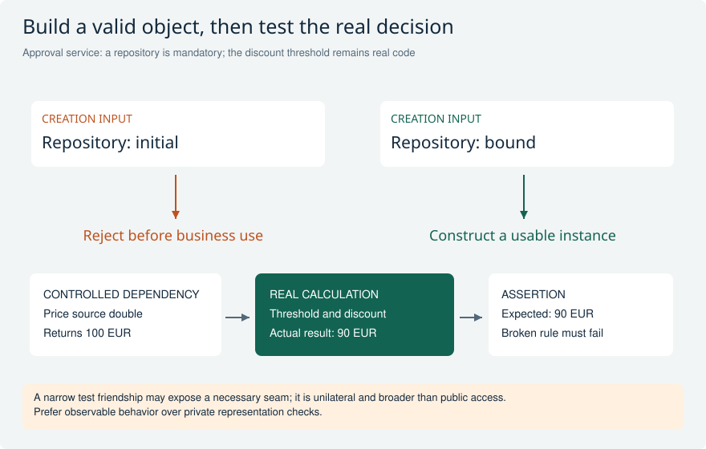

# Practical OO: contracts, state, and substitutability

Work through these decisions after the OO fundamentals. The emphasis is on observable promises: valid state, compatible substitutes, honest failure, ownership, and useful tests. Design recommendations are applications of the cited language rules and SAP guidance, not claims that the compiler enforces a complete business contract.

[Return to the study guide](../README.md) | [Study plan](../study/Study_Plan.md)

## OODEEP-01 A method named reserve returns a reservation ID. Which promises must be explicit beyond its parameter types?

**Level:** Senior

**Short answer:** I define accepted inputs, the observable success result, allowed state changes, and failure behavior. The caller needs to know whether the reservation is merely buffered or durable, whether repetition is safe, and who owns transaction completion. Those promises belong in the contract and its tests. A matching signature alone cannot tell another developer whether combining two operations is safe.

**Example and follow-up:** One implementation returns an ID before save; another commits immediately. Both compile against the same interface but are not interchangeable for a caller that reserves two items atomically. Document the intended boundary in ABAP Doc and test failure of the second item against the first one's state.

**Avoid this mistake:** RETURNING an identifier does not itself promise committed persistence, and a method name cannot replace a transaction contract.

**Interviewer follow-ups:**

- What state is allowed after reserve raises an exception?
- What is the result when the same business request is retried?

**Strong answer criteria:**

- Defines success and failure state
- States transaction ownership
- Defines repeat-call semantics

**Verification evidence:** Contract tests plus documentation covering buffered success, persistence boundary, and repeated requests.

**Read and verify this answer:**

- [SAP Learning: Documenting ABAP code](https://learning.sap.com/courses/deepening-your-abap-programming-knowledge/documenting-abap-code_ad565c7e-6ac5-4a49-95e2-e4c33268dac6) - ABAP Doc documents methods, parameters, and exceptions; the scenario applies this to behavioral contracts.

Visual: A concrete counterexample to substitutability

A valid quantity-one call exposes a behavioral violation invisible in matching parameter types. The lower table separates redefinition from a genuinely new capability.

**Explain it:** Would downcasting every caller to Provider B repair the contract? What else besides accepted inputs must agree?

**Limit:** Hypothetical contract; a narrower published domain would lead to a different assessment. No executable interface is implied.

## OODEEP-02 A new price-provider implementation rejects quantities below ten although the interface accepts any positive quantity. Is it a valid substitute?

**Level:** Senior

**Short answer:** No, if the published contract accepts every positive quantity, the new provider strengthens the precondition and breaks callers that validly request one unit. I either preserve the shared contract, expose the narrower capability separately, or change the contract through a managed migration. I compare outputs, errors, and side effects as well as input types when assessing substitutability.

**Example and follow-up:** A checkout calls the provider through an interface with quantity one and expects a quote. A subclass or implementation that raises an unsupported-quantity error for that valid input violates the agreed behavior even though activation succeeds. Run the same contract scenarios against each implementation.

**Avoid this mistake:** Implementing an interface or passing a cast check proves type compatibility, not behavioral substitutability.

**Interviewer follow-ups:**

- Can a substitute silently return a different currency?
- Which common tests would run against every provider?

**Strong answer criteria:**

- Identifies strengthened precondition
- Checks postconditions and side effects
- Uses shared behavioral tests

**Verification evidence:** A contract suite exercises minimum positive quantity, currency, failures, and repeat calls for both providers.

**Read and verify this answer:**

- [SAP Learning: Using interfaces](https://learning.sap.com/courses/deepening-your-abap-programming-knowledge/using-interfaces_e45af9bb-46e5-457b-88ef-d5ad6b0d38d7) - Interface references provide the common call surface for different implementations.

Visual: A concrete counterexample to substitutability

A valid quantity-one call exposes a behavioral violation invisible in matching parameter types. The lower table separates redefinition from a genuinely new capability.

**Explain it:** Would downcasting every caller to Provider B repair the contract? What else besides accepted inputs must agree?

**Limit:** Hypothetical contract; a narrower published domain would lead to a different assessment. No executable interface is implied.

## OODEEP-03 Two unrelated services share a capability and some validation code. Should their callers depend on an abstract superclass?

**Level:** Senior

**Short answer:** I separate the public capability from implementation reuse. An interface can express the capability without imposing a class hierarchy. Shared validation can be a collaborator. An abstract base class is justified when there is a stable specialization relationship and a useful shared lifecycle or template, not simply similar code. I also consider that a class has only one superclass.

**Example and follow-up:** A document exporter and a notification sender may both support cancellation but have unrelated lifecycles. A narrow cancellation interface lets a coordinator address either, while shared policy is composed where needed. For a genuine family of parsers with enforced shared steps, an abstract template may be appropriate.

**Avoid this mistake:** An abstract superclass is not automatically a better contract because it can carry reusable implementation.

**Interviewer follow-ups:**

- Which invariant would the superclass enforce?
- How would the design accommodate a class already inheriting from a framework base?

**Strong answer criteria:**

- Separates contract from reuse
- Tests the is-a relationship
- Accounts for independent variation

**Verification evidence:** A responsibility sketch shows the caller's minimal interface and the owner of shared validation.

**Read and verify this answer:**

- [SAP Learning: Defining interfaces](https://learning.sap.com/courses/deepening-your-abap-programming-knowledge/defining-interfaces_ab3c7c07-bb66-424b-ba06-6cfa7cc39439) - Interfaces support common capabilities across unrelated classes and restrict the client's view.

Visual: A concrete counterexample to substitutability

A valid quantity-one call exposes a behavioral violation invisible in matching parameter types. The lower table separates redefinition from a genuinely new capability.

**Explain it:** Would downcasting every caller to Provider B repair the contract? What else besides accepted inputs must agree?

**Limit:** Hypothetical contract; a narrower published domain would lead to a different assessment. No executable interface is implied.

## OODEEP-04 A subclass needs a different implementation and an extra mandatory input for an inherited method. Can REDEFINITION add it?

**Level:** Advanced

**Short answer:** No. Redefinition replaces an eligible inherited instance method's implementation while preserving its interface. ABAP does not use same-name, different-signature method overloading to solve this. If the additional input changes the operation's contract, I introduce a distinct operation or a deliberate compatible contract evolution. The existing inherited operation must still satisfy callers using the base type.

**Example and follow-up:** A base method formats a document. A specialized format requires an extra profile: provide a separately named operation, or configure a validated collaborator before use if that fits the existing contract. Requiring callers to downcast merely to make the inherited method usable exposes a broken abstraction.

**Avoid this mistake:** Redefinition is not method overloading, and optional parameters do not automatically make every behavioral change compatible.

**Read and verify this answer:**

- [SAP: Extending a subclass](https://help.sap.com/saphelp_em900/helpdata/en/2f/8bbf7bbb4111d2958600a0c94260a5/content.htm?no_cache=true) - Redefinition preserves the inherited method signature and applies to eligible instance methods.
- [SAP: ABAP Doc class example and method uniqueness](https://help.sap.com/docs/SAP_NETWEAVER_740/468a97775123488ab3345a0c48cadd8f/f6fba4c6e1cb49c7b355319ac9c8d1cd.html) - The ABAP Doc example explicitly distinguishes ABAP's lack of method overloading from JavaDoc.

Visual: A concrete counterexample to substitutability

A valid quantity-one call exposes a behavioral violation invisible in matching parameter types. The lower table separates redefinition from a genuinely new capability.

**Explain it:** Would downcasting every caller to Provider B repair the contract? What else besides accepted inputs must agree?

**Limit:** Hypothetical contract; a narrower published domain would lead to a different assessment. No executable interface is implied.

## OODEEP-05 A local test class needs access to private state. What does granting friendship expose, and what does it not imply?

**Level:** Advanced

**Short answer:** Friendship grants access to the granting class's protected and private components. It is unilateral, so the reverse access is not automatic. A friend of a superclass is not automatically a friend of its subclasses; subclasses of a friend can also gain access. I keep the grant narrow and first ask whether the test can assert the public behavior instead.

**Example and follow-up:** A focused final local test class may need a legacy injection seam. Making every production attribute public is broader than necessary. Granting friendship to a widely implemented interface is also much broader than naming one final class, because implementations participate in the friendship relationship.

**Avoid this mistake:** Do not summarize friendship as simply inherited or not inherited; the direction and which class is subclassed matter.

**Read and verify this answer:**

- [SAP: Friendship between classes](https://help.sap.com/doc/abapdocu_751_index_htm/7.51/en-US/abenfriends.htm?from=20423&from_column=20423) - Friendship is unilateral; distinguishes friends' subclasses from subclasses of the granting class.

Visual: Construction invariants and meaningful test boundaries

Invalid dependencies are rejected before use. In the successful test, the input price is controlled but the discount rule itself executes.

**Explain it:** What defect should make the assertion fail, and which private access is actually necessary?

**Limit:** The 10-percent discount is an illustrative fixture, not an application rule. Friendship details and real integration require separate checks.

## OODEEP-06 Two references point to one resource-owning object. Does clearing one reference close the resource or destroy the object?

**Level:** Senior

**Short answer:** Clearing one reference changes that variable to the null reference; another reference can still keep the object reachable. Memory reclamation by the garbage collector is distinct from business resource management. If a connection, registration, or lock needs timely release, I define an explicit ownership and release protocol and execute it on the relevant completion and failure paths.

**Example and follow-up:** A coordinator and cache both hold a reference to the same session object. Clearing the coordinator's reference leaves the cache entry usable. An explicit close can be appropriate for the owner, but then other holders need defined behavior after closure, and a borrowed resource must not be closed accidentally.

**Avoid this mistake:** Reference clearing is not an object-level close operation and must not be used as a lock-release guarantee.

**Interviewer follow-ups:**

- Who may close a shared or borrowed object?
- What should a second close or a call after close do?

**Strong answer criteria:**

- Separates reachability and resource lifetime
- Identifies owner versus borrower
- Defines closed-state behavior

**Verification evidence:** Tests cover multiple aliases, explicit close, repeated close, and use after closure.

**Read and verify this answer:**

- [SAP: Initializations](https://help.sap.com/docs/abap-cloud/abap-keyword/initializations) - Initializing a reference is distinct from the garbage collector deleting an unreachable object.

Visual: Value components versus a shared referent

Two structure values own independent string values but lead to the same pricing object. The arrow targets explain why a getter can expose mutable state.

**Explain it:** Which change affects only ls_copy, and which change affects an object visible through both?

**Limit:** Conceptual object identity, not physical memory addresses or a particular sharing optimization.

## OODEEP-07 An object can be created with a missing repository and fails much later on its first business call. What would you change?

**Level:** Senior

**Short answer:** I make mandatory construction requirements explicit and establish a valid state before the object is usable. Constructor injection can require the repository, with a meaningful failure if the supplied reference is invalid. Complex or fallible setup can be coordinated by a factory. I avoid publishing a half-initialized object or making unrelated business operations depend on a hidden setup call.

**Example and follow-up:** An approval service requires a repository and a policy. A public zero-argument constructor followed by set_repository creates an invalid intermediate state. Validate the mandatory dependencies at creation; if opening an external session is a separate lifecycle step, expose and test that lifecycle explicitly rather than surprising every constructor caller.

**Avoid this mistake:** Constructor injection does not validate an initial reference automatically, and heavy I/O is not required for good initialization.

**Interviewer follow-ups:**

- When would a factory improve error handling over constructor work?
- How do you prevent this object escaping before setup succeeds?

**Strong answer criteria:**

- Defines construction invariants
- Rejects missing dependencies early
- Separates setup from business work

**Verification evidence:** Creation tests prove invalid dependencies fail immediately and valid instances need no undocumented setup call.

**Read and verify this answer:**

- [SAP Learning: Encapsulation and consistency](https://learning.sap.com/courses/basic-abap-programming/using-encapsulation-to-ensure-consistency_e3780ce0-2ba3-4d03-a09f-15ac109b0c03) - Constructors establish initial state and can report construction failure.

Visual: Construction invariants and meaningful test boundaries

Invalid dependencies are rejected before use. In the successful test, the input price is controlled but the discount rule itself executes.

**Explain it:** What defect should make the assertion fail, and which private access is actually necessary?

**Limit:** The 10-percent discount is an illustrative fixture, not an application rule. Friendship details and real integration require separate checks.

## OODEEP-08 A test passes alone but fails after another test changes CLASS-DATA. Why does NEW not reliably isolate it?

**Level:** Senior

**Short answer:** Creating another instance initializes that instance's state; it does not reset class-level mutable state. Static attributes persist within the relevant internal session and may be shared by every instance of that class there. I identify and remove unnecessary global state or provide an explicit, controlled test reset. Cache keys and invalidation must also reflect the real context.

**Example and follow-up:** One test loads a policy cache, then another expects changed customizing. Recreating the service leaves the static cache populated. An injected policy provider with test-owned lifetime can avoid this coupling; if caching is a genuine requirement, test refresh, invalidation, and relevant user or tenant context separately.

**Avoid this mistake:** CLASS-DATA is not per instance, but it is also not a globally synchronized cache across application servers.

**Interviewer follow-ups:**

- Does a class constructor rerun for every NEW?
- Which context must appear in a security-sensitive cache key?

**Strong answer criteria:**

- Identifies static lifetime
- Separates test isolation from construction
- Defines cache scope and invalidation

**Verification evidence:** The suite passes individually, together, and with varied order without stale shared state.

**Read and verify this answer:**

- [SAP: CLASS-METHODS](https://help.sap.com/docs/abap-cloud/abap-keyword/class-methods) - Static members and initialization have class semantics, separate from instance state.

Visual: Three distinct state and memory lifetimes

Empty row slots and the initial allocation are deliberately drawn separately. A new object does not imply a new internal session or empty class cache.

**Explain it:** Why can recreating a service leave a test-order failure unchanged?

**Limit:** Allocation diagram is qualitative; measure actual ABAP memory and cache lifetime in the target context.

## OODEEP-09 A repository raises a low-level exception. Should a business service catch CX_ROOT and return an empty result?

**Level:** Senior

**Short answer:** Usually not: an empty result can turn technical failure into a false business fact. I catch failures at a boundary that can recover or translate them into the service's declared meaning. When wrapping an exception, I preserve the original through previous so diagnosis remains possible. Expected absence, business rejection, and technical failure need distinguishable outcomes.

**Example and follow-up:** A pricing repository connection failure must not look like 'no price exists' and trigger a free item. Translate the unavailable dependency into a meaningful service error while retaining its cause. Test not-found separately from unavailable, and ensure failure does not leave a misleading success result.

**Avoid this mistake:** Broad catch-and-default handling is not resilience when it changes an unknown outcome into valid-looking data.

**Interviewer follow-ups:**

- When is catching CX_ROOT justified at an application boundary?
- What information belongs in user feedback versus technical diagnostics?

**Strong answer criteria:**

- Keeps absence distinct from failure
- Translates at an abstraction boundary
- Preserves causal exception

**Verification evidence:** Tests assert distinct not-found and technical-failure paths, including the previous exception chain.

**Read and verify this answer:**

- [SAP Learning: Working with exception classes](https://learning.sap.com/courses/deepening-your-abap-programming-knowledge/working-with-exception-classes_acd9568c-be4e-445a-a454-14c6f2cfcd2e) - Exception propagation and previous preserve a technical cause during translation.

Visual: Exceptional exits and preserved causes

The table names three exit paths that require separate reasoning. The exception chain carries the lower-level diagnosis through a meaningful service-level failure.

**Explain it:** Which path would a test of only propagated exceptions miss?

**Limit:** Simplified non-resumable scenarios; exact nesting and handlers determine CLEANUP execution. Resource ownership remains application-specific.

## OODEEP-10 A getter returns a reference to a mutable internal collection. Has private visibility protected the object's invariants?

**Level:** Senior

**Short answer:** Private storage alone is insufficient if the getter hands out a reference that lets callers mutate the same data or object. I define whether the return value is a snapshot, a read capability, or intentionally shared mutable state. For an invariant-bearing aggregate, I prefer operations that validate changes and expose appropriate values rather than unrestricted aliases to internals.

**Example and follow-up:** A cart validates positive item quantities in add_item, but get_items returns a writable data reference to its actual table. A caller can then insert a negative quantity without calling add_item. Returning a table value removes that table alias; reference components inside its rows still require separate ownership decisions.

**Avoid this mistake:** A copied reference is not a copied referent; changing the static view alone does not create immutable state.

**Interviewer follow-ups:**

- Does returning a table value solve reference components inside its rows?
- Which mutation should remain an operation of the owning object?

**Strong answer criteria:**

- Finds alias-based invariant bypass
- Chooses explicit ownership semantics
- Considers nested references

**Verification evidence:** Attempted external mutation cannot bypass the owner's quantity rule or alter a promised snapshot.

**Read and verify this answer:**

- [SAP: Assignment rules for reference variables](https://help.sap.com/docs/abap-cloud/abap-keyword/assignment-rules-for-reference-variables) - Reference assignment preserves the same object; static views do not clone mutable state.

Visual: Value components versus a shared referent

Two structure values own independent string values but lead to the same pricing object. The arrow targets explain why a getter can expose mutable state.

**Explain it:** Which change affects only ls_copy, and which change affects an object visible through both?

**Limit:** Conceptual object identity, not physical memory addresses or a particular sharing optimization.

## OODEEP-11 A widely used provider interface needs an optional new capability. How do you avoid forcing unrelated implementations into fake behavior?

**Level:** Senior

**Short answer:** I assess both callers and implementers before extending the contract. A separate capability interface may let interested clients request the new operation without requiring every existing provider to pretend it supports it. If the main interface must evolve, I define semantics, compatibility, and rollout deliberately. A no-op implementation is valid only when doing nothing genuinely satisfies the documented contract.

**Example and follow-up:** A price provider gains simulation support, but one external provider cannot simulate. Adding simulate everywhere and returning an empty success hides a capability gap. A simulation interface and explicit capability selection can keep pricing callers unchanged; tests verify unsupported capability handling at the composition boundary.

**Avoid this mistake:** Adding a method is not automatically harmless merely because existing callers do not invoke it.

**Interviewer follow-ups:**

- How will existing implementers activate after the interface change?
- When would a separate version be clearer than optional capability discovery?

**Strong answer criteria:**

- Assesses caller and implementer impact
- Avoids fake successful behavior
- Defines migration and unsupported capability

**Verification evidence:** An implementation inventory and compatibility tests cover old clients and providers without simulation.

**Read and verify this answer:**

- [SAP: Interfaces in ABAP Objects](https://github.com/SAP-samples/abap-cheat-sheets/blob/main/04_ABAP_Object_Orientation.md#interfaces) - Interface components and implementation syntax underpin capability evolution.

Visual: A concrete counterexample to substitutability

A valid quantity-one call exposes a behavioral violation invisible in matching parameter types. The lower table separates redefinition from a genuinely new capability.

**Explain it:** Would downcasting every caller to Provider B repair the contract? What else besides accepted inputs must agree?

**Limit:** Hypothetical contract; a narrower published domain would lead to a different assessment. No executable interface is implied.

## OODEEP-12 An OO unit test mocks calculate_total and then asserts the mocked total. What behavior has it proved?

**Level:** Senior

**Short answer:** It has mainly proved the test configuration, not the calculation. I keep the behavior named as the code under test real and replace dependencies that make its inputs unpredictable, such as a price source or clock. Then I assert independently expected results and important failure behavior. A separate orchestration test may mock a calculator only when orchestration, rather than arithmetic, is its subject.

**Example and follow-up:** To test a discount calculation, provide controlled prices and exercise the real calculation at the threshold and around it. To test whether checkout requests a calculation before posting, the calculator can be a collaborator double. Naming the test's responsibility makes that difference explicit.

**Avoid this mistake:** The same component can be a real subject in one test and a doubled dependency in another; coverage alone does not settle test quality.

**Interviewer follow-ups:**

- Which defect should make this test fail?
- What real integration evidence remains necessary after a double-based unit test?

**Strong answer criteria:**

- Names the actual tested responsibility
- Doubles only dependencies
- Uses independent assertions

**Verification evidence:** A deliberately changed business rule makes its calculation test fail, while orchestration tests remain separately meaningful.

**Read and verify this answer:**

- [SAP: Adding test doubles](https://help.sap.com/docs/abap-cloud/abap-development-tools-user-guide/add-test-doubles) - Doubles isolate dependencies; the application scenario distinguishes a dependency from the behavior being tested.

Visual: Construction invariants and meaningful test boundaries

Invalid dependencies are rejected before use. In the successful test, the input price is controlled but the discount rule itself executes.

**Explain it:** What defect should make the assertion fail, and which private access is actually necessary?

**Limit:** The 10-percent discount is an illustrative fixture, not an application rule. Friendship details and real integration require separate checks.

## Official references

- [SAP Learning: Documenting ABAP code](https://learning.sap.com/courses/deepening-your-abap-programming-knowledge/documenting-abap-code_ad565c7e-6ac5-4a49-95e2-e4c33268dac6)
- [SAP Learning: Using interfaces](https://learning.sap.com/courses/deepening-your-abap-programming-knowledge/using-interfaces_e45af9bb-46e5-457b-88ef-d5ad6b0d38d7)
- [SAP Learning: Defining interfaces](https://learning.sap.com/courses/deepening-your-abap-programming-knowledge/defining-interfaces_ab3c7c07-bb66-424b-ba06-6cfa7cc39439)
- [SAP: Extending a subclass](https://help.sap.com/saphelp_em900/helpdata/en/2f/8bbf7bbb4111d2958600a0c94260a5/content.htm?no_cache=true)
- [SAP: ABAP Doc class example and method uniqueness](https://help.sap.com/docs/SAP_NETWEAVER_740/468a97775123488ab3345a0c48cadd8f/f6fba4c6e1cb49c7b355319ac9c8d1cd.html)
- [SAP: Friendship between classes](https://help.sap.com/doc/abapdocu_751_index_htm/7.51/en-US/abenfriends.htm?from=20423&from_column=20423)
- [SAP: Initializations](https://help.sap.com/docs/abap-cloud/abap-keyword/initializations)
- [SAP Learning: Encapsulation and consistency](https://learning.sap.com/courses/basic-abap-programming/using-encapsulation-to-ensure-consistency_e3780ce0-2ba3-4d03-a09f-15ac109b0c03)
- [SAP: CLASS-METHODS](https://help.sap.com/docs/abap-cloud/abap-keyword/class-methods)
- [SAP Learning: Working with exception classes](https://learning.sap.com/courses/deepening-your-abap-programming-knowledge/working-with-exception-classes_acd9568c-be4e-445a-a454-14c6f2cfcd2e)
- [SAP: Assignment rules for reference variables](https://help.sap.com/docs/abap-cloud/abap-keyword/assignment-rules-for-reference-variables)
- [SAP: Interfaces in ABAP Objects](https://github.com/SAP-samples/abap-cheat-sheets/blob/main/04_ABAP_Object_Orientation.md#interfaces)
- [SAP: Adding test doubles](https://help.sap.com/docs/abap-cloud/abap-development-tools-user-guide/add-test-doubles)
