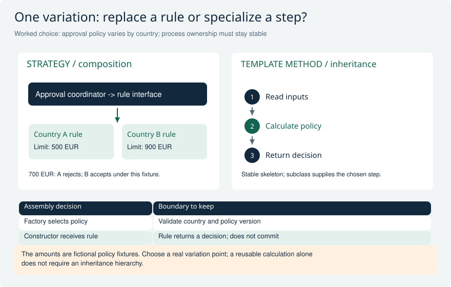
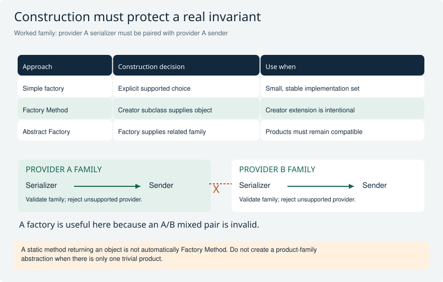
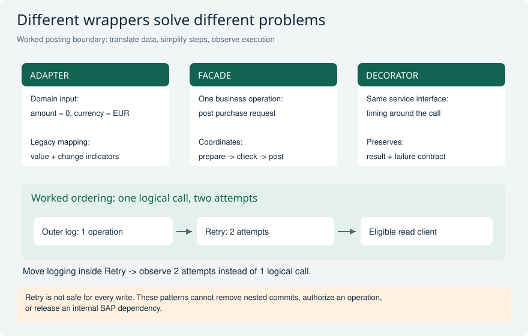
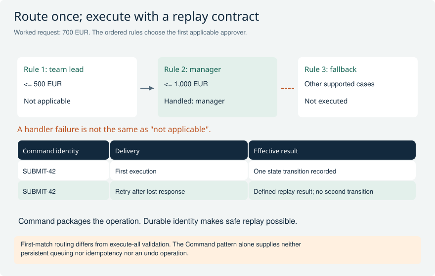
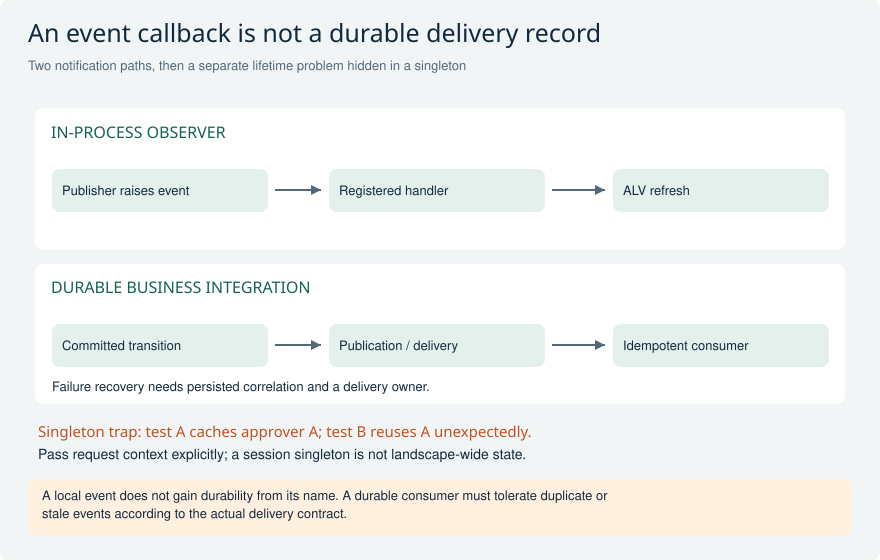
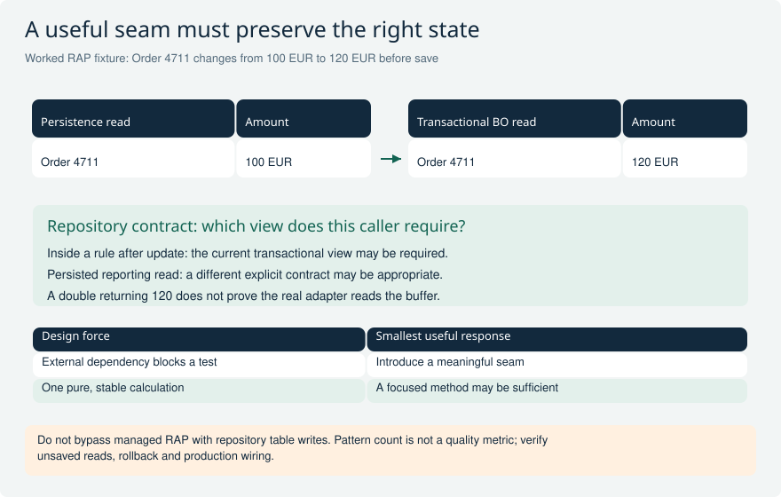

# Practical ABAP design patterns and trade-offs

Use patterns to explain a concrete design decision, not to recite a catalog. These original senior scenarios build on OO-09 through OO-12 and distinguish pattern mechanics from RAP transaction, API-release and security contracts. SAP's pattern examples are exploratory demonstrations, not production templates. Verify syntax and dependencies on the target release. Recommendations below are contextual analysis, not claims that SAP mandates a particular application architecture.

[Return to the study guide](../README.md) | [Study plan](../study/Study_Plan.md)

## PAT-01 Approval rules vary by country, while the application workflow should remain stable. Strategy or Template Method?

**Level:** Senior

**Short answer:** I would use Strategy for country-specific approval rules. The coordinator keeps the workflow, and the selected strategy returns the rule decision. Template Method fits a shared sequence where subclasses intentionally fill in a few fixed steps. Here the rule can vary without changing the coordinator class. I would only choose inheritance if the shared sequence and permitted overrides are clear requirements.

**Reasoning and example:** The application receives an order for 8,000 EUR and supplies the appropriate country rule. In this example, the DE rule requires a manager above 5,000 EUR, while the FR rule uses 10,000 EUR. The same amount therefore requires a manager for DE but not for FR. Each rule receives the required order data and returns a decision, such as the required approver. It should not secretly commit, send email or change global data. The coordinator stays responsible for applying the decision and continuing the workflow.

I test that coordinator with several rules and verify the same success and failure expectations. If countries later need different process sequences, I review the workflow itself instead of adding increasingly powerful subclass hooks. Strategy works best when the changing part is a replaceable rule. Template Method works when a stable base algorithm deliberately controls which steps subclasses may customize.

**Avoid this mistake:** Choosing inheritance solely to share code, or allowing a rule implementation to take over transaction ownership.

**Interviewer follow-ups:**

- Which variation changes at runtime rather than through subclassing?
- How would you prevent a new rule from changing the workflow's transaction boundary?

**Strong answer criteria:**

- Separates country rules from workflow coordination
- Explains why composition or inheritance fits this case
- Keeps rules replaceable and separately testable

**Verification evidence:** Run identical coordinator contract tests with two country rules and a test double; assert decision and side-effect boundaries.

**Read and verify this answer:**

- [SAP ABAP pattern examples: Strategy](https://github.com/SAP-samples/abap-cheat-sheets/blob/main/34_OO_Design_Patterns.md#strategy) - Primary SAP demonstration of the mechanism; the interview scenario and trade-off analysis here are original. Examples require target-release review and are not production templates.
- [SAP ABAP pattern examples: Template Method](https://github.com/SAP-samples/abap-cheat-sheets/blob/main/34_OO_Design_Patterns.md#template-method) - Primary SAP demonstration of the mechanism; the interview scenario and trade-off analysis here are original. Examples require target-release review and are not production templates.

Visual: Strategy versus Template Method in approval rules

The same 700 EUR request receives different policy decisions through the same Strategy contract. Template Method instead fixes a call skeleton and exposes deliberate subclass steps.

**Explain it:** Which part varies, who selects it, and which object keeps transaction ownership?

**Limit:** Conceptual pattern comparison, not executable ABAP or a universal approval rule. Framework-owned construction may require a supported delegation seam.

## PAT-02 A posting integration needs matching serializer and sender implementations for each provider. Is one static factory sufficient?

**Level:** Senior

**Short answer:** A simple factory may be enough for a small fixed set of providers. Abstract Factory helps when several objects must belong to a compatible family, such as a serializer and sender for one provider. Factory Method means a creation operation that subclasses can override. I choose the smallest design that prevents incompatible combinations. Returning an object from a static method does not automatically make it Factory Method.

**Reasoning and example:** Provider A expects one message format and endpoint behavior; provider B expects another. If the caller independently chooses a serializer and sender, it could combine A format with B sender. A factory that returns a validated pair can prevent that mistake without a large hierarchy when only a few combinations exist.

If each provider supplies several related products that evolve together, a provider-factory interface may make the family clearer. I test that every configured provider returns compatible objects and that unknown configuration fails explicitly. Silently choosing a default can send a business document to the wrong destination. The purpose is safe construction, not using the largest possible pattern.

**Avoid this mistake:** Confusing a static creation helper with inheritance-based Factory Method or introducing an Abstract Factory for one trivial object.

**Interviewer follow-ups:**

- What concrete invalid combination must construction prevent?
- When would adding a creator subclass be better than changing a configuration map?

**Strong answer criteria:**

- Distinguishes simple factory, Factory Method and Abstract Factory
- Names which related objects must be compatible
- Checks unknown configuration and future changes

**Verification evidence:** Test each supported provider family and an unknown provider; verify no serializer/sender cross-pairing can be constructed.

**Read and verify this answer:**

- [SAP ABAP pattern examples: Abstract Factory](https://github.com/SAP-samples/abap-cheat-sheets/blob/main/34_OO_Design_Patterns.md#abstract-factory) - Primary SAP demonstration of the mechanism; the interview scenario and trade-off analysis here are original. Examples require target-release review and are not production templates.
- [SAP Factory Method pattern](https://help.sap.com/docs/SUPPORT_CONTENT/abapobjects/3353524416.html) - Supports subclass-controlled creation; the simple-factory comparison is explanatory analysis.

Visual: Three factory choices and a concrete family constraint

The family boundary prevents an A serializer from being combined accidentally with a B sender. The table distinguishes a simple choice from subclass creation and related-product creation.

**Explain it:** What invalid combination does this factory prevent, and when would a simple factory be enough?

**Limit:** Provider compatibility is a fictional fixture. Pattern names do not grant API release eligibility, security or transaction guarantees.

## PAT-03 A legacy posting API has awkward parameters and a three-step prepare/check/post sequence. Would you build an Adapter, a Facade, or both?

**Level:** Senior

**Short answer:** An Adapter can translate the application request and errors into the legacy API format. A Facade can offer one posting operation over prepare, check and post. Both may be useful, but they must preserve failures, authorization and commit rules. I inspect the actual underlying calls. Neither wrapper makes an unreleased API available to ABAP Cloud or removes an internal commit.

**Reasoning and example:** The application sends a simple posting request. An adapter maps it into the required function-module structures and converts responses into meaningful results. A facade coordinates prepare, check and post, and stops before posting when the check fails. I test mapping separately from that sequence so errors are easy to locate.

Important cases include an explicit zero amount, a warning that must be handled according to the API rules and a remote timeout with an unknown outcome. A timeout is not always proof that nothing was posted. The caller needs enough information to reconcile rather than repeat the operation blindly. The wrapper must expose those facts instead of making the API look safer than it is.

**Avoid this mistake:** Treating any wrapper as both a supported API and a transaction adapter without inspecting its dependencies.

**Interviewer follow-ups:**

- Which errors belong to the domain contract and which retain technical detail?
- What evidence would make the legacy API unsuitable despite a neat interface?

**Strong answer criteria:**

- Separates field/error translation from coordinating several calls
- Preserves commit rules and API release restrictions
- Tests important values and error mapping

**Verification evidence:** Trace all three steps with injected failures and inspect dependency release state; assert no hidden commit or swallowed business rejection.

**Read and verify this answer:**

- [SAP ABAP pattern examples: Adapter](https://github.com/SAP-samples/abap-cheat-sheets/blob/main/34_OO_Design_Patterns.md#adapter) - Primary SAP demonstration of the mechanism; the interview scenario and trade-off analysis here are original. Examples require target-release review and are not production templates.
- [SAP ABAP pattern examples: Facade](https://github.com/SAP-samples/abap-cheat-sheets/blob/main/34_OO_Design_Patterns.md#facade) - Primary SAP demonstration of the mechanism; the interview scenario and trade-off analysis here are original. Examples require target-release review and are not production templates.

Visual: Adapter, Facade and Decorator with observable outcomes

Mapping, orchestration and added behavior are different responsibilities. The lower example shows why wrapper order changes whether a log records one logical call or two attempts.

**Explain it:** Where would you translate an explicit clear, stop after a failed check, and record retry attempts?

**Limit:** The retry example is deliberately an eligible read. Write retries need the actual idempotency and uncertainty contract; no pattern automatically supplies it.

## PAT-04 You want timing, diagnostic logging and retries around an outbound service. Would stacked Decorators be safe?

**Level:** Senior

**Short answer:** Decorators can add logging or timing around the same service interface. Their order matters. Retrying needs extra care because repeating a request can repeat a business effect. I only retry when the operation rules make that safe, and I distinguish a rejection from an unknown remote outcome. I also decide whether logs and timing describe each attempt or the complete operation.

**Reasoning and example:** Put logging outside retry and it can record one logical call with several attempts inside it. Put logging inside retry and it can record every attempt. Either can be useful, but the records should share an identifier so support can understand what happened instead of counting attempts as separate business requests.

I test exceptions and return values through the full decorator chain. Logs must avoid sensitive payloads. A diagnostic logging failure should not silently turn a successful business call into failure unless a required audit rule deliberately demands that. Automatic retries on every POST are unsafe: after a timeout, the remote system may already have applied the first request.

**Avoid this mistake:** Adding automatic retries to every POST or assuming decorator order cannot change observable behavior.

**Interviewer follow-ups:**

- Which wrapper should count attempts and which should measure total latency?
- How does a timeout after remote success affect the retry policy?

**Strong answer criteria:**

- Preserves the service results and errors
- Explains how wrapper order changes observation
- Does not assume retry automatically prevents duplicate effects

**Verification evidence:** Test wrapper orders, a transient read failure, uncertain write completion and logging failure; inspect returned outcome and number of remote effects.

**Read and verify this answer:**

- [SAP ABAP pattern examples: Decorator](https://github.com/SAP-samples/abap-cheat-sheets/blob/main/34_OO_Design_Patterns.md#decorator) - Primary SAP demonstration of the mechanism; the interview scenario and trade-off analysis here are original. Examples require target-release review and are not production templates.
- [SAP Clean ABAP: explicit failure flow](https://github.com/SAP/styleguides/blob/main/clean-abap/CleanABAP.md#focus-on-the-happy-path-or-error-handling-but-not-both) - Supports the stated design or testability principle; concrete scenario decisions are contextual recommendations.

Visual: Adapter, Facade and Decorator with observable outcomes

Mapping, orchestration and added behavior are different responsibilities. The lower example shows why wrapper order changes whether a log records one logical call or two attempts.

**Explain it:** Where would you translate an explicit clear, stop after a failed check, and record retry attempts?

**Limit:** The retry example is deliberately an eligible read. Write retries need the actual idempotency and uncertainty contract; no pattern automatically supplies it.

## PAT-05 Three handlers can route a request to an approver. The first matching rule should win. How would you implement and test Chain of Responsibility?

**Level:** Senior

**Short answer:** I would use an ordered Chain of Responsibility when the first matching handler should choose the route. Each handler must distinguish handled, not applicable and failed. I define what happens when no rule matches and test the configured order. A technical failure must not quietly fall through to another approver. If all validations must run, I use a different execute-all process.

**Reasoning and example:** A high-value rule, a regional rule and a fallback can all potentially apply to one request. If the high-value rule must win, it appears before the general fallback. The selected handler returns an approver decision, while the transaction coordinator applies it. The rule should not secretly save data during selection.

Tests include overlapping matches, no match and a failure while a rule reads required information. I record which rule selected the approver so support can explain the route. Treating a failed lookup as not applicable can accidentally send the request to a less restrictive fallback. First-match routing is useful, but it does not mean every validation in the chain has run.

**Avoid this mistake:** Treating an exception as 'not applicable', or confusing first-match routing with execute-all validation.

**Interviewer follow-ups:**

- What happens when two handlers match?
- How is a configuration error different from a valid request with no applicable route?

**Strong answer criteria:**

- Defines rule order and each routing outcome
- Separates first-match routing from running all validations
- Explains the selected route and controls data changes

**Verification evidence:** Test overlapping rules, no match, handler failure and reordered configuration; assert exactly which handlers execute and which route is chosen.

**Read and verify this answer:**

- [SAP ABAP pattern examples: Chain of Responsibility](https://github.com/SAP-samples/abap-cheat-sheets/blob/main/34_OO_Design_Patterns.md#chain-of-responsibility) - Primary SAP demonstration of the mechanism; the interview scenario and trade-off analysis here are original. Examples require target-release review and are not production templates.

Visual: First-match routing and idempotent command execution

The 700 EUR fixture passes the team-lead rule and stops at the manager rule. The selected operation then needs its own durable identity to handle duplicate delivery safely.

**Explain it:** What changes if all rules must run, and what must a repeated SUBMIT-42 return?

**Limit:** Routing thresholds and command identity are fictional. The actual business transition, persistence and compensation contracts must be designed separately.

## PAT-06 A local ABAP event updates an ALV, and the team proposes another handler to start an external workflow. What boundary has changed?

**Level:** Senior

**Short answer:** The requirement changed from a local notification to reliable work in another system. An ABAP OO event can notify registered listeners in the current execution context. It does not save a message or guarantee delivery after commit. An external workflow needs a supported publication mechanism plus retry and recovery rules. I separate display updates from the saved business transition that should start the workflow.

**Reasoning and example:** An ALV listener reacts to a local event and refreshes the screen. It can also be accidentally registered twice or left registered when obsolete, so I manage its lifetime and test error handling. None of that registration creates a durable subscription that survives the runtime context.

For an external workflow, I need to know that the document change was saved and that publication can recover after an outage. The receiving side must identify repeated or delayed messages and avoid creating duplicate workflows. A local handler that directly calls the external system can run before a later save failure or lose delivery on an error. Observer alone does not solve those business guarantees.

**Avoid this mistake:** Assuming SET HANDLER creates a durable subscription or that Observer guarantees exactly-once business effects.

**Interviewer follow-ups:**

- Which part of the design survives an application-server restart?
- What if one local listener fails after another already changed its state?

**Strong answer criteria:**

- Separates local notification from messages that survive failures
- Connects external work to saved business changes
- Defines handling for listener and delivery failures

**Verification evidence:** Test local listener registration separately from rejected save, duplicate event and delayed workflow delivery cases.

**Read and verify this answer:**

- [SAP Observer pattern](https://help.sap.com/docs/SUPPORT_CONTENT/abapobjects/3353524082.html) - Describes ABAP event-based observation; it does not claim durable messaging.
- [SAP RAP business events](https://help.sap.com/docs/ABAP_PLATFORM_NEW/fc4c71aa50014fd1b43721701471913d/0b925bc556d4491aad395b21ec2566ff.html) - Supports the separate RAP business-event mechanism and its lifecycle.

Visual: Observer delivery and hidden singleton state

A registered local handler can update an ALV, while an external process needs transactional publication and durable processing evidence. Session-shared mutable state is a separate source of repeated-test failures.

**Explain it:** Which facts survive a process restart, and which request-specific values must not be cached implicitly?

**Limit:** The lower path describes required responsibilities, not an automatic feature of ABAP Objects events. Verify the chosen event infrastructure and service lifetime.

## PAT-07 A command object represents Submit and can be queued or retried. Does using Command make execution idempotent or undoable?

**Level:** Senior

**Short answer:** No. Command packages an action and its inputs; it does not automatically make repeats safe or provide undo. I define a stable operation ID, storage, authorization and repeated-execution rules separately. An undo operation only works when the business has a valid reverse action. A posted document may require a compensating document rather than deletion or a simple rollback.

**Reasoning and example:** A Submit command stored only as an object in memory disappears when its runtime context ends. For a reliable queue, I store a suitable versioned data record and use it to reconstruct an allowed executor. A saved object reference is not a durable message format. At execution time, I check the required business state and authorization.

I also test a repeated operation ID with the same payload and with a conflicting payload. The first may return the existing result; the second may need rejection, according to the defined rules. If submission already posted a document, local rollback cannot erase that completed effect. Recovery may need a separate, audited reversal operation.

**Avoid this mistake:** Assuming execute can safely run twice or that every business command has an exact inverse.

**Interviewer follow-ups:**

- What result should a retry return after the first response was lost?
- How would you evolve a persisted command payload across application releases?

**Strong answer criteria:**

- Separates packaging an action from safe execution
- Defines a saved operation ID and repeat-call behavior
- Uses a business reversal where simple undo is impossible

**Verification evidence:** Simulate duplicate execution, conflicting payload reuse, lost response and executor upgrade; assert one effective transition and traceable recovery.

**Read and verify this answer:**

- [SAP ABAP pattern examples: Command](https://github.com/SAP-samples/abap-cheat-sheets/blob/main/34_OO_Design_Patterns.md#command) - Primary SAP demonstration of the mechanism; the interview scenario and trade-off analysis here are original. Examples require target-release review and are not production templates.
- [SAP LUWs in ABAP](https://help.sap.com/docs/abap-cloud/abap-concepts/luws-in-abap) - Provides the transaction boundary; command replay and compensation are design decisions in this scenario.

Visual: First-match routing and idempotent command execution

The 700 EUR fixture passes the team-lead rule and stops at the manager rule. The selected operation then needs its own durable identity to handle duplicate delivery safely.

**Explain it:** What changes if all rules must run, and what must a repeated SUBMIT-42 return?

**Limit:** Routing thresholds and command identity are fictional. The actual business transition, persistence and compensation contracts must be designed separately.

## PAT-08 A repository interface improves testability, but its RAP implementation reads managed persistence directly. What can go wrong?

**Level:** Senior

**Short answer:** A testable interface can still hide an incorrect implementation. Direct table reads can miss changes waiting in the RAP transaction buffer. I first define whether the repository should read saved data or the current transaction state. For BO logic that needs current changes, I use suitable EML access. I do not write managed tables directly and bypass the RAP behavior checks.

**Reasoning and example:** A validation changes an item and then reads it through a repository before save. If the repository selects the database table, it can return the old value even though the current RAP transaction already contains the new one. Newly created or deleted instances make the difference even more obvious.

A reporting read of persisted data may legitimately use a different approach. I give those needs distinct names or responsibilities so callers understand which state they receive. Tests should cover update-then-read, create-then-read and delete-then-read before save using the real BO path. A convenient fake returning expected rows will not reveal a production implementation that reads the wrong state, and a second home-made buffer adds more consistency problems.

**Avoid this mistake:** Equating a mockable interface with correct behavior or recreating RAP's transactional buffer in a second general-purpose cache.

**Interviewer follow-ups:**

- Which caller actually needs persisted rather than buffered state?
- What integration test would fail if the repository used SELECT instead of EML?

**Strong answer criteria:**

- States whether a read returns saved or current buffered data
- Respects RAP save ownership and pending changes
- Tests the interface and the real BO integration

**Verification evidence:** Compare unsaved create/update/delete reads through the adapter with the BO contract, then run rollback and save paths on the target system.

**Read and verify this answer:**

- [SAP ABAP pattern examples: data-access isolation examples](https://github.com/SAP-samples/abap-cheat-sheets/blob/main/34_OO_Design_Patterns.md#data-access-object-dao) - Primary SAP demonstration of the mechanism; the interview scenario and trade-off analysis here are original. Examples require target-release review and are not production templates.
- [SAP RAP implementation contract](https://help.sap.com/docs/abap-cloud/abap-rap/general-rap-bo-implementation-contract) - Defines transaction rules; Repository is a scenario abstraction, not a claim that SAP requires this pattern.

Visual: Repository read semantics and proportional abstraction

A direct persistence read returns 100 while the transaction already sees 120. The repository seam is valuable only if its real implementation honors the state contract required by the caller.

**Explain it:** Which integration test catches a mockable repository that reads the wrong state, and when is no new abstraction needed?

**Limit:** Conceptual read semantics rather than an SQL isolation guarantee. The specific BO, EML operation, authorization and target release remain authoritative.

## PAT-09 A singleton caches the current approver and makes tests pass alone but fail as a suite. How do you redesign its lifetime?

**Level:** Senior

**Short answer:** I would remove the current approver from long-lived shared mutable state. I would pass the relevant context explicitly and use an operation-scoped service, or a cache with clear keys and refresh rules. An ABAP singleton normally belongs to an internal session, not the whole system. Its lifetime can still span several operations or tests. Forcing test order does not fix that design.

**Reasoning and example:** One test asks for an approver for company A and populates the singleton. A later test for company B reuses the cached value and gets the wrong approver. Similar trouble can occur when a job processes several contexts. The cache stored current approver without saying current for which request or policy.

I make that context explicit in the operation and, if caching is needed, include every relevant distinction in its key and invalidation rules. Tests get controlled service instances. A reset method may temporarily isolate legacy tests, but production must still have the correct lifetime. Clearing a cache between tests cannot repair an application that mixes request-specific decisions during normal use.

**Avoid this mistake:** Claiming singleton means one system-wide instance or solving hidden state solely by forcing test order.

**Interviewer follow-ups:**

- What exact lifetime is required by the cached value?
- How would two simulated users in one test expose the defect?

**Strong answer criteria:**

- States the actual singleton lifetime
- Passes request-specific context explicitly
- Separates isolated tests from a correct production cache

**Verification evidence:** Run tests in multiple orders and reuse one session across different users or contexts; assert no stale decisions and deterministic dependency replacement.

**Read and verify this answer:**

- [SAP ABAP pattern examples: Singleton](https://github.com/SAP-samples/abap-cheat-sheets/blob/main/34_OO_Design_Patterns.md#singleton) - Primary SAP demonstration of the mechanism; the interview scenario and trade-off analysis here are original. Examples require target-release review and are not production templates.
- [SAP Clean ABAP: state lifetime](https://github.com/SAP/styleguides/blob/main/clean-abap/CleanABAP.md#dont-mix-stateful-and-stateless-in-the-same-class) - Supports the stated design or testability principle; concrete scenario decisions are contextual recommendations.

Visual: Observer delivery and hidden singleton state

A registered local handler can update an ALV, while an external process needs transactional publication and durable processing evidence. Session-shared mutable state is a separate source of repeated-test failures.

**Explain it:** Which facts survive a process restart, and which request-specific values must not be cached implicitly?

**Limit:** The lower path describes required responsibilities, not an automatic feature of ABAP Objects events. Verify the chosen event infrastructure and service lifetime.

## PAT-10 A service obtains every dependency from a global factory inside its methods. How would you introduce dependency injection without building a framework?

**Level:** Senior

**Short answer:** I would build the service near the application entry point and pass its required interface-typed helpers through the constructor. Business methods then use those supplied helpers instead of finding them globally. A small factory can assemble them if setup is complex. This makes tests predictable without requiring a dependency-injection framework. Framework-created classes may need a supported seam or a delegated service instead.

**Reasoning and example:** An approval method currently calls a global factory to obtain a repository and posting client every time. A unit test cannot easily control what it receives and may accidentally reach a live dependency. I move that construction into application setup and give the service the two objects explicitly.

The test supplies a known repository and a client that cannot post externally, then exercises the real approval decision. A separate integration check verifies production wiring. If RAP or another framework controls construction, I do not invent unsupported constructor parameters; I use a suitable delegated application service or supported test seam. Replacing the factory with another global lookup would still hide the same dependencies.

**Avoid this mistake:** Replacing one hidden global singleton with a service locator and calling the result fully decoupled.

**Interviewer follow-ups:**

- Which object owns construction in a framework-created RAP handler?
- How would a newly added dependency become visible to existing tests?

**Strong answer criteria:**

- Separates constructing dependencies from business decisions
- Supplies dependencies explicitly within framework rules
- Checks production setup and safe replacements in tests

**Verification evidence:** Instantiate the application service with doubles, assert no live dependency access, and test the production factory's intended object graph independently.

**Read and verify this answer:**

- [SAP Clean ABAP: dependency injection](https://github.com/SAP/styleguides/blob/main/clean-abap/CleanABAP.md#use-dependency-inversion-to-inject-test-doubles) - Supports the stated design or testability principle; concrete scenario decisions are contextual recommendations.
- [SAP ABAP test isolation examples](https://github.com/SAP-samples/abap-test-isolation-examples) - Provides primary examples of isolation techniques; select tools supported on the target release.

Visual: Strategy versus Template Method in approval rules

The same 700 EUR request receives different policy decisions through the same Strategy contract. Template Method instead fixes a call skeleton and exposes deliberate subclass steps.

**Explain it:** Which part varies, who selects it, and which object keeps transaction ownership?

**Limit:** Conceptual pattern comparison, not executable ABAP or a universal approval rule. Framework-owned construction may require a supported delegation seam.

Visual: Repository read semantics and proportional abstraction

A direct persistence read returns 100 while the transaction already sees 120. The repository seam is valuable only if its real implementation honors the state contract required by the caller.

**Explain it:** Which integration test catches a mockable repository that reads the wrong state, and when is no new abstraction needed?

**Limit:** Conceptual read semantics rather than an SQL isolation guarantee. The specific BO, EML operation, authorization and target release remain authoritative.

## PAT-11 A small report has one stable calculation. A reviewer requests Strategy, Abstract Factory and Repository 'for clean architecture'. How do you respond?

**Level:** Senior

**Short answer:** I would ask what concrete problem each pattern solves. One stable calculation may need only a clearly named method and good tests. An external service may deserve an interface because it can fail or needs replacement in tests. I add Strategy or factories when real variations make them useful. The aim is understandable change, not a high count of classes.

**Reasoning and example:** A small report calculates a tax base with one supported rule. A method with explicit inputs, an explicit result and boundary tests can be easy to read and maintain. Adding Strategy, Abstract Factory and Repository around that pure calculation may introduce many files without removing any actual difficulty.

If the rate comes from a remote service, that dependency is a real reason for a seam: tests need controlled values and failures. If a second tax rule arrives later, extracting a Strategy can then make sense. I leave a clear reason for that future change. I neither reject patterns automatically nor apply them as decoration; each added layer should make a named responsibility easier to understand or test.

**Avoid this mistake:** Equating more classes with greater maintainability or rejecting all patterns because the current implementation is short.

**Interviewer follow-ups:**

- Which expected change would justify the next abstraction?
- What testing benefit can you demonstrate before adding another interface?

**Strong answer criteria:**

- Connects each extra layer to a real problem
- Keeps the design simple while making outside calls testable
- Names a concrete future change that would justify another layer

**Verification evidence:** Compare change scope and tests for the current design and proposed abstraction; retain only boundaries with a demonstrated maintenance or testing benefit.

**Read and verify this answer:**

- [SAP Clean ABAP: abstraction level](https://github.com/SAP/styleguides/blob/main/clean-abap/CleanABAP.md#descend-one-level-of-abstraction) - Supports the stated design or testability principle; concrete scenario decisions are contextual recommendations.
- [SAP Clean ABAP: focused responsibilities](https://github.com/SAP/styleguides/blob/main/clean-abap/CleanABAP.md#keep-methods-small) - Supports the stated design or testability principle; concrete scenario decisions are contextual recommendations.

Visual: Three factory choices and a concrete family constraint

The family boundary prevents an A serializer from being combined accidentally with a B sender. The table distinguishes a simple choice from subclass creation and related-product creation.

**Explain it:** What invalid combination does this factory prevent, and when would a simple factory be enough?

**Limit:** Provider compatibility is a fictional fixture. Pattern names do not grant API release eligibility, security or transaction guarantees.

Visual: Repository read semantics and proportional abstraction

A direct persistence read returns 100 while the transaction already sees 120. The repository seam is valuable only if its real implementation honors the state contract required by the caller.

**Explain it:** Which integration test catches a mockable repository that reads the wrong state, and when is no new abstraction needed?

**Limit:** Conceptual read semantics rather than an SQL isolation guarantee. The specific BO, EML operation, authorization and target release remain authoritative.

## PAT-12 A factory selects country approval Strategies from configuration. How do you keep that combination safe, explainable and testable?

**Level:** Senior

**Short answer:** I map supported configuration values to known approval strategies and pass the selected strategy to the coordinator. Missing or unknown configuration should fail clearly, not default to approval. Each rule returns the same kind of result. I test selection separately from calculation. Dynamic class creation still needs approved class choices and allowed dependencies; it cannot bypass ABAP Cloud restrictions.

**Reasoning and example:** Configuration selects a country rule and, when needed, a policy version. A factory validates that choice and creates the corresponding strategy. Tests check every supported mapping and an unknown value. Separate tests verify each rule, while common cases check that all strategies keep the same result and failure promises.

For a long-running approval, I decide whether it keeps the policy version from submission or deliberately uses the current policy. Otherwise a configuration change could alter the rule halfway through without an explanation. When audit requires it, I record which policy produced the decision. Arbitrary class names from untrusted input and a fallback that approves after configuration failure are both unsafe shortcuts.

**Avoid this mistake:** Allowing arbitrary class names from untrusted input or implementing a 'default approve' path when configuration lookup fails.

**Interviewer follow-ups:**

- What should happen to a pending request after the configured policy changes?
- Which tests distinguish factory-selection failure from a correct rule rejecting the request?

**Strong answer criteria:**

- Separates choosing the strategy from running it
- Rejects unsupported configuration safely
- Defines policy versions and shared behavior rules

**Verification evidence:** Test supported and unknown countries, policy changes during pending approvals and identical contract assertions against every Strategy.

**Read and verify this answer:**

- [SAP ABAP pattern examples: Strategy](https://github.com/SAP-samples/abap-cheat-sheets/blob/main/34_OO_Design_Patterns.md#strategy) - Primary SAP demonstration of the mechanism; the interview scenario and trade-off analysis here are original. Examples require target-release review and are not production templates.
- [SAP ABAP pattern examples: object creation alternatives](https://github.com/SAP-samples/abap-cheat-sheets/blob/main/34_OO_Design_Patterns.md#factory-method) - Primary SAP demonstration of the mechanism; the interview scenario and trade-off analysis here are original. Examples require target-release review and are not production templates.

Visual: Strategy versus Template Method in approval rules

The same 700 EUR request receives different policy decisions through the same Strategy contract. Template Method instead fixes a call skeleton and exposes deliberate subclass steps.

**Explain it:** Which part varies, who selects it, and which object keeps transaction ownership?

**Limit:** Conceptual pattern comparison, not executable ABAP or a universal approval rule. Framework-owned construction may require a supported delegation seam.

Visual: Three factory choices and a concrete family constraint

The family boundary prevents an A serializer from being combined accidentally with a B sender. The table distinguishes a simple choice from subclass creation and related-product creation.

**Explain it:** What invalid combination does this factory prevent, and when would a simple factory be enough?

**Limit:** Provider compatibility is a fictional fixture. Pattern names do not grant API release eligibility, security or transaction guarantees.

## Official references

- [SAP ABAP pattern examples: Strategy](https://github.com/SAP-samples/abap-cheat-sheets/blob/main/34_OO_Design_Patterns.md#strategy)
- [SAP ABAP pattern examples: Template Method](https://github.com/SAP-samples/abap-cheat-sheets/blob/main/34_OO_Design_Patterns.md#template-method)
- [SAP ABAP pattern examples: Abstract Factory](https://github.com/SAP-samples/abap-cheat-sheets/blob/main/34_OO_Design_Patterns.md#abstract-factory)
- [SAP Factory Method pattern](https://help.sap.com/docs/SUPPORT_CONTENT/abapobjects/3353524416.html)
- [SAP ABAP pattern examples: Adapter](https://github.com/SAP-samples/abap-cheat-sheets/blob/main/34_OO_Design_Patterns.md#adapter)
- [SAP ABAP pattern examples: Facade](https://github.com/SAP-samples/abap-cheat-sheets/blob/main/34_OO_Design_Patterns.md#facade)
- [SAP ABAP pattern examples: Decorator](https://github.com/SAP-samples/abap-cheat-sheets/blob/main/34_OO_Design_Patterns.md#decorator)
- [SAP Clean ABAP: explicit failure flow](https://github.com/SAP/styleguides/blob/main/clean-abap/CleanABAP.md#focus-on-the-happy-path-or-error-handling-but-not-both)
- [SAP ABAP pattern examples: Chain of Responsibility](https://github.com/SAP-samples/abap-cheat-sheets/blob/main/34_OO_Design_Patterns.md#chain-of-responsibility)
- [SAP Observer pattern](https://help.sap.com/docs/SUPPORT_CONTENT/abapobjects/3353524082.html)
- [SAP RAP business events](https://help.sap.com/docs/ABAP_PLATFORM_NEW/fc4c71aa50014fd1b43721701471913d/0b925bc556d4491aad395b21ec2566ff.html)
- [SAP ABAP pattern examples: Command](https://github.com/SAP-samples/abap-cheat-sheets/blob/main/34_OO_Design_Patterns.md#command)
- [SAP LUWs in ABAP](https://help.sap.com/docs/abap-cloud/abap-concepts/luws-in-abap)
- [SAP ABAP pattern examples: data-access isolation examples](https://github.com/SAP-samples/abap-cheat-sheets/blob/main/34_OO_Design_Patterns.md#data-access-object-dao)
- [SAP RAP implementation contract](https://help.sap.com/docs/abap-cloud/abap-rap/general-rap-bo-implementation-contract)
- [SAP ABAP pattern examples: Singleton](https://github.com/SAP-samples/abap-cheat-sheets/blob/main/34_OO_Design_Patterns.md#singleton)
- [SAP Clean ABAP: state lifetime](https://github.com/SAP/styleguides/blob/main/clean-abap/CleanABAP.md#dont-mix-stateful-and-stateless-in-the-same-class)
- [SAP Clean ABAP: dependency injection](https://github.com/SAP/styleguides/blob/main/clean-abap/CleanABAP.md#use-dependency-inversion-to-inject-test-doubles)
- [SAP ABAP test isolation examples](https://github.com/SAP-samples/abap-test-isolation-examples)
- [SAP Clean ABAP: abstraction level](https://github.com/SAP/styleguides/blob/main/clean-abap/CleanABAP.md#descend-one-level-of-abstraction)
- [SAP Clean ABAP: focused responsibilities](https://github.com/SAP/styleguides/blob/main/clean-abap/CleanABAP.md#keep-methods-small)
- [SAP ABAP pattern examples: object creation alternatives](https://github.com/SAP-samples/abap-cheat-sheets/blob/main/34_OO_Design_Patterns.md#factory-method)
