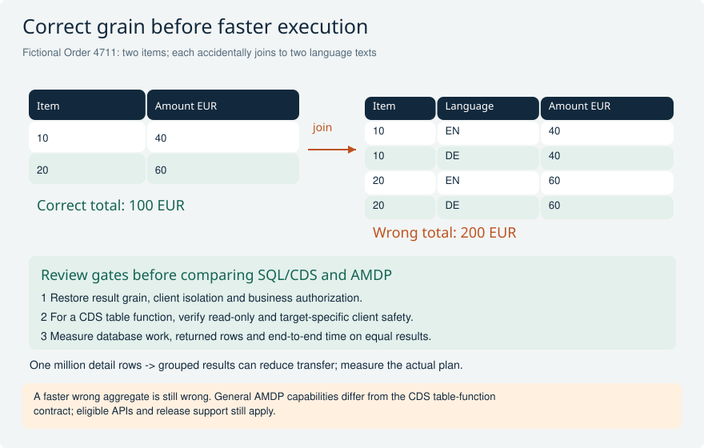
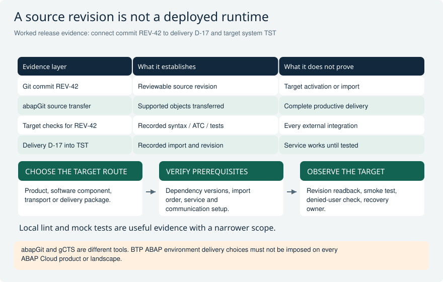

# Supporting skills: HANA decisions and source-to-release delivery

Three focused senior code-review decisions complement the main ABAP Cloud track: choose database implementation from semantics and evidence, protect client and authorization boundaries, and distinguish source history from tested runtime delivery. The fixtures are original; target product and release remain required inputs.

[Return to the study guide](../README.md) | [Study plan](../study/Study_Plan.md)

## SQLX-01 A CDS table function joins client-dependent purchasing data in SQLScript, writes a helper table, and assumes the outer CDS DCL protects every internal read. Would you approve it?

**Level:** Senior

**Short answer:** No. For the documented CDS table-function contract, the AMDP database function is read-only, uses SQLScript on HANA and must satisfy the applicable client-safety rules. I would remove the write and review every source, join and client boundary rather than trust an outer annotation. Client isolation and business authorization are separate concerns: establish protection at the supported consumption path and do not assume SQLScript reproduces ABAP SQL or CDS access-control behavior automatically. Confirm target-release and language-version eligibility first.

**Example and follow-up:** Use two clients containing the same business key and two users with different purchasing scopes. Verify that results, aggregates and error behavior cannot expose foreign data. Check the declared return types and result grain as well as the USING dependencies. Prefer a supported CDS or ABAP SQL expression if it already meets the requirement; a table function adds a database-specific contract.

**Avoid this mistake:** Treating every AMDP method as read-only, or treating this read-only table-function constraint as permission to read any SAP table. General AMDP capabilities and eligible dependencies are separate.

**Interviewer follow-ups:**

- How would a cross-client join contaminate an aggregate even if the final rows are later filtered?
- What evidence shows that both client isolation and the consumer's business authorization are enforced?

**Strong answer criteria:**

- Distinguishes table-function restrictions from general AMDP capabilities
- Reviews client safety and authorization as separate boundaries
- Verifies target support, dependencies and result contract

**Verification evidence:** Activate against the intended release, inspect dependencies and trace the real consumption path; test overlapping keys across clients and allowed/denied purchasing scopes.

**Read and verify this answer:**

- [SAP CDS table functions: SQLScript, read-only and client safety](https://help.sap.com/docs/ABAP_PLATFORM_NEW/67e4075c942e43d4a9f6f891a8dafcf4/ed4c5fc6d3fd43ebb355f12aa1e73757.html) - Primary reference reviewed in the 2025 FPS01 documentation; verify the corresponding contract on the actual target.
- [SAP ABAP data models and access-control concepts](https://help.sap.com/docs/abap-cloud/abap-data-models/learn) - Separates CDS data-model and authorization concepts; the client/authorization test fixture is original analysis.

Visual: HANA pushdown: result grain and table-function review

A two-language text join duplicates both item amounts. Repair the relationship before accepting a performance rewrite, then verify security, client isolation and the chosen implementation contract.

**Explain it:** Why would DISTINCT or dividing by two be an unreliable repair, and what metrics would justify pushdown?

**Limit:** Illustrative data, not a benchmark. Read-only here refers to the cited CDS table-function scenario, not every AMDP method; check target rules and consumption-path security.

## SQLX-02 A report transfers one million item rows to ABAP to calculate totals. A rewrite uses AMDP but doubles amounts after a text join. Which implementation would you recommend?

**Level:** Senior

**Short answer:** First establish the required result grain and repair the text relationship; a faster wrong aggregate is unacceptable. Then compare a supported ABAP SQL or CDS aggregation with AMDP only if its extra database capabilities are actually needed. Push selective filters and suitable aggregation toward the database to reduce transferred data, while preserving authorization, currencies, null handling and multiplicity. Measure database work, transferred rows and end-to-end time under representative volume rather than claiming SQLScript is inherently faster.

**Example and follow-up:** For order 4711, two items worth 40 and 60 EUR should total 100 EUR. Joining each item to two language texts produces four rows and a wrong 200 EUR total. Restrict the relationship or aggregate at the correct boundary as required by the semantics. Verify equivalent results before comparing traces; fewer returned rows alone does not prove less database work.

**Avoid this mistake:** Using DISTINCT or dividing by a current duplication factor without fixing the grain, or selecting AMDP simply because HANA is present.

**Interviewer follow-ups:**

- Which trace observations separate excessive transfer from an expensive database plan?
- How would you test multiple currencies, missing texts and duplicate text records?

**Strong answer criteria:**

- Proves result equivalence before accepting optimization
- Selects the simplest supported pushdown mechanism
- Measures transfer, execution and full-response cost

**Verification evidence:** Use known-total fixtures and representative datasets; compare result sets, row multiplicity, SQL trace duration/records and end-to-end timings for the alternatives.

**Read and verify this answer:**

- [SAP Learning: code pushdown with ABAP SQL and CDS](https://learning.sap.com/courses/building-data-models-with-the-abap-dictionary-and-abap-core-data-services/implementing-sql-expressions-in-cds-views_a9962c08-c5df-46a6-ba30-a74acf5c86b2) - Supports database-side expressions through SQL/CDS; the implementation choice and numeric fixture are original reasoning.
- [SAP SQL trace analysis](https://help.sap.com/docs/ABAP_PLATFORM_NEW/6d9d967c861d4f78b5b90a4fe9b7d2e7/fcee1d4c512b48c281593c862858e983.html) - Documents execution duration, accessed records and access-plan inspection; interpret measurements in the selected environment.

Visual: HANA pushdown: result grain and table-function review

A two-language text join duplicates both item amounts. Repair the relationship before accepting a performance rewrite, then verify security, client isolation and the chosen implementation contract.

**Explain it:** Why would DISTINCT or dividing by two be an unreliable repair, and what metrics would justify pushdown?

**Limit:** Illustrative data, not a benchmark. Read-only here refers to the cited CDS table-function scenario, not every AMDP method; check target rules and consumption-path security.

## DELIV-01 A pull request passes local linting and its ABAP sources are pushed with abapGit. The team calls the cloud feature deployed. What evidence and delivery steps are missing?

**Level:** Senior

**Short answer:** Git records source history; abapGit transfers supported development objects. Neither statement proves target activation or productive delivery. Establish the product-specific lifecycle route, software component and dependency order; BTP ABAP environment can use supported transport/gCTS or add-on delivery scenarios, while other ABAP Cloud environments have their own routes. Tie the source revision to target syntax/activation, ATC, meaningful ABAP Unit and integration results, then verify the imported revision, service access and configuration in the intended system.

**Example and follow-up:** A CI result must name what actually ran and where: local lint is not SAP activation, and mocked tests do not prove runtime authorization. Include dependency versions, transport or delivery identifiers, import evidence, communication setup and recovery ownership. Keep technical identities and secrets out of Git. A source export can support review without representing a complete deployable application.

**Avoid this mistake:** Equating an abapGit push with a transport release, treating gCTS and abapGit as interchangeable names, or applying one BTP delivery route to every ABAP Cloud product.

**Interviewer follow-ups:**

- How would you prove the tested source revision is the one imported into the target?
- Which prerequisites can make an active service fail after an otherwise successful import?

**Strong answer criteria:**

- Separates source control, source transfer and runtime delivery
- Chooses a lifecycle route for the actual product
- Requires traceable target checks and operational readiness

**Verification evidence:** Record commit, component/dependency versions and delivery IDs; retain target activation/ATC/test/import logs and a service smoke test with an authorized and a denied identity.

**Read and verify this answer:**

- [SAP: working with abapGit](https://help.sap.com/docs/btp/sap-business-technology-platform/working-with-abapgit?ai=true) - Describes source transfer, supported-object restrictions and activation after import; source transfer is distinct from deployment evidence.
- [SAP BTP ABAP environment: delivery via add-on or gCTS](https://help.sap.com/docs/sap-btp-abap-environment/abap-environment/delivery-via-add-on-or-gcts?locale=en-US) - Documents these BTP ABAP environment delivery options and their checks; do not generalize the scenario to every ABAP Cloud edition.

Visual: Source transfer, delivery and verified runtime evidence

Four evidence layers answer different questions. A release links the reviewed and tested revision to an actual imported state, then verifies the target consumer and configuration.

**Explain it:** Which artifact proves what was imported, and what can fail after a successful import?

**Limit:** REV-42, D-17 and TST are fictional identifiers. The table is an evidence checklist, not a mandatory sequence requiring abapGit in every transport landscape.

## Official references

- [SAP CDS table functions: SQLScript, read-only and client safety](https://help.sap.com/docs/ABAP_PLATFORM_NEW/67e4075c942e43d4a9f6f891a8dafcf4/ed4c5fc6d3fd43ebb355f12aa1e73757.html)
- [SAP ABAP data models and access-control concepts](https://help.sap.com/docs/abap-cloud/abap-data-models/learn)
- [SAP Learning: code pushdown with ABAP SQL and CDS](https://learning.sap.com/courses/building-data-models-with-the-abap-dictionary-and-abap-core-data-services/implementing-sql-expressions-in-cds-views_a9962c08-c5df-46a6-ba30-a74acf5c86b2)
- [SAP SQL trace analysis](https://help.sap.com/docs/ABAP_PLATFORM_NEW/6d9d967c861d4f78b5b90a4fe9b7d2e7/fcee1d4c512b48c281593c862858e983.html)
- [SAP: working with abapGit](https://help.sap.com/docs/btp/sap-business-technology-platform/working-with-abapgit?ai=true)
- [SAP BTP ABAP environment: delivery via add-on or gCTS](https://help.sap.com/docs/sap-btp-abap-environment/abap-environment/delivery-via-add-on-or-gcts?locale=en-US)
