# Visual interview atlas

Use these original teaching visuals alongside the full answers. Cover the explanation and answer the recall prompt aloud. Illustrations are analogies; diagrams are simplified models with explicit limits. [Download the printable atlas](../pdf/ABAP_Visual_Atlas.pdf).

## Clean Core levels A-D

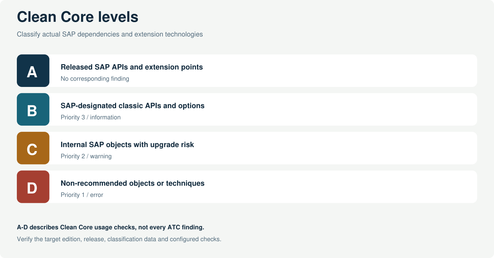

Read each level as a classification of the actual SAP dependency or extension technology.

**Explain it:** Which configured Clean Core finding priority corresponds to levels B, C and D?

**Limit:** This mapping is specific to Clean Core usage checks; it does not classify every ATC finding.

**Questions:** CORE-01, CORE-02, CORE-03, CORE-04, CORE-05, CORE-06, CORE-09, CORE-13, CORE-16, CORE-18, GOV-01, GOV-05, GOV-06, GOV-14, GOV-15, GOV-16, GOV-18

[Full-size PNG](clean-core-levels.png) | [Editable SVG](clean-core-levels.svg)

## RAP transaction and workflow boundary

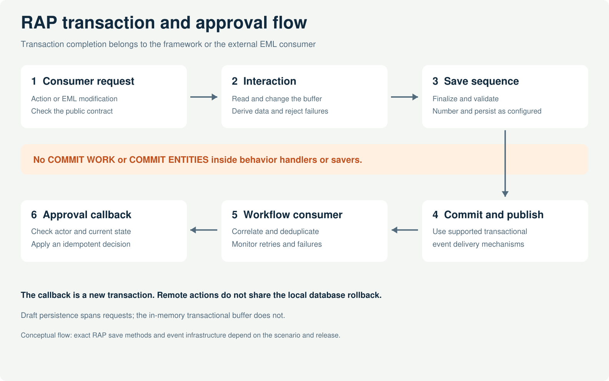

Separate the local transaction from event delivery and the later workflow callback.

**Explain it:** What is lost if a handler calls a committing legacy API?

**Limit:** Exact RAP save methods and supported event infrastructure depend on scenario and release.

**Questions:** RAP-04, RAP-05, RAP-15, RICEFW-11, RICEFW-12, RICEFW-14, SRAP-02, SRAP-03, SRAP-15, SRAP-18

[Full-size PNG](rap-transaction.png) | [Editable SVG](rap-transaction.svg)

## Extension placement decision

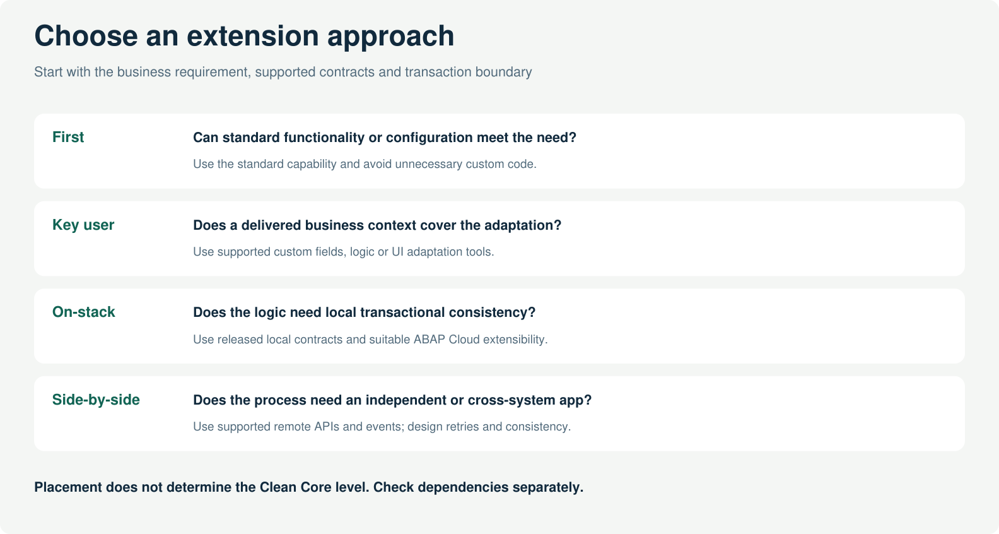

Start from the business need and transaction boundary before choosing an extension location.

**Explain it:** When would local transactional consistency favor an on-stack extension?

**Limit:** Placement does not establish Clean Core level or availability in a specific edition.

**Questions:** CORE-10, CORE-11, CORE-15, CORE-18, BTP-01, CLOUD-01, CLOUD-09, CLOUD-14, GOV-07, GOV-08

[Full-size PNG](extensibility-decision.png) | [Editable SVG](extensibility-decision.svg)

## Internal table lookup

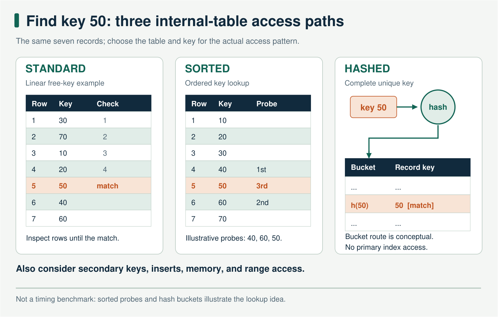

A free-key linear search, an ordered lookup, and a complete hashed-key lookup find the same record through different access paths.

**Explain it:** What changes if I need all rows in a key range, or preserve input order?

**Limit:** A standard table can use secondary keys; a hash lookup requires a suitable complete key. Hash storage and probe order are schematic, not SAP implementation guarantees.

**Questions:** ABAP-01, ABAP-02, ABAP-03

[Full-size PNG](classic-internal-table-lookup.png) | [Editable SVG](classic-internal-table-lookup.svg)

## DDIC technical and semantic layers

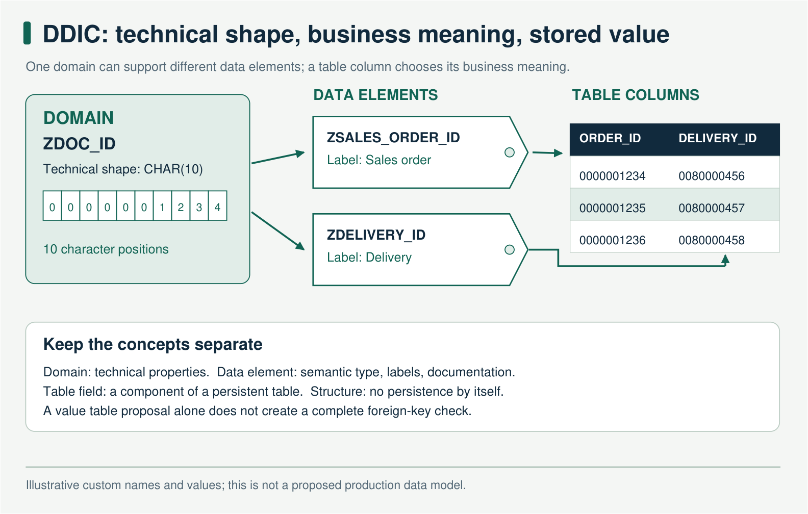

A ten-character domain acts like a technical mold; data elements give two fields different business meanings, and table columns hold values.

**Explain it:** Which layer supplies field labels, and which object actually persists records?

**Limit:** The picture simplifies DDIC typing and does not imply that domain values or a value table enforce every database write.

**Questions:** ABAP-05, ABAP-06

[Full-size PNG](classic-ddic-layers.png) | [Editable SVG](classic-ddic-layers.svg)

## SAP LUW and database LUW

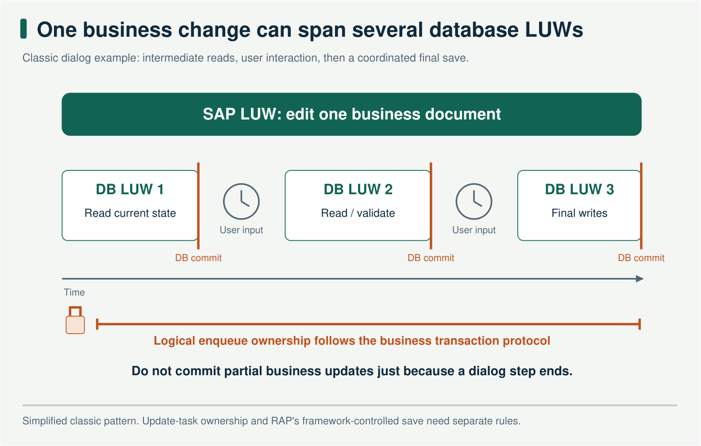

Several database transactions can serve a single classic SAP business transaction. The illustrated early database transactions only read; coordinated persistence happens at the end.

**Explain it:** Who owns the commit, and why does a database lock not protect a long user interaction?

**Limit:** The final save may use update processing in another context. Lock scope and transfer rules vary; the line is conceptual ownership, not a universal enqueue lifetime. Do not apply classic COMMIT WORK patterns inside RAP handlers.

**Questions:** ABAP-07, ABAP-08, ABAP-09

[Full-size PNG](classic-sap-database-luw.png) | [Editable SVG](classic-sap-database-luw.svg)

## OO interfaces and dependency injection

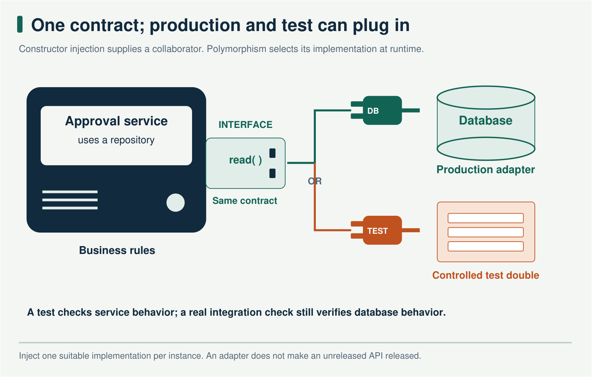

The service depends on a repository contract. Production and test implementations fit the same socket; the composition boundary supplies the appropriate collaborator.

**Explain it:** Which object chooses the implementation, and what does a double-based test fail to prove?

**Limit:** The plug is a design metaphor, not a SAP connector or code signature. Injection does not itself guarantee a good abstraction or production integration.

**Questions:** OO-01, OO-02, OO-07, OO-10, OO-14, CLOUD-15

[Full-size PNG](classic-oo-plug-contract.png) | [Editable SVG](classic-oo-plug-contract.svg)

## SQL join multiplication

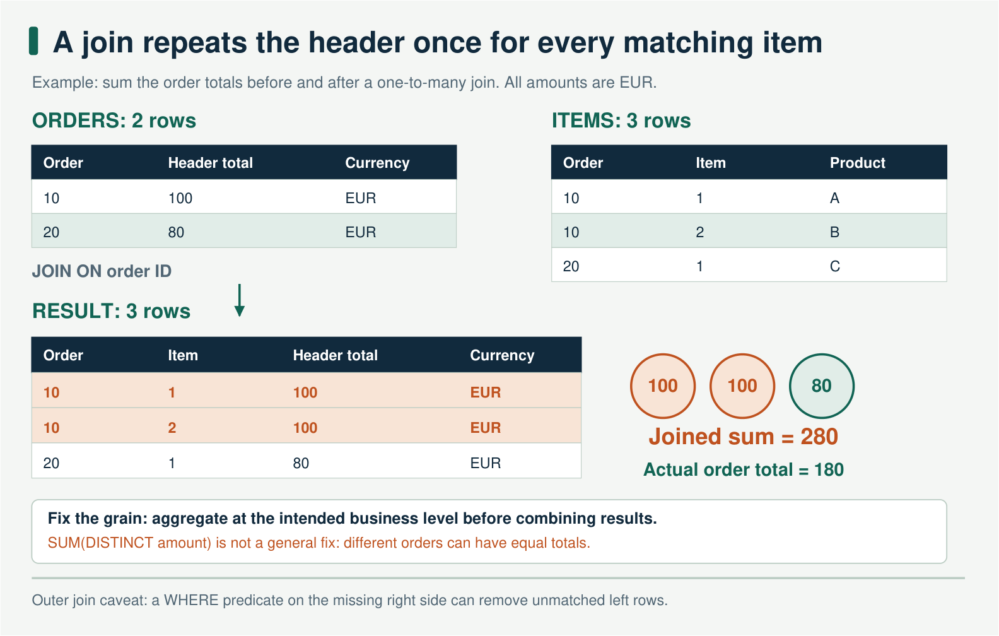

Joining two order headers to three items repeats order 10's total, inflating a naive sum from EUR 180 to EUR 280. For outer joins, matching conditions in ON can preserve unmatched left rows, while right-side conditions in WHERE can remove them.

**Explain it:** What is one row of this result supposed to represent? Where should a language filter go for optional text?

**Limit:** This is an inner-join example. WHERE and ON placement must follow intended semantics; neither DISTINCT nor SUM(DISTINCT amount) repairs every incorrect join or aggregation.

**Questions:** SQL-04, SQL-06, SQL-07, MODEL-06, MODEL-10, MODEL-18

[Full-size PNG](classic-sql-join-grain.png) | [Editable SVG](classic-sql-join-grain.svg)

## Performance diagnosis

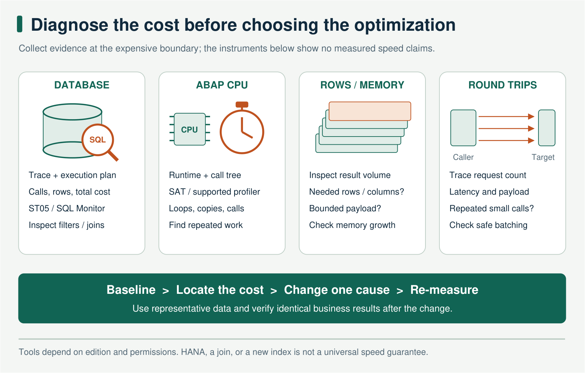

Inspect database work, ABAP computation, transferred volume, and repeated calls as different possible causes. Choose the trace and change based on evidence.

**Explain it:** Is the largest cost one slow statement, many cheap statements, ABAP processing, or transfer volume?

**Limit:** No percentages or speedups are measured here. These cost categories can overlap; do not sum overlapping trace durations. Available tools differ between classic and cloud editions.

**Questions:** SQL-09, SQL-10, SQL-11, SQL-12

[Full-size PNG](classic-performance-instruments.png) | [Editable SVG](classic-performance-instruments.svg)

## RAP contract stack

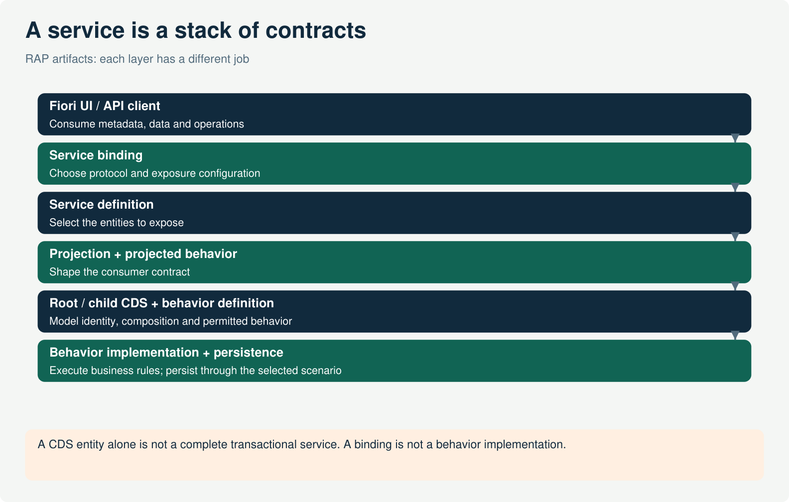

Read from the client down to storage, then explain what each artifact contributes.

**Explain it:** Where would you restrict the exposed operation set?

**Limit:** Conceptual layers; the exact artifact set depends on the scenario and release.

**Questions:** RAP-01, RAP-14, ADV-09, CDS-05, CDS-08, ODATA-02, CLOUD-10, MODEL-08, MODEL-16, SRAP-16, SRAP-22

[Full-size PNG](rap-contract-stack.png) | [Editable SVG](rap-contract-stack.svg)

## CDS links and ownership

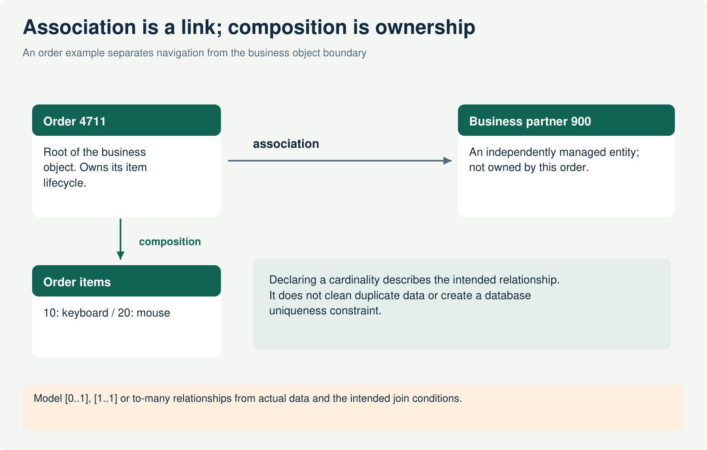

Items belong to the order BO; a partner reference crosses to an independently managed object.

**Explain it:** What breaks if a declared to-one relationship actually returns two partners?

**Limit:** Composition semantics and generated operations still require the corresponding RAP model.

**Questions:** CDS-03, CDS-04, CDS-11, SQL-07, CLOUD-07, MODEL-06, MODEL-10

[Full-size PNG](cds-relationships.png) | [Editable SVG](cds-relationships.svg)

## CDS security boundaries

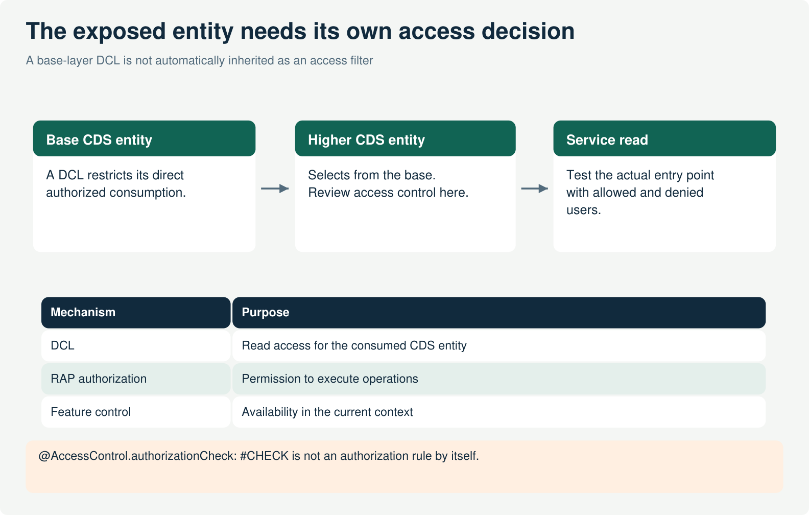

Review security where consumers enter the model, rather than assuming that lower layers protect every upper view.

**Explain it:** Which two tests prove that an exposed service rejects unauthorized access?

**Limit:** Authorization behavior depends on the access path and supported DCL inheritance mechanisms.

**Questions:** CDS-07, ADV-02, TEST-06, MODEL-01, MODEL-11, MODEL-14, MODEL-16

[Full-size PNG](cds-security-boundaries.png) | [Editable SVG](cds-security-boundaries.svg)

## RAP buffer with a concrete value change

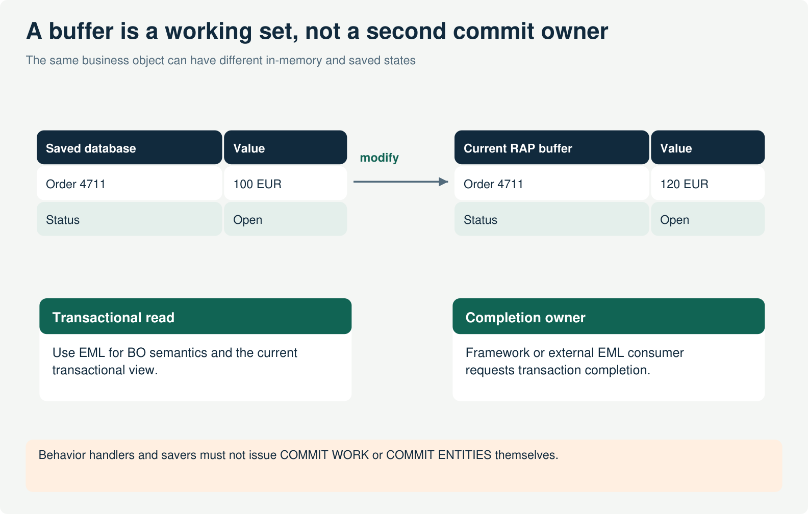

During modification, the transactional view can show 120 EUR while saved data still shows 100 EUR.

**Explain it:** Why can a direct SQL read be the wrong way to read the BO during modification?

**Limit:** Simplified single-record example, not a promise about a particular SQL isolation level.

**Questions:** RAP-03, RAP-04, RAP-05, RAP-08, RAP-15, SRAP-01, SRAP-17, SRAP-19

[Full-size PNG](rap-buffer-example.png) | [Editable SVG](rap-buffer-example.svg)

## RAP hook responsibilities

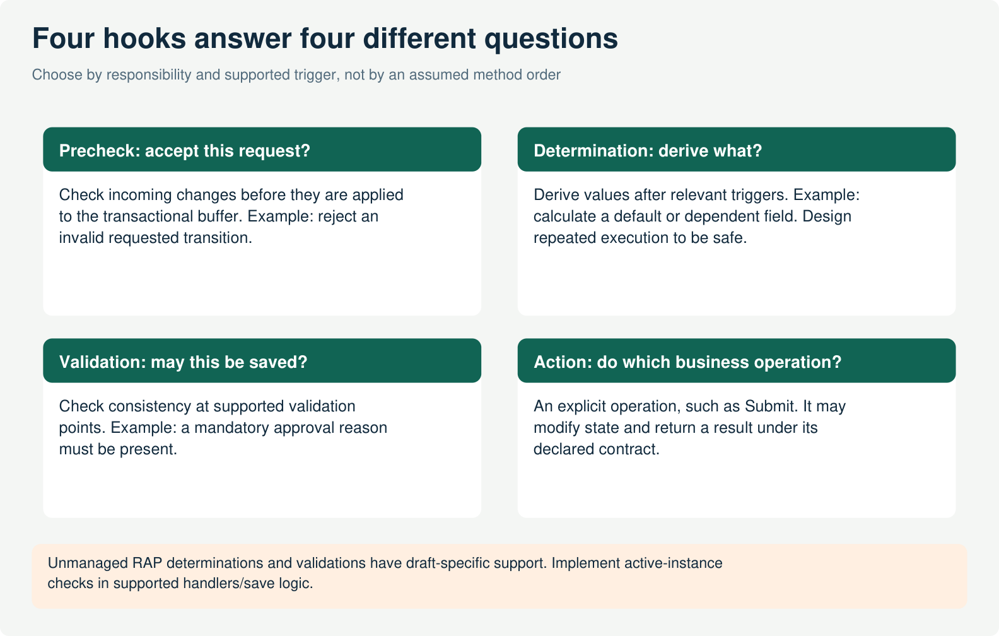

Read each card as a separate design question; this is not an execution sequence.

**Explain it:** Where would you derive a total, reject an invalid input and implement Submit?

**Limit:** Check scenario and release support; do not rely on an undocumented ordering of independent hooks.

**Questions:** RAP-06, RAP-13, ADV-04, ADV-05, SRAP-02, SRAP-03, SRAP-11, SRAP-12, SRAP-19

[Full-size PNG](rap-hook-choices.png) | [Editable SVG](rap-hook-choices.svg)

## EML identity tags

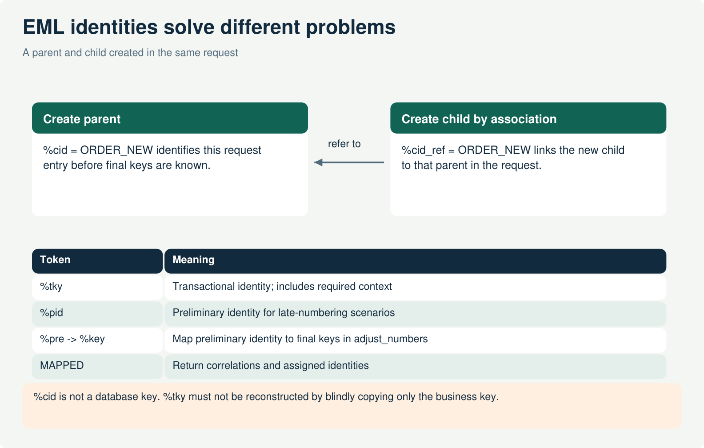

Content IDs connect entries within a request. Transactional and preliminary identities address other lifecycle needs.

**Explain it:** How can a new item refer to a newly created order before the final order number exists?

**Limit:** Generated EML types and available components are authoritative for the specific BO.

**Questions:** RAP-07, RAP-10, RAP-11, SRAP-07, SRAP-08, SRAP-13

[Full-size PNG](eml-identity-tags.png) | [Editable SVG](eml-identity-tags.svg)

## Draft lifecycle

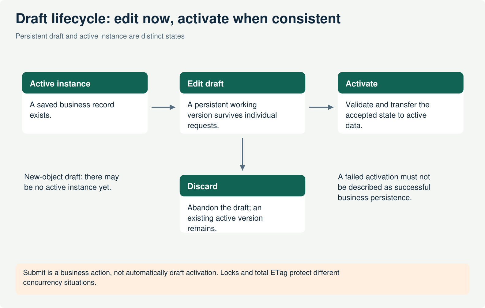

Follow edit, activate and discard for an existing active object, then explain how a new-object draft differs.

**Explain it:** What remains after discarding an edit draft? What if activation fails?

**Limit:** Schematic state transitions; draft actions and supported flows depend on the BO and consumer.

**Questions:** RAP-12, ADV-01, ADV-08, RICEFW-11, SRAP-09, SRAP-10, OPS-04

[Full-size PNG](draft-lifecycle.png) | [Editable SVG](draft-lifecycle.svg)

## Identity, authorization and feature control

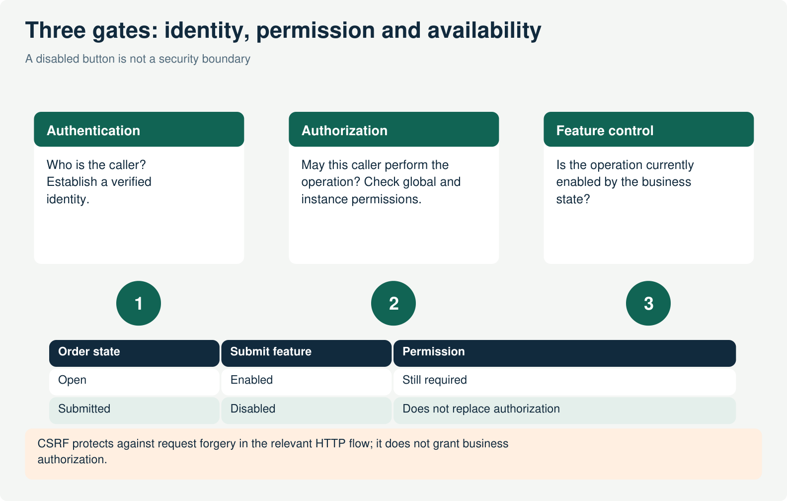

Treat identity, business permission and contextual availability as separate checks.

**Explain it:** If Submit is disabled in Fiori, what happens when someone calls the service directly?

**Limit:** Static operation characteristics differ from dynamic instance/global feature checks.

**Questions:** ADV-02, ADV-03, ADV-13, ODATA-09, TEST-06, MODEL-02, MODEL-11, MODEL-12, MODEL-13, MODEL-16

[Full-size PNG](security-three-gates.png) | [Editable SVG](security-three-gates.svg)

## OData batch envelope and atomic groups

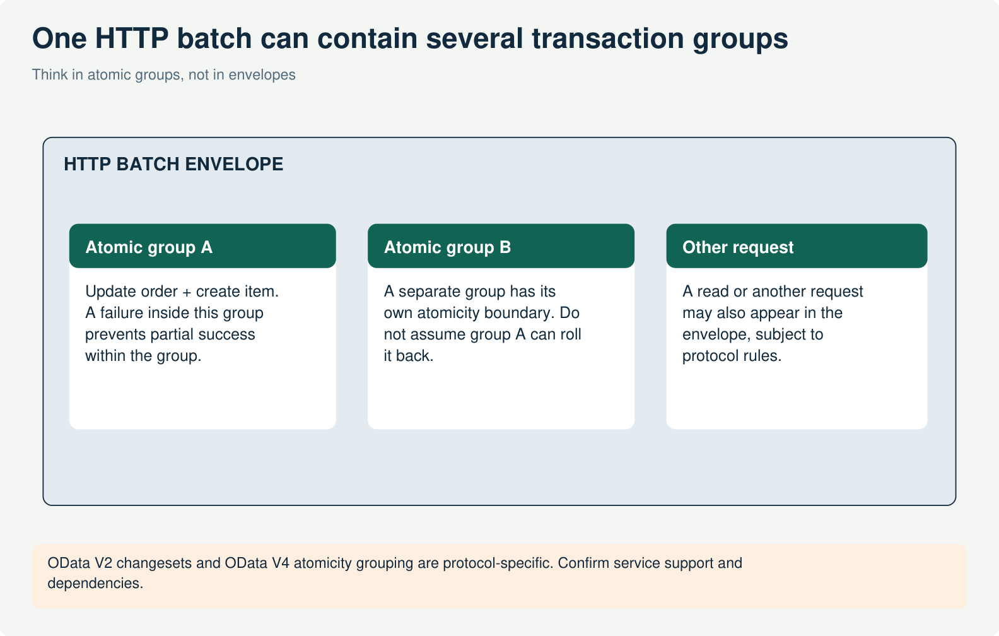

The outer envelope reduces HTTP packaging overhead; it does not establish one universal database transaction.

**Explain it:** If a later independent group fails, must an earlier successful group be rolled back?

**Limit:** Conceptual grouping, not an exact multipart or JSON batch payload.

**Questions:** ODATA-07, BTP-07, TEST-07, SRAP-20

[Full-size PNG](odata-batch-envelope.png) | [Editable SVG](odata-batch-envelope.svg)

## Filtering, paging and total count

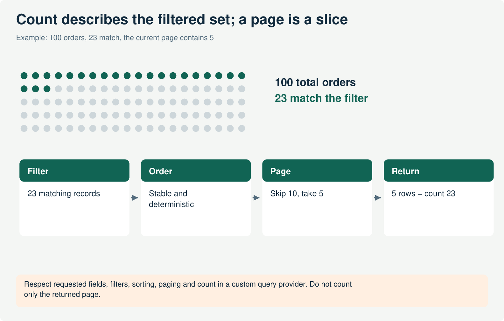

Count and paging answer different questions. Stable ordering matters when the client requests successive pages.

**Explain it:** For this example, what count belongs beside a page of five records?

**Limit:** Provider-side execution order may be optimized while preserving request semantics.

**Questions:** ODATA-03, ODATA-04, ADV-10, ODATA-11, MODEL-03, MODEL-04, MODEL-05, OPS-07

[Full-size PNG](query-page-count.png) | [Editable SVG](query-page-count.svg)

## Clean Core wrapper dependency

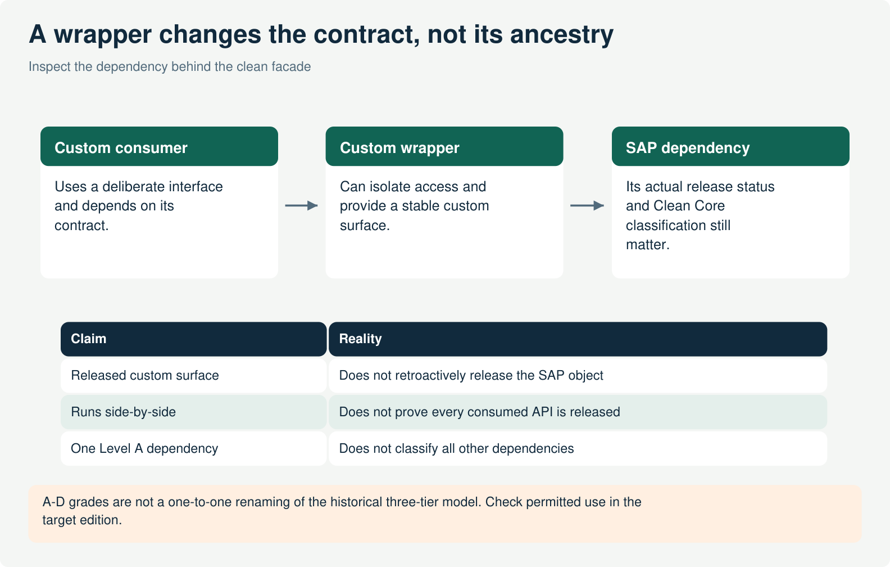

Trace dependencies across the wrapper instead of classifying the solution from its visible surface alone.

**Explain it:** What evidence would let you accept a classic SAP dependency responsibly?

**Limit:** A governance review must consider technology restrictions, classifications and lifecycle risk.

**Questions:** CORE-04, CORE-05, CORE-07, CORE-08, CORE-11, CORE-14, CORE-15, OO-10, CLOUD-03, GOV-03, GOV-07, GOV-14, GOV-15

[Full-size PNG](clean-core-wrapper.png) | [Editable SVG](clean-core-wrapper.svg)

## BTP account and runtime map

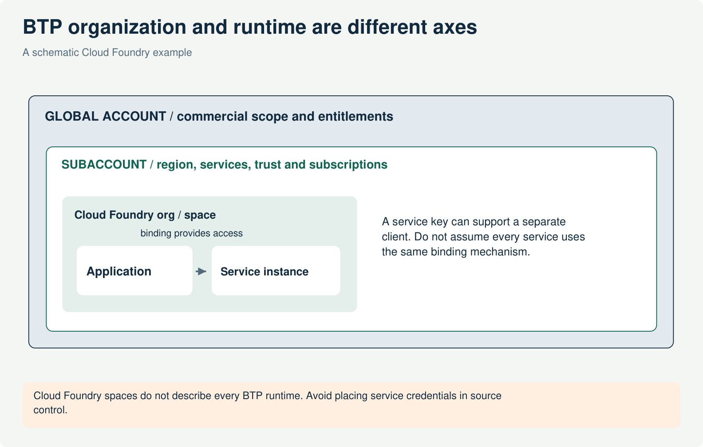

Read the nesting as an organizational example, then distinguish the application, service instance and credentials.

**Explain it:** How is a service instance different from a binding or service key?

**Limit:** Schematic Cloud Foundry route; other BTP environments have different runtime structures.

**Questions:** BTP-01, BTP-02, BTP-04, BTP-05, BTP-09, BTP-10, CLOUD-02, CLOUD-08

[Full-size PNG](btp-account-runtime.png) | [Editable SVG](btp-account-runtime.svg)

## Local and remote transaction boundaries

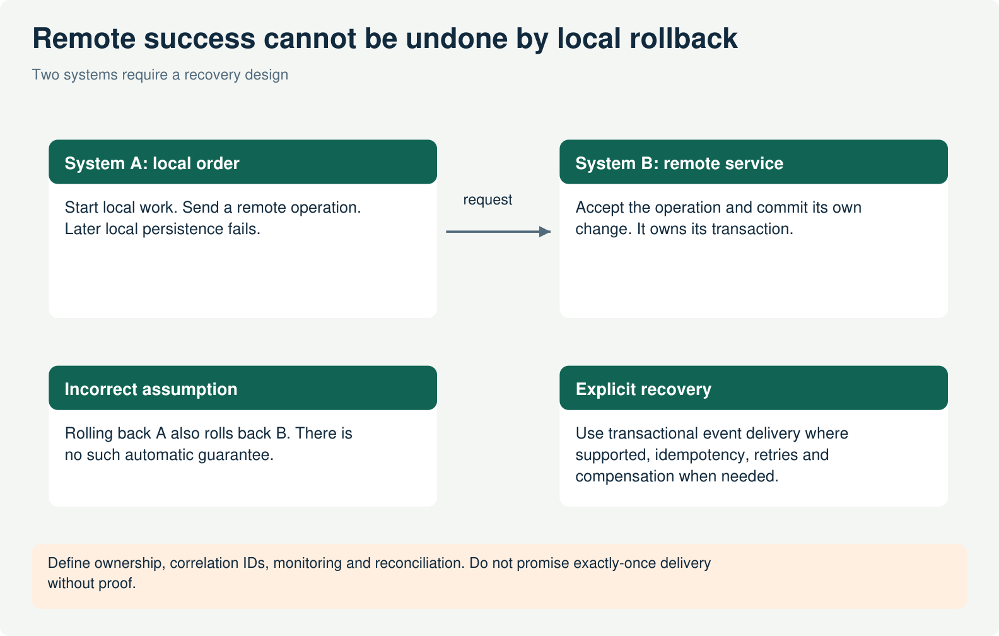

The remote commit belongs to another system, so local failure needs an explicit recovery strategy.

**Explain it:** What should happen if the remote side succeeds but the response is lost?

**Limit:** This explains distributed consistency, not a particular messaging product guarantee.

**Questions:** BTP-06, BTP-07, BTP-08, RICEFW-05, RAP-15, CLOUD-01, CLOUD-05, SRAP-04, SRAP-15, OPS-11

[Full-size PNG](remote-transaction-boundary.png) | [Editable SVG](remote-transaction-boundary.svg)

## Duplicate events and stale approvals

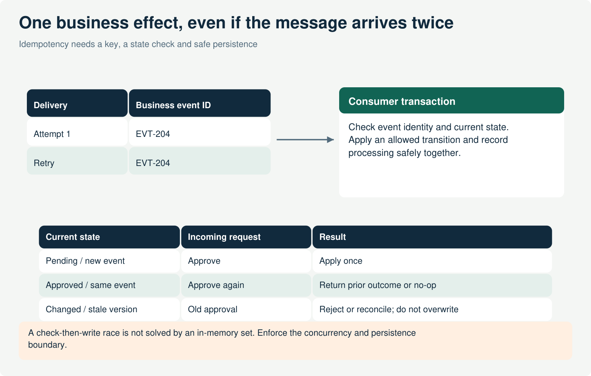

The event identity and current business state decide whether to apply, ignore or reject the request.

**Explain it:** Two consumers process the same event simultaneously: what prevents a double effect?

**Limit:** Exact transactional deduplication mechanisms depend on the chosen infrastructure.

**Questions:** BTP-08, RICEFW-11, RICEFW-12, RICEFW-13, ADV-11, OO-12, SRAP-18, SRAP-23, OPS-11

[Full-size PNG](event-idempotency.png) | [Editable SVG](event-idempotency.svg)

## Testing scope and evidence

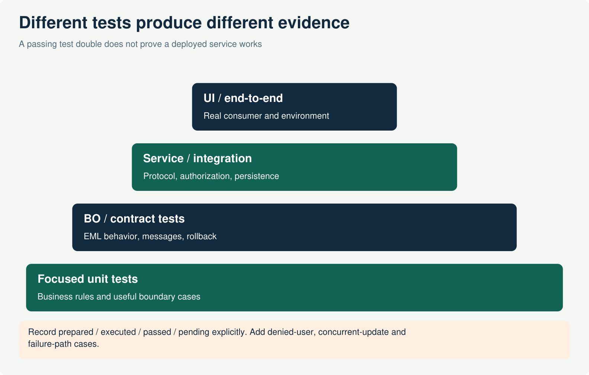

The widening base suggests many focused checks, but there is no mandatory numerical ratio.

**Explain it:** Which risk remains after an ABAP Unit test with doubles passes?

**Limit:** Conceptual coverage map, not a count of tests actually run in SAP.

**Questions:** TEST-01, TEST-02, TEST-03, TEST-04, TEST-05, TEST-07, TEST-08, TEST-09, TEST-10, OO-14, CLOUD-18, OPS-01, OPS-02, OPS-09, OPS-14, OPS-15, OPS-16, OPS-18

[Full-size PNG](test-evidence-pyramid.png) | [Editable SVG](test-evidence-pyramid.svg)

## Explain decisions with evidence

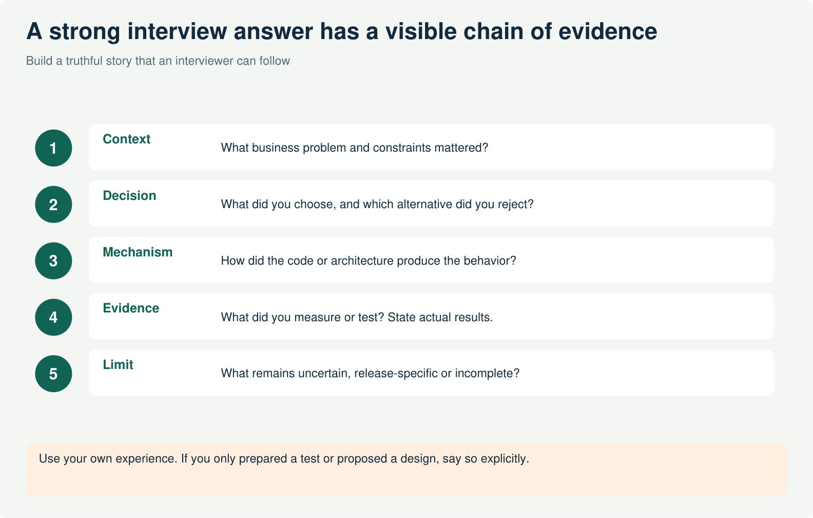

Practice a 60-second version first, then expand the mechanism and evidence when prompted.

**Explain it:** Can you name the decision, trade-off and evidence without inventing metrics?

**Limit:** A rehearsal structure, not a scripted personal history or a substitute for technical depth.

**Questions:** STORY-01, STORY-02, STORY-03, STORY-04, STORY-05, STORY-06, TEST-10, OPS-18

[Full-size PNG](interview-evidence-story.png) | [Editable SVG](interview-evidence-story.svg)

## HTTP request and response anatomy

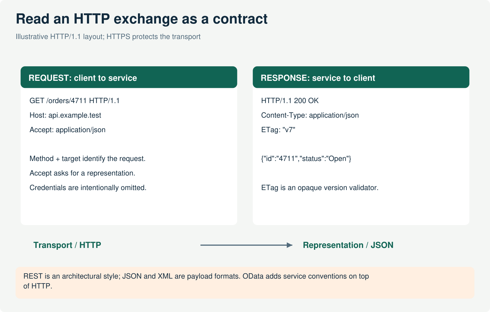

Read the method, target, status and headers before interpreting the body. The sample domain is deliberately non-production.

**Explain it:** Which header describes the returned body, and which requests a response format?

**Limit:** A teaching example, not a runnable endpoint. HTTP/2 and HTTP/3 use different wire framing.

**Questions:** HTTP-01, HTTP-02, HTTP-05, HTTP-06, HTTP-10, ODATA-02

[Full-size PNG](http-message-anatomy.png) | [Editable SVG](http-message-anatomy.svg)

## JSON and XML: values and mapping

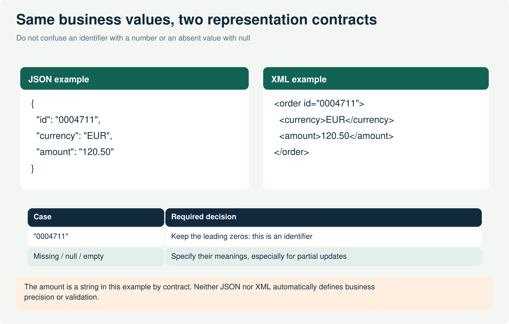

These are two explicitly designed representations of the same sample values, not a universal automatic JSON/XML conversion.

**Explain it:** What could go wrong if an ABAP mapper converts the identifier to an integer?

**Limit:** XML namespace/schema rules and JSON API types must be defined by the actual interface contract.

**Questions:** HTTP-03, HTTP-07, HTTP-08, HTTP-09, HTTP-12, ABAP-12

[Full-size PNG](json-xml-values.png) | [Editable SVG](json-xml-values.svg)

## RFC modes and guarantee boundaries

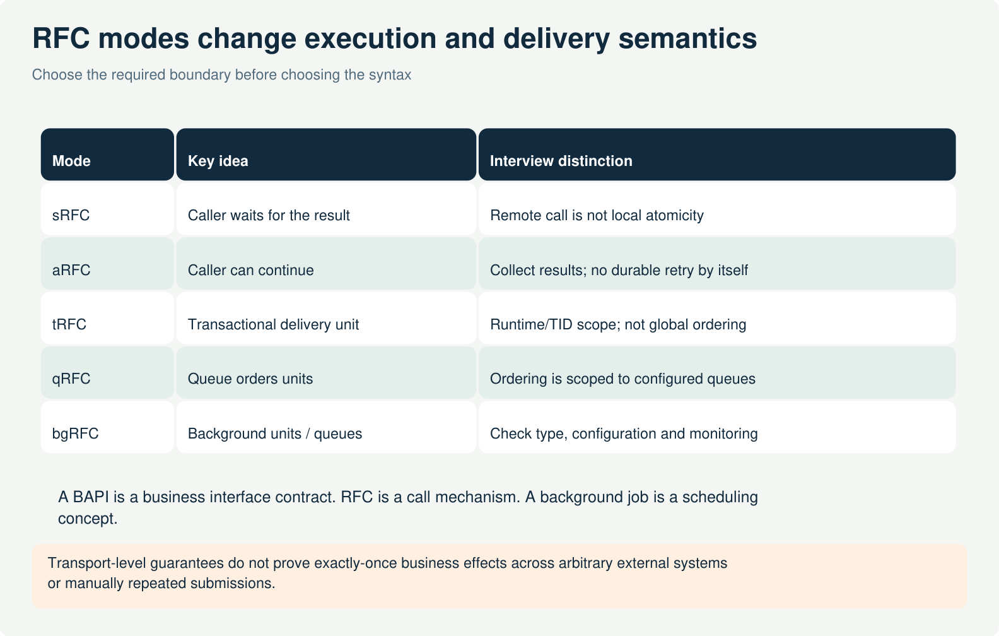

Compare the caller behavior and delivery unit, then name the monitoring and retry owner.

**Explain it:** Why does an asynchronous call not automatically become a durable queued transaction?

**Limit:** Classic terminology; API release, runtime availability and transaction rules must be checked for the target.

**Questions:** RFC-01, RFC-02, RFC-03, RFC-04, RFC-05, RFC-08, RFC-12

[Full-size PNG](rfc-mode-comparison.png) | [Editable SVG](rfc-mode-comparison.svg)

## Parallel processing inside a job

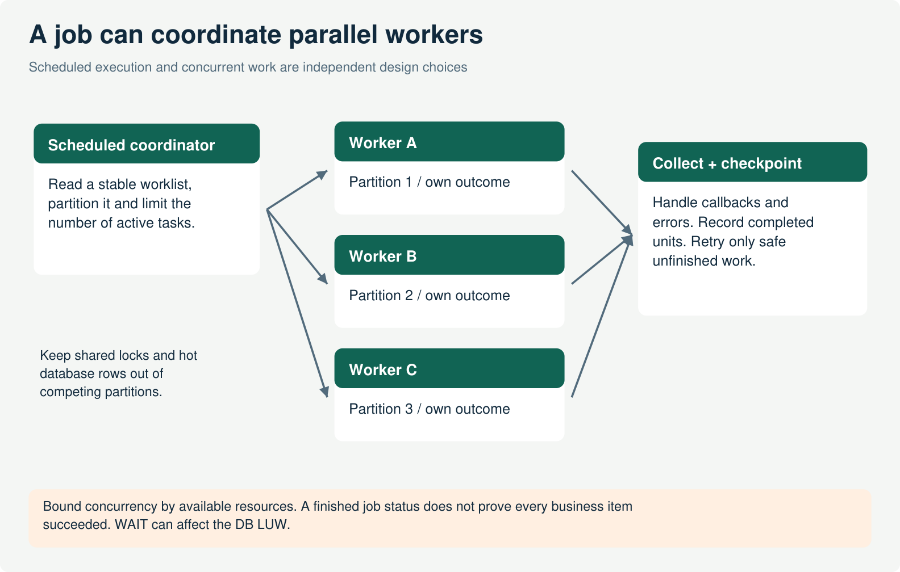

A coordinator schedules bounded independent work and collects explicit outcomes; a scheduler does not create parallelism automatically.

**Explain it:** If worker B fails after A commits, what is safe to retry?

**Limit:** Conceptual fan-out/fan-in. Worker session and transaction boundaries require explicit design.

**Questions:** RFC-06, RFC-07, RFC-08, RFC-09, RFC-10, RFC-11, RFC-12, OPS-17

[Full-size PNG](parallel-job-workers.png) | [Editable SVG](parallel-job-workers.svg)

## IDoc processing and AIF operations

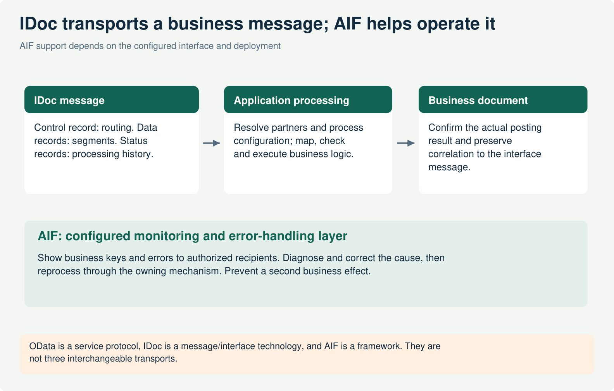

Follow the message to the business outcome. The AIF band represents supported configured capabilities, not an obligatory stage for every IDoc.

**Explain it:** Before restarting an error, how would you check whether a document already exists?

**Limit:** Do not infer end-to-end business success from a transport hand-off status or assume all interfaces use AIF.

**Questions:** INTF-01, INTF-02, INTF-03, INTF-04, INTF-05, INTF-06, INTF-07, INTF-08, INTF-09, INTF-10, INTF-11, INTF-12, RICEFW-06

[Full-size PNG](idoc-aif-lifecycle.png) | [Editable SVG](idoc-aif-lifecycle.svg)

## EML update intent: absent versus clear

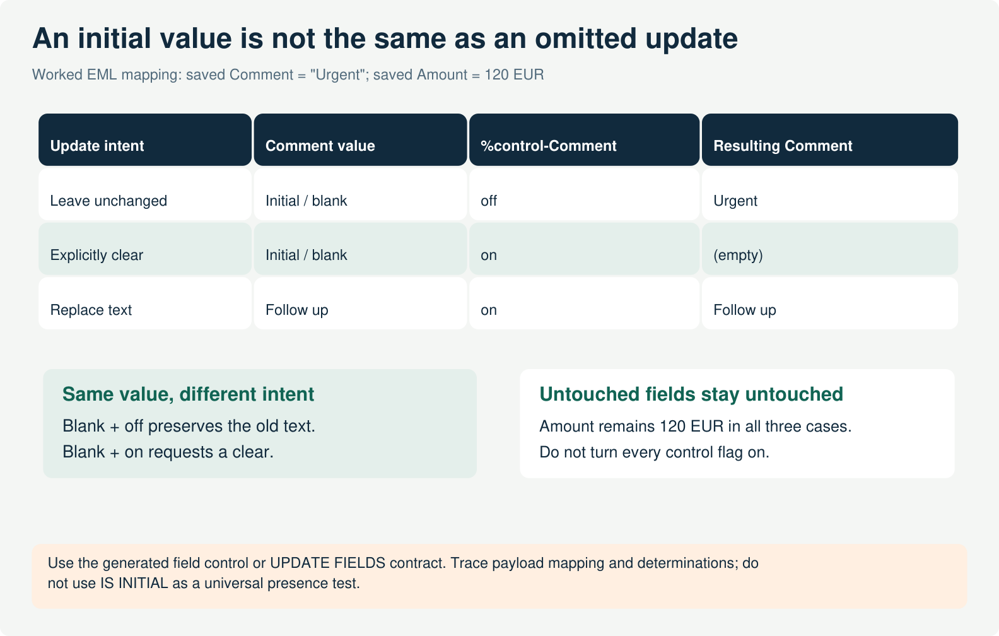

The first two requests carry the same initial ABAP value but differ in update intent. The field control decides whether the old comment is preserved or explicitly cleared.

**Explain it:** How would you preserve Amount while clearing Comment, and how could an adapter lose that distinction?

**Limit:** This is a worked mapping example. Actual generated EML types, UPDATE FIELDS syntax, protocol nullability, and business validation remain authoritative.

**Questions:** SRAP-06, SRAP-12, HTTP-07, HTTP-09

[Full-size PNG](senior-control-presence.png) | [Editable SVG](senior-control-presence.svg)

## FAILED, REPORTED, and MAPPED in a worked create

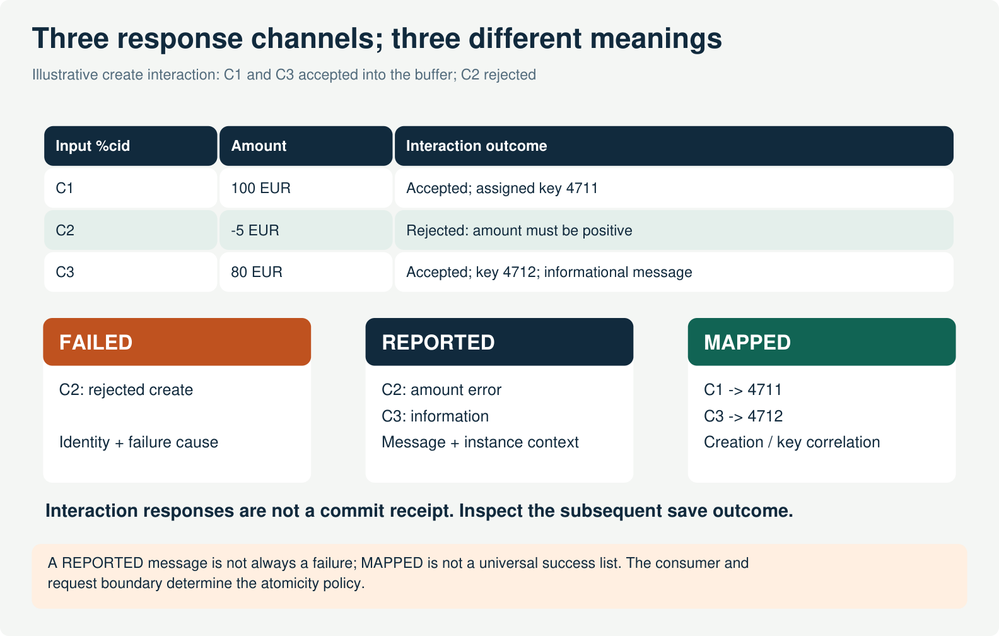

Three input identities produce separate rejection, message, and key-correlation information. A message on C3 does not itself reject that input, and assigned keys do not prove durable persistence.

**Explain it:** What must the consumer inspect after this interaction, and what happens if the later save fails?

**Limit:** Conceptual response contents, not executable EML. Available fields and correlation depend on the operation and BO; save and atomicity semantics must be tested separately.

**Questions:** SRAP-05, SRAP-07, SRAP-20, OPS-03

[Full-size PNG](senior-response-channels.png) | [Editable SVG](senior-response-channels.svg)

## Remote commit and uncertain local outcome

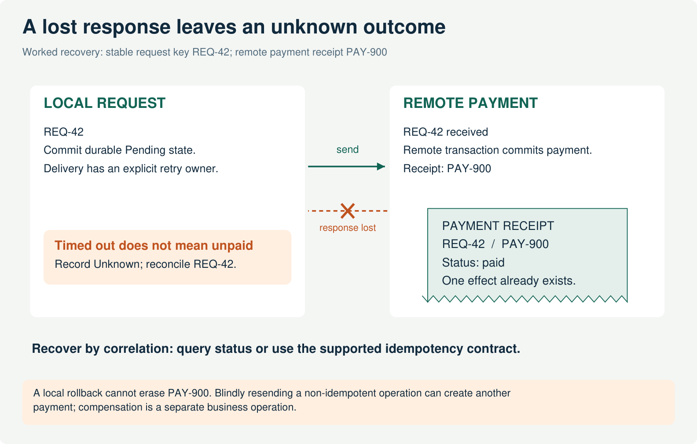

The local application durably records intent before separately owned delivery. The remote payment commits, but its reply is lost; recovery must identify the existing effect through REQ-42.

**Explain it:** How do you distinguish an unprocessed request from a committed payment whose response never arrived?

**Limit:** The delivery and idempotency mechanisms are design requirements, not automatic guarantees from HTTP or RAP. This example does not claim distributed atomicity.

**Questions:** SRAP-04, SRAP-18, SRAP-23, OPS-11, CLOUD-01

[Full-size PNG](senior-remote-uncertainty.png) | [Editable SVG](senior-remote-uncertainty.svg)

## Existing and proposed state authorization

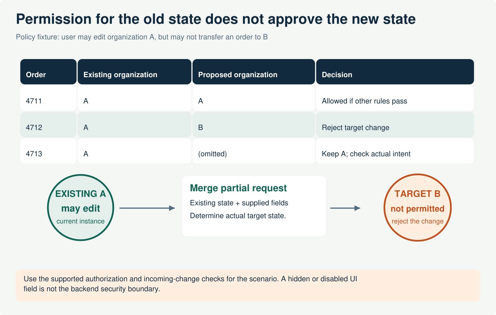

Editing the current A instance and moving it into B are different authorization decisions. Partial input must be interpreted with existing state without treating omitted fields as explicit clears.

**Explain it:** Which state does each check inspect, and what happens if a determination changes the target scope?

**Limit:** A policy example, not a universal company-code rule. Implement through the target RAP scenario's supported hooks; prechecks do not replace the complete authorization model.

**Questions:** MODEL-02, MODEL-13, MODEL-16, SRAP-12

[Full-size PNG](senior-proposed-state-authorization.png) | [Editable SVG](senior-proposed-state-authorization.svg)

## Secure custom-query filtering, count, and page

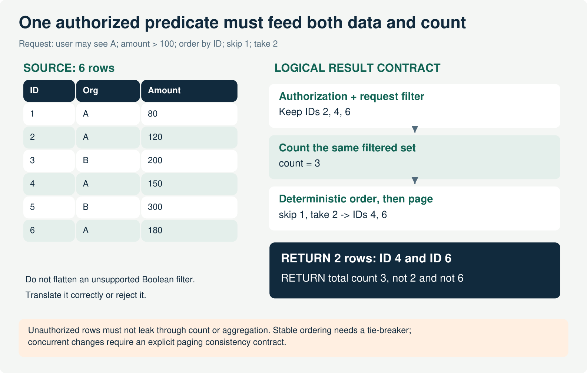

The same authorized logical set contains IDs 2, 4, and 6. Counting it returns three; skipping one and taking two returns IDs 4 and 6 without revealing hidden B rows.

**Explain it:** What should a count-only request return, and what should happen if the filter cannot be represented safely?

**Limit:** The drawing specifies semantics, not a mandatory physical execution plan. A remote/custom provider must preserve equivalent authorization, filtering, count, and ordering behavior.

**Questions:** MODEL-03, MODEL-04, MODEL-05, OPS-07

[Full-size PNG](senior-query-secure-pipeline.png) | [Editable SVG](senior-query-secure-pipeline.svg)

## Real behavior under test and dependency doubles

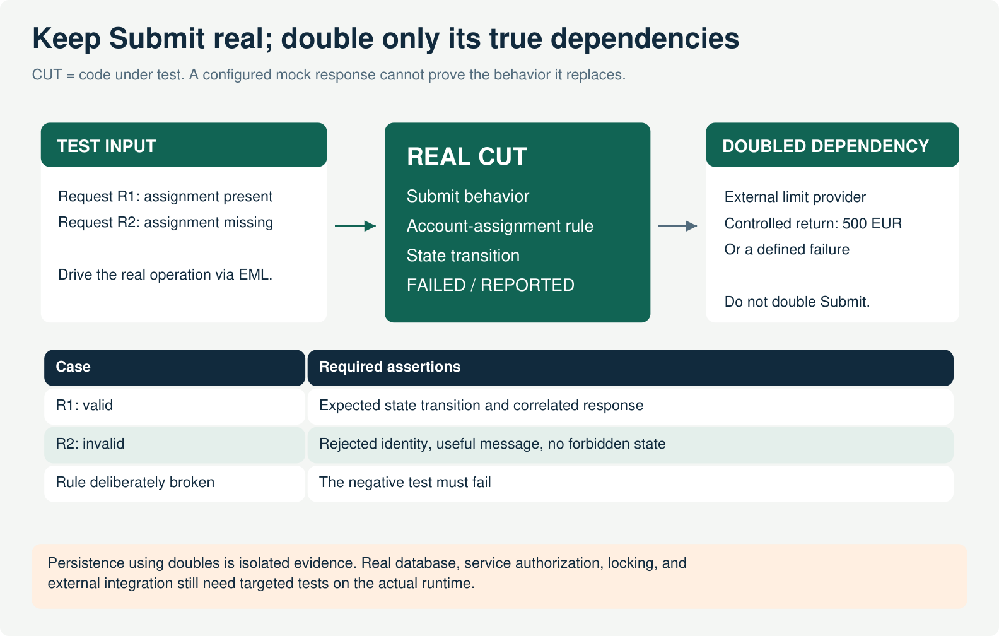

Two deliberately different inputs exercise the real Submit rule while a separate limit-provider dependency is controlled. Assertions inspect state and response identity, not only execution coverage.

**Explain it:** If the account-assignment rejection is removed, which test fails? What evidence remains missing after these tests pass?

**Limit:** The fixture is conceptual and not an executed ABAP Unit result. Framework double support and persistence setup depend on the target release and test boundary.

**Questions:** OPS-01, OPS-02, OPS-03, OPS-15, MODEL-14

[Full-size PNG](senior-real-cut-evidence.png) | [Editable SVG](senior-real-cut-evidence.svg)

## Release contracts versus Clean Core levels

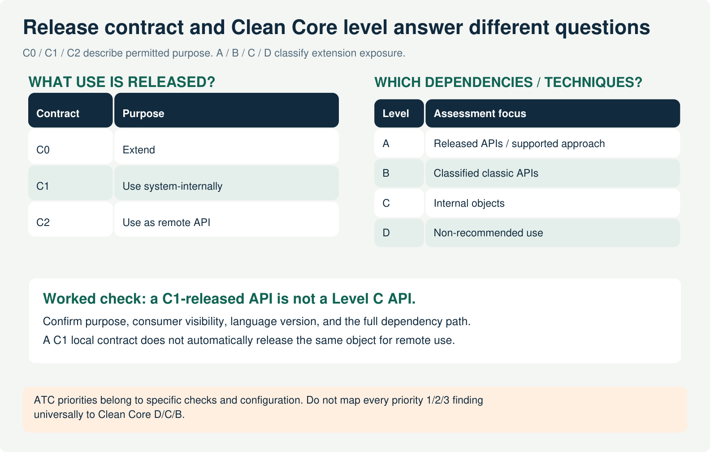

The two tables are separate classification axes. C1 identifies a local-use contract, while Level C identifies internal-object exposure in the Clean Core assessment context.

**Explain it:** What else must you verify after finding a C1 release flag, and why does a wrapper not erase the underlying exposure?

**Limit:** These are the three contracts requested for this comparison, not the complete release-contract catalogue. Exact object classification, extension technology, target edition, and ATC scope remain decisive.

**Questions:** GOV-01, GOV-02, GOV-03, GOV-05, GOV-18, CLOUD-05

[Full-size PNG](senior-contracts-versus-levels.png) | [Editable SVG](senior-contracts-versus-levels.svg)

## Exception governance and review lifecycle

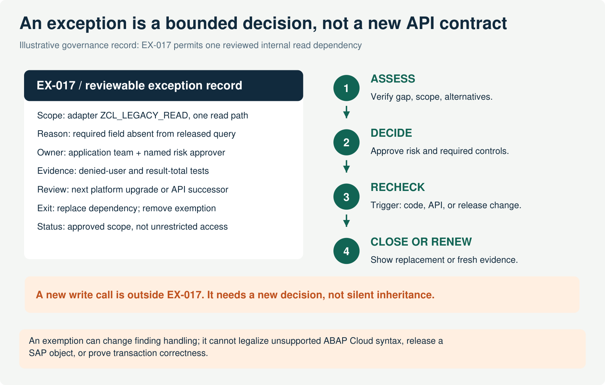

A concrete exception record limits one dependency, states its evidence and owner, and defines review and exit triggers. A changed implementation must be assessed against that scope.

**Explain it:** Which change invalidates this decision, and what proves that an exception is resolved rather than merely hidden?

**Limit:** EX-017 and the class name are fictional teaching identifiers. Actual approvals, gate behavior, and allowed development techniques follow the target environment and organization policy.

**Questions:** GOV-04, GOV-07, GOV-11, GOV-12, GOV-15, GOV-18

[Full-size PNG](senior-exception-lifecycle.png) | [Editable SVG](senior-exception-lifecycle.svg)

## RAP implementation ownership matrix

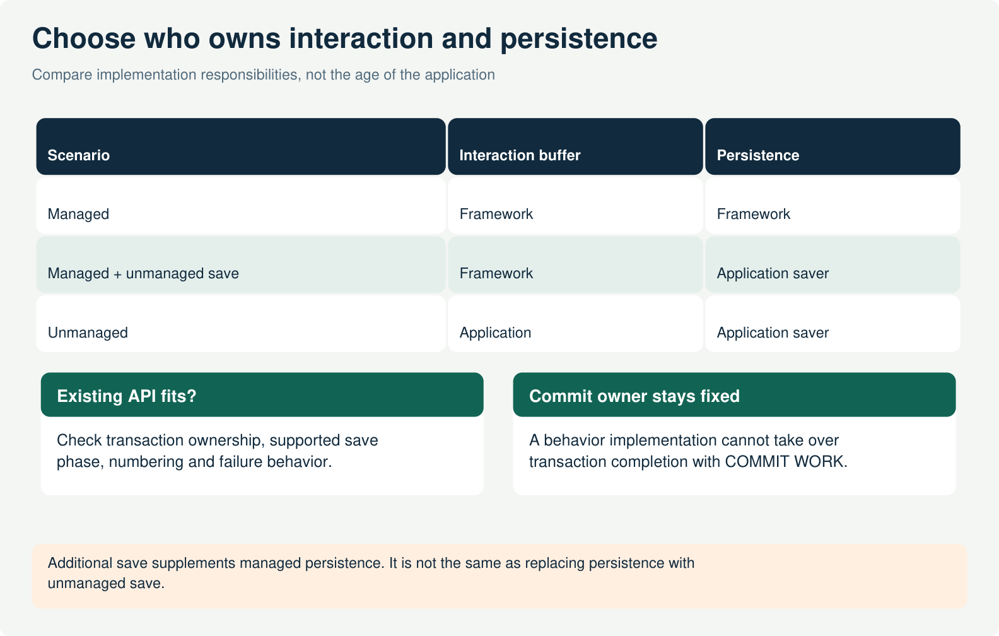

Trace the same request through three implementation choices and name the owner of each responsibility.

**Explain it:** Which part stays managed when only the save implementation is replaced?

**Limit:** Conceptual comparison; specific saver variants and failure support depend on release and scenario.

**Questions:** RAP-02, SRAP-01, SRAP-02

[Full-size PNG](rap-save-ownership-matrix.png) | [Editable SVG](rap-save-ownership-matrix.svg)

## RAP identity and numbering timeline

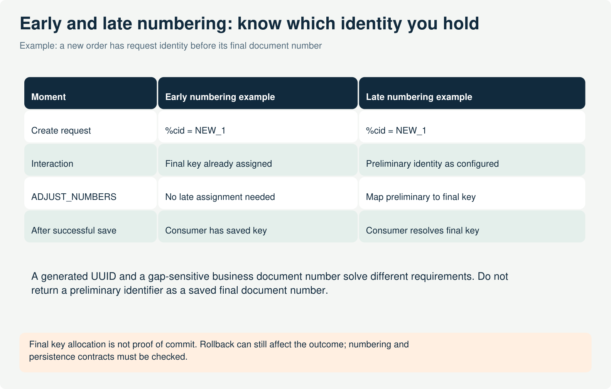

Compare when the identity becomes final and when persistence is confirmed.

**Explain it:** What must an external EML consumer inspect after MODIFY and after COMMIT?

**Limit:** Illustrative numbering paths; exact %pid/%pre mapping and conversion syntax are release/scenario-specific.

**Questions:** RAP-10, RAP-11, SRAP-07, SRAP-08

[Full-size PNG](rap-numbering-timeline.png) | [Editable SVG](rap-numbering-timeline.svg)

## Augmentation versus additional save

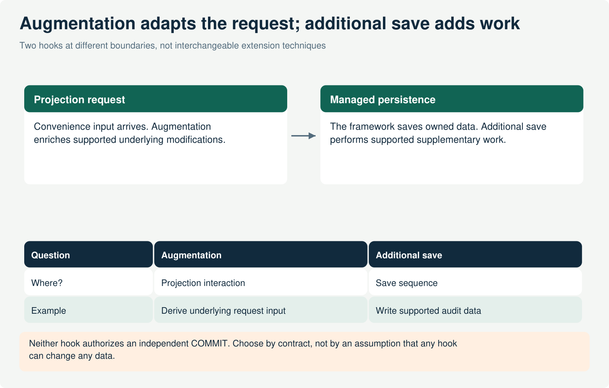

Locate the input transformation and persistence supplement on the same conceptual timeline.

**Explain it:** Why would writing an audit row not make augmentation the right save hook?

**Limit:** The arrow is conceptual; availability, supported fields and trigger details depend on the target RAP release.

**Questions:** ADV-06, SRAP-02, SRAP-14

[Full-size PNG](rap-augmentation-additional-save.png) | [Editable SVG](rap-augmentation-additional-save.svg)

## Two ETag boundaries

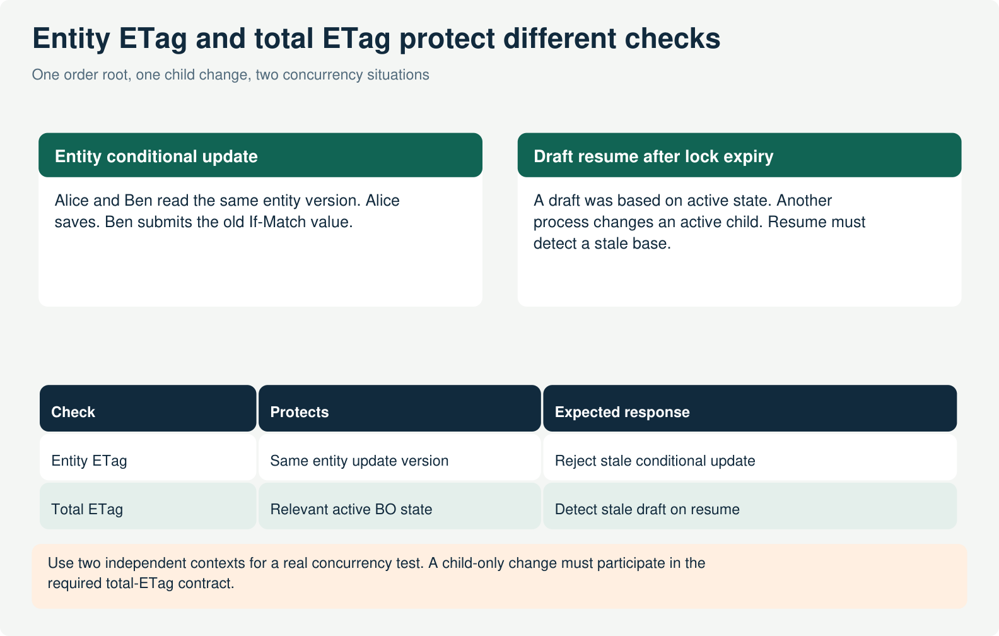

The left side tests a conditional entity update; the right tests the active-state basis of a resumed draft.

**Explain it:** Why does testing one entity ETag not prove the draft total-ETag implementation?

**Limit:** ETags are opaque. Verify lock expiry, relevant child changes and generated behavior on the actual system.

**Questions:** ADV-01, SRAP-10, OPS-05

[Full-size PNG](rap-two-etag-boundaries.png) | [Editable SVG](rap-two-etag-boundaries.svg)

## Side effects and stale UI diagnosis

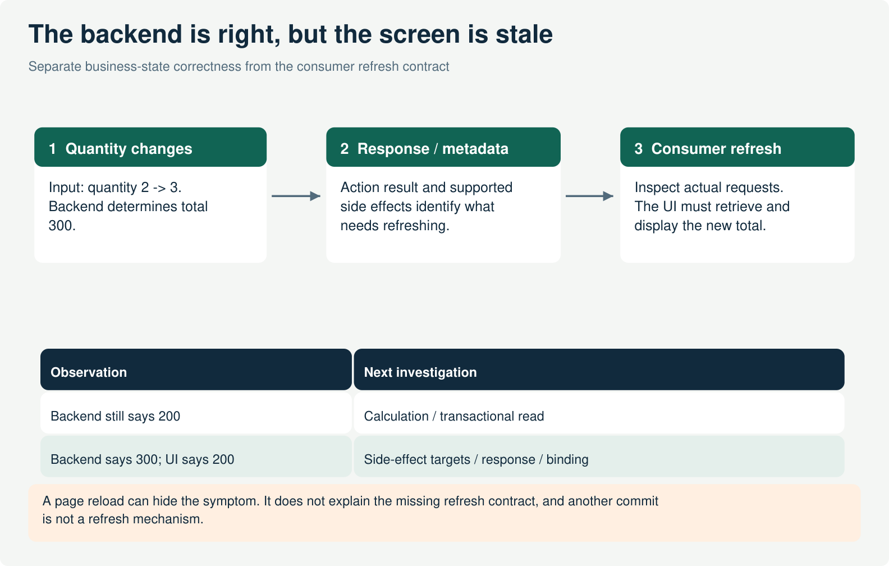

Use the observed backend value to choose the next debugging branch.

**Explain it:** What request proves that the consumer refreshed the calculated total?

**Limit:** Consumer and metadata support are release-dependent; a valid backend side effect is not proof that every client processes it.

**Questions:** ADV-07, SRAP-21, OPS-06

[Full-size PNG](rap-side-effect-diagnosis.png) | [Editable SVG](rap-side-effect-diagnosis.svg)

## RAP message lifecycle and correction

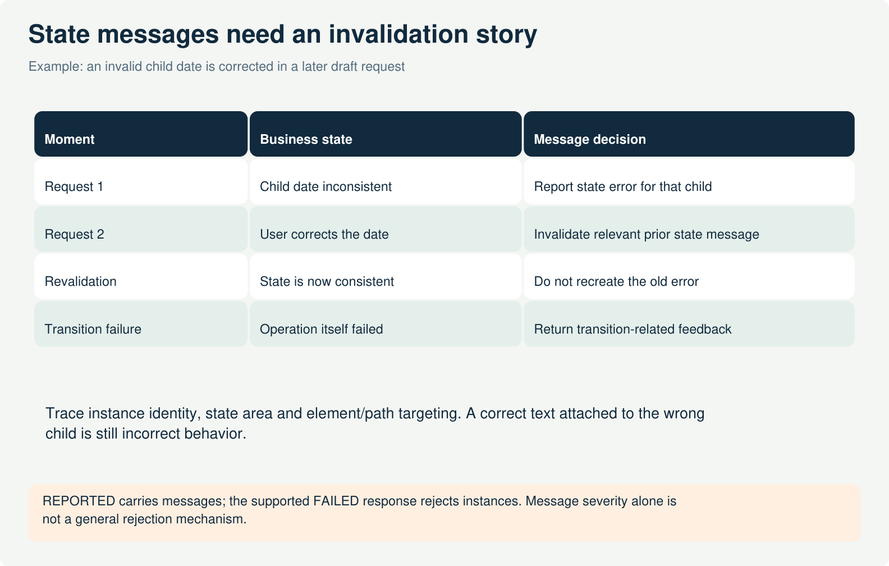

Follow the same child through an error and correction instead of treating a message as timeless text.

**Explain it:** Which identity and state area would you inspect when the old error remains?

**Limit:** Message lifetime and permitted state-message scenarios depend on active/draft and the supported operation contract.

**Questions:** ADV-08, SRAP-24, RAP-07

[Full-size PNG](rap-message-lifecycle.png) | [Editable SVG](rap-message-lifecycle.svg)

## Calculation placement and query semantics

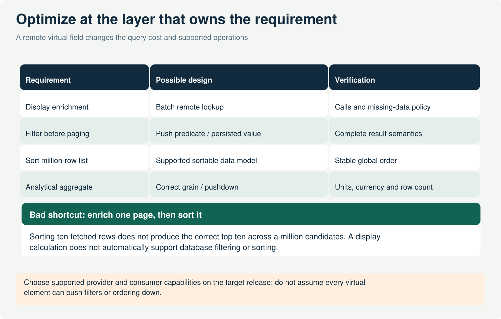

Use the requirement to decide where a value must exist before filtering, ordering or aggregation.

**Explain it:** Why can a correct calculation still yield a wrong page of results?

**Limit:** Architecture alternatives, not a promise that all listed options are supported by each projection/custom provider.

**Questions:** CDS-09, MODEL-07, MODEL-08, MODEL-09, MODEL-18, OPS-08

[Full-size PNG](rap-query-calculation-placement.png) | [Editable SVG](rap-query-calculation-placement.svg)

## RAP release and consumption gates

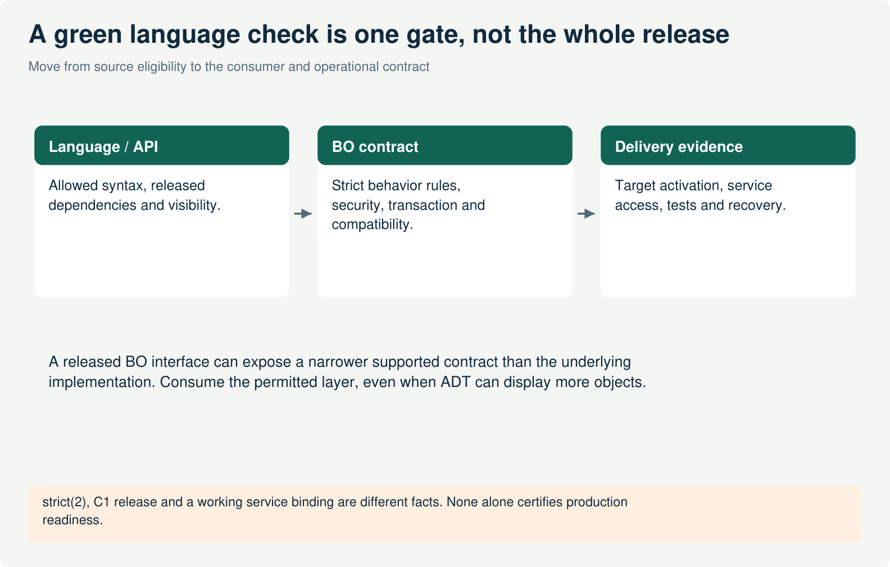

Review eligibility, behavior and delivery as separate evidence gates.

**Explain it:** Which gate would catch an API-compatible change that breaks deployment configuration?

**Limit:** A teaching checklist; exact release contracts, component visibility and delivery tools depend on the product.

**Questions:** SRAP-16, SRAP-22, CLOUD-06, CLOUD-10, CLOUD-13, CLOUD-17, OPS-09, OPS-10, OPS-14

[Full-size PNG](rap-release-gates.png) | [Editable SVG](rap-release-gates.svg)

## Parameter values after exceptional exit

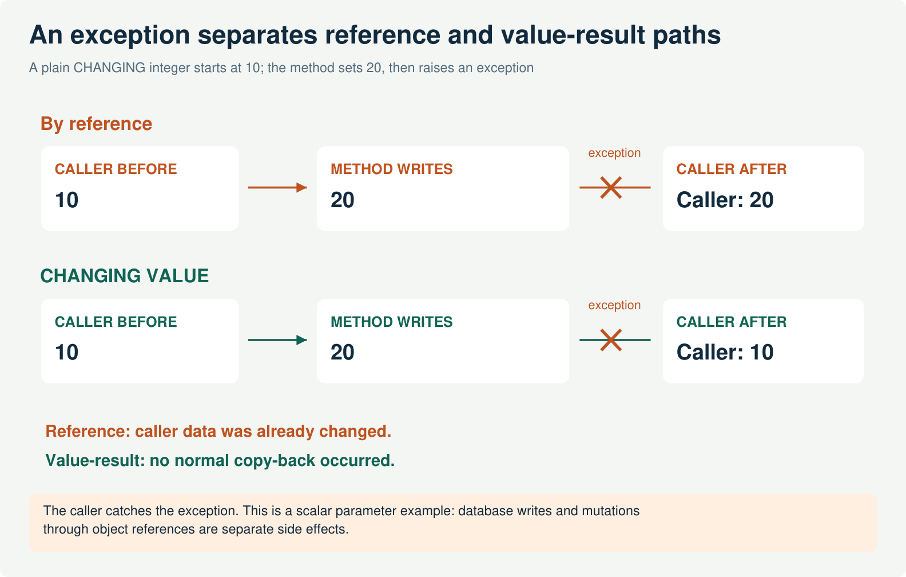

Compare the same assignment under two transfer modes. The final caller value is visible evidence of the difference.

**Explain it:** Which result changes if the method returns normally? What changes if the parameter holds an object reference?

**Limit:** This assumes a plain integer, value-result passing, and no additional side effects.

**Questions:** BASE-01

[Full-size PNG](deep-parameter-paths.png) | [Editable SVG](deep-parameter-paths.svg)

## Value components versus a shared referent

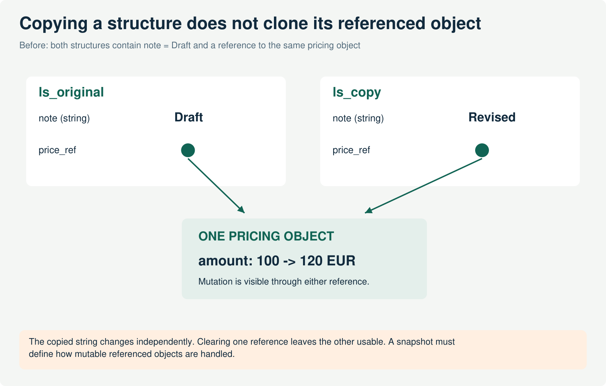

Two structure values own independent string values but lead to the same pricing object. The arrow targets explain why a getter can expose mutable state.

**Explain it:** Which change affects only ls_copy, and which change affects an object visible through both?

**Limit:** Conceptual object identity, not physical memory addresses or a particular sharing optimization.

**Questions:** BASE-02, OODEEP-06, OODEEP-10

[Full-size PNG](deep-alias-snapshot.png) | [Editable SVG](deep-alias-snapshot.svg)

## Three distinct state and memory lifetimes

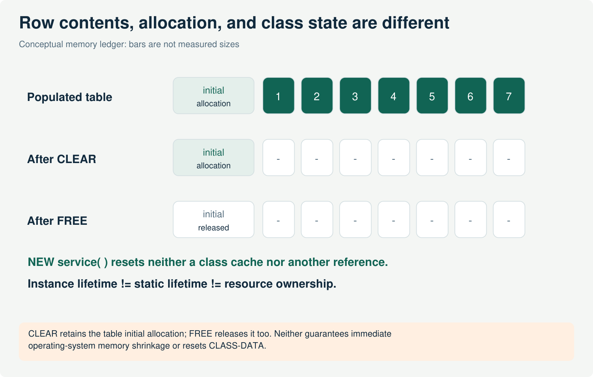

Empty row slots and the initial allocation are deliberately drawn separately. A new object does not imply a new internal session or empty class cache.

**Explain it:** Why can recreating a service leave a test-order failure unchanged?

**Limit:** Allocation diagram is qualitative; measure actual ABAP memory and cache lifetime in the target context.

**Questions:** BASE-03, OODEEP-08

[Full-size PNG](deep-memory-lifetime.png) | [Editable SVG](deep-memory-lifetime.svg)

## Stale aliases and overwritten return codes

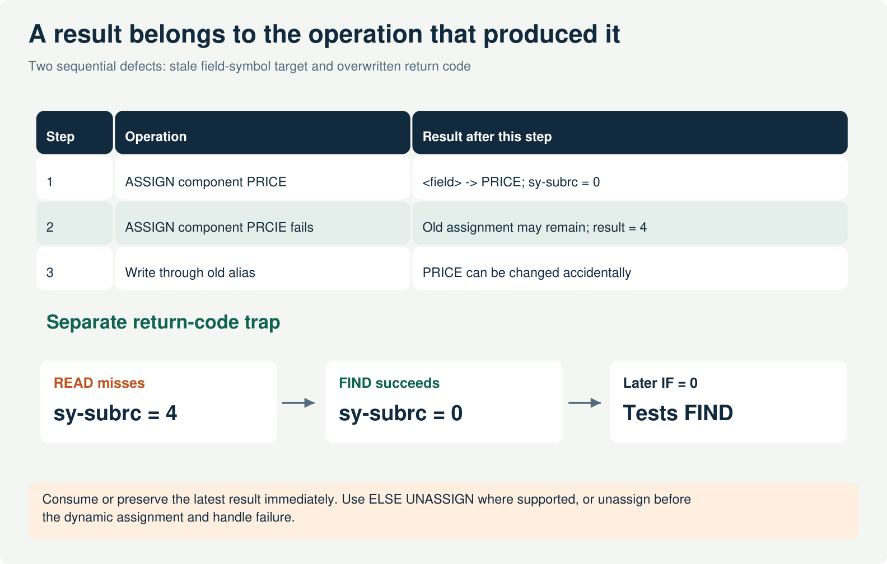

The first sequence can write to the previous target. The second takes a success branch for a different operation than the programmer intended.

**Explain it:** Which test requires a successful operation before the failure to expose the defect?

**Limit:** Only statements documented to set sy-subrc replace it. Assignment failure behavior depends on the exact form and additions.

**Questions:** BASE-04, BASE-05

[Full-size PNG](deep-stale-results.png) | [Editable SVG](deep-stale-results.svg)

## Conversion, rounding, and reduction counterexamples

A lost character, a one-cent difference, and a false maximum reveal three unrelated errors that concise syntax can hide.

**Explain it:** Which expected results change with a different rounding mode, and which are independent of rounding?

**Limit:** Half-up and two decimals are explicit exercise assumptions, not a universal currency rule. MAX notation is explanatory.

**Questions:** BASE-06, BASE-07, BASE-11

[Full-size PNG](deep-numeric-boundaries.png) | [Editable SVG](deep-numeric-boundaries.svg)

## Three mapping cases and two presence cases

The matching initial status overwrites BASE just as a populated status does. A separate parameter table shows why zero cannot encode omission.

**Explain it:** Which source needs a presence flag when the source type always contains status?

**Limit:** Structure mapping example; internal-table BASE preserves rows under different construction semantics.

**Questions:** BASE-08, BASE-14

[Full-size PNG](deep-presence-merge.png) | [Editable SVG](deep-presence-merge.svg)

## Unsorted group membership and explicit filter keys

Arrows bring nonadjacent A rows into one group. The grouping total is computed from members, not read from the representative row.

**Explain it:** What changes with WITHOUT MEMBERS, and why is an arbitrary OR predicate not automatically a basic FILTER condition?

**Limit:** Source rows and totals are illustrative; no measured performance advantage is asserted.

**Questions:** BASE-09, BASE-10

[Full-size PNG](deep-group-filter.png) | [Editable SVG](deep-group-filter.svg)

## Duplicate insertion and empty authorization boundaries

A duplicate unique key preserves the original row for the specified insertion form. An initial selection range has a very different meaning from an empty list of permissions.

**Explain it:** How would you distinguish identical duplicates from conflicting ones, and prove a user with no plants sees nothing?

**Limit:** Single-line INSERT INTO TABLE with a unique primary key; other insertion and key-conflict forms need their own documented handling.

**Questions:** BASE-15, BASE-16

[Full-size PNG](deep-duplicates-ranges.png) | [Editable SVG](deep-duplicates-ranges.svg)

## Two input kinds and two safe handling paths

The apostrophe is intentionally harmless data on the left. The sort request on the right selects a predefined identifier rather than supplying executable SQL.

**Explain it:** Why would quoting the sort option as a literal fail to solve identifier validation?

**Limit:** Conceptual SQL boundary; available dynamic-programming helpers and API release status depend on the target environment.

**Questions:** BASE-12

[Full-size PNG](deep-sql-inputs.png) | [Editable SVG](deep-sql-inputs.svg)

## Exceptional exits and preserved causes

The table names three exit paths that require separate reasoning. The exception chain carries the lower-level diagnosis through a meaningful service-level failure.

**Explain it:** Which path would a test of only propagated exceptions miss?

**Limit:** Simplified non-resumable scenarios; exact nesting and handlers determine CLEANUP execution. Resource ownership remains application-specific.

**Questions:** BASE-13, OODEEP-09

[Full-size PNG](deep-cleanup-cause.png) | [Editable SVG](deep-cleanup-cause.svg)

## A concrete counterexample to substitutability

A valid quantity-one call exposes a behavioral violation invisible in matching parameter types. The lower table separates redefinition from a genuinely new capability.

**Explain it:** Would downcasting every caller to Provider B repair the contract? What else besides accepted inputs must agree?

**Limit:** Hypothetical contract; a narrower published domain would lead to a different assessment. No executable interface is implied.

**Questions:** OODEEP-01, OODEEP-02, OODEEP-03, OODEEP-04, OODEEP-11

[Full-size PNG](deep-substitution-dispatch.png) | [Editable SVG](deep-substitution-dispatch.svg)

## Construction invariants and meaningful test boundaries

Invalid dependencies are rejected before use. In the successful test, the input price is controlled but the discount rule itself executes.

**Explain it:** What defect should make the assertion fail, and which private access is actually necessary?

**Limit:** The 10-percent discount is an illustrative fixture, not an application rule. Friendship details and real integration require separate checks.

**Questions:** OODEEP-05, OODEEP-07, OODEEP-12

[Full-size PNG](deep-construction-test.png) | [Editable SVG](deep-construction-test.svg)

## Strategy versus Template Method in approval rules

The same 700 EUR request receives different policy decisions through the same Strategy contract. Template Method instead fixes a call skeleton and exposes deliberate subclass steps.

**Explain it:** Which part varies, who selects it, and which object keeps transaction ownership?

**Limit:** Conceptual pattern comparison, not executable ABAP or a universal approval rule. Framework-owned construction may require a supported delegation seam.

**Questions:** PAT-01, PAT-10, PAT-12

[Full-size PNG](patterns-strategy-template.png) | [Editable SVG](patterns-strategy-template.svg)

## Three factory choices and a concrete family constraint

The family boundary prevents an A serializer from being combined accidentally with a B sender. The table distinguishes a simple choice from subclass creation and related-product creation.

**Explain it:** What invalid combination does this factory prevent, and when would a simple factory be enough?

**Limit:** Provider compatibility is a fictional fixture. Pattern names do not grant API release eligibility, security or transaction guarantees.

**Questions:** PAT-02, PAT-11, PAT-12

[Full-size PNG](patterns-factory-families.png) | [Editable SVG](patterns-factory-families.svg)

## Adapter, Facade and Decorator with observable outcomes

Mapping, orchestration and added behavior are different responsibilities. The lower example shows why wrapper order changes whether a log records one logical call or two attempts.

**Explain it:** Where would you translate an explicit clear, stop after a failed check, and record retry attempts?

**Limit:** The retry example is deliberately an eligible read. Write retries need the actual idempotency and uncertainty contract; no pattern automatically supplies it.

**Questions:** PAT-03, PAT-04

[Full-size PNG](patterns-adapter-facade-decorator.png) | [Editable SVG](patterns-adapter-facade-decorator.svg)

## First-match routing and idempotent command execution

The 700 EUR fixture passes the team-lead rule and stops at the manager rule. The selected operation then needs its own durable identity to handle duplicate delivery safely.

**Explain it:** What changes if all rules must run, and what must a repeated SUBMIT-42 return?

**Limit:** Routing thresholds and command identity are fictional. The actual business transition, persistence and compensation contracts must be designed separately.

**Questions:** PAT-05, PAT-07

[Full-size PNG](patterns-chain-command.png) | [Editable SVG](patterns-chain-command.svg)

## Observer delivery and hidden singleton state

A registered local handler can update an ALV, while an external process needs transactional publication and durable processing evidence. Session-shared mutable state is a separate source of repeated-test failures.

**Explain it:** Which facts survive a process restart, and which request-specific values must not be cached implicitly?

**Limit:** The lower path describes required responsibilities, not an automatic feature of ABAP Objects events. Verify the chosen event infrastructure and service lifetime.

**Questions:** PAT-06, PAT-09

[Full-size PNG](patterns-observer-lifetime.png) | [Editable SVG](patterns-observer-lifetime.svg)

## Repository read semantics and proportional abstraction

A direct persistence read returns 100 while the transaction already sees 120. The repository seam is valuable only if its real implementation honors the state contract required by the caller.

**Explain it:** Which integration test catches a mockable repository that reads the wrong state, and when is no new abstraction needed?

**Limit:** Conceptual read semantics rather than an SQL isolation guarantee. The specific BO, EML operation, authorization and target release remain authoritative.

**Questions:** PAT-08, PAT-10, PAT-11

[Full-size PNG](patterns-repository-contract.png) | [Editable SVG](patterns-repository-contract.svg)

## HANA pushdown: result grain and table-function review

A two-language text join duplicates both item amounts. Repair the relationship before accepting a performance rewrite, then verify security, client isolation and the chosen implementation contract.

**Explain it:** Why would DISTINCT or dividing by two be an unreliable repair, and what metrics would justify pushdown?

**Limit:** Illustrative data, not a benchmark. Read-only here refers to the cited CDS table-function scenario, not every AMDP method; check target rules and consumption-path security.

**Questions:** SQLX-01, SQLX-02

[Full-size PNG](hana-grain-review.png) | [Editable SVG](hana-grain-review.svg)

## Source transfer, delivery and verified runtime evidence

Four evidence layers answer different questions. A release links the reviewed and tested revision to an actual imported state, then verifies the target consumer and configuration.

**Explain it:** Which artifact proves what was imported, and what can fail after a successful import?

**Limit:** REV-42, D-17 and TST are fictional identifiers. The table is an evidence checklist, not a mandatory sequence requiring abapGit in every transport landscape.

**Questions:** DELIV-01

[Full-size PNG](delivery-source-runtime-evidence.png) | [Editable SVG](delivery-source-runtime-evidence.svg)

## Three storage lifetimes: an illustrated analogy

The desk represents the current transactional buffer; the draft cabinet represents persistent work across requests; the shared archive represents saved active data.

**Explain it:** Which of the three can survive several HTTP requests without becoming active business data?

**Limit:** An analogy, not literal SAP storage architecture or a mandatory three-stage pipeline. A new draft may have no active instance. Active business records may still be updated.

**Questions:** RAP-03, RAP-12, SRAP-09, OPS-04

[Full-size PNG](draft-storage-illustration.png)

## Two editors and one version: an illustrated story

Alice and Ben read version 7. Alice updates successfully, producing version 8. Ben must not overwrite that newer state using the stale version 7 precondition.

**Explain it:** Why should the client refresh and resolve the conflict instead of blindly retrying its old payload?

**Limit:** Version numbers are illustrative. Real ETags are opaque validators; a failed If-Match precondition commonly returns HTTP 412. This is optimistic concurrency, not a pessimistic lock.

**Questions:** ADV-01, ODATA-06, TEST-07, OPS-05, SRAP-10

[Full-size PNG](etag-story-illustration.png)
